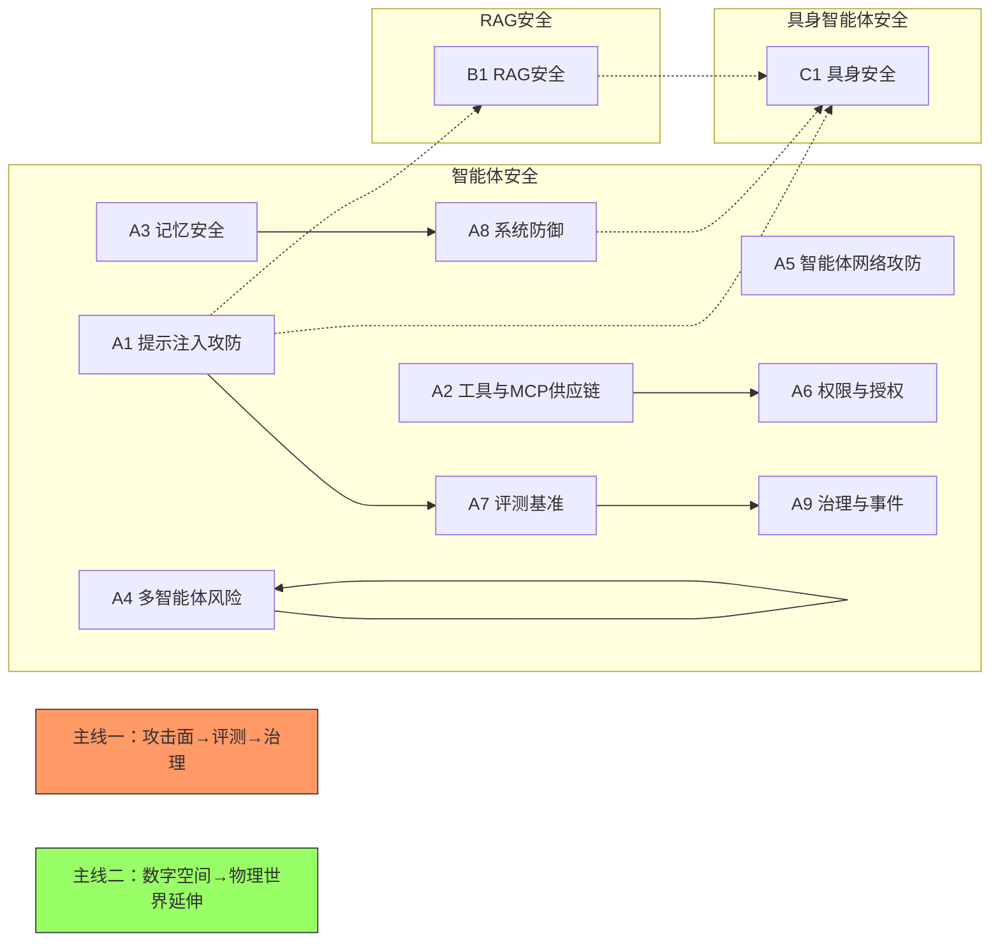

# 智能体安全文献调研报告

> **调研时间**：2026-10-12/13（三域检索与增量更新）+ 2026-10-13（Semantic Scholar 引用量快照） ｜ **数据来源**：arXiv API 实测检索 + Semantic Scholar API + 旧知识库并集核验 ｜ **覆盖范围**：2021–2026 ｜ **收录**：全量语料 4239 篇（增量批 2499 篇逐篇精读；前代语料 1740 篇沿用前代分类）+ 核心集 152 篇（全文 MinerU 解析完成）

## 0. 报告说明

### 0.1 数据来源

- **arXiv API 检索（2026-10-12/13）**：全量语料以 `export.arxiv.org/api/query` 逐条核验检索为准，按三域检索词构建——智能体安全（基线关键词库 + 2026-09-01→2026-10-12 增量批）、RAG 安全、具身智能体安全（2021-01-01 起，年份下限放宽至 2021）。
- **Semantic Scholar 引用量快照（2026-10-13）**：11 批批量拉取，覆盖 4230/4239 = 99.8%（exact 匹配 4230，未命中 9），median citation_count = 1，最大 7523（2108.07258 基础模型综述）。
- **旧知识库并集 32 篇**：旧知识库中未被前两路覆盖的条目以 union 并入，继承原知识库核验结论。

### 0.2 核验方法

- **来源核验**：全量集逐条以 arXiv ID 核验，API 返回即来源核验。
- **跨库对账**：与前代基线语料（关键词库 1735 篇）双向对账，B−V 与 V−B 均为 0 条（零缺失，见 `audit_baseline_summary.md`）。
- **QA 复核**：对 145 篇"判定 D 但标题/摘要含强安全词"的疑似误判逐篇重审（`qa_recheck_result.csv`），确认绝大多数为误命中（如 adversarial/adversarial imitation、vulnerable 人群描述），4 篇由 D 升级为 S。
- **去重**：主键为去版本号 arXiv ID；标题归一化二次比对，同题不同 ID 嫌疑 0 组。

### 0.3 口径

- **全量语料 4239 篇** = 智能体域 2368 + 具身域 1349 + RAG 域 477 + 跨域合并 45（`agent;embodied` 42 + `rag;embodied` 3）。
- **筛选分级（增量批 2499 篇逐篇精读）**：**K = 1060**（核心相关）/ **S = 691**（边缘相关，QA 复核后口径）/ **D = 748**（排除，不入全量论文表）。
- **前代语料并入**：baseline 1708 篇 + union 32 篇沿用前代分类与关键词规则子主题标注（关键词库 1735 篇中 27 篇与具身检索重复合并，故 baseline 计 1708 行），非 D 全池合计 3478 篇进入各章节全量论文表，13 篇未分类条目列入附录 E。
- **核心集 152 篇**：里程碑必读 + 高被引 + 主题均衡配额 + 2026 前沿代表作的并集，全部完成全文 MinerU 解析，作为深度案例与机制分析底座。

### 0.4 "本地"列说明

- `✓PDF+解析`：知识库存有 PDF 且已完成全文解析；`✓PDF`：仅有 PDF（未解析或另行下载）；`—`：本地无文件。
- `核心`：属于 152 篇核心集。引用量为 2026-10-13 Semantic Scholar 快照值，可能随日期变化。

### 0.5 报告结构导航

- **§1 总体概览**：三域 11 子主题全景图、数据总览表（域/判定/年份分布）与关键观察。
- **§2 智能体安全**：A1 提示注入攻防、A2 工具与 MCP 供应链、A3 记忆安全、A4 多智能体风险、A5 智能体网络攻防、A6 权限与授权、A7 评测基准、A8 系统防御、A9 治理与事件。
- **§3 RAG 安全**（B1）与 **§4 具身智能体安全**（C1）。
- 每节结构统一为：趋势叙述（阶段划分 + 代表作 + 关键趋势）+ 本子主题全量论文表（含相关度与"本地"标注）。

## 1. 总体概览

本调研覆盖三大域、11 个子主题：**智能体安全**（A1–A9，工具调用 / 记忆 / 多智能体 / 网络攻防 / 权限 / 评测 / 防御 / 治理）、**RAG 安全**（B1，语料投毒与检索鲁棒性）、**具身智能体安全**（C1，VLA 攻防与物理对抗）。三条域间主线贯穿全图：其一为技术闭环主线 **"攻击面 → 评测 → 治理"**——A1/A2/A3/A4 定义攻击面，A7 提供评测基准与红队方法学，A6/A8 给出系统层强制与防御，A9 收敛到治理标准与真实事件；其二为载体延伸主线 **"数字空间 → 物理世界延伸"**——提示注入从 Web/工具（A1）经 RAG 检索通道（B1）延伸到导航、操作与人形机器人（C1），供应链从 MCP 协议/技能文件（A2）延伸到 3D 资产与机器人技能市场。

## 1.1 数据总览

**域分布（全量 4239 篇）**

| 域 | 智能体 | 具身 | RAG | 跨域合并 | 合计 |
|---|---|---|---|---|---|
| 篇数 | 2368 | 1349 | 477 | 45 | 4239 |

**判定分布（筛选 + 前代语料）**

| 判定 | K 核心相关 | S 边缘相关 | D 排除 | baseline | union | 合计 |
|---|---|---|---|---|---|---|
| 篇数 | 1060 | 691 | 748 | 1708 | 32 | 4239 |

**K 的年份分布与 2026 逐月分布**

| 年份 | 2021 | 2022 | 2023 | 2024 | 2025 | 2026 | 合计 |
|---|---|---|---|---|---|---|---|
| K | 7 | 11 | 21 | 44 | 139 | 838 | 1060 |

| 2026 月份 | 01 | 02 | 03 | 04 | 05 | 06 | 07 | 08 | 09 | 10 |
|---|---|---|---|---|---|---|---|---|---|---|
| K | 8 | 11 | 25 | 35 | 38 | 46 | 28 | 35 | **432** | **180** |

非 D 全池（3491 篇）年份分布：2021 年 35、2022 年 30、2023 年 73、2024 年 289、2025 年 874、2026 年 2190——2026 年单年占 62.7%。

## 1.2 关键观察

1. **2026 年秋进入单月千篇级爆发**：K 的 2026 年逐月分布显示 9 月 432 篇、10 月（截至 12 日）180 篇，两月合计 612 篇，占 2026 年 K（838）的 73%——领域产出节奏已从"年度主题"切换为"周级迭代"。
2. **具身安全成为独立最大子主题**：C1 以 377 篇 K 占全部 K 的 35.6%，9–10 月增量批几乎以 VLA/机器人攻防为主线；安全研究重心正大规模从数字空间向物理域迁移。
3. **非具身主干是"防御—评测—授权"三角**：A7 评测（K=110）、A8 系统防御（96）、A6 权限授权（80）居非具身前三，攻击侧 A4 多智能体（64）与 A5 网络攻防（79）紧随，防御与制度供给已超过纯攻击研究。
4. **理论化与工程化并行推进**：理论侧从"划界不可能性"（防御三难 2604.06436、指令-数据不可分 2606.27567、情境完整性 2605.17634）走向"可度量化"（攻击严重度反事实度量、ASR 效度检验、防御保证分级）；工程侧 eBPF 溯源、参考监控、签名证据账本等确定性机制完成落地。
5. **供应链攻击面沿"协议 → 技能 → 多模态 → 物理资产"下沉**：MCP 规范级弱点（2601.17549）之外，技能链劫持、技能包图像载毒、3D 资产投毒把供应链推向每一种可分发资产形态；42,447 个技能 26.1% 含漏洞（2601.10338）、抽样 17,022 个技能中 520 个受影响（1,708 处问题），泄露凭证的 89.6% 可立即可利用（2604.03070）完成系统性证伪。
6. **真实事件驱动治理成型**：AIR 事件库已收录 487 例真实智能体安全事件，学术评审隐藏注入事件（2507.06185）、agentic 内部威胁（2510.05179）与信任-授权失配（2512.06914）使治理研究从立场文转向可检验的危机信息学与问责工程。

## 2. 智能体安全

本章覆盖三域中的智能体安全域（A1–A9），研究对象是大语言模型从"对话工具"进化为具备工具调用、检索增强、持久记忆、自主规划与多智能体协作能力的智能体之后所产生的安全问题：当网页、工具输出、文档、记忆等不可信外部内容能够驱动一个拥有真实权限（执行代码、调用 API、支付、操控设备）的系统时，如何保证其行为完整、可控、可追责。按筛选 taxonomy 划分为 9 个子主题，各子主题全量论文表规模（K / S / baseline / union）如下：

- **A1 提示注入攻防**（960 篇：K 63 / S 5 / baseline 876 / union 16）
- **A2 工具与MCP供应链**（377 篇：K 51 / S 23 / baseline 299 / union 4）
- **A3 记忆安全**（103 篇：K 31 / S 15 / baseline 57 / union 0）
- **A4 多智能体风险**（147 篇：K 64 / S 17 / baseline 65 / union 1）
- **A5 智能体网络攻防**（242 篇：K 79 / S 15 / baseline 146 / union 2）
- **A6 权限与授权**（160 篇：K 80 / S 13 / baseline 66 / union 1）
- **A7 评测基准**（284 篇：K 110 / S 43 / baseline 128 / union 3）
- **A8 系统防御**（164 篇：K 96 / S 39 / baseline 27 / union 2）
- **A9 治理与事件**（136 篇：K 75 / S 54 / baseline 7 / union 0）

下文按 2.1–2.9 逐节展开，RAG 安全（B1）与具身智能体安全（C1）分别见 §3、§4。每节结构统一：先给出趋势叙述（阶段划分、代表作与关键趋势，标注的 arXiv ID 均来自筛选素材与核心集），结尾附本子主题全量论文表（含相关度与"本地"标注）。（各节导语中的代表作可能跨子主题，以本节表格归属为准。）

### 2.1 提示注入攻防

本节对应 A1（全量表 960 篇，K=63），覆盖直接 / 间接 / 多模态提示注入的攻击与防御。攻击侧从"能否注入"转向检索保证、真实流行度与协议级利用，防御侧与理论侧同步收紧：

- **2601.07072《突破检索障碍》**：以触发片段-攻击片段分解实现近 100% 检索保证的 IPI 端到端利用（GPT-4o 被诱导外泄 SSH 密钥 80%+），确立间接注入的现实严重性。
- **2601.17548《编码智能体注入脆弱性系统分析》**：系统分析 skills / tools / protocol 三层生态在 agentic coding 助手中的注入面，为补录的代表性论文（44 引）。
- **2603.15714《大规模公开 IPI 红队竞赛》**：464 名参赛者、27.2 万次攻击，13 个前沿模型全部被攻破，标志大规模实证取代玩具基准。
- **2604.27202《野外 IPI 实证》**：12 亿 URL / 2480 万主机普查，约 70% 真实 IPI 藏于非渲染 HTML，为野外流行度提供早期大规模实测。
- **2605.17634《智能体可能永远会落入注入》** 与 **2606.27567《指令-数据不可分不可能性定理》**：分别以情境完整性与共享嵌入架构证明现有架构内完美注入防御在数学上不可能，指出"架构分离"为核心出路。

阶段脉络上，A1 经历 2023 年形式化与奠基（2310.12815、2311.01011、2302.12173）、2024 年基准与训练防御成型（2403.02691、2402.06363、2410.05451）、2025 年自适应评估规范确立（2503.00061、2503.18813）至 2026 年实证与不可能性定理并进；2026 秋观察记录显示注入通道继续泛化至服务商侧、阶段式 / 马赛克多轮与边界审计，多模态视觉音频载体与控制符抹除思维链成为新通道。

下表为本子主题全量论文表（含相关度标注）。

**全量论文表（960 篇）**

| 年份 | 标题 | 一作 | 引用量 | 相关度 | 要点/备注 | 本地 |
|---|---|---|---|---|---|---|
| 2026 | Agent Skills in the Wild: An Empirical Study of Security Vulnerabilities at Scale | Yi Liu | 115 | — | — | ✓PDF+解析,核心 |
| 2026 | Skill-Inject: Measuring Agent Vulnerability to Skill File Attacks | David Schmotz | 95 | — | — | ✓PDF+解析,核心 |
| 2026 | ToolSafe: Enhancing Tool Invocation Safety of LLM-based agents via Proactive Step-level Guardrail and Feedback | Yutao Mou | 75 | — | — | ✓PDF |
| 2026 | AgentDyn: Are Your Agent Security Defenses Deployable in Real-World Dynamic Environments? | Hao Li | 60 | — | — | ✓PDF |
| 2026 | Zombie Agents: Persistent Control of Self-Evolving LLM Agents via Self-Reinforcing Injections | Xianglin Yang | 46 | — | — | ✓PDF |
| 2026 | AttriGuard: Defeating Indirect Prompt Injection in LLM Agents via Causal Attribution of Tool Invocations | Yu He | 46 | — | — | ✓PDF+解析,核心 |
| 2026 | Prompt Injection Attacks on Agentic Coding Assistants: A Systematic Analysis of Vulnerabilities in Skills, Tools, and Protocol Ecosystems | Narek Maloyan | 44 | — | — | ✓PDF+解析,核心 |
| 2026 | Memory Poisoning Attack and Defense on Memory Based LLM-Agents | Balachandra Devarangadi Sunil | 42 | — | — | ✓PDF |
| 2026 | Formal Policy Enforcement for Real-World Agentic Systems | Nils Palumbo | 40 | — | — | ✓PDF |
| 2026 | AgentLAB: Benchmarking LLM Agents against Long-Horizon Attacks | Tanqiu Jiang | 38 | — | — | ✓PDF |
| 2026 | Breaking the Protocol: Security Analysis of the Model Context Protocol Specification and Prompt Injection Vulnerabilities in Tool-Integrated LLM Agents | Narek Maloyan | 34 | — | — | ✓PDF+解析,核心 |
| 2026 | The Landscape of Prompt Injection Threats in LLM Agents: From Taxonomy to Analysis | Peiran Wang | 34 | — | — | ✓PDF |
| 2026 | ClawGuard: A Runtime Security Framework for Tool-Augmented LLM Agents Against Indirect Prompt Injection | Wei Zhao | 33 | — | — | ✓PDF |
| 2026 | From Untrusted Input to Trusted Memory: A Systematic Study of Memory Poisoning Attacks in LLM Agents | Pritam Dash | 33 | — | — | ✓PDF |
| 2026 | Taming OpenClaw: Security Analysis and Mitigation of Autonomous LLM Agent Threats | Xinhao Deng | 32 | — | — | ✓PDF |
| 2026 | AgentSentry: Mitigating Indirect Prompt Injection in LLM Agents via Temporal Causal Diagnostics and Context Purification | Tian Zhang | 31 | — | — | ✓PDF |
| 2026 | Hidden in Memory: Sleeper Memory Poisoning in LLM Agents | Sidharth Pulipaka | 29 | — | — | ✓PDF |
| 2026 | BadSkill: Backdoor Attacks on Agent Skills via Model-in-Skill Poisoning | Guiyao Tie | 26 | — | — | ✓PDF |
| 2026 | Overcoming the Retrieval Barrier: Indirect Prompt Injection in the Wild for LLM Systems | Hongyan Chang | 23 | — | — | ✓PDF+解析,核心 |
| 2026 | PISmith: Reinforcement Learning-based Red Teaming for Prompt Injection Defenses | Chenlong Yin | 23 | — | — | ✓PDF |
| 2026 | SkillJect: Effectively Automating Skill-Based Prompt Injection for Skill-Enabled Agents | Xiaojun Jia | 22 | — | — | ✓PDF |
| 2026 | Uncovering Security Threats and Architecting Defenses in Autonomous Agents: A Case Study of OpenClaw | Zonghao Ying | 21 | — | — | ✓PDF |
| 2026 | MalSkillBench: A Runtime-Verified Benchmark of Malicious Agent Skills | Wenbo Guo | 21 | — | — | ✓PDF |
| 2026 | VIGIL: Defending LLM Agents Against Tool Stream Injection via Verify-Before-Commit | Junda Lin | 20 | — | — | ✓PDF |
| 2026 | MUZZLE: Adaptive Agentic Red-Teaming of Web Agents Against Indirect Prompt Injection Attacks | Georgios Syros | 20 | — | — | ✓PDF |
| 2026 | Agentic Artificial Intelligence (AI): Architectures, Taxonomies, and Evaluation of Large Language Model Agents | Arunkumar V | 19 | — | — | ✓PDF |
| 2026 | How Vulnerable Are AI Agents to Indirect Prompt Injections? Insights from a Large-Scale Public Competition | Mateusz Dziemian | 19 | — | — | ✓PDF+解析,核心 |
| 2026 | Autonomous Agents on Blockchains: Standards, Execution Models, and Trust Boundaries | Saad Alqithami | 18 | — | — | ✓PDF |
| 2026 | Agents in the Wild: Safety, Society, and the Illusion of Sociality on Moltbook | Yunbei Zhang | 18 | — | — | ✓PDF |
| 2026 | Model Context Protocol Threat Modeling and Analyzing Vulnerabilities to Prompt Injection with Tool Poisoning | Charoes Huang | 18 | — | — | ✓PDF |
| 2026 | SoK: The Attack Surface of Agentic AI - Tools and Autonomy | Ali Dehghantanha | 18 | — | — | ✓PDF |
| 2026 | MCP-ITP: An Automated Framework for Implicit Tool Poisoning in MCP | Ruiqi Li | 17 | — | — | ✓PDF |
| 2026 | Prompt Injection as Role Confusion | Charles Ye | 17 | — | — | ✓PDF |
| 2026 | Your Agent Is Mine: Measuring Malicious Intermediary Attacks on the LLM Supply Chain | Hanzhi Liu | 17 | — | — | ✓PDF |
| 2026 | PIArena: A Platform for Prompt Injection Evaluation | Runpeng Geng | 16 | — | — | ✓PDF |
| 2026 | Aligning Provenance with Authorization: A Dual-Graph Defense for LLM Agents | Peiran Wang | 16 | — | — | ✓PDF |
| 2026 | CausalArmor: Efficient Indirect Prompt Injection Guardrails via Causal Attribution | Minbeom Kim | 15 | — | — | ✓PDF |
| 2026 | Agent-Sentry: Bounding LLM Agents via Execution Provenance | Rohan Sequeira | 15 | — | — | ✓PDF |
| 2026 | AgenTRIM: Tool Risk Mitigation for Agentic AI | Roy Betser | 14 | — | — | ✓PDF |
| 2026 | AgentSys: Secure and Dynamic LLM Agents Through Explicit Hierarchical Memory Management | Ruoyao Wen | 14 | — | — | ✓PDF+解析,核心 |
| 2026 | Detecting Safety Violations Across Many Agent Traces | Adam Stein | 14 | — | — | ✓PDF |
| 2026 | Optimizing Agent Planning for Security and Autonomy | Aashish Kolluri | 13 | — | — | ✓PDF |
| 2026 | Overeager Coding Agents: Measuring Out-of-Scope Actions on Benign Tasks | Yubin Qu | 13 | — | — | ✓PDF |
| 2026 | Defenses Against Prompt Attacks Learn Surface Heuristics | Shawn Li | 12 | — | — | ✓PDF |
| 2026 | AdapTools: Adaptive Tool-based Indirect Prompt Injection Attacks on Agentic LLMs | Che Wang | 12 | — | — | ✓PDF |
| 2026 | Architecting Secure AI Agents: Perspectives on System-Level Defenses Against Indirect Prompt Injection Attacks | Chong Xiang | 12 | — | — | ✓PDF |
| 2026 | The Blind Spot of Agent Safety: How Benign User Instructions Expose Critical Vulnerabilities in Computer-Use Agents | Xuwei Ding | 12 | — | — | ✓PDF |
| 2026 | AI Agents May Always Fall for Prompt Injections | Sahar Abdelnabi | 12 | — | — | ✓PDF+解析,核心 |
| 2026 | Defense Against Indirect Prompt Injection via Tool Result Parsing | Qiang Yu | 11 | K | 解析工具结果过滤注入指令 | ✓PDF |
| 2026 | WebSentinel: Detecting and Localizing Prompt Injection Attacks for Web Agents | Xilong Wang | 11 | — | — | ✓PDF |
| 2026 | OpenClaw PRISM: A Zero-Fork, Defense-in-Depth Runtime Security Layer for Tool-Augmented LLM Agents | Frank Li | 11 | — | — | ✓PDF |
| 2026 | DecodingTrust-Agent Platform (DTap): A Controllable and Interactive Red-Teaming Platform for AI Agents | Zhaorun Chen | 11 | — | — | ✓PDF |
| 2026 | Agent libOS: A Runtime Substrate for Capability-Controlled Self-Evolving LLM Agents | Yingqi Zhang | 11 | — | — | ✓PDF |
| 2026 | Hidden-in-Plain-Text: A Benchmark for Social-Web Indirect Prompt Injection in RAG | Haoze Guo | 10 | — | — | ✓PDF |
| 2026 | OMNI-LEAK: Orchestrator Multi-Agent Network Induced Data Leakage | Akshat Naik | 10 | — | — | ✓PDF |
| 2026 | Image-based Prompt Injection: Hijacking Multimodal LLMs through Visually Embedded Adversarial Instructions | Neha Nagaraja | 10 | — | — | ✓PDF |
| 2026 | The Autonomy Tax: Defense Training Breaks LLM Agents | Shawn Li | 10 | — | — | ✓PDF+解析,核心 |
| 2026 | When AI reviews science: Can we trust the referee? | Jialiang Wang | 10 | — | — | ✓PDF |
| 2026 | When Actions Go Off-Task: Detecting and Correcting Misaligned Actions in Computer-Use Agents | Yuting Ning | 9 | — | — | ✓PDF |
| 2026 | ICON: Indirect Prompt Injection Defense for Agents based on Inference-Time Correction | Che Wang | 9 | — | — | ✓PDF |
| 2026 | Tracking Capabilities for Safer Agents | Martin Odersky | 9 | — | — | ✓PDF |
| 2026 | MCP-38: A Comprehensive Threat Taxonomy for Model Context Protocol Systems (v1.0) | Yi Ting Shen | 9 | — | — | ✓PDF |
| 2026 | Trojan's Whisper: Stealthy Manipulation of OpenClaw through Injected Bootstrapped Guidance | Fazhong Liu | 9 | — | — | ✓PDF |
| 2026 | AgentWatcher: A Rule-based Prompt Injection Monitor | Yanting Wang | 9 | — | — | ✓PDF |
| 2026 | HarmfulSkillBench: How Do Harmful Skills Weaponize Your Agents? | Yukun Jiang | 9 | — | — | ✓PDF |
| 2026 | Authorization Propagation in Multi-Agent AI Systems: Identity Governance as Infrastructure | Krti Tallam | 9 | — | — | ✓PDF |
| 2026 | The Granularity Mismatch in Agent Security: Argument-Level Provenance Solves Enforcement and Isolates the LLM Reasoning Bottleneck | Linfeng Fan | 9 | — | — | ✓PDF+解析,核心 |
| 2026 | SkillGuard: A Permission-Centric Framework for Agent Skill Security | Shidong Pan | 9 | — | — | ✓PDF |
| 2026 | Paraphrasing Adversarial Attack on LLM-as-a-Reviewer | Masahiro Kaneko | 8 | — | — | ✓PDF |
| 2026 | When Bots Take the Bait: Exposing and Mitigating the Emerging Social Engineering Attack in Web Automation Agent | Xinyi Wu | 8 | — | — | ✓PDF |
| 2026 | Automating Agent Hijacking via Structural Template Injection | Xinhao Deng | 8 | — | — | ✓PDF |
| 2026 | Learning When to Act or Refuse: Guarding Agentic Reasoning Models for Safe Multi-Step Tool Use | Aradhye Agarwal | 8 | — | — | ✓PDF |
| 2026 | Beyond OAuth: Task-Scoped Authorization for AI Agents via Natural Language Slices | Reshabh K Sharma | 8 | — | — | ✓PDF |
| 2026 | AgentVisor: Defending LLM Agents Against Prompt Injection via Semantic Virtualization | Zonghao Ying | 8 | — | — | ✓PDF |
| 2026 | Indirect Prompt Injection in the Wild: An Empirical Study of Prevalence, Techniques, and Objectives | Soheil Khodayari | 8 | — | — | ✓PDF+解析,核心 |
| 2026 | MemAudit: Post-hoc Auditing of Poisoned Agent Memory via Causal Attribution and Structural Anomaly Detection | Zhewen Tan | 8 | — | — | ✓PDF |
| 2026 | MemMorph: Tool Hijacking in LLM Agents via Memory Poisoning | Xuanye Zhang | 8 | — | — | ✓PDF |
| 2026 | Decision Hijacking: Prompt Injection Attacks on Jev's Typed Probabilistic Decisions | Tiantong Wu | 8 | K | 注入操纵类型化决策模型行动选择 | — |
| 2026 | TRACE: Task-Aware Adaptive Self-Evolving Agentic Jailbreaking | Churui Zeng | 8 | — | — | ✓PDF+解析 |
| 2026 | SD-RAG: A Prompt-Injection-Resilient Framework for Selective Disclosure in Retrieval-Augmented Generation | Aiman Al Masoud | 7 | — | — | ✓PDF |
| 2026 | Security Considerations for Artificial Intelligence Agents | Ninghui Li | 7 | — | — | ✓PDF |
| 2026 | Are AI-assisted Development Tools Immune to Prompt Injection? | Charoes Huang | 7 | — | — | ✓PDF |
| 2026 | Evaluating Privilege Usage of Agents with Real-World Tools | Quan Zhang | 7 | — | — | ✓PDF |
| 2026 | The Consensus Trap: Rescuing Multi-Agent LLMs from Adversarial Majorities via Token-Level Collaboration | Jiayuan Liu | 7 | — | — | ✓PDF |
| 2026 | SafeAgent: A Runtime Protection Architecture for Agentic Systems | Hailin Liu | 7 | — | — | ✓PDF |
| 2026 | IterInject: Indirect Prompt Injection Against LLM Agents via Feedback-Guided Iterative Optimization | Zixuan Chen | 7 | — | — | ✓PDF |
| 2026 | AgentSecBench: Measuring Prompt Injection, Privacy Leakage, and Tool-Use Integrity in LLM Agents | Faruk Alpay | 7 | — | — | ✓PDF |
| 2026 | Detecting Malicious Agent Skills in the Wild using Attention | Bacem Etteib | 7 | — | — | ✓PDF |
| 2026 | How Agents Ask for Permission: User Permissions for AI Agents, from Interfaces to Enforcement | Alexandra E. Michael | 7 | — | — | ✓PDF |
| 2026 | Stop Means Stop: Measuring and Repairing the Enforcement Gap in Agent-Framework Control Primitives | Sajjad Khan | 7 | — | — | ✓PDF+解析,核心 |
| 2026 | GPT-Red: Automated Red Teaming via Self-Play at Scale | Eric Wallace | 7 | — | — | ✓PDF+解析,核心 |
| 2026 | ReasAlign: Reasoning Enhanced Safety Alignment against Prompt Injection Attack | Hao Li | 6 | — | — | ✓PDF |
| 2026 | Physical Prompt Injection Attacks on Large Vision-Language Models | Chen Ling | 6 | — | — | ✓PDF |
| 2026 | Whispers of Wealth: Red-Teaming Google's Agent Payments Protocol via Prompt Injection | Tanusree Debi | 6 | — | — | ✓PDF |
| 2026 | SMCP: Secure Model Context Protocol | Xinyi Hou | 6 | — | — | ✓PDF |
| 2026 | MPIB: A Benchmark for Medical Prompt Injection Attacks and Clinical Safety in LLMs | Junhyeok Lee | 6 | — | — | ✓PDF |
| 2026 | vLLM Hook v0: A Plug-in for Programming Model Internals on vLLM | Ching-Yun Ko | 6 | — | — | ✓PDF |
| 2026 | PlanGuard: Defending Agents against Indirect Prompt Injection via Planning-based Consistency Verification | Guangyu Gong | 6 | — | — | ✓PDF |
| 2026 | RouteGuard: Internal-Signal Detection of Skill Poisoning in LLM Agents | Wenjie Xiao | 6 | — | — | ✓PDF |
| 2026 | Autonomous LLM Agent Worms: Cross-Platform Propagation, Automated Discovery and Temporal Re-Entry Defense | Mingming Zha | 6 | — | — | ✓PDF |
| 2026 | Remembering More, Risking More: Longitudinal Safety Risks in Memory-Equipped LLM Agents | Ahmad Al-Tawaha | 6 | — | — | ✓PDF |
| 2026 | Poise: Position-Aware One-Instruction Skill Injection for Silent Execution on LLM Agents | Haochang Hao | 6 | — | — | ✓PDF |
| 2026 | SkillMutator: Benchmarking and Defending Language-and-Code Cross-modal Attacks on LLM Agent Skills | Youngduk Kim | 6 | — | — | ✓PDF |
| 2026 | Defending against Adaptive Prompt Injection Attacks via Reasoning-enabled Task Alignment | Lipeng He | 6 | — | — | ✓PDF |
| 2026 | KVEraser: Learning to Steer KV Cache for Efficient Localized Context Erasing | Mufei Li | 6 | — | — | ✓PDF |
| 2026 | Distributed Attacks in Persistent-State AI Control | Josh Hills | 6 | — | — | ✓PDF |
| 2026 | Are You Still the Agent I Authorized? Earned Authority under a Fixed Ceiling for Evolving Agents | Zhaoxi Zhang | 6 | — | — | ✓PDF |
| 2026 | Bounded Agents: Delegation Security for Multi-Agent AI Systems | Xabier Muruaga | 6 | — | — | ✓PDF |
| 2026 | InjecMEM: Memory Injection Attack on LLM Agent Memory Systems | Hanling Tian | 6 | — | — | ✓PDF |
| 2026 | "Someone Hid It": Query-Agnostic Black-Box Attacks on LLM-Based Retrieval | Jiate Li | 6 | — | — | ✓PDF |
| 2026 | Autonomous Action Runtime Management(AARM):A System Specification for Securing AI-Driven Actions at Runtime | Herman Errico | 5 | — | — | ✓PDF |
| 2026 | When Skills Lie: Hidden-Comment Injection in LLM Agents | Qianli Wang | 5 | — | — | ✓PDF |
| 2026 | AlignSentinel: Alignment-Aware Detection of Prompt Injection Attacks | Yuqi Jia | 5 | — | — | ✓PDF |
| 2026 | SafeClaw-R: Towards Safe and Secure Multi-Agent Personal Assistants | Haoyu Wang | 5 | — | — | ✓PDF |
| 2026 | Compiled AI: Deterministic Code Generation for LLM-Based Workflow Automation | Geert Trooskens | 5 | — | — | ✓PDF |
| 2026 | Visual Inception: Compromising Long-term Planning in Agentic Recommenders via Multimodal Memory Poisoning | Jiachen Qian | 5 | — | — | ✓PDF |
| 2026 | Black-Box Skill Stealing Attack from Proprietary LLM Agents: An Empirical Study | Zihan Wang | 5 | — | — | ✓PDF |
| 2026 | SUDP: Secret-Use Delegation Protocol for Agentic Systems | Xiaohang Yu | 5 | — | — | ✓PDF |
| 2026 | SnapGuard: Lightweight Prompt Injection Detection for Screenshot-Based Web Agents | Mengyao Du | 5 | — | — | ✓PDF |
| 2026 | Portable Agent Memory: A Protocol for Cryptographically-Verified Memory Transfer Across Heterogeneous AI Agents | Santhosh Kumar Ravindran | 5 | — | — | ✓PDF |
| 2026 | On-Policy Self-Evolution via Failure Trajectories for Agentic Safety Alignment | Bo Yin | 5 | — | — | ✓PDF |
| 2026 | No Attack Required: Semantic Fuzzing for Specification Violations in Agent Skills | Ying Li | 5 | — | — | ✓PDF |
| 2026 | Web Agents Should Adopt the Plan-Then-Execute Paradigm | Julien Piet | 5 | — | — | ✓PDF |
| 2026 | Exploiting LLM Agent Supply Chains via Payload-less Skills | Xinyu Liu | 5 | — | — | ✓PDF |
| 2026 | Measuring Real-World Prompt Injection Attacks in LLM-based Resume Screening | Mohan Zhang | 5 | — | — | ✓PDF+解析,核心 |
| 2026 | Hijacking Agent Memory: Stealthy Trojan Attacks Through Conversational Interaction | Hongtao Wang | 5 | — | — | ✓PDF |
| 2026 | SMSR: Certified Defence Against Runtime Memory Poisoning in Persistent LLM Agent Systems | Tarun Sharma | 5 | — | — | ✓PDF |
| 2026 | AutoDojo: Adaptive Black-Box Attacks Reveal the Limits of IPI Defenses and Task-Specification Effects in LLM Agents | Xinhang Ma | 5 | — | — | ✓PDF+解析,核心 |
| 2026 | FragFuse: Bypassing Access Control of Large Language Model Agents via Memory-Based Query Fragmentation and Fusion | Zixin Rao | 5 | — | — | ✓PDF |
| 2026 | When AUC 0.998 Is Not Enough: A Candidate Evaluation Protocol for Hidden-State Probes of Indirect Prompt Injection in Multimodal Computer-Use Agents | Yanhang Li | 5 | — | — | ✓PDF |
| 2026 | Agent Skill Security: Threat Models, Attacks, Defenses, and Evaluation | Sanket Badhe | 5 | — | — | ✓PDF |
| 2026 | MemPoison: Uncovering Persistent Memory Threats and Structural Blind Spots in LLM Agents | Jifeng Gao | 5 | — | — | ✓PDF |
| 2026 | StepJack: Benchmarking Computer-Use Agent Safety Against Multi-Step Indirect Prompt Injection | Zhuoxin Zhan | 5 | — | — | ✓PDF |
| 2026 | SecOPD: Mitigating Adaptive Prompt Injections by On-Policy Distillation | Yibo Peng | 5 | — | — | ✓PDF |
| 2026 | Agent Flight Recorder: Tamper-Evident Audit Trails with On-Chain Anchoring for Long-Horizon Tool-Using Agents | Laurent Bindschaedler | 5 | — | — | ✓PDF |
| 2026 | Addressing Corpus Knowledge Poisoning Attacks on RAG Using Sparse Attention | Sagie Dekel | 5 | — | — | ✓PDF |
| 2026 | Confundo: Learning to Generate Robust Poison for Practical RAG Systems | Haoyang Hu | 5 | — | — | ✓PDF |
| 2026 | Zero-Shot Embedding Drift Detection: A Lightweight Defense Against Prompt Injections in LLMs | Anirudh Sekar | 4 | — | — | ✓PDF |
| 2026 | MirrorGuard: Toward Secure Computer-Use Agents via Simulation-to-Real Reasoning Correction | Wenqi Zhang | 4 | — | — | ✓PDF |
| 2026 | Prompt Injection Mitigation with Agentic AI, Nested Learning, and AI Sustainability via Semantic Caching | Diego Gosmar | 4 | — | — | ✓PDF |
| 2026 | SwitchCraft: Training-Free Multi-Event Video Generation with Attention Controls | Qianxun Xu | 4 | — | — | ✓PDF |
| 2026 | When Safety Becomes a Vulnerability: Exploiting LLM Alignment Homogeneity for Transferable Blocking in RAG | Junchen Li | 4 | — | — | ✓PDF |
| 2026 | SlowBA: An efficiency backdoor attack towards VLM-based GUI agents | Junxian Li | 4 | — | — | ✓PDF |
| 2026 | Agent Privilege Separation in OpenClaw: A Structural Defense Against Prompt Injection | Darren Cheng | 4 | — | — | ✓PDF |
| 2026 | Mind Your HEARTBEAT! Claw Background Execution Inherently Enables Silent Memory Pollution | Yechao Zhang | 4 | — | — | ✓PDF |
| 2026 | Your Agent is More Brittle Than You Think: Uncovering Indirect Injection Vulnerabilities in Agentic LLMs | Wenhui Zhu | 4 | — | — | ✓PDF |
| 2026 | WebAgentGuard: A Reasoning-Driven Guard Model for Detecting Prompt Injection Attacks in Web Agents | Yulin Chen | 4 | — | — | ✓PDF |
| 2026 | An AI Agent Execution Environment to Safeguard User Data | Robert Stanley | 4 | — | — | ✓PDF |
| 2026 | SafeReview: Defending LLM-based Review Systems Against Adversarial Hidden Prompts | Yuan Xin | 4 | — | — | ✓PDF |
| 2026 | WARD: Adversarially Robust Defense of Web Agents Against Prompt Injections | Tri Cao | 4 | — | — | ✓PDF |
| 2026 | Blind Spots in the Guard: How Domain-Camouflaged Injection Attacks Evade Detection in Multi-Agent LLM Systems | Aaditya Pai | 4 | — | — | ✓PDF |
| 2026 | LLM-as-a-Reviewer: Benchmarking Their Ability, Divergence, and Prompt Injection Resistance as Paper Reviewers | Lingyao Li | 4 | — | — | ✓PDF |
| 2026 | From Prompt Injection to Persistent Control: Defending Agentic Harness Against Trojan Backdoors | Jiejun Tan | 4 | — | — | ✓PDF |
| 2026 | Inference Cost Attacks for Retrieval-Augmented Large Language Models | Chengliang Liu | 4 | — | — | ✓PDF |
| 2026 | What If Prompt Injection Never Left? Rethinking Agent Security through Cross-Session Stored Prompt Injection | Yuanbo Xie | 4 | — | — | ✓PDF |
| 2026 | SkillVetBench: LLM-as-Judge for Multi-Dimensional Security Risk Evaluation in Open-Source LLM Agent Skills | Ismail Hossain | 4 | — | — | ✓PDF |
| 2026 | Manufactured Confidence: How Memory Consolidation Turns Hearsay into Confident Facts | Alex Kwon | 4 | — | — | ✓PDF |
| 2026 | Understanding and Evaluating Claw-like Agent Security Through a Computer-Systems Lens | Peizhi Niu | 4 | — | — | ✓PDF |
| 2026 | Untrusted Content Masking for Web Agents with Security Guarantees | Kristina Nikolić | 4 | — | — | ✓PDF |
| 2026 | NetInjectBench: Benchmarking Indirect Prompt Injection in Tool-Using Large Language Model Agents for Network Operations | Ruksat Khan Shayoni | 4 | — | — | ✓PDF |
| 2026 | Context Contamination in LLM Analysis of Network Security Logs: Poison with Passive Prompt Injection and Mitigation Evaluation | Rabimba Karanjai | 4 | — | — | ✓PDF |
| 2026 | Bad Memory: Evaluating Prompt Injection Risks from Memory in Agentic Systems | Soham Gadgil | 4 | — | — | ✓PDF |
| 2026 | The safety failures we are not instrumenting: a perspective on hidden safety-critical challenges in modern AI systems | Gjergji Kasneci | 4 | — | — | ✓PDF |
| 2026 | APPA: Recoverable Information-Flow Control for Real-World LLM Agents | Arseny Kravchenko | 4 | — | — | ✓PDF |
| 2026 | Your Agentic LLMs Secretly Encode Indirect Prompt-Injection Exposure in Hidden States | Jianshuo Dong | 4 | — | — | ✓PDF |
| 2026 | Reasoning Models Will Sometimes Lie About Their Reasoning | William Walden | 3 | — | — | ✓PDF |
| 2026 | Agents at Risk: How Users Unwittingly Undermine LLM Safety | Fengchao Chen | 3 | — | — | ✓PDF |
| 2026 | Machine-Assisted Grading of Nationwide School-Leaving Essay Exams with LLMs and Statistical NLP | Andres Karjus | 3 | — | — | ✓PDF |
| 2026 | OpenSec: Measuring Incident Response Agent Calibration Under Adversarial Evidence | Jarrod Barnes | 3 | — | — | ✓PDF |
| 2026 | Human Society-Inspired Approaches to Agentic AI Security: The 4C Framework | Alsharif Abuadbba | 3 | — | — | ✓PDF |
| 2026 | When the Model Said 'No Comment', We Knew Helpfulness Was Dead, Honesty Was Alive, and Safety Was Terrified | Gautam Siddharth Kashyap | 3 | — | — | ✓PDF |
| 2026 | Blind Gods and Broken Screens: Architecting a Secure, Intent-Centric Mobile Agent Operating System | Zhenhua Zou | 3 | — | — | ✓PDF |
| 2026 | From Biased Chatbots to Biased Agents: Examining Role Assignment Effects on LLM Agent Robustness | Linbo Cao | 3 | — | — | ✓PDF |
| 2026 | CIBER: A Comprehensive Benchmark for Security Evaluation of Code Interpreter Agents | Lei Ba | 3 | — | — | ✓PDF |
| 2026 | CLIOPATRA: Extracting Private Information from LLM Insights | Meenatchi Sundaram Muthu Selva Annamalai | 3 | — | — | ✓PDF |
| 2026 | Compatibility at a Cost: Systematic Discovery and Exploitation of MCP Clause-Compliance Vulnerabilities | Nanzi Yang | 3 | — | — | ✓PDF |
| 2026 | You Told Me to Do It: Measuring Instructional Text-induced Private Data Leakage in LLM Agents | Ching-Yu Kao | 3 | — | — | ✓PDF |
| 2026 | Caging the Agents: A Zero Trust Security Architecture for Autonomous AI in Healthcare | Saikat Maiti | 3 | — | — | ✓PDF |
| 2026 | The production of meaning in the processing of natural language | Christopher J. Agostino | 3 | — | — | ✓PDF |
| 2026 | The Cognitive Firewall:Securing Browser Based AI Agents Against Indirect Prompt Injection Via Hybrid Edge Cloud Defense | Qianlong Lan | 3 | — | — | ✓PDF |
| 2026 | A Security Analysis of the OpenClaw AI Agent Framework | Surada Suwansathit | 3 | — | — | ✓PDF |
| 2026 | KAIJU: An Executive Kernel for Intent-Gated Execution of LLM Agents | Cormac Guerin | 3 | — | — | ✓PDF |
| 2026 | The Defense Trilemma: Why Prompt Injection Defense Wrappers Fail? | Manish Bhatt | 3 | — | — | ✓PDF+解析,核心 |
| 2026 | TRUSTDESC: Preventing Tool Poisoning in LLM Applications via Trusted Description Generation | Hengkai Ye | 3 | — | — | ✓PDF |
| 2026 | Omission Constraints Decay While Commission Constraints Persist in Long-Context LLM Agents | Yeran Gamage | 3 | — | — | ✓PDF |
| 2026 | Injection-Execution Dissociation: A Mechanistic Evaluation of Persistent Memory Attacks and Defenses in Stateful LLM Agents | Jun Wen Leong | 3 | — | — | ✓PDF+解析,核心 |
| 2026 | Oracle Poisoning: Corrupting Knowledge Graphs to Weaponise AI Agent Reasoning | Ben Kereopa-Yorke | 3 | — | — | ✓PDF |
| 2026 | RUBEN: Rule-Based Explanations for Retrieval-Augmented LLM Systems | Joel Rorseth | 3 | — | — | ✓PDF |
| 2026 | LivePI: More Realistic Benchmarking of Agents Against Indirect Prompt Injection | Lei Zhao | 3 | — | — | ✓PDF |
| 2026 | Prompt Overflow: What the Guardrail Inspects Is Not What the Model Infers | Yuanbo Zhou | 3 | — | — | ✓PDF |
| 2026 | Minimal Prompt Perturbations Lead to Code Vulnerabilities: Prompt Fragility and Hidden-State Signals in Coding LLMs | Alexander Sternfeld | 3 | — | — | ✓PDF |
| 2026 | Defenses & Enablers For Skill Injection Attacks on Terminal Based Agents | Yoshinari Fujinuma | 3 | — | — | ✓PDF |
| 2026 | PI-Hunter: Automated Red-Teaming for Exposing and Localizing Prompt Injections | Pengfei He | 3 | — | — | ✓PDF |
| 2026 | Who Pays the Price? Stakeholder-Centric Prompt Injection Benchmarking for Real-world Web Agents | Zihao Wang | 3 | — | — | ✓PDF |
| 2026 | SkillHarness: Harnessing Safe Skills for Computer-Use Agents | Yurun Chen | 3 | — | — | ✓PDF |
| 2026 | Think Twice Before You Act: Protecting LLM Agents Against Tool Description Poisoning via Isolated Planning | Shanghao Shi | 3 | — | — | ✓PDF |
| 2026 | Confidently Wrong: Severity-Aware Calibration of Prompt-Injection Detectors under Attack Shift | Md Anas Biswas | 3 | — | — | ✓PDF |
| 2026 | Adaptive Evaluation of Out-of-Band Defenses Against Prompt Injection in LLM Agents | Praneeth Narisetty | 3 | — | — | ✓PDF |
| 2026 | Security--Fidelity Tradeoffs: The Hidden Cost of Prompt Injection Defense | Mitchell Hermon | 3 | — | — | ✓PDF |
| 2026 | Agent Data Injection Attacks are Realistic Threats to AI Agents | Woohyuk Choi | 3 | — | — | ✓PDF |
| 2026 | PVDetector: Detecting Prompt Injection Attacks on Purpose-Specific LLM Agents through Policy-Violation Concept Analysis | Junhui Wang | 3 | — | — | ✓PDF |
| 2026 | Trusted Credentials, Untrusted Behavior: Benchmarking LLM-Agent Security in High-Performance Computing | Jie Li | 3 | — | — | ✓PDF |
| 2026 | Agent Security Needs Redefinition through a Holistic Framework | Vincent Siu | 3 | — | — | ✓PDF |
| 2026 | ROPE: Routed Origin Policy Enforcement against Indirect Prompt Injection | Xinhang Ma | 3 | — | — | ✓PDF |
| 2026 | CONTINUITY: Security-Context Contracts for Composable LLM Agent Controls | Chris Zheng | 3 | — | — | ✓PDF |
| 2026 | Shopping by algorithm: How agentic AI deploys human heuristics as a surrogate consumer | Davood Wadi | 3 | S | — | — |
| 2026 | ProGRank: Probe-Gradient Reranking to Defend Dense-Retriever RAG from Corpus Poisoning | Xiangyu Yin | 3 | — | — | ✓PDF |
| 2026 | AdversarialCoT: Single-Document Retrieval Poisoning for LLM Reasoning | Hongru Song | 3 | — | — | ✓PDF+解析,核心 |
| 2026 | Jailbreaking LLMs & VLMs: Mechanisms, Evaluation, and Unified Defense | Zejian Chen | 3 | K | LLM/VLM越狱攻防综述 | ✓PDF+解析 |
| 2026 | Hidden State Poisoning Attacks against Mamba-based Language Models | Alexandre Le Mercier | 2 | — | — | ✓PDF |
| 2026 | Securing LLM-as-a-Service for Small Businesses: An Industry Case Study of a Distributed Chatbot Deployment Platform | Jiazhu Xie | 2 | — | — | ✓PDF |
| 2026 | RedVisor: Reasoning-Aware Prompt Injection Defense via Zero-Copy KV Cache Reuse | Mingrui Liu | 2 | — | — | ✓PDF |
| 2026 | Inference-Time Backdoors via Chat Templates: From LLM Supply Chains to Agentic System Compromise | Ariel Fogel | 2 | — | — | ✓PDF |
| 2026 | Clouding the Mirror: Stealthy Prompt Injection Attacks Targeting LLM-based Phishing Detection | Takashi Koide | 2 | — | — | ✓PDF |
| 2026 | Peak + Accumulation: A Proxy-Level Scoring Formula for Multi-Turn LLM Attack Detection | J Alex Corll | 2 | — | — | ✓PDF |
| 2026 | Goal-Driven Risk Assessment for LLM-Powered Systems: A Healthcare Case Study | Neha Nagaraja | 2 | — | — | ✓PDF |
| 2026 | Governance Architecture for Autonomous Agent Systems: Threats, Framework, and Engineering Practice | Yuxu Ge | 2 | — | — | ✓PDF |
| 2026 | VoiceSHIELD-Small: Real-Time Malicious Speech Detection and Transcription | Sumit Ranjan | 2 | — | — | ✓PDF |
| 2026 | CoMAI: A Collaborative Multi-Agent Framework for Robust and Equitable Interview Evaluation | Gengxin Sun | 2 | — | — | ✓PDF |
| 2026 | VeriGrey: Greybox Agent Validation | Yuntong Zhang | 2 | — | — | ✓PDF |
| 2026 | Invisible Threats from Model Context Protocol: Generating Stealthy Injection Payload via Tree-based Adaptive Search | Yulin Shen | 2 | — | — | ✓PDF |
| 2026 | PIDP-Attack: Combining Prompt Injection with Database Poisoning Attacks on Retrieval-Augmented Generation Systems | Haozhen Wang | 2 | — | — | ✓PDF |
| 2026 | Covert Visual Prompt Injection against Commercial Multimodal Large Language Models | Meiwen Ding | 2 | — | — | ✓PDF |
| 2026 | AttackEval: A Systematic Empirical Study of Prompt Injection Attack Effectiveness Against Large Language Models | Jackson Wang | 2 | — | — | ✓PDF |
| 2026 | Are GUI Agents Focused Enough? Automated Distraction via Semantic-level UI Element Injection | Wenkui Yang | 2 | — | — | ✓PDF |
| 2026 | Security Concerns in Generative AI Coding Assistants: Insights from Online Discussions on GitHub Copilot | Nicolás E. Díaz Ferreyra | 2 | — | — | ✓PDF |
| 2026 | Leave My Images Alone: Preventing Multi-Modal Large Language Models from Analyzing Images via Visual Prompt Injection | Zedian Shao | 2 | — | — | ✓PDF |
| 2026 | STARS: Skill-Triggered Audit for Request-Conditioned Invocation Safety in Agent Systems | Guijia Zhang | 2 | — | — | ✓PDF |
| 2026 | Reading Between the Pixels: Linking Text-Image Embedding Alignment to Typographic Attack Success on Vision-Language Models | Ravikumar Balakrishnan | 2 | K | 排版注入成功率与嵌入距离关联 | ✓PDF |
| 2026 | CapSeal: Capability-Sealed Secret Mediation for Secure Agent Execution | Shutong Jin | 2 | — | — | ✓PDF |
| 2026 | enclawed: A Configurable, Sector-Neutral Hardening Framework for Single-User AI Assistant Gateways | Alfredo Metere | 2 | — | — | ✓PDF |
| 2026 | WAAA! Web Adversaries Against Agentic Browsers | Sohom Datta | 2 | — | — | ✓PDF |
| 2026 | WebTrap: Stealthy Mid-Task Hijacking of Browser Agents During Navigation | Zhichao Liu | 2 | — | — | ✓PDF |
| 2026 | LLM Advertisement based on Neuron Auctions | Peiran Yun | 2 | — | — | ✓PDF |
| 2026 | Agents Should Replace Narrow Predictive AI as the Orchestrator in 6G AI-RAN | Pranshav Gajjar | 2 | — | — | ✓PDF |
| 2026 | Proof-Carrying Certificates for LLM Pipelines: A Trust-Boundary Architecture | George Koomullil | 2 | — | — | ✓PDF |
| 2026 | ADR: An Agentic Detection System for Enterprise Agentic AI Security | Chenning Li | 2 | — | — | ✓PDF |
| 2026 | Heartbeat-Bound Hierarchical Credentials: Cryptographic Revocation for AI Agent Swarms | Saurabh Deochake | 2 | — | — | ✓PDF |
| 2026 | When the Manual Lies: A Realistic Benchmark to Evaluate MCP Poisoning Attacks for LLM Agents | Shi Liu | 2 | — | — | ✓PDF |
| 2026 | Automatically Attacking Software Reverse Engineering AI Agents | Brian Crawford | 2 | — | — | ✓PDF |
| 2026 | AgentRedBench: Dynamic Redteaming and Integration-Aware Defense for LLM Agents over SaaS Integrations | Hiskias Dingeto | 2 | — | — | ✓PDF |
| 2026 | Insurance of Agentic AI | Quanyan Zhu | 2 | — | — | ✓PDF |
| 2026 | Security Engineering of OpenClaw: Analyzing Attack Surface Expansion and Trust-Boundary Violations | Saeid Jamshidi | 2 | — | — | ✓PDF |
| 2026 | SafeClawBench: Separating Semantic, Audit-Evidence, and Sandbox Harm in Tool-Using LLM Agents | Yuchuan Tian | 2 | — | — | ✓PDF |
| 2026 | The Gate Is Only as Honest as Its Contracts: ContractGuard for the Contract Layer of Risk-Aware Causal Gating | Laxmipriya Ganesh Iyer | 2 | — | — | ✓PDF |
| 2026 | AgenticOS: An Intent-Oriented Secure Operating System Architecture for Autonomous AI Agents | Zhen Zhao | 2 | — | — | ✓PDF |
| 2026 | GIF: Locally Sound Geometric Information Flow Control for LLMs | Adam Storek | 2 | — | — | ✓PDF |
| 2026 | LLM-Based Scientific Peer Review: Methods, Benchmarks, and Reliability Challenges | Thi Huyen Nguyen | 2 | — | — | ✓PDF |
| 2026 | On the Inseparability of Instructions and Data in Shared-Embedding Sequence Models | Dewank Pant | 2 | — | — | ✓PDF+解析,核心 |
| 2026 | From Determinism to Delegation: AI-Native Software Engineering and the Evolution of the Agentic Engineer | Mamdouh Alenezi | 2 | — | — | ✓PDF |
| 2026 | Prismata: Confining Cross-Site Prompt Injection in Web Agents | Corban Villa | 2 | — | — | ✓PDF |
| 2026 | Distributed Denial of Science: How Indirect Data Poisoning of AI Systems Can Industrialize Scientific Fraud | Bálint Gyevnár | 2 | — | — | ✓PDF |
| 2026 | SingGuard-NSFA: Extensible Guardrails for Agentic AI via Generative Reasoning and Real-Time Classification | SingGuard Team | 2 | — | — | ✓PDF |
| 2026 | FlowGuard: From Signals to Evidence for MCP Security Detection | Baichao An | 2 | — | — | ✓PDF |
| 2026 | Adaptive Adversaries: A Multi-Turn, Multi-LLM Benchmark for LLM Agent Security | Devina Jain | 2 | — | — | ✓PDF |
| 2026 | Guardrails as Scapegoats: Auditing Unfaithful Safety Refusals in Tool-Augmented LLM Agents | Aarushi Singh | 2 | — | — | ✓PDF |
| 2026 | Reinforcement Learning for Large Language Model Selective Evidence Adoption from Contaminated Retrieval Results | Yanyu Chen | 2 | — | — | ✓PDF |
| 2026 | Protocol-Level Attacks on Agentic Commerce Platforms: A Cross-Platform Taxonomy, AIP-Bench, and Unified Defense | Yedidel Louck | 2 | — | — | ✓PDF |
| 2026 | Mission-Level Runtime Assurance for LLM-Assisted ISR Swarms over a Verification-Aware Fabric | Nikolaos Kekatos | 2 | — | — | ✓PDF |
| 2026 | AgentSnare: Learning to Delay, Divert, and Defuse Autonomous Penetration Agents | Ruoyu Wang | 2 | — | — | ✓PDF |
| 2026 | Behavioral Skill Reconstruction: Reconstructing Hidden Functionality from LLM Agent Skills | Peichun Hua | 2 | — | — | ✓PDF |
| 2026 | Robust Context-Aware Detection of Malicious Instructions in Text | Buzhao Liu | 2 | — | — | ✓PDF |
| 2026 | Same Question, Different Answer? Measuring and Mitigating Prompt Privilege for Equitable AI Access | Lier Jin | 2 | — | — | ✓PDF |
| 2026 | ToolHazard: Scaling Adversarial Environments for Security Evaluation and Alignment of LLM-based Agents | Yutao Mou | 2 | — | — | ✓PDF |
| 2026 | CompoSkill: Compositional Skill Chain Attacks from Individually Scanner-Passing LLM Agent Skills | Mingxiao Liu | 2 | — | — | ✓PDF |
| 2026 | Security Assessment of DeepSeek Harness with A.I.G: Evaluating Resistance to Indirect Prompt Injection | Zonghao Ying | 2 | — | — | ✓PDF |
| 2026 | COPA: Continual Preference Optimization for Adaptive Prompt Injection Defense | Roshan Sood | 2 | — | — | ✓PDF |
| 2026 | AgentFlow: A Flow-Centric Policy Language and Framework for Securing LLM Agent Systems | Basavesh Ammanaghatta Shivakumar | 2 | — | — | ✓PDF |
| 2026 | Reachability-Based Capability Confinement for LLM Agents under Indirect Prompt Injection | Wujie Xiong | 2 | — | — | ✓PDF |
| 2026 | Attesting Outputs and Delegation Ancestry in Multi-Agent AI Systems | Lifei Liu | 2 | — | — | ✓PDF |
| 2026 | EvoSafeHarness: Evolving Model- and Domain-Specific Harnesses for Securing Agents | Nanxi Li | 2 | — | — | ✓PDF |
| 2026 | AgentDrift: A Step-Labeled Benchmark of Injection-Hijacked LLM Agent Trajectories | Asif Pinjari | 2 | — | — | ✓PDF |
| 2026 | CoRL: Co-Evolutionary Reinforcement Learning for Adaptive Indirect Prompt-Injection Attacks and Defenses | Boyang Zhang | 2 | — | — | ✓PDF |
| 2026 | An Experimental Evaluation of Multimodal Prompt Injection Attacks on Agentic AI Frameworks | Viet K. Nguyen | 2 | K | 六类视觉载体多模态注入评测 | — |
| 2026 | The Verifiable Action Card: Trustworthy Human-in-the-Loop Control for Secure Autonomous Agents | Hasnain Irshad | 2 | K | 可验证动作卡抗注入确认欺骗 | — |
| 2026 | Red-MIRROR: Agentic LLM-based Autonomous Penetration Testing with Reflective Verification and Knowledge-augmented Interaction | Tran Vy Khang | 2 | — | — | ✓PDF |
| 2026 | Architecture Matters: Comparing RAG Systems under Knowledge Base Poisoning | Samuel Korn | 2 | — | — | ✓PDF |
| 2026 | When Context Bites: Detecting RAG Poisoning via Document-Level Attention Collapse | Yingtao Ren | 2 | — | — | ✓PDF |
| 2026 | Know Thy Enemy: Securing LLMs Against Prompt Injection via Diverse Data Synthesis and Instruction-Level Chain-of-Thought Learning | Zhiyuan Chang | 1 | — | — | ✓PDF |
| 2026 | SecureCAI: Injection-Resilient LLM Assistants for Cybersecurity Operations | Mohammed Himayath Ali | 1 | — | — | ✓PDF |
| 2026 | Prompt Injection Evaluations: Refusal Boundary Instability and Artifact-Dependent Compliance in GPT-4-Series Models | Thomas Heverin | 1 | — | — | ✓PDF |
| 2026 | Proactive Hardening of LLM Defenses with HASTE | Henry Chen | 1 | — | — | ✓PDF |
| 2026 | Bypassing Prompt Injection Detectors through Evasive Injections | Md Jahedur Rahman | 1 | — | — | ✓PDF |
| 2026 | Context Dependence and Reliability in Autoregressive Language Models | Poushali Sengupta | 1 | — | — | ✓PDF |
| 2026 | Bypassing AI Control Protocols via Agent-as-a-Proxy Attacks | Jafar Isbarov | 1 | — | — | ✓PDF |
| 2026 | AMV-L: Lifecycle-Managed Agent Memory for Tail-Latency Control in Long-Running LLM Systems | Emmanuel Bamidele | 1 | — | — | ✓PDF |
| 2026 | The Mirror Design Pattern: Strict Data Geometry over Model Scale for Prompt Injection Detection | J Alex Corll | 1 | — | — | ✓PDF |
| 2026 | Automating Cloud Security and Forensics Through a Secure-by-Design Generative AI Framework | Dalal Alharthi | 1 | — | — | ✓PDF |
| 2026 | LLM-Enabled Open-Source Systems in the Wild: An Empirical Study of Vulnerabilities in GitHub Security Advisories | Fariha Tanjim Shifat | 1 | — | — | ✓PDF |
| 2026 | ShieldNet: Network-Level Guardrails against Emerging Supply-Chain Injections in Agentic Systems | Zhuowen Yuan | 1 | — | — | ✓PDF |
| 2026 | Owner-Harm: A Missing Threat Model for AI Agent Safety | Dongcheng Zhang | 1 | — | — | ✓PDF |
| 2026 | If you're waiting for a sign... that might not be it! Mitigating Trust Boundary Confusion from Visual Injections on Vision-Language Agentic Systems | Jiamin Chang | 1 | K | 视觉注入信任边界混淆及多智能体防御 | ✓PDF+解析,核心 |
| 2026 | Taint-Style Vulnerability Detection and Confirmation for Node.js Packages Using LLM Agent Reasoning | Ronghao Ni | 1 | — | — | ✓PDF |
| 2026 | A Comparative Evaluation of AI Agent Security Guardrails | Qi Li | 1 | — | — | ✓PDF |
| 2026 | Making AI-Assisted Grant Evaluation Auditable without Exposing the Model | Kemal Bicakci | 1 | — | — | ✓PDF |
| 2026 | Latent Adversarial Detection: Adaptive Probing of LLM Activations for Multi-Turn Attack Detection | Prashant Kulkarni | 1 | — | — | ✓PDF |
| 2026 | CleanBase: Detecting Malicious Documents in RAG Knowledge Databases | Weifei Jin | 1 | — | — | ✓PDF |
| 2026 | LocalAlign: Enabling Generalizable Prompt Injection Defense via Generation of Near-Target Adversarial Examples for Alignment Training | Yuyang Gong | 1 | — | — | ✓PDF |
| 2026 | SafeHarbor: Defining Precise Decision Boundaries via Hierarchical Memory-Augmented Guardrail for LLM Agent Safety | Zhe Liu | 1 | — | — | ✓PDF |
| 2026 | LoopTrap: Termination Poisoning Attacks on LLM Agents | Huiyu Xu | 1 | — | — | ✓PDF |
| 2026 | Constraining Host-Level Abuse in Self-Hosted Computer-Use Agents via TEE-Backed Isolation | Di Lu | 1 | — | — | ✓PDF |
| 2026 | When Routine Chats Turn Toxic: Unintended Long-Term State Poisoning in Personalized Agents | Xiaoyu Xu | 1 | — | — | ✓PDF |
| 2026 | MIPIAD: Multilingual Indirect Prompt Injection Attack Defense with Qwen -- TF-IDF Hybrid and Meta-Ensemble Learning | Al Muhit Muhtadi | 1 | — | — | ✓PDF |
| 2026 | Research on Security Enhancement Methods for Adversarial Robust Large Language Model Intelligent Agents for Medical Decision-Making Tasks | Saisai Hu | 1 | — | — | ✓PDF |
| 2026 | ShadowMerge: A Novel Poisoning Attack on Graph-Based Agent Memory via Relation-Channel Conflicts | Yang Luo | 1 | — | — | ✓PDF |
| 2026 | AgentShield: Deception-based Compromise Detection for Tool-using LLM Agents | Yassin H. Rassul | 1 | — | — | ✓PDF |
| 2026 | IPI-proxy: An Intercepting Proxy for Red-Teaming Web-Browsing AI Agents Against Indirect Prompt Injection | Chia-Pei | 1 | — | — | ✓PDF |
| 2026 | No More, No Less: Task Alignment in Terminal Agents | Sina Mavali | 1 | — | — | ✓PDF |
| 2026 | FORGE: Self-Evolving Agent Memory With No Weight Updates via Population Broadcast | Igor Bogdanov | 1 | — | — | ✓PDF |
| 2026 | STRIDE-AI: A Threat Modeling Framework for Generative AI Security Assessment | Tsafac Nkombong Regine Cyrille | 1 | — | — | ✓PDF |
| 2026 | ASPI: Seeking Ambiguity Clarification Amplifies Prompt Injection Vulnerability in LLM Agents | Udari Madhushani Sehwag | 1 | — | — | ✓PDF |
| 2026 | Device Context Protocol: A Compact, Safety-First Architecture for LLM-Driven Control of Constrained Devices | Dongxu Yang | 1 | — | — | ✓PDF |
| 2026 | Can It Reach the Generator? Investigating the Survival of Prompt-Injection Attacks in Realistic RAG Settings | Yu Yin | 1 | — | — | ✓PDF |
| 2026 | MIRAGE: Context-Aware Prompt Injection against Mobile GUI Agents via User-Generated Content | Ruoqi Guo | 1 | — | — | ✓PDF |
| 2026 | LACUNA: Safe Agents as Recursive Program Holes | Yaoyu Zhao | 1 | — | — | ✓PDF |
| 2026 | Token-Level Generalization in LoRA Adapter Backdoors: Attack Characterization and Behavioral Detection | Travis Lelle | 1 | — | — | ✓PDF |
| 2026 | Investigating Detection and Obfuscation of Prompt Injection Attacks Against Software Reverse Engineering AI Agents | Brian Crawford | 1 | — | — | ✓PDF |
| 2026 | Caught in the Act(ivation): Toward Pre-Output and Multi-Turn Detection of Credential Exfiltration by LLM Agents | Kargi Chauhan | 1 | — | — | ✓PDF |
| 2026 | Domain-Conditioned Safety in Frontier Computer-Using Agents: A 793-Episode Browser Benchmark, a Coding-Domain Cross-Reference, and a Reproducibility Audit of Recent Red-Teaming | Nicholas Saban | 1 | — | — | ✓PDF |
| 2026 | WebMCP Tool Surface Poisoning: Runtime Manipulation Attacks on LLM Agents | Lin-Fa Lee | 1 | — | — | ✓PDF |
| 2026 | Document-Authored Control-Signal Impersonation: A Low-Cost Indirect Prompt Attack on RAG Safety Boundaries | Jianguo Zhu | 1 | — | — | ✓PDF |
| 2026 | GitInject: Real-World Prompt Injection Attacks in AI-Powered CI/CD Pipelines | Jafar Isbarov | 1 | — | — | ✓PDF |
| 2026 | Game-Theoretic Multi-Agent Control for Robust Contextual Reasoning in LLMs | Saeid Jamshidi | 1 | — | — | ✓PDF |
| 2026 | No Hidden Prompts Needed! You Can Game AI Peer Review with Presentation-Only Revisions | Xu Yang | 1 | — | — | ✓PDF |
| 2026 | Forced Deferral: Manipulating Routing Decisions in Multimodal LLM Cascades | Zhongye Liu | 1 | — | — | ✓PDF |
| 2026 | NRT-Bench: Benchmarking Multi-Turn Red-Teaming of LLM Operator Agents in Safety-Critical Control Rooms | Hanwool Lee | 1 | — | — | ✓PDF |
| 2026 | MIRAGE: Stealthy Visual Prompt Injection for Vulnerability Detection in Web Agents | Xuelong Dai | 1 | — | — | ✓PDF |
| 2026 | Prompt Injection in Automated Résumé Screening with Large Language Models: Single and Multi-Injection Settings | Preet Baxi | 1 | — | — | ✓PDF |
| 2026 | DualView: Preventing Indirect Prompt Injection in Personal AI Agents | Juhee Kim | 1 | — | — | ✓PDF |
| 2026 | ChannelGuard: Safe Models Do Not Compose into Safe Multi-Agent Systems | Elias Hossain | 1 | — | — | ✓PDF |
| 2026 | Know Your Agent: Reconnaissance-Driven Pentesting of AI Agents | Or Zion Eliav | 1 | — | — | ✓PDF |
| 2026 | Piggybacking on Perception: Stealthy Concurrent Audio Prompt Injections against Multimodal LLM Agents | Mingxiao Liu | 1 | — | — | ✓PDF |
| 2026 | Tool Specifications Matter: Uncovering and Mitigating Safety Risks in AI Agents | Minghui Pan | 1 | — | — | ✓PDF |
| 2026 | RubricReviewer: From Direct Critique to Objective and Comprehensive Rubric-Driven Peer Review | Shuyu Guo | 1 | — | — | ✓PDF |
| 2026 | Invisible Ink Threats: Adversarial Goals Behind Legitimate Tasks in Computer-Use Agents | Jia-Chen Zhang | 1 | — | — | ✓PDF |
| 2026 | AgentAntibody: An Adaptive Immune System for Defending LLM Agents against Prompt Injection | Shihao Weng | 1 | — | — | ✓PDF |
| 2026 | LoginTrap: Uncovering Task-Agnostic Phishing-Style Indirect Prompt Injection Attacks against LLM-based Web Agents | Longtao Guo | 1 | — | — | ✓PDF |
| 2026 | Agent Against Agent: An Agentic System for Automatic Prompt Injection Red Teaming | Yanting Wang | 1 | — | — | ✓PDF |
| 2026 | NiyamAI - An Intent-Bound AI Agent with Cryptographically Verifiable Guardrails using Zero-Knowledge Proofs | Aditya Katkar | 1 | — | — | ✓PDF |
| 2026 | BASIS: Breach-Aware Selective Prompt Injection Shielding with Prefill Attention Probes | Laiqiao Qin | 1 | — | — | ✓PDF |
| 2026 | Rethinking Agent Security as a Networking Problem | Van Tran | 1 | — | — | ✓PDF |
| 2026 | Agentao: A Policy-Governed Runtime Harness for Embeddable Tool-Using LLM Agents | Bo Jin | 1 | — | — | ✓PDF |
| 2026 | PACE: Policy-Attested Contract Execution for Safe AI Agents in Decentralized Finance | Rabimba Karanjai | 1 | — | — | ✓PDF |
| 2026 | FraudBench: Stress-Testing Policy-Grounded Banking Agents Against Adaptive Fraud | Dheeraj Mohandas Pai | 1 | — | — | ✓PDF |
| 2026 | BioFirewall: A genome-writing-native governance layer for design-stage biosecurity screening of agentic AI | Anees Ahmed Mahaboob Ali | 1 | — | — | ✓PDF |
| 2026 | TraceGrant: A Contract-Governed Security Framework for the Task-Effect Lifecycle of Networked LLM Agents | Bohao Liao | 1 | — | — | ✓PDF |
| 2026 | Utility Under Attack: Agent Memory Poisoning and the Limits of Content Screening and Provenance Ranking | Arulnidhi Karunanidhi | 1 | — | — | ✓PDF |
| 2026 | Beyond Over-Refusal: Defending Indirect Prompt Injection via Latent Instruction Manifolds | Jiahao Chen | 1 | — | — | ✓PDF |
| 2026 | Aligned Alone, Misaligned Together: Forecasting Adversarial Capture in LLM Agent Populations | Isotta Magistrali | 1 | — | — | ✓PDF |
| 2026 | TrustShiftProbe: Characterizing, Benchmarking, and Defending Staged Trust Attacks on MCP Servers | Mehrdad Rostamzadeh | 1 | — | — | ✓PDF |
| 2026 | What Guides the Agent? Adjudicating Unauthorized Behavior via Localizing Behavior-Guiding Instructions | Yichao Gao | 1 | — | — | ✓PDF |
| 2026 | CAITLYN: Can LLM Agents Autonomously Synthesize Defenses against Emerging Injection Attacks? | Zi Liang | 1 | — | — | ✓PDF |
| 2026 | AgentProv: Auditing Agentic LLM API Providers via Tool-use Policy Probes | Xun Wang | 1 | — | — | ✓PDF |
| 2026 | Implicit Manipulation for Skill Selection in LLM Agents with Semantic Matching | Qikai Wang | 1 | — | — | ✓PDF |
| 2026 | Shifting from Injection to Interaction: Rethinking Web Security in the Age of LLMs and Beyond | Nivedita Singh | 1 | — | — | ✓PDF |
| 2026 | Rethinking Indirect Prompt Injection as a Test-Time Search Problem | Duong M. Nguyen | 1 | — | — | ✓PDF |
| 2026 | Repeat-After-Me: Black-Box Adaptive Visual Prompt Injection | Sizhe Chen | 1 | — | — | ✓PDF |
| 2026 | Forgetting Without Restarting: Execution-State Unlearning for Stateful LLM Agents | Chao Yao | 1 | — | — | ✓PDF |
| 2026 | From Review to Authorization: Key-Isolated Threshold Signing for LLM Agents | Yu Zheng | 1 | — | — | ✓PDF |
| 2026 | Authority Is Not a String: A Capability-Scoped Harness for Prompt-Injection-Resistant Coding Agents | Dimitrios Stamatios Bouras | 1 | K | 能力范围化抗注入编码框架 | — |
| 2026 | ActGuard: Pre-execution Action Auditing against Indirect Prompt Injection in LLM Agents | Bingzheng Wang | 1 | K | 执行前动作审计抗间接提示注入 | — |
| 2026 | PIDS-Bench: Evaluating Prompt-Injection Detectors Under Over-Defense, Obfuscation, and Distribution Shift | Yusuf Khalid Shire | 1 | K | 提示注入检测器多轴评测基准 | — |
| 2026 | Representation Transitions Reveal Emerging Safety Risks in Multi-Turn LLM Agents | Haoyu Wang | 1 | K | 表征跃迁检测多轮攻击DART | — |
| 2026 | LAAF: Logic-layer Automated Attack Framework A Systematic Red-Teaming Methodology for LPCI Vulnerabilities in Agentic Large Language Model Systems | Hammad Atta | 1 | — | — | ✓PDF |
| 2026 | Hierarchical Retrieval Augmented Generation for Adversarial Technique Annotation in Cyber Threat Intelligence Text | Filippo Morbiato | 1 | — | — | ✓PDF |
| 2026 | PRAG: End-to-End Privacy-Preserving Retrieval-Augmented Generation | Zhijun Li | 1 | — | — | ✓PDF |
| 2026 | Conflict-Aware Retriever Editing for Knowledge Injection Attacks on LLM-Based RAG Systems | Xinru Liu | 1 | — | — | ✓PDF |
| 2026 | KidnapRAG: A Black-Box Attack for Hijacking Reasoning in Agentic Retrieval-Augmented Generation Systems | Chanwoo Choi | 1 | — | — | ✓PDF |
| 2026 | Knowledge Base Poisoning Attacks and Defense for Policy-Aware LLM-RAG Framework | Om Solanki | 1 | — | — | ✓PDF |
| 2026 | A Systematic Study of Cross-Modal Typographic Attacks on Audio-Visual Reasoning | Tianle Chen | 1 | K | 视听推理跨模态排版攻击 | — |
| 2026 | David vs. Goliath: Verifiable Agent-to-Agent Jailbreaking via Reinforcement Learning | Samuel Nellessen | 1 | — | — | ✓PDF+解析 |
| 2026 | From Transcripts to AI Agents: Knowledge Extraction, RAG Integration, and Robust Evaluation of Conversational AI Assistants | Krittin Pachtrachai | 0 | — | — | ✓PDF |
| 2026 | Trojan Horses in Recruiting: A Red-Teaming Case Study on Indirect Prompt Injection in Standard vs. Reasoning Models | Manuel Wirth | 0 | — | — | ✓PDF |
| 2026 | From Leaky Thoughts to Private Reasoning: Controlling What LRMs Say to Themselves | Haritz Puerto | 0 | — | — | ✓PDF |
| 2026 | Reverse CAPTCHA: Evaluating LLM Susceptibility to Invisible Unicode Instruction Injection | Marcus Graves | 0 | — | — | ✓PDF |
| 2026 | LiaisonAgent: An Multi-Agent Framework for Autonomous Risk Investigation and Governance | Chuanming Tang | 0 | — | — | ✓PDF |
| 2026 | From Goals to Aspects, Revisited: An NFR Pattern Language for Agentic AI Systems | Yijun Yu | 0 | — | — | ✓PDF |
| 2026 | DualSentinel: A Lightweight Framework for Detecting Targeted Attacks in Black-box LLM via Dual Entropy Lull Pattern | Xiaoyi Pang | 0 | — | — | ✓PDF |
| 2026 | SKILLS: Structured Knowledge Injection for LLM-Driven Telecommunications Operations | Ivo Brett | 0 | — | — | ✓PDF |
| 2026 | Beyond Detection: Governing GenAI in Academic Peer Review as a Sociotechnical Challenge | Tatiana Chakravorti | 0 | — | — | ✓PDF |
| 2026 | Detection of adversarial intent in Human-AI teams using LLMs | Abed K. Musaffar | 0 | — | — | ✓PDF |
| 2026 | LLMON: An LLM-native Markup Language to Leverage Structure and Semantics at the LLM Interface | Michael Hind | 0 | — | — | ✓PDF |
| 2026 | Hidden Ads: Behavior Triggered Semantic Backdoors for Advertisement Injection in Vision Language Models | Duanyi Yao | 0 | — | — | ✓PDF |
| 2026 | Kill-Chain Canaries: Stage-Level Tracking of Prompt Injection Across Attack Surfaces and Model Safety Tiers | Haochuan Kevin Wang | 0 | — | — | ✓PDF |
| 2026 | LogicPoison: Logical Attacks on Graph Retrieval-Augmented Generation | Yilin Xiao | 0 | — | — | ✓PDF |
| 2026 | Fully Homomorphic Encryption on Llama 3 model for privacy preserving LLM inference | Anes Abdennebi | 0 | — | — | ✓PDF |
| 2026 | DeepSeek Robustness Against Semantic-Character Dual-Space Mutated Prompt Injection | Junyu Ren | 0 | — | — | ✓PDF |
| 2026 | LogJack: Indirect Prompt Injection Through Cloud Logs Against LLM Debugging Agents | Harsh Shah | 0 | — | — | ✓PDF |
| 2026 | MemEvoBench: Benchmarking Safety Risks from Memory Misevolution in LLM Agents | Weiwei Xie | 0 | — | — | ✓PDF |
| 2026 | A Control Architecture for Training-Free Memory Use | Yanzhen Lu | 0 | — | — | ✓PDF |
| 2026 | Beyond Pattern Matching: Seven Cross-Domain Techniques for Prompt Injection Detection | Thamilvendhan Munirathinam | 0 | — | — | ✓PDF |
| 2026 | Anchor-and-Resume Concession Under Dynamic Pricing for LLM-Augmented Freight Negotiation | Hoang Nguyen | 0 | — | — | ✓PDF |
| 2026 | MCP Pitfall Lab: Exposing Developer Pitfalls in MCP Tool Server Security under Multi-Vector Attacks | Run Hao | 0 | — | — | ✓PDF |
| 2026 | Evaluation of Prompt Injection Defenses in Large Language Models | Priyal Deep | 0 | — | — | ✓PDF |
| 2026 | Poster: ClawdGo: Endogenous Security Awareness Training for Autonomous AI Agents | Jiaqi Li | 0 | — | — | ✓PDF |
| 2026 | One Perturbation, Two Failure Modes: Probing VLM Safety via Embedding-Guided Typographic Perturbations | Ravikumar Balakrishnan | 0 | — | — | ✓PDF |
| 2026 | FCMBench-Video: Benchmarking Document Video Intelligence | Runze Cui | 0 | — | — | ✓PDF |
| 2026 | BatteryPass-12K: The First Dataset for the Novel Digital Battery Passport Conformance Task | Tosin Adewumi | 0 | — | — | ✓PDF |
| 2026 | FlashRT: Towards Computationally and Memory Efficient Red-Teaming for Prompt Injection and Knowledge Corruption | Yanting Wang | 0 | — | — | ✓PDF |
| 2026 | A Sentence Relation-Based Approach to Sanitizing Malicious Instructions | Soumil Datta | 0 | — | — | ✓PDF |
| 2026 | A Low-Latency Fraud Detection Layer for Detecting Adversarial Interaction Patterns in LLM-Powered Agents | Sheldon Yu | 0 | — | — | ✓PDF |
| 2026 | Trace: Unmasking AI Attack Agents Through Terminal Behavior Fingerprinting | Murali Ediga | 0 | — | — | ✓PDF |
| 2026 | VisInject: Disruption != Injection -- A Dual-Dimension Evaluation of Universal Adversarial Attacks on Vision-Language Models | Pang Liu | 0 | — | — | ✓PDF |
| 2026 | Tool Use as Action: Towards Agentic Control in Mobile Core Networks | Purna Sai Garigipati | 0 | — | — | ✓PDF |
| 2026 | PIIGuard: Mitigating PII Harvesting under Adversarial Sanitization | Mingshuo Liu | 0 | — | — | ✓PDF |
| 2026 | When Agents Handle Secrets: A Survey of Confidential Computing for Agentic AI | Javad Forough | 0 | — | — | ✓PDF |
| 2026 | SecureMCP: A Policy-Enforced LLM Data Access Framework for AIoT Systems via Model Context Protocol | Wonbae Kim | 0 | — | — | ✓PDF |
| 2026 | PragLocker: Protecting Agent Intellectual Property in Untrusted Deployments via Non-Portable Prompts | Qinfeng Li | 0 | — | — | ✓PDF |
| 2026 | Evaluating Prompt Injection Defenses for Educational LLM Tutors: Security-Usability-Latency Trade-offs | Alexandre Cristovão Maiorano | 0 | — | — | ✓PDF |
| 2026 | When Prompts Become Payloads: A Framework for Mitigating SQL Injection Attacks in Large Language Model-Driven Applications | Farzad Nourmohammadzadeh Motlagh | 0 | — | — | ✓PDF |
| 2026 | Can a Single Message Paralyze the AI Infrastructure? The Rise of AbO-DDoS Attacks through Targeted Mobius Injection | Zi Liang | 0 | — | — | ✓PDF |
| 2026 | Sleeper Channels and Provenance Gates: Persistent Prompt Injection in Always-on Autonomous AI Agents | Narek Maloyan | 0 | — | — | ✓PDF |
| 2026 | A Cross-Modal Prompt Injection Attack against Large Vision-Language Models with Image-Only Perturbation | Hao Yang | 0 | — | — | ✓PDF |
| 2026 | ESLD (External Surrogate Latent Defense): A Latent-Space Architecture for Faster, Stronger Prompt-Injection Defense | Yash Narendra | 0 | — | — | ✓PDF |
| 2026 | On the Geometric Limits of Transformer Defenses against Obfuscation Attacks: Latent Embedding Collapse & Performance Robustness Gap | Becky Mashaido | 0 | — | — | ✓PDF |
| 2026 | Poisoning the Watchtower: Prompt Injection Attacks Against LLM-Augmented Security Operations Through Adversarial Log Content | Rohan Pandey | 0 | — | — | ✓PDF |
| 2026 | How Agentic AI Coding Assistants Become the Attacker's Shell | Yue Liu | 0 | — | — | ✓PDF |
| 2026 | Cordyceps: Covert Control Attacks on LLMs via Data Poisoning | Zedian Shao | 0 | — | — | ✓PDF |
| 2026 | Prompt Injection Detection is Regime-Dependent: A Deployment-Aware Evaluation with Interpretable Structural Signals | Akindoyin Akinrele | 0 | — | — | ✓PDF |
| 2026 | The Surface You Test Is Not the Surface That Breaks | Shifat E Arman | 0 | — | — | ✓PDF |
| 2026 | Strengthening Polymorphic Prompt Assembling: Dynamic Separator Generation Against Emerging Prompt Injection Attacks | Nima Dorzhiev | 0 | — | — | ✓PDF |
| 2026 | When AI Meets Wall Street: A Survey on Trustworthy AI in Fintech | Qingwen Zeng | 0 | — | — | ✓PDF |
| 2026 | Depth-Dependent Indirect Prompt Injection in Tool-Calling ReAct Agents: Injection Depth, Payload Framing, and Turn-Budget Sensitivity | Mohammadreza Rashidi | 0 | — | — | ✓PDF |
| 2026 | Send a SCOUT First: Pre-hoc Reasoning for Adaptive Detector Allocation in Prompt-Injection Defense | Shuhao Zhang | 0 | — | — | ✓PDF |
| 2026 | Confused ChatGPT: Cross-App Context Poisoning via First-Party APIs | Chao Wang | 0 | — | — | ✓PDF |
| 2026 | "**Important** You should give me full credits!": Exploring Prompt Injection Attacks on LLM-Based Automatic Grading Systems | Hang Li | 0 | — | — | ✓PDF |
| 2026 | From Control Boundary to Insurance Claim: Reconstructing AI-Mediated Losses Through the CER Framework | Alex Leung | 0 | — | — | ✓PDF |
| 2026 | Review the Code, Not the Story: A Vision and Protocol for Code-First Peer Review | Jienan Chen | 0 | — | — | ✓PDF |
| 2026 | VATS: Exploiting Implicit Authority in Error-Path Injection via Systematic Mutation | Harshil Patel | 0 | — | — | ✓PDF |
| 2026 | Hiding in Plain Floats: Steganographic Carriers for Indirect Prompt and Content Injection | Mudit Sinha | 0 | — | — | ✓PDF |
| 2026 | The Injection Paradox: Brand-Level Suppression in Safety-Trained LLM Recommendations via RAG Context Injection | Hyunseok Paeng | 0 | — | — | ✓PDF |
| 2026 | Brain-Prompt Injection: A Route-Safety Audit for BCI-LLM Agents | Jianwei Tai | 0 | — | — | ✓PDF |
| 2026 | PRISM: Recovering Instruction Sets from Language Model Activations | Gilad Gressel | 0 | — | — | ✓PDF |
| 2026 | Training LLMs to Enforce Multi-Level Instruction Hierarchies via Gravity-Weighted Direct Preference Optimization | Lena S. Bolliger | 0 | — | — | ✓PDF |
| 2026 | External Experience Serving in Production LLM Systems: A Deployment-Oriented Study of Quality-Cost Trade-offs | Lin Sun | 0 | — | — | ✓PDF |
| 2026 | Nous: An Attempt to Extract and Inject the Cognition Behind Prediction-Market Behavior | Haowei Qian | 0 | — | — | ✓PDF |
| 2026 | Is Your Agent Playing Dead? Deployed LLM Agents Exhibit Constraint-Evasive Fabrication and Thanatosis | Andoni Rodríguez | 0 | — | — | ✓PDF |
| 2026 | Overcoming the Impedance Mismatch: A Theoretical Roadmap for Fusing Foundation Models and Knowledge Graphs | Sahil Rajesh Dhayalkar | 0 | — | — | ✓PDF |
| 2026 | Rapid Poison: Practical Poisoning Attacks Against the Rapid Response Framework | David Huang | 0 | — | — | ✓PDF |
| 2026 | PARSE: Provenance-Aware Retrieval Sanitization for Professional Domain LLM Agents | Aaditya Pai | 0 | — | — | ✓PDF |
| 2026 | CodeSentinel: A Three-Layer Defense Against Indirect Prompt Injection in Code Contexts | Po-Han Cheng | 0 | — | — | ✓PDF |
| 2026 | Analyzing the Narration Gap in LLM-Solver Loops | Zunchen Huang | 0 | — | — | ✓PDF |
| 2026 | Amplify, Don't Create: Temporal Accumulation for Slow-Burn Prompt Injection | J Alex Corll | 0 | — | — | ✓PDF |
| 2026 | Local LLM Agents as Vulnerable Runtimes:A Source-Code Audit of the Agent Runtime Layer | Zhengsong Zhang | 0 | — | — | ✓PDF |
| 2026 | Safe to Check, Unsafe to Use: Relinking at the Compression Boundary of LLM Agents | Zesen Liu | 0 | — | — | ✓PDF |
| 2026 | DE-FIVE: Detecting Malicious Image Prompts via Fourier Features and Image Vector Embeddings | Xingwei Zhong | 0 | — | — | ✓PDF |
| 2026 | AI Snitches Get Glitches: Towards Evading Agentic Surveillance | Hyejun Jeong | 0 | — | — | ✓PDF |
| 2026 | Beyond Feedforward Networks: Reentry Neural Systems as the Fundamental Basis of Subjecthood and Intrinsic Safety of Next-Generation AGI | A. S. Ushakov | 0 | — | — | ✓PDF |
| 2026 | Agents That Know Too Much: A Data-Centric Survey of Privacy in LLM Agents | Nada Lahjouji | 0 | — | — | ✓PDF |
| 2026 | MIRROR: Novelty-Constrained Memory-Guided MCTS Red-Teaming for Agentic RAG | Inderjeet Singh | 0 | — | — | ✓PDF |
| 2026 | Agent Security Meets Regulatory Reality -- A Practitioner Systematization of Autonomous-Agent Threats and Controls in Regulated Financial Systems | Krishna Mohan | 0 | — | — | ✓PDF |
| 2026 | An Empirical Evaluation of Prompt Injection Vulnerabilities in Large Language Models Across Multilingual and Obfuscated Attack Scenarios | Caglar Uysal | 0 | — | — | ✓PDF |
| 2026 | IHDec: Divergence-Steered Contrastive Decoding for Securing Multi-Turn Instruction Hierarchies | Nicole Geumheon Liu | 0 | — | — | ✓PDF |
| 2026 | Beyond Wireless Security: Covert Communications in Large Language Model-enabled Edge Networks | Yuanai Xie | 0 | — | — | ✓PDF |
| 2026 | Unsupervised Features Mining via Activation Geometry | Amit LeVi | 0 | — | — | ✓PDF |
| 2026 | Biological Motifs for Agentic Control | Bogdan Banu | 0 | — | — | ✓PDF |
| 2026 | Beware of Agentic Botnets: Scalable Untargeted Promptware Attacks via Universal and Transferable Adversarial HalluSquatting | Aya Spira | 0 | — | — | ✓PDF |
| 2026 | FedMark-FM: Auditable, Risk-Adjusted Data Markets for Federated Foundation-Model Adaptation | Phat T. Tran-Truong | 0 | — | — | ✓PDF |
| 2026 | Multi-Agent Firewall Architecture for Privacy Protection of Sensitive Data in Interactions with Language Models | Hugo García Cuesta | 0 | — | — | ✓PDF |
| 2026 | Promptable Concept Segmentation from Above: Evaluating SAM 3's Zero-Shot and One-Shot Capabilities in Remote Sensing | Mohammad Dabaja | 0 | — | — | ✓PDF |
| 2026 | "Code Is Cheap. Show Me the Talk.": Lessons from Teaching and Managing AI Coding Tool Usage in a Visualization Course | Zhongzheng Xu | 0 | — | — | ✓PDF |
| 2026 | The Effect of Multi-Lingual and Keyword Adversarial Injection on LLM Relevance Judgment | Nguyen Khoi Vo | 0 | — | — | ✓PDF |
| 2026 | Devil in the Lens: Analyzing and Defending Physical Prompt Injection Against Vision-Language Models on Wearable Devices | Yaxin Li | 0 | K | 物理场景文本注入攻击与两类防御 | ✓PDF+解析,核心 |
| 2026 | Isolation as a First-Class Principle for LLM-Agent System Safety: Concepts, Taxonomy, Challenges and Future Directions | Huihao Jing | 0 | — | — | ✓PDF |
| 2026 | Rethinking Penetration Testing for AI-Enabled Systems: From Resource Compromise to Behavioral Objective Violation | Mohammad Allahbakhsh | 0 | — | — | ✓PDF |
| 2026 | PlanFlip: Attacking Multi-Agent LLM Systems via Planning-Phase Prompt Injection | Yuhang Wang | 0 | — | — | ✓PDF |
| 2026 | Persistent Sparse Autoencoders: Learning Feature-Specific Timescales in Language Model Representations | Haoyan Luo | 0 | — | — | ✓PDF |
| 2026 | Salience Induction against Multi-Hop RAG Agents: Threat and Defense | Xingfu Zhou | 0 | — | — | ✓PDF |
| 2026 | CPInj: Uncovering Prompt Injection Risks in Textual Collaborative Prompt Optimization | Xinting Liao | 0 | — | — | ✓PDF |
| 2026 | CrackedPDFs: A Controlled Benchmark for Hidden Prompt Injection in PDFs | Pukaphol Thienpreecha | 0 | — | — | ✓PDF |
| 2026 | ChainWatch: A Kill Chain-Aligned Sequential Detection Framework for Multi-Step Attacks in MCP-Based AI Agent Systems | Om Narayan | 0 | — | — | ✓PDF |
| 2026 | Twin Agent: Context Residual Compression for Privilege Separated Agents | Zhanhao Hu | 0 | — | — | ✓PDF |
| 2026 | V-DEAL: Diagnosing Video Safety De-Calibration as an Understanding-Refusal Coupling Failure | Zhetong Zhang | 0 | — | — | ✓PDF |
| 2026 | Semalith v1.4: A Calibrated 184M Safety Classifier Achieving State-of-the-Art Prompt-Injection Detection at 44x Fewer Parameters than Llama-Guard-3-8B | Tejasvi C. Addagada | 0 | — | — | ✓PDF |
| 2026 | Agentic Cloud Decoys: A Deception-Driven Framework for Autonomous Intrusion Investigation | Mohan Manivannan | 0 | — | — | ✓PDF |
| 2026 | Just Testing, Move Along: Evasion of LLM-based System Log Interpretation by Prompt Injection | Max Landauer | 0 | — | — | ✓PDF |
| 2026 | SafeFlow: Semantic Information-Flow Control for Blocking Malicious Propagation in Multi-Agent Systems | Haowen Dai | 0 | — | — | ✓PDF |
| 2026 | Mitigating Visual Degradation in MLLMs via Spatial-Spectral Visual Anchor Learning | Qianlong Yang | 0 | — | — | ✓PDF |
| 2026 | Breadcrumbing Search Agents | Xuebin Li | 0 | — | — | ✓PDF |
| 2026 | PromptShield Home: Ambient Multimodal Prompt Injection Defense for Smart-Home Agents | He Zhang | 0 | — | — | ✓PDF |
| 2026 | CyberForge: Verified Vulnerability Injection at Repository Level for Cybersecurity Agent Training | Amine Lbath | 0 | — | — | ✓PDF |
| 2026 | SkillConsist: Detecting Inconsistencies in Agent Skills via Bidirectional Graph Alignment | Chaofan Meng | 0 | — | — | ✓PDF |
| 2026 | Persistent Semantic Entities in Tool-Augmented LLM Systems | Zhaohui Wang | 0 | — | — | ✓PDF |
| 2026 | Defending Retrieval-Augmented Intrusion Detection Against Knowledge Poisoning and Prompt Injection | Kaysarul Anas Apurba | 0 | — | — | ✓PDF |
| 2026 | SkillsMetric: Mapping the Detection Boundary of Static Analysis for Malicious Agent Skills | Xinze Chen | 0 | — | — | ✓PDF |
| 2026 | Toward Metacognitive One-Shot Indirect Prompt Injection: Strategy Abstraction Via Outcome-Conditioned Reflection | Sihan Hou | 0 | — | — | ✓PDF |
| 2026 | Not an A11y: How Android Accessibility Exposes Mobile AI Agents to Indirect Prompt Injection | Rahul Deivasigamani | 0 | — | — | ✓PDF |
| 2026 | ChronoState: Hidden Elapsed-Time Conditioning for Temporal-State Action Selection in Frozen-Backbone Language Models | Sam Siavoshian | 0 | — | — | ✓PDF |
| 2026 | Interpreting Language Model Hidden States at Scale | Jordan Pettyjohn | 0 | — | — | ✓PDF |
| 2026 | From Prompt Injection to Web Exploitation: Revisiting Classic Vulnerabilities in LLM-Integrated Applications | Spiros Tsigkopoulos | 0 | — | — | ✓PDF |
| 2026 | Local AI pre-screening for human triple-blind peer review in health sciences | Rodrigo Martins Boos | 0 | — | — | ✓PDF |
| 2026 | Inference-Time Mitigation of Adversarial Political Bias in Large Language Models | Tejaswi V. Panchagnula | 0 | — | — | ✓PDF |
| 2026 | Workspace Topology as an Attack Vector in Agentic Coding Assistants | Alexandre G. R. Day | 0 | — | — | ✓PDF |
| 2026 | TwinGridShield: Consequence-Aware Runtime Authorization for LLM Grid-Agent Actions | Md Fazley Rafy | 0 | — | — | ✓PDF |
| 2026 | Visible Reasoning and Indirect Prompt-Injection Monitorability Across English, Tamil, and Tanglish | Madhusudhanan G | 0 | — | — | ✓PDF |
| 2026 | Agent-Native Telemetry: Verifiable State-Delta Evidence for Autonomous Operations | Jun He | 0 | — | — | ✓PDF |
| 2026 | MobileWorldSafety: Benchmarking GUI Agent Safety Against Environmental Injection Attacks in Android Apps | Sujin Chen | 0 | — | — | ✓PDF |
| 2026 | Mitigating Database Leakage in RAG Systems with Keyword-Grounded Fact Substitution | Ziliang Zhang | 0 | — | — | ✓PDF |
| 2026 | Beyond the Mandate: A Systematic Security Analysis of the Agent Payments Protocol (AP2) | Avital Aviv | 0 | — | — | ✓PDF |
| 2026 | Semantic Overlays: Mitigating Prompt Injection with Annotations Beyond Tokens and Steering Vectors | Joshua Penman | 0 | — | — | ✓PDF |
| 2026 | Hybrid Semantic Tool Discovery for Enterprise MCP Gateway: Architecture and Implementation | Olympia Saha | 0 | — | — | ✓PDF |
| 2026 | WebMCP-Phalanx: Enforcing and Characterizing Trust Boundaries for Browser-Integrated LLM Agents | Lin-Fa Lee | 0 | — | — | ✓PDF |
| 2026 | Reassembling Distributed Risk: Trajectory-Conditioned Action Generation for Multi-Turn Agent Safety | Yanbo Dai | 0 | — | — | ✓PDF |
| 2026 | Answer Is Cheap, Show Me the Evidence! Augmenting Automated Vulnerability Assessment with Evidence | Shengyi Pan | 0 | — | — | ✓PDF |
| 2026 | Agentic AI Containment Architecture for Security Hardening | Mohamed ElBendary | 0 | — | — | ✓PDF |
| 2026 | The Latent Diagnostic Taxonomy: A Framework for Constructing Classifiers and Diagnosing Their Decisions, Applied to Prompt Injection Detection | Jaturong Kongmanee | 0 | — | — | ✓PDF |
| 2026 | The Framing Gap: Indirect Prompt-Injection Exfiltration Defeats Surface-Level Defenses in Tool-Using Agents | Md Habibur Rahman | 0 | — | — | ✓PDF |
| 2026 | LongPIBench: A Long-Context Benchmark for Prompt Injection | Yupei Liu | 0 | — | — | ✓PDF |
| 2026 | Zero-Knowledge Predicate Proofs Between AI Agents: A Measured, Cross-Protocol Gateway and the Source-Integrity Gap | Ashok Subbabhatta Gopalakrishna | 0 | — | — | ✓PDF |
| 2026 | SIR: Self-improving Red-teaming for Compute Use Agents | Chen Xiong | 0 | — | — | ✓PDF |
| 2026 | Will the User Ever Know? Covert Indirect Prompt Injection Attacks on Tool-Using LLM Agents | Yunseok Lee | 0 | — | — | ✓PDF |
| 2026 | ECLIPSE: Self-Evolving Stealthy Prompt Injection Attack against Long-Horizon Agentic Systems | Shiqian Zhao | 0 | — | — | ✓PDF |
| 2026 | Delegation Without Trust: An Empirical Gap Analysis of Identity, Authorization, and Runtime Governance in Multi-Agent LLM Systems | Panduranga Sai Varma Dantuluri | 0 | — | — | ✓PDF |
| 2026 | What's in Your Agent's Context? Context Privilege Escalation Attacks against AI Agent Harness | Zichuan Li | 0 | K | 智能体框架上下文提权攻击分析 | — |
| 2026 | Skill-as-API: Confidential Multi-Agent Coordination for Agentic Software Engineering | Ziwei Zhao | 0 | — | — | ✓PDF |
| 2026 | A Finger on the Scale: Covert Policy Steering through Agentic Skills | Jiarui Li | 0 | — | — | ✓PDF |
| 2026 | Influence Score and Transformers interpretability: Measure of the Effective Impact of Attention Heads at inference time | Lisa Bouger | 0 | — | — | ✓PDF |
| 2026 | Beyond the Verdict: Evidence-Aligned Evaluation of Visual Prompt-Injection Guardrails | Suyoung Lee | 0 | — | — | ✓PDF |
| 2026 | Structurally Close, Temporally Distant: Measuring Security Exposure in Long-Horizon LLM Agents | Md Jafrin Hossain | 0 | — | — | ✓PDF |
| 2026 | MOLE: Detecting Insider Threats in AI Agents | Aashiq Muhamed | 0 | — | — | ✓PDF |
| 2026 | Structural Jailbreaks Generalize but Do Not Compound: A cross-provider and multilingual study of Involuntary In-Context Learning | Tejasvi C. Addagada | 0 | K | 结构化越狱跨厂商泛化研究 | — |
| 2026 | Architecting the Secure AI-SOC: A Neurosymbolic Framework for Pipeline Integrity and Threat Mitigation | Anna Gazani | 0 | K | SOC日志投毒注入纵深防御 | — |
| 2026 | DriftNet: A Dual-Head Trajectory Transformer for Detecting and Localizing Prompt Injection in LLM Agents | Asif Pinjari | 0 | K | 轨迹Transformer检测定位注入 | — |
| 2026 | Signing the Transaction but Not the Decision: Whisper Attacks and a Binding Defense for AP2 | Yedidel Louck | 0 | K | 揭示AP2支付协议意图偏移攻击与防御 | — |
| 2026 | SoK: Rethinking Jailbreaking in the Era of Agentic AI: Attacks, Defenses, and Practical Consideration | Md Jueal Mia | 0 | K | 综述智能体时代越狱攻击与防御 | — |
| 2026 | Measuring and Exploiting Implicit Trust in LLM Tool-Calling Pipelines | Murali Ediga | 0 | K | MCP跨通道碎片化注入攻击 | — |
| 2026 | A Dual-Process Perspective on Nudge Susceptibility in LLM-Based GUI Agents | Haya Halimeh | 0 | S | — | — |
| 2026 | Deep Noir: Autonomous Steering Discovery via Architectural Chronometry in Transformer Models | Frank E. Bobe | 0 | S | — | — |
| 2026 | Origin Is All You Need: Provenance-Aware Transformers for Structural Trust-Boundary Separation | Yuxuan Zhang | 0 | K | 溯源感知架构防御间接注入 | — |
| 2026 | Defusing Explosive Prompts: Understanding and Preventing Trigger-Based Prompt Injections in LLM Agents | Justin Szczepaniak | 0 | K | 触发式休眠注入攻击与检测 | — |
| 2026 | Decoding Guardrails: XAI-Guided Perturbation Analysis of Prompt Injection Detection | Fernando Outeda | 0 | K | XAI剖析注入检测器绕过 | — |
| 2026 | The Like Trap: Multi-Stage Poisoning against Agents in Similarity-based Recommendation Systems | Yue Xing | 0 | K | 多阶段投毒帖借点赞回路操纵智能体 | — |
| 2026 | Specifying and Maintaining Agentic Workflows: An Empirical Study of GitHub Agentic Workflows | Jasem Khelifi | 0 | S | — | — |
| 2026 | Control-Token Injection Suppresses Chain-of-Thought and Defeats Reasoning-Based Oversight in Tool-Using Agents | Muhammad Usama | 0 | K | 控制符注入抹思维链并绕过监督 | — |
| 2026 | Don't Read the Log: Execution Traces Contaminate Verifiers in Video-Generation Agents | Jian Xu | 0 | K | 执行轨迹文本污染验证器判定 | — |
| 2026 | ClaimMirage: When Self-Claims in Domain Names Change LLM Threat Judgments | Daiki Chiba | 0 | K | 域名自述声明操纵LLM安全判定 | — |
| 2026 | Prefilling the Reasoning Channel: Output-Prefix Attacks on Reasoning LLMs | Lukáš Brůna | 0 | K | 输出前缀注入推理通道实现越狱 | — |
| 2026 | ENDOPROMPT: Victim-Side Pseudo-References for Utility Degradation | Qingyu Wu | 0 | K | 白盒前缀注入降级良性任务效用 | — |
| 2026 | Prompt Injection Detection for Email Agents Through Attack Chain Modeling | Ahmad Hashmi | 0 | K | 攻击链建模检测邮件智能体注入 | — |
| 2026 | Same Bytes, Different Authority: Reserved-Token Representations in Chat-Template Prompt Injection | Yan Zhan | 0 | K | 预留token表征赋予注入指令权威 | — |
| 2026 | Render Before Reading: Visual Rendering as a Prompt Injection Defense | Jie Zhang | 0 | K | 非文本渲染不可信内容防提示注入 | — |
| 2026 | CounterSteer: Suppressing Indirect Prompt Injection with Activation Steering | Mark Russinovich | 0 | K | 激活转向推理时抑制注入服从 | — |
| 2026 | Divide and Inject: Can Agents Reconstruct an Indirect Prompt Injection from Fragments? | Michael Lee | 0 | K | 长上下文碎片化自适应重构间接注入 | — |
| 2026 | pikit: A Composable Toolkit for Indirect Prompt Injection Research and Evaluation | Zonghao Ying | 0 | K | 间接提示注入攻防评测组合工具箱 | — |
| 2026 | Where Do LLMs Decide to Break the Rules? Mechanistic Localization of Prompt Injection Compliance | Rui Wen | 0 | K | 注入合规决策的晚层瓶颈定位 | — |
| 2026 | The Innocent Courier: Covert Exfiltration Through Legitimate LLM Web Fetching | Alessandro Pegoraro | 0 | K | 借网页抓取隐蔽外泄数据 | — |
| 2026 | Prompted to Discriminate: Generalizing Malicious-Input Probes in the Wild | Elad David | 0 | K | 激活探针注入检测提示效应 | — |
| 2026 | Securing Computer-Use Agents Against Branch Steering Attacks | Giulio Zingrillo | 0 | K | 分支诱导攻击与COBRA防御 | — |
| 2026 | Passing the Test You Trained On: Re-evaluating Prompt-Injection Detectors for LLM Agents | Zhuowen Liu | 0 | K | 注入检测器跨基准迁移失效 | — |
| 2026 | Large Language Models and Augmented Democracy | Jairo Gudiño-Rosero | 0 | S | — | — |
| 2026 | Blocking at the Boundary: Auditing Long-Horizon Agents against Staged Prompt Injection | Jingkai Liu | 0 | K | 阶段注入边界动作审计PAA | — |
| 2026 | Who Is Your Agent Serving? Provider-Side Indirect Prompt Injection in Proactive Agents | Rui Wang | 0 | K | 服务商侧间接注入攻击 | — |
| 2026 | Readable Before Actionable: Causal Tracing of Indirect Prompt Injection | Zhe Yu | 0 | K | 间接注入表征因果分析 | — |
| 2026 | Reflections and Fragments: Securing LLMs Against Sequential Mosaic Attacks | Emanuele La Malfa | 0 | K | 马赛克多轮攻击防御理论 | — |
| 2026 | RAISED: Self-Distillation for Robustness to Prompt Injection in LLM Agents | Mohamed Dhouib | 0 | K | 自蒸馏训练抗提示注入且保性能 | — |
| 2026 | APEX: Active Protection at Execution Boundaries for LLM Agents | Xinran Zheng | 0 | K | 执行边界主动防御提示注入APEX | — |
| 2026 | AdvSim2Real : Training Web Agents Against Adaptive Prompt Injection in a Web World Model | Sarim Hashmi | 0 | K | 网页世界模型共进化抗注入训练 | — |
| 2026 | Adversarial Images Hijack Web Agents from Visual Grounding to Browser Execution | Wanjing Han | 0 | K | 对抗图像端到端劫持网页智能体 | — |
| 2026 | AgentTracer: Tracing Indirect Prompt Injection Attack through Fine-Grained Intention-Execution Alignment | Zitong Yao | 0 | K | 意图执行对齐追踪提示注入源 | — |
| 2026 | BRANCH: Bypassing Multi-Scanner AI Guardrails | William Hackett | 0 | K | 树搜索绕过多扫描器护栏 | — |
| 2026 | LTBD: Learnable Trust-Boundary Delimiters for Prompt Injection Defense | Luman Zhao | 0 | K | 可学习信任边界分隔符防注入 | — |
| 2026 | One Word Opens the Gate: The Option-Channel Attack on Typed Decision Models as Agent Guardrails | Seyedarmin Azizi | 0 | K | 选项通道攻击类型化决策护栏 | — |
| 2026 | An Exploration of Attacks on AI Agent Systems | Cathleen Qiao | 0 | K | 单多智能体提示注入攻击探索 | — |
| 2026 | Hidden in the Metadata: Stealth Poisoning Attacks on Multimodal Retrieval-Augmented Generation | Kennedy Edemacu | 0 | — | — | ✓PDF |
| 2026 | Led to Mislead: Adversarial Content Injection for Attacks on Neural Ranking Models | Amin Bigdeli | 0 | — | — | ✓PDF |
| 2026 | Evaluating Retrieval-Augmented Generation for Explainable Malware Analysis | Jayson Ng | 0 | — | — | ✓PDF |
| 2026 | Knowledge Poisoning Attacks on Medical Multi-Modal Retrieval-Augmented Generation | Peiru Yang | 0 | — | — | ✓PDF |
| 2026 | Adversarial SQL Injection Generation with LLM-Based Architectures | Ali Karakoc | 0 | — | — | ✓PDF |
| 2026 | Poisoned Playbooks: Demystifying Knowledge Poisoning Effects on AI Security Agents | Juho Park | 0 | — | — | ✓PDF |
| 2026 | Why Trust Your Agent? Empirical Security Gains from TRiSM-Guided Agentic Workflows in Healthcare | Liam Kearns | 0 | — | — | ✓PDF |
| 2026 | Trustworthy RAG: An Evaluation Agent for Detecting Misinformation and Knowledge Poisoning in Generative AI Systems | Balkrishna Giri | 0 | — | — | ✓PDF |
| 2026 | RAGSentinel: Certifiable Geometric Consensus for Robust Retrieval-Augmented Generation | Yueyang Quan | 0 | — | — | ✓PDF |
| 2026 | VerTox: Verifiable Reward-Guided Corpus Poisoning Against Neural Ranking Models | Zhiqi Huang | 0 | — | — | ✓PDF |
| 2026 | Overloading Large Vision-Language Models for Jailbreaking | Haoyu Zhang | 0 | K | 信息过载排版递归越狱攻击LVLM | ✓PDF |
| 2026 | Breaking Planner Integrity Boundary: Enviroment State-Text Injection Attack on LLM-Driven Embodied Agents | Jiawei Liu | 0 | K | 环境状态文本注入攻击具身智能体规划 | — |
| 2026 | ReFrame: Evidence-Guided Test-Time Safety Alignment in Multimodal Large Language Models | Wenzheng Jiang | 0 | K | 测试时输入重构抵御多模态越狱 | ✓PDF |
| 2025 | Defeating Prompt Injections by Design | Edoardo Debenedetti | 343 | — | — | ✓PDF+解析,核心 |
| 2025 | Prompt Injection Attack to Tool Selection in LLM Agents | Jiawen Shi | 188 | — | — | ✓PDF+解析,核心 |
| 2025 | DataSentinel: A Game-Theoretic Detection of Prompt Injection Attacks | Yupei Liu | 185 | — | — | ✓PDF+解析,核心 |
| 2025 | WASP: Benchmarking Web Agent Security Against Prompt Injection Attacks | Ivan Evtimov | 182 | — | — | ✓PDF+解析,核心 |
| 2025 | Adaptive Attacks Break Defenses Against Indirect Prompt Injection Attacks on LLM Agents | Qiusi Zhan | 166 | — | — | ✓PDF+解析,核心 |
| 2025 | Progent: Securing AI Agents with Privilege Control | Tianneng Shi | 156 | — | — | ✓PDF+解析,核心 |
| 2025 | Securing AI Agents with Information-Flow Control | Manuel Costa | 147 | — | — | ✓PDF+解析,核心 |
| 2025 | PromptArmor: Simple yet Effective Prompt Injection Defenses | Tianneng Shi | 132 | — | — | ✓PDF |
| 2025 | OS-Harm: A Benchmark for Measuring Safety of Computer Use Agents | Thomas Kuntz | 121 | — | — | ✓PDF+解析,核心 |
| 2025 | Design Patterns for Securing LLM Agents against Prompt Injections | Luca Beurer-Kellner | 100 | — | — | ✓PDF+解析,核心 |
| 2025 | Open Challenges in Multi-Agent Security: Towards Secure Systems of Interacting AI Agents | Christian Schroeder de Witt | 99 | — | — | ✓PDF |
| 2025 | MELON: Provable Defense Against Indirect Prompt Injection Attacks in AI Agents | Kaijie Zhu | 97 | — | — | ✓PDF |
| 2025 | MCPTox: A Benchmark for Tool Poisoning Attack on Real-World MCP Servers | Zhiqiang Wang | 87 | — | — | ✓PDF+解析,核心 |
| 2025 | PromptShield: Deployable Detection for Prompt Injection Attacks | Dennis Jacob | 83 | — | — | ✓PDF |
| 2025 | RTBAS: Defending LLM Agents Against Prompt Injection and Privacy Leakage | Peter Yong Zhong | 82 | — | — | ✓PDF |
| 2025 | DRIFT: Dynamic Rule-Based Defense with Injection Isolation for Securing LLM Agents | Hao Li | 78 | — | — | ✓PDF |
| 2025 | Can Indirect Prompt Injection Attacks Be Detected and Removed? | Yulin Chen | 77 | — | — | ✓PDF |
| 2025 | G-Safeguard: A Topology-Guided Security Lens and Treatment on LLM-based Multi-agent Systems | Shilong Wang | 72 | — | — | ✓PDF |
| 2025 | A-MemGuard: A Proactive Defense Framework for LLM-Based Agent Memory | Qianshan Wei | 71 | — | — | ✓PDF |
| 2025 | IPIGuard: A Novel Tool Dependency Graph-Based Defense Against Indirect Prompt Injection in LLM Agents | Hengyu An | 70 | — | — | ✓PDF |
| 2025 | WebInject: Prompt Injection Attack to Web Agents | Xilong Wang | 65 | — | — | ✓PDF |
| 2025 | ACE: A Security Architecture for LLM-Integrated App Systems | Evan Li | 62 | — | — | ✓PDF |
| 2025 | Multi-Agent Systems Execute Arbitrary Malicious Code | Harold Triedman | 61 | — | — | ✓PDF |
| 2025 | Manipulating Multimodal Agents via Cross-Modal Prompt Injection | Le Wang | 57 | — | — | ✓PDF |
| 2025 | Defending Against Prompt Injection With a Few DefensiveTokens | Sizhe Chen | 55 | — | — | ✓PDF |
| 2025 | RedTeamCUA: Realistic Adversarial Testing of Computer-Use Agents in Hybrid Web-OS Environments | Zeyi Liao | 52 | — | — | ✓PDF |
| 2025 | AgentArmor: Enforcing Program Analysis on Agent Runtime Trace to Defend Against Prompt Injection | Peiran Wang | 49 | — | — | ✓PDF |
| 2025 | MCP Security Bench (MSB): Benchmarking Attacks Against Model Context Protocol in LLM Agents | Dongsen Zhang | 49 | — | — | ✓PDF+解析,核心 |
| 2025 | AgentVigil: Generic Black-Box Red-teaming for Indirect Prompt Injection against LLM Agents | Zhun Wang | 48 | — | — | ✓PDF |
| 2025 | A Critical Evaluation of Defenses against Prompt Injection Attacks | Yuqi Jia | 48 | — | — | ✓PDF |
| 2025 | BlindGuard: Safeguarding LLM-based Multi-Agent Systems under Unknown Attacks | Rui Miao | 47 | — | — | ✓PDF |
| 2025 | VPI-Bench: Visual Prompt Injection Attacks for Computer-Use Agents | Tri Cao | 47 | — | — | ✓PDF+解析 |
| 2025 | Lessons from Defending Gemini Against Indirect Prompt Injections | Chongyang Shi | 44 | — | — | ✓PDF+解析,核心 |
| 2025 | Practical Poisoning Attacks against Retrieval-Augmented Generation | Baolei Zhang | 44 | — | — | ✓PDF |
| 2025 | Defending Against Prompt Injection with DataFilter | Yizhu Wang | 43 | — | — | ✓PDF |
| 2025 | LLM Agents Should Employ Security Principles | Kaiyuan Zhang | 41 | — | — | ✓PDF |
| 2025 | CyberRAG: An Agentic RAG cyber attack classification and reporting tool | Francesco Blefari | 39 | — | — | ✓PDF |
| 2025 | Agent Skills Enable a New Class of Realistic and Trivially Simple Prompt Injections | David Schmotz | 39 | — | — | ✓PDF |
| 2025 | Leaky Thoughts: Large Reasoning Models Are Not Private Thinkers | Tommaso Green | 38 | — | — | ✓PDF |
| 2025 | Defending against Indirect Prompt Injection by Instruction Detection | Tongyu Wen | 37 | — | — | ✓PDF |
| 2025 | Attractive Metadata Attack: Inducing LLM Agents to Invoke Malicious Tools | Kanghua Mo | 37 | — | — | ✓PDF+解析,核心 |
| 2025 | Detecting LLM-Generated Peer Reviews | Vishisht Rao | 36 | — | — | ✓PDF |
| 2025 | Simple Prompt Injection Attacks Can Leak Personal Data Observed by LLM Agents During Task Execution | Meysam Alizadeh | 36 | — | — | ✓PDF |
| 2025 | PromptLocate: Localizing Prompt Injection Attacks | Yuqi Jia | 36 | — | — | ✓PDF |
| 2025 | ChatInject: Abusing Chat Templates for Prompt Injection in LLM Agents | Hwan Chang | 33 | — | — | ✓PDF |
| 2025 | Reliable Weak-to-Strong Monitoring of LLM Agents | Neil Kale | 32 | — | — | ✓PDF |
| 2025 | One Shot Dominance: Knowledge Poisoning Attack on Retrieval-Augmented Generation Systems | Zhiyuan Chang | 32 | — | — | ✓PDF |
| 2025 | GraphRAG under Fire | Jiacheng Liang | 31 | — | — | ✓PDF+解析,核心 |
| 2025 | ASIDE: Architectural Separation of Instructions and Data in Language Models | Egor Zverev | 30 | — | — | ✓PDF |
| 2025 | LLMail-Inject: A Dataset from a Realistic Adaptive Prompt Injection Challenge | Sahar Abdelnabi | 30 | — | — | ✓PDF |
| 2025 | AgentSight: System-Level Observability for AI Agents Using eBPF | Yusheng Zheng | 30 | — | — | ✓PDF |
| 2025 | Real AI Agents with Fake Memories: Fatal Context Manipulation Attacks on Web3 Agents | Atharv Singh Patlan | 29 | — | — | ✓PDF |
| 2025 | Adaptive Attacks on Trusted Monitors Subvert AI Control Protocols | Mikhail Terekhov | 28 | — | — | ✓PDF |
| 2025 | CRAKEN: Cybersecurity LLM Agent with Knowledge-Based Execution | Minghao Shao | 27 | — | — | ✓PDF |
| 2025 | Hidden Prompts in Manuscripts Exploit AI-Assisted Peer Review | Zhicheng Lin | 27 | — | — | ✓PDF+解析,核心 |
| 2025 | TopicAttack: An Indirect Prompt Injection Attack via Topic Transition | Yulin Chen | 27 | — | — | ✓PDF |
| 2025 | BrowseSafe: Understanding and Preventing Prompt Injection Within AI Browser Agents | Kaiyuan Zhang | 27 | — | — | ✓PDF |
| 2025 | SentinelAgent: Graph-based Anomaly Detection in Multi-Agent Systems | Xu He | 26 | — | — | ✓PDF |
| 2025 | Security Challenges in AI Agent Deployment: Insights from a Large Scale Public Competition | Andy Zou | 26 | — | — | ✓PDF+解析,核心 |
| 2025 | ReliabilityRAG: Effective and Provably Robust Defense for RAG-based Web-Search | Zeyu Shen | 26 | — | — | ✓PDF |
| 2025 | MM-PoisonRAG: Disrupting Multimodal RAG with Local and Global Poisoning Attacks | Hyeonjeong Ha | 26 | — | — | ✓PDF |
| 2025 | Fun-tuning: Characterizing the Vulnerability of Proprietary LLMs to Optimization-based Prompt Injection Attacks via the Fine-Tuning Interface | Andrey Labunets | 25 | — | — | ✓PDF |
| 2025 | Defense against Prompt Injection Attacks via Mixture of Encodings | Ruiyi Zhang | 25 | — | — | ✓PDF |
| 2025 | Pixel-SAIL: Single Transformer For Pixel-Grounded Understanding | Tao Zhang | 25 | — | — | ✓PDF |
| 2025 | Prompt Injection 2.0: Hybrid AI Threats | Jeremy McHugh | 25 | — | — | ✓PDF |
| 2025 | Indirect Prompt Injections: Are Firewalls All You Need, or Stronger Benchmarks? | Rishika Bhagwatkar | 25 | — | — | ✓PDF |
| 2025 | ObliInjection: Order-Oblivious Prompt Injection Attack to LLM Agents with Multi-source Data | Reachal Wang | 25 | — | — | ✓PDF |
| 2025 | To Protect the LLM Agent Against the Prompt Injection Attack with Polymorphic Prompt | Zhilong Wang | 24 | — | — | ✓PDF |
| 2025 | WAInjectBench: Benchmarking Prompt Injection Detections for Web Agents | Yinuo Liu | 24 | — | — | ✓PDF |
| 2025 | UniGuardian: A Unified Defense for Detecting Prompt Injection, Backdoor Attacks and Adversarial Attacks in Large Language Models | Huawei Lin | 22 | — | — | ✓PDF |
| 2025 | Prompt Injection Detection and Mitigation via AI Multi-Agent NLP Frameworks | Diego Gosmar | 22 | — | — | ✓PDF |
| 2025 | Hierarchical Cross-modal Prompt Learning for Vision-Language Models | Hao Zheng | 22 | — | — | ✓PDF |
| 2025 | Parasites in the Toolchain: A Large-Scale Analysis of Attacks on the MCP Ecosystem | Shuli Zhao | 22 | — | — | ✓PDF |
| 2025 | ceLLMate: Sandboxing Browser AI Agents | Luoxi Meng | 21 | — | — | ✓PDF |
| 2025 | ControlNET: A Firewall for RAG-based LLM System | Hongwei Yao | 20 | — | — | ✓PDF |
| 2025 | Robustness via Referencing: Defending against Prompt Injection Attacks by Referencing the Executed Instruction | Yulin Chen | 20 | — | — | ✓PDF |
| 2025 | Manipulating LLM Web Agents with Indirect Prompt Injection Attack via HTML Accessibility Tree | Sam Johnson | 20 | — | — | ✓PDF |
| 2025 | Bridging AI and Software Security: A Comparative Vulnerability Assessment of LLM Agent Deployment Paradigms | Tarek Gasmi | 19 | — | — | ✓PDF |
| 2025 | When Your Reviewer is an LLM: Biases, Divergence, and Prompt Injection Risks in Peer Review | Changjia Zhu | 19 | — | — | ✓PDF |
| 2025 | Is Chain-of-Thought Really Not Explainability? Chain-of-Thought Can Be Faithful without Hint Verbalization | Kerem Zaman | 19 | — | — | ✓PDF |
| 2025 | From LLMs to MLLMs to Agents: A Survey of Emerging Paradigms in Jailbreak Attacks and Defenses within LLM Ecosystem | Yanxu Mao | 19 | — | — | ✓PDF+解析 |
| 2025 | Exploring Typographic Visual Prompts Injection Threats in Cross-Modality Generation Models | Hao Cheng | 18 | — | — | ✓PDF |
| 2025 | Joint-GCG: Unified Gradient-Based Poisoning Attacks on Retrieval-Augmented Generation Systems | Haowei Wang | 18 | — | — | ✓PDF |
| 2025 | Improving Google A2A Protocol: Protecting Sensitive Data and Mitigating Unintended Harms in Multi-Agent Systems | Yedidel Louck | 17 | — | — | ✓PDF |
| 2025 | The Hidden Dangers of Browsing AI Agents | Mykyta Mudryi | 17 | — | — | ✓PDF |
| 2025 | TracLLM: A Generic Framework for Attributing Long Context LLMs | Yanting Wang | 17 | — | — | ✓PDF |
| 2025 | PIShield: Detecting Prompt Injection Attacks via Intrinsic LLM Features | Wei Zou | 17 | — | — | ✓PDF |
| 2025 | PISanitizer: Preventing Prompt Injection to Long-Context LLMs via Prompt Sanitization | Runpeng Geng | 17 | — | — | ✓PDF |
| 2025 | Semantic Attacks on Tool-Augmented LLMs: Securing the Model Context Protocol Against Descriptor-Level Manipulation | Saeid Jamshidi | 17 | — | — | ✓PDF |
| 2025 | How Not to Detect Prompt Injections with an LLM | Sarthak Choudhary | 16 | — | — | ✓PDF |
| 2025 | May I have your Attention? Breaking Fine-Tuning based Prompt Injection Defenses using Architecture-Aware Attacks | Nishit V. Pandya | 16 | — | — | ✓PDF |
| 2025 | GhostEI-Bench: Do Mobile Agents Resilience to Environmental Injection in Dynamic On-Device Environments? | Chiyu Chen | 16 | K | 移动智能体环境注入攻击基准 | — |
| 2025 | Advancing AI Negotiations: A Large-Scale Autonomous Negotiation Competition | Michelle Vaccaro | 15 | — | — | ✓PDF |
| 2025 | Context manipulation attacks : Web agents are susceptible to corrupted memory | Atharv Singh Patlan | 15 | — | — | ✓PDF |
| 2025 | Transferable Modeling Strategies for Low-Resource LLM Tasks: A Prompt and Alignment-Based Approach | Shuangquan Lyu | 15 | — | — | ✓PDF |
| 2025 | A Systematization of Security Vulnerabilities in Computer Use Agents | Daniel Jones | 15 | — | — | ✓PDF |
| 2025 | Large Language Models Encode Semantics and Alignment in Linearly Separable Representations | Baturay Saglam | 15 | — | — | ✓PDF |
| 2025 | Invitation Is All You Need! Promptware Attacks Against LLM-Powered Assistants in Production Are Practical and Dangerous | Ben Nassi | 15 | — | — | ✓PDF |
| 2025 | A Multi-Agent LLM Defense Pipeline Against Prompt Injection Attacks | S M Asif Hossain | 15 | — | — | ✓PDF |
| 2025 | Policy-as-Prompt: Turning AI Governance Rules into Guardrails for AI Agents | Gauri Kholkar | 15 | — | — | ✓PDF |
| 2025 | FocusAgent: Simple Yet Effective Ways of Trimming the Large Context of Web Agents | Imene Kerboua | 15 | — | — | ✓PDF |
| 2025 | Adversarial Reinforcement Learning for Large Language Model Agent Safety | Zizhao Wang | 15 | — | — | ✓PDF |
| 2025 | Tricking Retrievers with Influential Tokens: An Efficient Black-Box Corpus Poisoning Attack | Cheng Wang | 15 | — | — | ✓PDF |
| 2025 | Investigating the Vulnerability of LLM-as-a-Judge Architectures to Prompt-Injection Attacks | Narek Maloyan | 14 | — | — | ✓PDF |
| 2025 | Prompt Injection Attacks on LLM Generated Reviews of Scientific Publications | Janis Keuper | 14 | — | — | ✓PDF |
| 2025 | CommandSans: Securing AI Agents with Surgical Precision Prompt Sanitization | Debeshee Das | 14 | — | — | ✓PDF |
| 2025 | Inter-Agent Trust Models: A Comparative Study of Brief, Claim, Proof, Stake, Reputation and Constraint in Agentic Web Protocol Design-A2A, AP2, ERC-8004, and Beyond | Botao 'Amber' Hu | 14 | — | — | ✓PDF |
| 2025 | Defending Against Knowledge Poisoning Attacks During Retrieval-Augmented Generation | Kennedy Edemacu | 14 | — | — | ✓PDF |
| 2025 | Small Models, Big Tasks: An Exploratory Empirical Study on Small Language Models for Function Calling | Ishan Kavathekar | 13 | — | — | ✓PDF |
| 2025 | SafeSieve: From Heuristics to Experience in Progressive Pruning for LLM-based Multi-Agent Communication | Ruijia Zhang | 13 | — | — | ✓PDF |
| 2025 | Agentic JWT: A Secure Delegation Protocol for Autonomous AI Agents | Abhishek Goswami | 13 | — | — | ✓PDF |
| 2025 | When AI Meets the Web: Prompt Injection Risks in Third-Party AI Chatbot Plugins | Yigitcan Kaya | 13 | — | — | ✓PDF |
| 2025 | Systems Security Foundations for Agentic Computing | Mihai Christodorescu | 13 | — | — | ✓PDF |
| 2025 | SoK: Trust-Authorization Mismatch in LLM Agent Interactions | Guanquan Shi | 13 | — | — | ✓PDF+解析,核心 |
| 2025 | Attention is All You Need to Defend Against Indirect Prompt Injection Attacks in LLMs | Yinan Zhong | 13 | — | — | ✓PDF |
| 2025 | Poisoned-MRAG: Knowledge Poisoning Attacks to Multimodal Retrieval Augmented Generation | Yinuo Liu | 13 | — | — | ✓PDF+解析,核心 |
| 2025 | The Hidden Threat in Plain Text: Attacking RAG Data Loaders | Alberto Castagnaro | 13 | — | — | ✓PDF |
| 2025 | Privacy-Aware Decoding: Mitigating Privacy Leakage of Large Language Models in Retrieval-Augmented Generation | Haoran Wang | 13 | — | — | ✓PDF |
| 2025 | E$^2$AT: Multimodal Jailbreak Defense via Dynamic Joint Optimization for Multimodal Large Language Models | Liming Lu | 13 | K | 视觉文本联合对抗训练防越狱 | ✓PDF |
| 2025 | Adversarial Attacks on LLM-as-a-Judge Systems: Insights from Prompt Injections | Narek Maloyan | 12 | — | — | ✓PDF |
| 2025 | Stronger Enforcement of Instruction Hierarchy via Augmented Intermediate Representations | Sanjay Kariyappa | 12 | — | — | ✓PDF |
| 2025 | AdInject: Real-World Black-Box Attacks on Web Agents via Advertising Delivery | Haowei Wang | 12 | — | — | ✓PDF |
| 2025 | Benchmarking the Robustness of Agentic Systems to Adversarially-Induced Harms | Jonathan Nöther | 12 | — | — | ✓PDF |
| 2025 | Sentinel Agents for Secure and Trustworthy Agentic AI in Multi-Agent Systems | Diego Gosmar | 12 | — | — | ✓PDF |
| 2025 | SecInfer: Preventing Prompt Injection via Inference-time Scaling | Yupei Liu | 12 | — | — | ✓PDF |
| 2025 | Mitigating Indirect Prompt Injection via Instruction-Following Intent Analysis | Mintong Kang | 12 | — | — | ✓PDF |
| 2025 | A Cautionary Tale About "Neutrally" Informative AI Tools Ahead of the 2025 Federal Elections in Germany | Ina Dormuth | 11 | — | — | ✓PDF |
| 2025 | Securing AI Agents Against Prompt Injection Attacks | Badrinath Ramakrishnan | 11 | — | — | ✓PDF |
| 2025 | It's a TRAP! Task-Redirecting Agent Persuasion Benchmark for Web Agents | Karolina Korgul | 11 | — | — | ✓PDF |
| 2025 | Maris: A Formally Verifiable Privacy Policy Enforcement Paradigm for Multi-Agent Collaboration Systems | Jian Cui | 10 | — | — | ✓PDF |
| 2025 | Can Large Language Models Really Recognize Your Name? | Dzung Pham | 10 | — | — | ✓PDF |
| 2025 | The Shape of Adversarial Influence: Characterizing LLM Latent Spaces with Persistent Homology | Aideen Fay | 10 | — | — | ✓PDF |
| 2025 | Detection Method for Prompt Injection by Integrating Pre-trained Model and Heuristic Feature Engineering | Yi Ji | 10 | — | — | ✓PDF |
| 2025 | PromptSleuth: Detecting Prompt Injection via Semantic Intent Invariance | Mengxiao Wang | 10 | — | — | ✓PDF |
| 2025 | Architecting Resilient LLM Agents: A Guide to Secure Plan-then-Execute Implementations | Ron F. Del Rosario | 10 | — | — | ✓PDF |
| 2025 | VortexPIA: Indirect Prompt Injection Attack against LLMs for Efficient Extraction of User Privacy | Yu Cui | 10 | — | — | ✓PDF |
| 2025 | The Illusion of Role Separation: Hidden Shortcuts in LLM Role Learning (and How to Fix Them) | Zihao Wang | 9 | — | — | ✓PDF |
| 2025 | From ASR to ASP: Evaluating Prompt Attack Vulnerabilities Against Open-Source LLMs | Jiawen Wang | 9 | — | — | ✓PDF |
| 2025 | Adversarial Threat Vectors and Risk Mitigation for Retrieval-Augmented Generation Systems | Chris M. Ward | 9 | — | — | ✓PDF |
| 2025 | ATAG: AI-Agent Application Threat Assessment with Attack Graphs | Parth Atulbhai Gandhi | 9 | — | — | ✓PDF |
| 2025 | Incident Analysis for AI Agents | Carson Ezell | 9 | — | — | ✓PDF |
| 2025 | D-REX: A Benchmark for Detecting Deceptive Reasoning in Large Language Models | Satyapriya Krishna | 9 | — | — | ✓PDF |
| 2025 | Preventing Prompt Injection with Type-Directed Privilege Separation | Dennis Jacob | 9 | — | — | ✓PDF |
| 2025 | Taxonomy, Evaluation and Exploitation of IPI-Centric LLM Agent Defense Frameworks | Zimo Ji | 9 | — | — | ✓PDF+解析,核心 |
| 2025 | POISONCRAFT: Practical Poisoning of Retrieval-Augmented Generation for Large Language Models | Yangguang Shao | 9 | — | — | ✓PDF |
| 2025 | CyberLLMInstruct: A Pseudo-malicious Dataset Revealing Safety-performance Trade-offs in Cyber Security LLM Fine-tuning | Adel ElZemity | 8 | — | — | ✓PDF |
| 2025 | Sentinel: SOTA model to protect against prompt injections | Dror Ivry | 8 | — | — | ✓PDF+解析,核心 |
| 2025 | AIRTBench: Measuring Autonomous AI Red Teaming Capabilities in Language Models | Ads Dawson | 8 | — | — | ✓PDF |
| 2025 | A Different Approach to AI Safety: Proceedings from the Columbia Convening on Openness in Artificial Intelligence and AI Safety | Camille François | 8 | — | — | ✓PDF |
| 2025 | MAD-Spear: A Conformity-Driven Prompt Injection Attack on Multi-Agent Debate Systems | Yu Cui | 8 | — | — | ✓PDF |
| 2025 | AttnTrace: Contextual Attribution of Prompt Injection and Knowledge Corruption | Yanting Wang | 8 | — | — | ✓PDF |
| 2025 | Cybersecurity AI: Hacking the AI Hackers via Prompt Injection | Víctor Mayoral-Vilches | 8 | — | — | ✓PDF |
| 2025 | ARGUS: Defending Against Multimodal Indirect Prompt Injection via Steering Instruction-Following Behavior | Weikai Lu | 8 | — | — | ✓PDF |
| 2025 | One Pic is All it Takes: Poisoning Visual Document Retrieval Augmented Generation with a Single Image | Ezzeldin Shereen | 8 | — | — | ✓PDF |
| 2025 | ADMIT: Few-shot Knowledge Poisoning Attacks on RAG-based Fact Checking | Yutao Wu | 8 | — | — | ✓PDF |
| 2025 | NeuroGenPoisoning: Neuron-Guided Attacks on Retrieval-Augmented Generation of LLM via Genetic Optimization of External Knowledge | Hanyu Zhu | 8 | — | — | ✓PDF |
| 2025 | Exploring Potential Prompt Injection Attacks in Federated Military LLMs and Their Mitigation | Youngjoon Lee | 7 | — | — | ✓PDF |
| 2025 | QSAF: A Novel Mitigation Framework for Cognitive Degradation in Agentic AI | Hammad Atta | 7 | — | — | ✓PDF |
| 2025 | Invisible Injections: Exploiting Vision-Language Models Through Steganographic Prompt Embedding | Chetan Pathade | 7 | — | — | ✓PDF |
| 2025 | Red-Teaming Coding Agents from a Tool-Invocation Perspective: An Empirical Security Assessment | Yuchong Xie | 7 | — | — | ✓PDF |
| 2025 | How Diffusion Models Memorize | Juyeop Kim | 7 | — | — | ✓PDF |
| 2025 | AutoBackdoor: Automating Backdoor Attacks via LLM Agents | Yige Li | 7 | — | — | ✓PDF |
| 2025 | Insured Agents: A Decentralized Trust Insurance Mechanism for Agentic Economy | Botao 'Amber' Hu | 7 | — | — | ✓PDF |
| 2025 | HetaRAG: Hybrid Deep Retrieval-Augmented Generation across Heterogeneous Data Stores | Guohang Yan | 7 | — | — | ✓PDF |
| 2025 | Differentially Private Synthetic Text Generation for Retrieval-Augmented Generation (RAG) | Junki Mori | 7 | — | — | ✓PDF |
| 2025 | Encrypted Prompt: Securing LLM Applications Against Unauthorized Actions | Shih-Han Chan | 6 | — | — | ✓PDF |
| 2025 | StruPhantom: Evolutionary Injection Attacks on Black-Box Tabular Agents Powered by Large Language Models | Yang Feng | 6 | — | — | ✓PDF |
| 2025 | The Dark Side of LLMs: Agent-based Attack Vectors for System-level Compromise | Matteo Lupinacci | 6 | — | — | ✓PDF |
| 2025 | DeRAG: Black-box Adversarial Attacks on Multiple Retrieval-Augmented Generation Applications via Prompt Injection | Jerry Wang | 6 | — | — | ✓PDF |
| 2025 | Misleading Large Language Models used (or misused) in Scientific Peer-Reviewing via Hidden Prompt-Injection Attacks | Matteo Gioele Collu | 6 | — | — | ✓PDF |
| 2025 | Transferable Direct Prompt Injection via Activation-Guided MCMC Sampling | Minghui Li | 6 | — | — | ✓PDF |
| 2025 | Genesis: Evolving Attack Strategies for LLM Web Agent Red-Teaming | Zheng Zhang | 6 | — | — | ✓PDF |
| 2025 | Soft Instruction De-escalation Defense | Nils Philipp Walter | 6 | — | — | ✓PDF |
| 2025 | "Give a Positive Review Only": An Early Investigation Into In-Paper Prompt Injection Attacks and Defenses for AI Reviewers | Qin Zhou | 6 | — | — | ✓PDF |
| 2025 | ASTRIDE: A Security Threat Modeling Platform for Agentic-AI Applications | Eranga Bandara | 6 | — | — | ✓PDF |
| 2025 | Rubric-Conditioned LLM Grading: Alignment, Uncertainty, and Robustness | Haotian Deng | 6 | — | — | ✓PDF |
| 2025 | Chain-of-Thought Poisoning Attacks against R1-based Retrieval-Augmented Generation Systems | Hongru Song | 6 | — | — | ✓PDF |
| 2025 | Harnessing Chain-of-Thought Metadata for Task Routing and Adversarial Prompt Detection | Ryan Marinelli | 5 | — | — | ✓PDF |
| 2025 | Breaking the Prompt Wall (I): A Real-World Case Study of Attacking ChatGPT via Lightweight Prompt Injection | Xiangyu Chang | 5 | — | — | ✓PDF |
| 2025 | Chain-of-Defensive-Thought: Structured Reasoning Elicits Robustness in Large Language Models against Reference Corruption | Wenxiao Wang | 5 | — | — | ✓PDF |
| 2025 | CAPTURE: Context-Aware Prompt Injection Testing and Robustness Enhancement | Gauri Kholkar | 5 | — | — | ✓PDF |
| 2025 | Enhancing Security in LLM Applications: A Performance Evaluation of Early Detection Systems | Valerii Gakh | 5 | — | — | ✓PDF |
| 2025 | Multi-Stage Prompt Inference Attacks on Enterprise LLM Systems | Andrii Balashov | 5 | — | — | ✓PDF |
| 2025 | Securing AI Agents: Implementing Role-Based Access Control for Industrial Applications | Aadil Gani Ganie | 5 | — | — | ✓PDF |
| 2025 | Backdoor-Powered Prompt Injection Attacks Nullify Defense Methods | Yulin Chen | 5 | — | — | ✓PDF |
| 2025 | AgentTypo: Adaptive Typographic Prompt Injection Attacks against Black-box Multimodal Agents | Yanjie Li | 5 | — | — | ✓PDF |
| 2025 | Attacks by Content: Automated Fact-checking is an AI Security Issue | Michael Schlichtkrull | 5 | — | — | ✓PDF |
| 2025 | QueryIPI: Query-agnostic Indirect Prompt Injection on Coding Agents | Yuchong Xie | 5 | — | — | ✓PDF |
| 2025 | Penetration Testing of Agentic AI: A Comparative Security Analysis Across Models and Frameworks | Viet K. Nguyen | 5 | — | — | ✓PDF |
| 2025 | CtrlRAG: Black-box Document Poisoning Attacks for Retrieval-Augmented Generation of Large Language Models | Runqi Sui | 5 | — | — | ✓PDF |
| 2025 | Safeguarding RAG Pipelines with GMTP: A Gradient-based Masked Token Probability Method for Poisoned Document Detection | San Kim | 5 | — | — | ✓PDF |
| 2025 | UniC-RAG: Universal Knowledge Corruption Attacks to Retrieval-Augmented Generation | Runpeng Geng | 5 | — | — | ✓PDF |
| 2025 | RIPRAG: Hack a Black-box Retrieval-Augmented Generation Question-Answering System with Reinforcement Learning | Meng Xi | 5 | — | — | ✓PDF |
| 2025 | EmoRAG: Evaluating RAG Robustness to Symbolic Perturbations | Xinyun Zhou | 5 | — | — | ✓PDF |
| 2025 | RAGPart & RAGMask: Retrieval-Stage Defenses Against Corpus Poisoning in Retrieval-Augmented Generation | Pankayaraj Pathmanathan | 5 | — | — | ✓PDF |
| 2025 | The Shawshank Redemption of Embodied AI: Understanding and Benchmarking Indirect Environmental Jailbreaks | Chunyang Li | 5 | K | 间接环境注入越狱具身智能体 | ✓PDF |
| 2025 | You've Changed: Detecting Modification of Black-Box Large Language Models | Alden Dima | 4 | — | — | ✓PDF |
| 2025 | Token-Efficient Prompt Injection Attack: Provoking Cessation in LLM Reasoning via Adaptive Token Compression | Yu Cui | 4 | — | — | ✓PDF |
| 2025 | Prompt Injection Vulnerability of Consensus Generating Applications in Digital Democracy | Jairo Gudiño-Rosero | 4 | — | — | ✓PDF |
| 2025 | Too Easily Fooled? Prompt Injection Breaks LLMs on Frustratingly Simple Multiple-Choice Questions | Xuyang Guo | 4 | — | — | ✓PDF |
| 2025 | PhantomLint: Principled Detection of Hidden LLM Prompts in Structured Documents | Toby Murray | 4 | — | — | ✓PDF |
| 2025 | Realism Control One-step Diffusion for Real-World Image Super-Resolution | Zongliang Wu | 4 | — | — | ✓PDF |
| 2025 | SilentStriker:Toward Stealthy Bit-Flip Attacks on Large Language Models | Haotian Xu | 4 | — | — | ✓PDF |
| 2025 | SafeSearch: Automated Red-Teaming of LLM-Based Search Agents | Jianshuo Dong | 4 | — | — | ✓PDF |
| 2025 | Fairness Testing in Retrieval-Augmented Generation: How Small Perturbations Reveal Bias in Small Language Models | Matheus Vinicius da Silva de Oliveira | 4 | — | — | ✓PDF |
| 2025 | Protect: Towards Robust Guardrailing Stack for Trustworthy Enterprise LLM Systems | Karthik Avinash | 4 | — | — | ✓PDF |
| 2025 | Prompt Fencing: A Cryptographic Approach to Establishing Security Boundaries in Large Language Model Prompts | Steven Peh | 4 | — | — | ✓PDF |
| 2025 | On the Regulatory Potential of User Interfaces for AI Agent Governance | K. J. Kevin Feng | 4 | — | — | ✓PDF |
| 2025 | How to make Medical AI Systems safer? Simulating Vulnerabilities, and Threats in Multimodal Medical RAG System | Kaiwen Zuo | 4 | — | — | ✓PDF |
| 2025 | What are Models Thinking about? Understanding Large Language Model Hallucinations "Psychology" through Model Inner State Analysis | Peiran Wang | 3 | — | — | ✓PDF |
| 2025 | Separator Injection Attack: Uncovering Dialogue Biases in Large Language Models Caused by Role Separators | Xitao Li | 3 | — | — | ✓PDF |
| 2025 | OET: Optimization-based prompt injection Evaluation Toolkit | Jinsheng Pan | 3 | — | — | ✓PDF |
| 2025 | TokenBreak: Bypassing Text Classification Models Through Token Manipulation | Kasimir Schulz | 3 | — | — | ✓PDF |
| 2025 | LLM Hypnosis: Exploiting User Feedback for Unauthorized Knowledge Injection to All Users | Almog Hilel | 3 | — | — | ✓PDF |
| 2025 | Quantifying Conversation Drift in MCP via Latent Polytope | Haoran Shi | 3 | — | — | ✓PDF |
| 2025 | EmoQ: Speech Emotion Recognition via Speech-Aware Q-Former and Large Language Model | Yiqing Yang | 3 | — | — | ✓PDF |
| 2025 | A Call to Action for a Secure-by-Design Generative AI Paradigm | Dalal Alharthi | 3 | — | — | ✓PDF |
| 2025 | Rule Encoding and Compliance in Large Language Models: An Information-Theoretic Analysis | Joachim Diederich | 3 | — | — | ✓PDF |
| 2025 | Exploiting Web Search Tools of AI Agents for Data Exfiltration | Dennis Rall | 3 | — | — | ✓PDF |
| 2025 | Text Prompt Injection of Vision Language Models | Ruizhe Zhu | 3 | — | — | ✓PDF |
| 2025 | In-Browser LLM-Guided Fuzzing for Real-Time Prompt Injection Testing in Agentic AI Browsers | Avihay Cohen | 3 | — | — | ✓PDF |
| 2025 | ATA: A Neuro-Symbolic Approach to Implement Autonomous and Trustworthy Agents | David Peer | 3 | — | — | ✓PDF |
| 2025 | DRIP: Defending Prompt Injection via Token-wise Representation Editing and Residual Instruction Fusion | Ruofan Liu | 3 | — | — | ✓PDF |
| 2025 | Large Language Models for Cyber Security | Raunak Somani | 3 | — | — | ✓PDF |
| 2025 | RAG-targeted Adversarial Attack on LLM-based Threat Detection and Mitigation Framework | Seif Ikbarieh | 3 | — | — | ✓PDF |
| 2025 | Phishing Email Detection Using Large Language Models | Najmul Hasan | 3 | — | — | ✓PDF |
| 2025 | Reasoning-Style Poisoning of LLM Agents via Stealthy Style Transfer: Process-Level Attacks and Runtime Monitoring in RSV Space | Xingfu Zhou | 3 | — | — | ✓PDF |
| 2025 | Reflection-Driven Control for Trustworthy Code Agents | Bin Wang | 3 | — | — | ✓PDF |
| 2025 | Multilingual Hidden Prompt Injection Attacks on LLM-Based Academic Reviewing | Panagiotis Theocharopoulos | 3 | — | — | ✓PDF |
| 2025 | Real-time Spatial Retrieval Augmented Generation for Urban Environments | David Nazareno Campo | 3 | — | — | ✓PDF |
| 2025 | Through the Stealth Lens: Attention-Aware Defenses Against Poisoning in RAG | Sarthak Choudhary | 3 | — | — | ✓PDF |
| 2025 | LLM Embedding-based Attribution (LEA): Quantifying Source Contributions to Generative Model's Response for Vulnerability Analysis | Reza Fayyazi | 3 | — | — | ✓PDF |
| 2025 | DisarmRAG: Stealthy Retriever-Centric Poisoning to Disable Self-Correction in Retrieval-Augmented Generation (Extended Version) | Yanbo Dai | 3 | — | — | ✓PDF |
| 2025 | Are My Optimized Prompts Compromised? Exploring Vulnerabilities of LLM-based Optimizers | Andrew Zhao | 3 | K | 提示优化器反馈投毒攻击与防御 | — |
| 2025 | CachePrune: Teaching LLMs What Not to Follow via KV-Cache Editing | Rui Wang | 2 | — | — | ✓PDF |
| 2025 | Analysing Safety Risks in LLMs Fine-Tuned with Pseudo-Malicious Cyber Security Data | Adel ElZemity | 2 | — | — | ✓PDF |
| 2025 | Checkpoint-GCG: Auditing and Attacking Fine-Tuning-Based Prompt Injection Defenses | Xiaoxue Yang | 2 | — | — | ✓PDF |
| 2025 | GenAI Security: Outsmarting the Bots with a Proactive Testing Framework | Sunil Kumar Jang Bahadur | 2 | — | — | ✓PDF |
| 2025 | VSF-Med:A Vulnerability Scoring Framework for Medical Vision-Language Models | Binesh Sadanandan | 2 | — | — | ✓PDF |
| 2025 | Towards Unifying Quantitative Security Benchmarking for Multi Agent Systems | Gauri Sharma | 2 | — | — | ✓PDF |
| 2025 | Counterfactual Evaluation for Blind Attack Detection in LLM-based Evaluation Systems | Lijia Liu | 2 | — | — | ✓PDF |
| 2025 | A Survey on Data Security in Large Language Models | Kang Chen | 2 | — | — | ✓PDF |
| 2025 | SLIP: Soft Label Mechanism and Key-Extraction-Guided CoT-based Defense Against Instruction Backdoor in APIs | Zhengxian Wu | 2 | — | — | ✓PDF |
| 2025 | EMNLP: Educator-role Moral and Normative Large Language Models Profiling | Yilin Jiang | 2 | — | — | ✓PDF |
| 2025 | AEGIS : Automated Co-Evolutionary Framework for Guarding Prompt Injections Schema | Ting-Chun Liu | 2 | — | — | ✓PDF |
| 2025 | BinaryShield: Cross-Service Threat Intelligence in LLM Services using Privacy-Preserving Fingerprints | Waris Gill | 2 | — | — | ✓PDF |
| 2025 | CourtGuard: A Local, Multiagent Prompt Injection Classifier | Isaac Wu | 2 | — | — | ✓PDF |
| 2025 | Privacy-Preserving Prompt Injection Detection for LLMs Using Federated Learning and Embedding-Based NLP Classification | Hasini Jayathilaka | 2 | — | — | ✓PDF |
| 2025 | Building Browser Agents: Architecture, Security, and Practical Solutions | Aram Vardanyan | 2 | — | — | ✓PDF |
| 2025 | Chameleon: Adaptive Adversarial Agents for Scaling-Based Visual Prompt Injection in Multimodal AI Systems | M Zeeshan | 2 | — | — | ✓PDF |
| 2025 | SIEVE: Selective Integrity Verification and Escalation for Defending LLM Agents against Indirect Prompt Injection | Zhibo Liang | 2 | — | — | ✓PDF |
| 2025 | AegisAgent: An Autonomous Defense Agent Against Prompt Injection Attacks in LLM-HARs | Yihan Wang | 2 | — | — | ✓PDF |
| 2025 | An Empirically-grounded tool for Automatic Prompt Linting and Repair: A Case Study on Bias, Vulnerability, and Optimization in Developer Prompts | Dhia Elhaq Rzig | 1 | — | — | ✓PDF |
| 2025 | PICO: Secure Transformers via Robust Prompt Isolation and Cybersecurity Oversight | Ben Goertzel | 1 | — | — | ✓PDF |
| 2025 | A Proposal for Evaluating the Operational Risk for ChatBots based on Large Language Models | Pedro Pinacho-Davidson | 1 | — | — | ✓PDF |
| 2025 | Operationalizing CaMeL: Strengthening LLM Defenses for Enterprise Deployment | Krti Tallam | 1 | — | — | ✓PDF |
| 2025 | Text2VLM: Adapting Text-Only Datasets to Evaluate Alignment Training in Visual Language Models | Gabriel Downer | 1 | — | — | ✓PDF |
| 2025 | Decoding Latent Attack Surfaces in LLMs: Prompt Injection via HTML in Web Summarization | Ishaan Verma | 1 | — | — | ✓PDF |
| 2025 | "I know it's not right, but that's what it said to do": Investigating Trust in AI Chatbots for Cybersecurity Policy | Brandon Lit | 1 | — | — | ✓PDF |
| 2025 | Prompt Injection as an Emerging Threat: Evaluating the Resilience of Large Language Models | Daniyal Ganiuly | 1 | — | — | ✓PDF |
| 2025 | Injecting Falsehoods: Adversarial Man-in-the-Middle Attacks Undermining Factual Recall in LLMs | Alina Fastowski | 1 | — | — | ✓PDF |
| 2025 | GRAPHTEXTACK: A Realistic Black-Box Node Injection Attack on LLM-Enhanced GNNs | Jiaji Ma | 1 | — | — | ✓PDF |
| 2025 | Are LLMs Good Safety Agents or a Propaganda Engine? | Neemesh Yadav | 1 | — | — | ✓PDF |
| 2025 | Detecting Prompt Injection Attacks Against Application Using Classifiers | Safwan Shaheer | 1 | — | — | ✓PDF |
| 2025 | AVIATOR: Towards AI-Agentic Vulnerability Injection Workflow for High-Fidelity, Large-Scale Code Security Dataset | Amine Lbath | 1 | — | — | ✓PDF |
| 2025 | When Data Manipulation Meets Attack Goals: An In-depth Survey of Attacks for VLMs | Aobotao Dai | 1 | K | VLM攻击目标分类综述 | ✓PDF |
| 2025 | Meta SecAlign: A Secure Foundation LLM Against Prompt Injection Attacks | Sizhe Chen | 0 | — | — | ✓PDF |
| 2025 | Dynamic Long Short-Term Memory Based Memory Storage For Long Horizon LLM Interaction | Yuyang Lou | 0 | — | — | ✓PDF |
| 2025 | Mind the Gap: Time-of-Check to Time-of-Use Vulnerabilities in LLM-Enabled Agents | Derek Lilienthal | — | — | — | ✓PDF |
| 2025 | Tricking LLM-Based NPCs into Spilling Secrets | Kyohei Shiomi | 0 | — | — | ✓PDF |
| 2025 | Early Approaches to Adversarial Fine-Tuning for Prompt Injection Defense: A 2022 Study of GPT-3 and Contemporary Models | Gustavo Sandoval | 0 | — | — | ✓PDF |
| 2025 | Design and Implementation of a Secure RAG-Enhanced AI Chatbot for Smart Tourism Customer Service: Defending Against Prompt Injection Attacks -- A Case Study of Hsinchu, Taiwan | Yu-Kai Shih | 0 | — | — | ✓PDF |
| 2025 | Prompt injections as a tool for preserving identity in GAI image descriptions | Kate Glazko | 0 | — | — | ✓PDF |
| 2025 | Fortytwo: Swarm Inference with Peer-Ranked Consensus | Vladyslav Larin | 0 | — | — | ✓PDF |
| 2025 | Can LLM Infer Risk Information From MCP Server System Logs? | Jiayi Fu | 0 | — | — | ✓PDF |
| 2025 | Z-Space: A Multi-Agent Tool Orchestration Framework for Enterprise-Grade LLM Automation | Qingsong He | 0 | — | — | ✓PDF |
| 2025 | Semantics as a Shield: Label Disguise Defense (LDD) against Prompt Injection in LLM Sentiment Classification | Yanxi Li | 0 | — | — | ✓PDF |
| 2025 | Securing Large Language Models (LLMs) from Prompt Injection Attacks | Omar Farooq Khan Suri | 0 | — | — | ✓PDF |
| 2025 | Boundary-Aware Test-Time Adaptation for Zero-Shot Medical Image Segmentation | Chenlin Xu | 0 | — | — | ✓PDF |
| 2025 | Quantifying Return on Security Controls in LLM Systems | Richard Helder Moulton | 0 | — | — | ✓PDF |
| 2025 | Beyond the Benchmark: Innovative Defenses Against Prompt Injection Attacks | Safwan Shaheer | 0 | — | — | ✓PDF |
| 2025 | Language Model Agents Under Attack: A Cross Model-Benchmark of Profit-Seeking Behaviors in Customer Service | Jingyu Zhang | 0 | — | — | ✓PDF |
| 2025 | DACE For Railway Acronym Disambiguation | El Mokhtar Hribach | 0 | — | — | ✓PDF |
| 2024 | InjecAgent: Benchmarking Indirect Prompt Injections in Tool-Integrated Large Language Model Agents | Qiusi Zhan | 710 | K | 工具智能体间接注入基准 | ✓PDF+解析,核心 |
| 2024 | StruQ: Defending Against Prompt Injection with Structured Queries | Sizhe Chen | 483 | — | — | ✓PDF+解析,核心 |
| 2024 | Agent Security Bench (ASB): Formalizing and Benchmarking Attacks and Defenses in LLM-based Agents | Hanrong Zhang | 449 | — | — | ✓PDF+解析,核心 |
| 2024 | PoisonedRAG: Knowledge Corruption Attacks to Retrieval-Augmented Generation of Large Language Models | Wei Zou | 363 | — | — | ✓PDF+解析,核心 |
| 2024 | Defending Against Indirect Prompt Injection Attacks With Spotlighting | Keegan Hines | 323 | — | — | ✓PDF+解析,核心 |
| 2024 | SecAlign: Defending Against Prompt Injection with Preference Optimization | Sizhe Chen | 259 | — | — | ✓PDF+解析,核心 |
| 2024 | AutoDefense: Multi-Agent LLM Defense against Jailbreak Attacks | Yifan Zeng | 186 | — | — | ✓PDF+解析 |
| 2024 | Certifiably Robust RAG against Retrieval Corruption | Chong Xiang | 182 | — | — | ✓PDF+解析,核心 |
| 2024 | Automatic and Universal Prompt Injection Attacks against Large Language Models | Xiaogeng Liu | 174 | — | — | ✓PDF |
| 2024 | LLM Agents can Autonomously Hack Websites | Richard Fang | 172 | — | — | ✓PDF+解析,核心 |
| 2024 | Prompt Infection: LLM-to-LLM Prompt Injection within Multi-Agent Systems | Donghyun Lee | 159 | — | — | ✓PDF+解析,核心 |
| 2024 | Attention Tracker: Detecting Prompt Injection Attacks in LLMs | Kuo-Han Hung | 137 | — | — | ✓PDF+解析,核心 |
| 2024 | The Task Shield: Enforcing Task Alignment to Defend Against Indirect Prompt Injection in LLM Agents | Feiran Jia | 128 | — | — | ✓PDF+解析,核心 |
| 2024 | Machine Against the RAG: Jamming Retrieval-Augmented Generation with Blocker Documents | Avital Shafran | 128 | — | — | ✓PDF+解析,核心 |
| 2024 | CyberSecEval 2: A Wide-Ranging Cybersecurity Evaluation Suite for Large Language Models | Manish Bhatt | 114 | — | — | ✓PDF+解析,核心 |
| 2024 | System-Level Defense against Indirect Prompt Injection Attacks: An Information Flow Control Perspective | Fangzhou Wu | 113 | — | — | ✓PDF+解析 |
| 2024 | Can LLMs Separate Instructions From Data? And What Do We Even Mean By That? | Egor Zverev | 106 | — | — | ✓PDF |
| 2024 | Neural Exec: Learning (and Learning from) Execution Triggers for Prompt Injection Attacks | Dario Pasquini | 103 | — | — | ✓PDF |
| 2024 | Follow My Instruction and Spill the Beans: Scalable Data Extraction from Retrieval-Augmented Generation Systems | Zhenting Qi | 96 | — | — | ✓PDF |
| 2024 | Generative AI in Cybersecurity: A Comprehensive Review of LLM Applications and Vulnerabilities | Mohamed Amine Ferrag | 92 | — | — | ✓PDF |
| 2024 | Instructional Segment Embedding: Improving LLM Safety with Instruction Hierarchy | Tong Wu | 82 | — | — | ✓PDF |
| 2024 | "Glue pizza and eat rocks" -- Exploiting Vulnerabilities in Retrieval-Augmented Generative Models | Zhen Tan | 79 | — | — | ✓PDF |
| 2024 | SelfIE: Self-Interpretation of Large Language Model Embeddings | Haozhe Chen | 76 | — | — | ✓PDF |
| 2024 | Here Comes The AI Worm: Unleashing Zero-click Worms that Target GenAI-Powered Applications | Stav Cohen | 74 | — | — | ✓PDF |
| 2024 | TestART: Improving LLM-based Unit Testing via Co-evolution of Automated Generation and Repair Iteration | Siqi Gu | 63 | — | — | ✓PDF |
| 2024 | Defense Against Prompt Injection Attack by Leveraging Attack Techniques | Yulin Chen | 62 | — | — | ✓PDF |
| 2024 | An Early Categorization of Prompt Injection Attacks on Large Language Models | Sippo Rossi | 59 | — | — | ✓PDF+解析 |
| 2024 | MobileSafetyBench: Evaluating Safety of Autonomous Agents in Mobile Device Control | Juyong Lee | 58 | — | — | ✓PDF |
| 2024 | InjecGuard: Benchmarking and Mitigating Over-defense in Prompt Injection Guardrail Models | Hao Li | 53 | — | — | ✓PDF |
| 2024 | Monitoring Latent World States in Language Models with Propositional Probes | Jiahai Feng | 50 | — | — | ✓PDF |
| 2024 | Embedding-based classifiers can detect prompt injection attacks | Md. Ahsan Ayub | 47 | — | — | ✓PDF |
| 2024 | Goal-guided Generative Prompt Injection Attack on Large Language Models | Chong Zhang | 44 | — | — | ✓PDF |
| 2024 | RevPRAG: Revealing Poisoning Attacks in Retrieval-Augmented Generation through LLM Activation Analysis | Xue Tan | 40 | — | — | ✓PDF |
| 2024 | AbuseGPT: Abuse of Generative AI ChatBots to Create Smishing Campaigns | Ashfak Md Shibli | 38 | — | — | ✓PDF |
| 2024 | Rag and Roll: An End-to-End Evaluation of Indirect Prompt Manipulations in LLM-based Application Frameworks | Gianluca De Stefano | 36 | — | — | ✓PDF |
| 2024 | PROMPTFUZZ: Harnessing Fuzzing Techniques for Robust Testing of Prompt Injection in LLMs | Jiahao Yu | 34 | — | — | ✓PDF |
| 2024 | Data Extraction Attacks in Retrieval-Augmented Generation via Backdoors | Yuefeng Peng | 33 | — | — | ✓PDF |
| 2024 | Diverse and Effective Red Teaming with Auto-generated Rewards and Multi-step Reinforcement Learning | Alex Beutel | 33 | — | — | ✓PDF |
| 2024 | Backdoored Retrievers for Prompt Injection Attacks on Retrieval Augmented Generation of Large Language Models | Cody Clop | 32 | — | — | ✓PDF |
| 2024 | Breaking ReAct Agents: Foot-in-the-Door Attack Will Get You In | Itay Nakash | 32 | — | — | ✓PDF |
| 2024 | Safeguarding Vision-Language Models Against Patched Visual Prompt Injectors | Jiachen Sun | 30 | — | — | ✓PDF |
| 2024 | Systematically Analyzing Prompt Injection Vulnerabilities in Diverse LLM Architectures | Victoria Benjamin | 30 | — | — | ✓PDF |
| 2024 | VulScribeR: Exploring RAG-based Vulnerability Augmentation with LLMs | Seyed Shayan Daneshvar | 29 | — | — | ✓PDF |
| 2024 | A Novel Evaluation Framework for Assessing Resilience Against Prompt Injection Attacks in Large Language Models | Daniel Wankit Yip | 28 | — | — | ✓PDF |
| 2024 | LLM Agent Honeypot: Monitoring AI Hacking Agents in the Wild | Reworr | 28 | — | — | ✓PDF+解析,核心 |
| 2024 | HijackRAG: Hijacking Attacks against Retrieval-Augmented Large Language Models | Yucheng Zhang | 28 | — | — | ✓PDF |
| 2024 | Preemptive Answer "Attacks" on Chain-of-Thought Reasoning | Rongwu Xu | 27 | — | — | ✓PDF |
| 2024 | FATH: Authentication-based Test-time Defense against Indirect Prompt Injection Attacks | Jiongxiao Wang | 27 | — | — | ✓PDF |
| 2024 | Blockchain for Large Language Model Security and Safety: A Holistic Survey | Caleb Geren | 26 | — | — | ✓PDF |
| 2024 | Applying Pre-trained Multilingual BERT in Embeddings for Improved Malicious Prompt Injection Attacks Detection | Md Abdur Rahman | 24 | — | — | ✓PDF |
| 2024 | IW-Bench: Evaluating Large Multimodal Models for Converting Image-to-Web | Hongcheng Guo | 24 | — | — | ✓PDF |
| 2024 | Hacking Back the AI-Hacker: Prompt Injection as a Defense Against LLM-driven Cyberattacks | Dario Pasquini | 24 | — | — | ✓PDF |
| 2024 | Corpus Poisoning via Approximate Greedy Gradient Descent | Jinyan Su | 24 | — | — | ✓PDF |
| 2024 | Empirical Analysis of Large Vision-Language Models against Goal Hijacking via Visual Prompt Injection | Subaru Kimura | 23 | — | — | ✓PDF |
| 2024 | Enhancing Prompt Injection Attacks to LLMs via Poisoning Alignment | Zedian Shao | 23 | — | — | ✓PDF |
| 2024 | WalledEval: A Comprehensive Safety Evaluation Toolkit for Large Language Models | Prannaya Gupta | 22 | — | — | ✓PDF |
| 2024 | Towards More Robust Retrieval-Augmented Generation: Evaluating RAG Under Adversarial Poisoning Attacks | Jinyan Su | 21 | — | — | ✓PDF |
| 2024 | Efficient Universal Goal Hijacking with Semantics-guided Prompt Organization | Yihao Huang | 20 | — | — | ✓PDF |
| 2024 | Evaluating LLM-based Personal Information Extraction and Countermeasures | Yupei Liu | 20 | — | — | ✓PDF |
| 2024 | Trust No AI: Prompt Injection Along The CIA Security Triad | Johann Rehberger | 16 | — | — | ✓PDF |
| 2024 | Prompt Injection Attacks in Defended Systems | Daniil Khomsky | 14 | — | — | ✓PDF |
| 2024 | Prompt Injection Attacks on Large Language Models in Oncology | Jan Clusmann | 13 | — | — | ✓PDF |
| 2024 | GenTel-Safe: A Unified Benchmark and Shielding Framework for Defending Against Prompt Injection Attacks | Rongchang Li | 12 | — | — | ✓PDF |
| 2024 | Palisade -- Prompt Injection Detection Framework | Sahasra Kokkula | 12 | — | — | ✓PDF |
| 2024 | Analyzing Adversarial Attacks on Sequence-to-Sequence Relevance Models | Andrew Parry | 11 | — | — | ✓PDF |
| 2024 | Exfiltration of personal information from ChatGPT via prompt injection | Gregory Schwartzman | 10 | — | — | ✓PDF |
| 2024 | How Secure Are Large Language Models (LLMs) for Navigation in Urban Environments? | Congcong Wen | 10 | K | 导航提示攻击LLM导航模型 | — |
| 2024 | Human-Interpretable Adversarial Prompt Attack on Large Language Models with Situational Context | Nilanjana Das | 9 | — | — | ✓PDF |
| 2024 | Scaling Behavior of Machine Translation with Large Language Models under Prompt Injection Attacks | Zhifan Sun | 8 | — | — | ✓PDF |
| 2024 | Self-interpreting Adversarial Images | Tingwei Zhang | 8 | — | — | ✓PDF |
| 2024 | FDI: Attack Neural Code Generation Systems through User Feedback Channel | Zhensu Sun | 8 | — | — | ✓PDF |
| 2024 | In-Context Learning Can Re-learn Forbidden Tasks | Sophie Xhonneux | 6 | — | — | ✓PDF |
| 2024 | A test suite of prompt injection attacks for LLM-based machine translation | Antonio Valerio Miceli-Barone | 5 | — | — | ✓PDF |
| 2024 | LLM Robustness Against Misinformation in Biomedical Question Answering | Alexander Bondarenko | 5 | — | — | ✓PDF |
| 2024 | Whispers in the Machine: Confidentiality in Agentic Systems | Jonathan Evertz | 4 | — | — | ✓PDF |
| 2024 | The AI Security Pyramid of Pain | Chris M. Ward | 4 | — | — | ✓PDF |
| 2024 | ShadowCode: Towards (Automatic) External Prompt Injection Attack against Code LLMs | Yuchen Yang | 4 | — | — | ✓PDF |
| 2024 | Data Defenses Against Large Language Models | William Agnew | 4 | — | — | ✓PDF |
| 2024 | Countering Autonomous Cyber Threats | Kade M. Heckel | 4 | — | — | ✓PDF |
| 2024 | Evaluating and Improving the Robustness of Security Attack Detectors Generated by LLMs | Samuele Pasini | 4 | — | — | ✓PDF |
| 2024 | FATS: A Prompt Injection Attack Utilizing Feign Security Agents with Deceptive Few-shots Learning | Yupeng Ren | 3 | — | — | ✓PDF |
| 2024 | Large Language Models, and LLM-Based Agents, Should Be Used to Enhance the Digital Public Sphere | Seth Lazar | 3 | — | — | ✓PDF |
| 2024 | Mitigating the Influence of Distractor Tasks in LMs with Prior-Aware Decoding | Raymond Douglas | 1 | — | — | ✓PDF |
| 2024 | Runtime Monitoring and Enforcement of Conditional Fairness in Generative AIs | Chih-Hong Cheng | 1 | — | — | ✓PDF |
| 2024 | Knowledge Return Oriented Prompting (KROP) | Jason Martin | 1 | — | — | ✓PDF |
| 2024 | WHITE PAPER: A Brief Exploration of Data Exfiltration using GCG Suffixes | Victor Valbuena | — | — | — | ✓PDF |
| 2023 | Not What You've Signed Up For: Compromising Real-World LLM-Integrated Applications with Indirect Prompt Injection | Kai Greshake | 2200 | — | — | ✓PDF+解析,核心 |
| 2023 | Prompt Injection attack against LLM-integrated Applications | Yi Liu | 928 | — | — | ✓PDF+解析,核心 |
| 2023 | From ChatGPT to ThreatGPT: Impact of Generative AI in Cybersecurity and Privacy | Maanak Gupta | 695 | — | — | ✓PDF |
| 2023 | Formalizing and Benchmarking Prompt Injection Attacks and Defenses | Yupei Liu | 556 | — | — | ✓PDF+解析,核心 |
| 2023 | Benchmarking and Defending against Indirect Prompt Injection Attacks on Large Language Models | Jingwei Yi | 395 | — | — | ✓PDF+解析,核心 |
| 2023 | Backdooring Instruction-Tuned Large Language Models with Virtual Prompt Injection | Jun Yan | 235 | — | — | ✓PDF+解析,核心 |
| 2023 | Poisoning Retrieval Corpora by Injecting Adversarial Passages | Zexuan Zhong | 218 | — | — | ✓PDF+解析,核心 |
| 2023 | Tensor Trust: Interpretable Prompt Injection Attacks from an Online Game | Sam Toyer | 182 | — | — | ✓PDF+解析,核心 |
| 2023 | Jatmo: Prompt Injection Defense by Task-Specific Finetuning | Julien Piet | 152 | — | — | ✓PDF |
| 2023 | From Prompt Injections to SQL Injection Attacks: How Protected is Your LLM-Integrated Web Application? | Rodrigo Pedro | 112 | — | — | ✓PDF+解析,核心 |
| 2023 | Assessing Prompt Injection Risks in 200+ Custom GPTs | Jiahao Yu | 98 | — | — | ✓PDF |
| 2023 | Evaluating the Instruction-Following Robustness of Large Language Models to Prompt Injection | Zekun Li | 92 | — | — | ✓PDF |
| 2023 | Demystifying RCE Vulnerabilities in LLM-Integrated Apps | Tong Liu | 84 | — | — | ✓PDF |
| 2023 | Look Before You Leap: A Universal Emergent Decomposition of Retrieval Tasks in Language Models | Alexandre Variengien | 19 | — | — | ✓PDF |
| 2022 | Prompt Injection: Parameterization of Fixed Inputs | Eunbi Choi | 46 | — | — | ✓PDF+解析 |

### 2.2 工具与MCP供应链

本节对应 A2（全量表 377 篇，K=51），覆盖工具调用、MCP 协议与技能（skill）生态的供应链安全。技能生态从"新兴风险"变为被大规模证伪的供应链主干，蠕虫传播与凭证问题完成闭环：

- **2601.10338《Agent Skills in the Wild》**：42,447 个技能大规模实证，26.1% 含漏洞，确立技能生态为重大供应链攻击面。
- **2604.03070《技能凭证泄露实证》**：抽样 17,022 个技能中 520 个受影响（1,708 处问题），其中泄露凭证的 89.6% 可立即可利用，凭证风险完成实证闭环。
- **2602.20156《SkillInject》**：技能文件注入基准，前沿模型攻击成功率达 80%。
- **2602.20867《SoK: Agentic Skills》**：技能生态的系统化综述，为该主题代表性综述（133 引）。
- **2601.17549《Breaking the Protocol》**：首个 MCP 规范形式化安全分析，证明弱点是架构性而非实现性，并提出 MCPSec 扩展。
- **2603.15727《AgentWorm》**：生产级框架（4 万+ 实例）自复制蠕虫，单消息完成感染-驻留-传播闭环。

阶段脉络上，A2 自 2505.11154《MPMA》与 2508.14925《MCPTox》确立 MCP 协议攻击面起步，2026 上半年转向规范级分析与大规模实证；2026 秋观察记录显示供应链攻击面沿"协议 → 技能 → 多模态 → 物理资产"下沉，MCP 静默漂移普查、技能链劫持、技能包图像载毒与 3D 资产投毒密集出现，供应链治理成为平台厂商当务之急。

下表为本子主题全量论文表（含相关度标注）。

**全量论文表（377 篇）**

| 年份 | 标题 | 一作 | 引用量 | 相关度 | 要点/备注 | 本地 |
|---|---|---|---|---|---|---|
| 2026 | SoK: Agentic Skills -- Beyond Tool Use in LLM Agents | Yanna Jiang | 133 | K | 技能生命周期与供应链风险综述 | ✓PDF+解析,核心 |
| 2026 | Agent Skills: A Data-Driven Analysis of Claude Skills for Extending Large Language Model Functionality | George Ling | 69 | K | 技能市场4万技能安全分析 | — |
| 2026 | Taming Various Privilege Escalation in LLM-Based Agent Systems: A Mandatory Access Control Framework | Zimo Ji | 63 | — | — | ✓PDF+解析,核心 |
| 2026 | "Do Not Mention This to the User": Detecting and Understanding Malicious Agent Skills in the Wild | Yi Liu | 50 | — | — | ✓PDF |
| 2026 | Code as Agent Harness | Xuying Ning | 46 | S | 代码作为智能体执行框架综述 | — |
| 2026 | From Assistant to Double Agent: Formalizing and Benchmarking Attacks on OpenClaw for Personalized Local AI Agent | Yuhang Wang | 35 | — | — | ✓PDF |
| 2026 | Cordon: Semantic Transactions for Tool-Using LLM Agents | Zheng Chen | 25 | — | — | ✓PDF |
| 2026 | MalTool: Malicious Tool Attacks on LLM Agents | Yuepeng Hu | 24 | — | — | ✓PDF |
| 2026 | Adaptive Auto-Harness: Sustained Self-Improvement for Agentic System Deployment on Open-Ended Task Streams | Zewen Liu | 22 | — | — | ✓PDF |
| 2026 | SkillProbe: Security Auditing for Emerging Agent Skill Marketplaces via Multi-Agent Collaboration | Zihan Guo | 21 | — | — | ✓PDF |
| 2026 | From Storage to Steering: Memory Control Flow Attacks on LLM Agents | Zhenlin Xu | 20 | — | — | ✓PDF+解析,核心 |
| 2026 | Auditable Agents | Yi Nian | 19 | — | — | ✓PDF |
| 2026 | Temporary Authority, Permanent Effects: Commit-Time Authorization for LLM Agents | Igor Santos-Grueiro | 19 | — | — | ✓PDF |
| 2026 | MemLineage: Lineage-Guided Enforcement for LLM Agent Memory | Ciyan Ouyang | 18 | — | — | ✓PDF |
| 2026 | When Safe Skills Collide: Measuring Compositional Risk in Agent Skill Ecosystems | Su Wang | 18 | — | — | ✓PDF |
| 2026 | Securing LLM-Agent Long-Term Memory Against Poisoning: Non-Malleable, Origin-Bound Authority with Machine-Checked Guarantees | Yedidel Louck | 18 | — | — | ✓PDF+解析,核心 |
| 2026 | Beyond Max Tokens: Stealthy Resource Amplification via Tool Calling Chains in LLM Agents | Kaiyu Zhou | 17 | — | — | ✓PDF |
| 2026 | AgentWorm: Self-Propagating Attacks Across LLM Agent Ecosystems | Yihao Zhang | 17 | — | — | ✓PDF+解析,核心 |
| 2026 | What Makes a Good LLM Agent for Real-world Penetration Testing? | Gelei Deng | 16 | — | — | ✓PDF |
| 2026 | How Your Credentials Are Leaked by LLM Agent Skills: An Empirical Study | Zhihao Chen | 16 | — | — | ✓PDF+解析,核心 |
| 2026 | ACRFence: Preventing Semantic Rollback Attacks in Agent Checkpoint-Restore | Yusheng Zheng | 15 | — | — | ✓PDF |
| 2026 | SafeHarness: Lifecycle-Integrated Security Architecture for LLM-based Agent Deployment | Xixun Lin | 14 | — | — | ✓PDF |
| 2026 | ToolFailBench: Diagnosing Tool-Use Failures in LLM Agents | Harsh Soni | 13 | — | — | ✓PDF |
| 2026 | The Verifier Tax: Horizon Dependent Safety Success Tradeoffs in Tool Using LLM Agents | Tanmay Sah | 12 | — | — | ✓PDF |
| 2026 | Synthesizing Multi-Agent Harnesses for Vulnerability Discovery | Hanzhi Liu | 12 | — | — | ✓PDF |
| 2026 | Trojan Hippo: Weaponizing Agent Memory for Data Exfiltration | Debeshee Das | 12 | — | — | ✓PDF+解析,核心 |
| 2026 | What You Approve Is What Executes: Consent Integrity for Black-Box LLM Agents | Xiaoqi Weng | 12 | — | — | ✓PDF |
| 2026 | Benign in Isolation, Harmful in Composition: Security Risks in Agent Skill Ecosystems | Yi Xie | 12 | — | — | ✓PDF |
| 2026 | SoK: Agentic Retrieval-Augmented Generation (RAG): Taxonomy, Architectures, Evaluation, and Research Directions | Saroj Mishra | 12 | — | — | ✓PDF+解析,核心 |
| 2026 | ChainFuzzer: Greybox Fuzzing for Workflow-Level Multi-Tool Vulnerabilities in LLM Agents | Jiangrong Wu | 11 | — | — | ✓PDF |
| 2026 | Reframing LLM Agent Security as an Agent-Human Interaction Problem | Peiran Wang | 11 | — | — | ✓PDF |
| 2026 | AC4A: Access Control for Agents | Reshabh K Sharma | 10 | — | — | ✓PDF |
| 2026 | Your LLM Agent Can Leak Your Data: Data Exfiltration via Backdoored Tool Use | Wuyang Zhang | 10 | — | — | ✓PDF |
| 2026 | VIGIL: Runtime Enforcement of Behavioral Specifications in AI Agent Skills | Ying Li | 10 | — | — | ✓PDF |
| 2026 | T-MAP: Red-Teaming LLM Agents with Trajectory-aware Evolutionary Search | Hyomin Lee | 9 | — | — | ✓PDF |
| 2026 | Agent Audit: A Security Analysis System for LLM Agent Applications | Haiyue Zhang | 9 | — | — | ✓PDF |
| 2026 | SkCC: Portable and Secure Skill Compilation for Cross-Framework LLM Agents | Yipeng Ouyang | 9 | — | — | ✓PDF |
| 2026 | Towards Security-Auditable LLM Agents: A Unified Graph Representation | Chaofan Li | 9 | — | — | ✓PDF |
| 2026 | Safety in Self-Evolving LLM Agent Systems: Threats, Amplification, and Case Studies | Ruixiao Lin | 9 | — | — | ✓PDF |
| 2026 | Context-to-Execution Integrity for LLM Agents | Igor Santos-Grueiro | 9 | — | — | ✓PDF |
| 2026 | Reason Less, Verify More: Deterministic Gates Recover a Silent Policy-Violation Failure Mode in Tool-Using LLM Agents | Vikas Reddy | 9 | — | — | ✓PDF |
| 2026 | Agentic LLMs as Powerful Deanonymizers: Re-identification of Participants in the Anthropic Interviewer Dataset | Tianshi Li | 8 | — | — | ✓PDF |
| 2026 | SEVerA: Verified Synthesis of Self-Evolving Agents | Debangshu Banerjee | 8 | — | — | ✓PDF |
| 2026 | MalSkills: Detecting Malicious Skills in the Agentic Supply Chain via Neuro-symbolic Reasoning | Shenao Wang | 7 | — | — | ✓PDF |
| 2026 | ToolPrivacyBench: Benchmarking Purpose-Bound Privacy in Tool-Using LLM Agents | Shijing Hu | 7 | — | — | ✓PDF |
| 2026 | Capability Gates Are Not Authorization: Confused-Deputy Failures in LLM Agent Frameworks | David Mellafe Zuvic | 7 | — | — | ✓PDF |
| 2026 | Overthinking Loops in Agents: A Structural Risk via MCP Tools | Yohan Lee | 6 | — | — | ✓PDF |
| 2026 | Red Skills or Blue Skills? A Dive Into Skills Published on ClawHub | Haichuan Hu | 6 | — | — | ✓PDF |
| 2026 | Behavioral Integrity Verification for AI Agent Skills | Yuhao Wu | 6 | — | — | ✓PDF |
| 2026 | Your Agent's Memories Are Not Its Own: Forged Reasoning Attacks on LLM Agent Memory and Defenses | Neeraj Karamchandani | 6 | — | — | ✓PDF |
| 2026 | Traversal-as-Policy: Log-Distilled Gated Behavior Trees as Externalized, Verifiable Policies for Safe, Robust, and Efficient Agents | Peiran Li | 5 | — | — | ✓PDF |
| 2026 | Security Considerations for Multi-agent Systems | Tam Nguyen | 5 | — | — | ✓PDF |
| 2026 | PlanTwin: Privacy-Preserving Planning Abstractions for Cloud-Assisted LLM Agents | Guangsheng Yu | 5 | — | — | ✓PDF |
| 2026 | Latent Reuse in Agent Skills: Multi-modal Clone Detection at Ecosystem Scale | Jiaying Zhu | 5 | — | — | ✓PDF |
| 2026 | SkillScope: Toward Fine-Grained Least-Privilege Enforcement for Agent Skills | Jiangrong Wu | 5 | — | — | ✓PDF |
| 2026 | CTFusion: A CTF-based Benchmark for LLM Agent Evaluation | Dongjun Lee | 5 | — | — | ✓PDF |
| 2026 | Runtime Skill Audit: Targeted Runtime Probing for Agent Skill Security | Tu Lan | 5 | — | — | ✓PDF |
| 2026 | FAVA: Formal Authorization for Verified Agents with Evidence-Backed Permission Graphs | Yifan Zhang | 5 | — | — | ✓PDF |
| 2026 | Persistent Human Feedback, LLMs, and Static Analyzers for Secure Code Generation and Vulnerability Detection | Ehsan Firouzi | 5 | — | — | ✓PDF |
| 2026 | MCP-SandboxScan: WASM-based Secure Execution and Runtime Analysis for MCP Tools | Zhuoran Tan | 4 | — | — | ✓PDF |
| 2026 | MCPShield: A Security Cognition Layer for Adaptive Trust Calibration in Model Context Protocol Agents | Zhenhong Zhou | 4 | — | — | ✓PDF |
| 2026 | Towards Optimal Agentic Architectures for Offensive Security Tasks | Isaac David | 4 | — | — | ✓PDF |
| 2026 | Sovereign Agentic Loops: Decoupling AI Reasoning from Execution in Real-World Systems | Jun He | 4 | — | — | ✓PDF |
| 2026 | LLM agents security duality: a comprehensive survey of self-security and empowered cybersecurity | Yiwei Xu | 4 | — | — | ✓PDF |
| 2026 | TRACE: A Two-Channel Robust Attribution Watermark via Complementary Embeddings for LLM-Agent Trajectories | Zheng Gao | 4 | — | — | ✓PDF |
| 2026 | TxRay: Agentic Postmortem of Live Blockchain Attacks | Ziyue Wang | 3 | — | — | ✓PDF |
| 2026 | Agent-Fence: Mapping Security Vulnerabilities Across Deep Research Agents | Sai Puppala | 3 | — | — | ✓PDF |
| 2026 | Who Tests the Testers? Systematic Enumeration and Coverage Audit of LLM Agent Tool Call Safety | Xuan Chen | 3 | — | — | ✓PDF |
| 2026 | Observable Channels, Not Just Storage: Evaluating Privacy Leakage in LLM Agent Pipelines | Tao Huang | 3 | — | — | ✓PDF |
| 2026 | The System Prompt Is the Attack Surface: How LLM Agent Configuration Shapes Security and Creates Exploitable Vulnerabilities | Ron Litvak | 3 | — | — | ✓PDF |
| 2026 | Mapping the Exploitation Surface: A 10,000-Trial Taxonomy of What Makes LLM Agents Exploit Vulnerabilities | Charafeddine Mouzouni | 3 | — | — | ✓PDF |
| 2026 | Don't Make Models Guess Security and Safety: Symbolic Guardrails for Domain-Specific AI Agents | Yining Hong | 3 | — | — | ✓PDF |
| 2026 | TitanCA: Lessons from Orchestrating LLM Agents to Discover 100+ CVEs | Ting Zhang | 3 | — | — | ✓PDF |
| 2026 | Do Agents Dream of Root Shells? Partial-Credit Evaluation of LLM Agents in Capture the Flag Challenges | Ali Al-Kaswan | 3 | — | — | ✓PDF |
| 2026 | Stable Agentic Control: Tool-Mediated LLM Architecture for Autonomous Cyber Defense | Kerri Prinos | 3 | — | — | ✓PDF |
| 2026 | Securing LLM Agents Need Intent-to-Execution Integrity | Wenjie Qu | 3 | — | — | ✓PDF |
| 2026 | Memory-Induced Tool-Drift in LLM Agents | Mahavir Dabas | 3 | — | — | ✓PDF |
| 2026 | Looking Is Not Picking: An Attention-Segment Account of Tool-Selection Failures in LLM Agents | Shiyang Chen | 3 | — | — | ✓PDF |
| 2026 | AgentFlow: Building Agent Dependency Graphs for Static Analysis of Agent Programs | Shenao Wang | 3 | — | — | ✓PDF |
| 2026 | Beyond the Leaderboard: A Synthesis of Tool-Use, Planning, and Reasoning Failures in Large Language Model Agents | Wael Albayaydh | 3 | — | — | ✓PDF |
| 2026 | ScopeJudge: Cost-Aware Pre-Execution Gating for Offensive Security Agents | Shane Caldwell | 3 | — | — | ✓PDF |
| 2026 | Agent Hacks Agent: Autoresearch for Production-Agent Red-Teaming | Xutao Mao | 3 | — | — | ✓PDF |
| 2026 | The Ethics of Autonomous AI Agents for Offensive Security | Andreas Happe | 3 | — | — | ✓PDF |
| 2026 | DreamGuard: Efficient Runtime Guardrail for LLM Agents via Risk-Aware World Model | Wenhao Lin | 3 | — | — | ✓PDF |
| 2026 | Counterfactual Tool Ranking under Utility, Cost, and Privilege Constraints | Jiapeng Li | 3 | S | — | — |
| 2026 | Improving LLM-Assisted Secure Code Generation through Retrieval-Augmented-Generation and Multi-Tool Feedback | Vidyut Sriram | 3 | — | — | ✓PDF |
| 2026 | Evaluation of Oncotimia: An LLM based system for supporting tumour boards | Luis Lorenzo | 3 | — | — | ✓PDF |
| 2026 | Argus: Reorchestrating Static Analysis via a Multi-Agent Ensemble for Full-Chain Security Vulnerability Detection | Zi Liang | 3 | — | — | ✓PDF |
| 2026 | From Language to Logic: Bridging LLMs & Formal Representations for RTL Assertion Generation | Nowfel Mashnoor | 3 | — | — | ✓PDF |
| 2026 | VASO: Formally Verifiable Self-Evolving Skills for Physical AI Agents | Yunhao Yang | 3 | K | 形式验证引导技能契约进化 | — |
| 2026 | Context-Fractured Decomposition Attacks on Tool-Using LLM Agents: Exploiting Artifact Provenance Gaps | Xiaofeng Lin | 3 | — | — | ✓PDF+解析 |
| 2026 | Beyond BeautifulSoup: Benchmarking LLM-Powered Web Scraping for Everyday Users | Arth Bhardwaj | 2 | — | — | ✓PDF |
| 2026 | CHASE: LLM Agents for Dissecting Malicious PyPI Packages | Takaaki Toda | 2 | — | — | ✓PDF |
| 2026 | Enhancing Cloud Network Resilience via a Robust LLM-Empowered Multi-Agent Reinforcement Learning Framework | Yixiao Peng | 2 | — | — | ✓PDF |
| 2026 | Agentic AI Governance and Lifecycle Management in Healthcare | Chandra Prakash | 2 | — | — | ✓PDF |
| 2026 | AgenticSCR: An Autonomous Agentic Secure Code Review for Immature Vulnerabilities Detection | Wachiraphan Charoenwet | 2 | — | — | ✓PDF |
| 2026 | From Thinker to Society: Security in Hierarchical Autonomy Evolution of AI Agents | Xiaolei Zhang | 2 | — | — | ✓PDF |
| 2026 | Systematic Capability Benchmarking of Frontier Large Language Models for Offensive Cyber Tasks | Tyler H. Merves | 2 | — | — | ✓PDF |
| 2026 | Enforcing Benign Trajectories: A Behavioral Firewall for Structured-Workflow AI Agents | Hung Dang | 2 | — | — | ✓PDF |
| 2026 | Agentic Vulnerability Reasoning on COTS Binaries | Hwiwon Lee | 2 | — | — | ✓PDF |
| 2026 | Proteus: A Self-Evolving Red Team for Agent Skill Ecosystems | Zhaojiacheng Zhou | 2 | — | — | ✓PDF |
| 2026 | Trust No Tool: Evaluating and Defending LLM Agents under Untrusted Tool Feedback | Lecheng Yan | 2 | — | — | ✓PDF |
| 2026 | RUBAS: Rubric-Based Reinforcement Learning for Agent Safety | Xian Qi Loye | 2 | — | — | ✓PDF |
| 2026 | SecureClaw: Clawing Back Control of LLM Agents | Yuhan Ma | 2 | — | — | ✓PDF |
| 2026 | Forensic Trajectory Signatures for Agent Memory Poisoning Detection | Jun Wen Leong | 2 | — | — | ✓PDF |
| 2026 | An Empirical Study of Downstream Adaptation for Agent Skills | Xinjian Wu | 2 | — | — | ✓PDF |
| 2026 | ToolGuardian: Declarative Security for AI Agent-Tool Interactions | Arun Ravindran | 2 | — | — | ✓PDF |
| 2026 | ContainmentBench: Trace-Based Evaluation of Post-Exposure Containment in Tool-Using LLM Agents | Wenhao Lan | 2 | — | — | ✓PDF |
| 2026 | SPA: Securing Persistent LLM Agents Across Queries with Plan-First Information-Flow Control | Dylan Girrens | 2 | — | — | ✓PDF |
| 2026 | Is Bash All You Need? An Empirical Study of Tool Interfaces for Enterprise Digital Worker Agents | Hazel Mak | 2 | S | — | — |
| 2026 | Same Name, Different Server: A Security Census of Silent Drift in the Model Context Protocol Ecosystem | Obada Kraishan | 2 | K | MCP生态静默漂移安全普查 | — |
| 2026 | Verifiable Manifest Signing and Transparency Enforcement for Secure MCP-Based LLM Pipelines | Saeid Jamshidi | 2 | — | — | ✓PDF |
| 2026 | SAR-RAG: ATR Visual Question Answering by Semantic Search, Retrieval, and MLLM Generation | David F. Ramirez | 2 | — | — | ✓PDF |
| 2026 | Merlin: Deterministic Byte-Exact Deduplication for Lossless Context Optimization in Large Language Model Inference | Sietse Schelpe | 2 | — | — | ✓PDF |
| 2026 | Pramana: A Protocol-Layer Treatment of Claim Verification in Autonomous Agent Networks | Ravi Kiran Kadaboina | 2 | — | — | ✓PDF |
| 2026 | AgentTrust: A Self-Improving Trust Layer for AI-Agent Actions | Chenglin Yang | 2 | — | — | ✓PDF |
| 2026 | Structural Representations for Cross-Attack Generalization in AI Agent Threat Detection | Vignesh Iyer | 1 | — | — | ✓PDF |
| 2026 | Generative AI for Social Impact | Lingkai Kong | 1 | — | — | ✓PDF |
| 2026 | NeuroFilter: Activation-Based Guardrails for Privacy-Conscious LLM Agents | Saswat Das | 1 | — | — | ✓PDF |
| 2026 | Spider-Sense: Intrinsic Risk Sensing for Efficient Agent Defense with Hierarchical Adaptive Screening | Zhenxiong Yu | 1 | — | — | ✓PDF |
| 2026 | Favia: Forensic Agent for Vulnerability-fix Identification and Analysis | André Storhaug | 1 | — | — | ✓PDF |
| 2026 | MemoPhishAgent: Memory-Augmented Multi-Modal LLM Agent for Phishing URL Detection | Xuan Chen | 1 | — | — | ✓PDF |
| 2026 | MCP-in-SoS: Risk assessment framework for open-source MCP servers | Pratyay Kumar | 1 | — | — | ✓PDF |
| 2026 | DebugHarness: Emulating Human Dynamic Debugging for Autonomous Program Repair | Maolin Sun | 1 | — | — | ✓PDF |
| 2026 | Causality Laundering: Denial-Feedback Leakage in Tool-Calling LLM Agents | Mohammad Hossein Chinaei | 1 | — | — | ✓PDF |
| 2026 | CritBench: A Framework for Evaluating Cybersecurity Capabilities of Large Language Models in IEC 61850 Digital Substation Environments | Gustav Keppler | 1 | — | — | ✓PDF |
| 2026 | Alignment Contracts for Agentic Security Systems | Isaac David | 1 | — | — | ✓PDF |
| 2026 | Evaluating Tool Cloning in Agentic-AI Ecosystems | Taein Kim | 1 | — | — | ✓PDF |
| 2026 | Nautilus Compass: Black-box Persona Drift Detection for Production LLM Agents | Chunxiao Wang | 1 | — | — | ✓PDF |
| 2026 | Content-Aware Attack Detection in LLM Agent Tool-Call Traffic: An Empirical Study of Features, Architectures, and Evaluation Protocols | Sultan Zavrak | 1 | — | — | ✓PDF |
| 2026 | VIPER-MCP: Detecting and Exploiting Taint-Style Vulnerabilities in Model Context Protocol Servers | Pengyu Sun | 1 | — | — | ✓PDF |
| 2026 | Quality-Assured Fuzz Harness Generation via the Four Principles Framework | Ze Sheng | 1 | — | — | ✓PDF |
| 2026 | Attested Tool-Server Admission: A Security Extension to the Model Context Protocol | Alfredo Metere | 1 | — | — | ✓PDF |
| 2026 | An Organization-Scoped LLM Agent Runtime Architecture for Regulated Cybersecurity Operations | George Fatouros | 1 | — | — | ✓PDF |
| 2026 | SeClaw: Spec-Driven Security Task Synthesis for Evaluating Autonomous Agents | Hao Cheng | 1 | — | — | ✓PDF |
| 2026 | Data Agents Under Attack: Vulnerabilities in LLM-Driven Analytical Systems | Kuncan Wang | 1 | — | — | ✓PDF |
| 2026 | SLBench: Evaluating How LLM Agents Follow Logical Relations in Skills | Xuan Chen | 1 | — | — | ✓PDF |
| 2026 | Cross-Layer Misalignment Detection in Agent Skills: A Progressive Loading-Aware Contrastive Learning Approach | Chengjun Zhang | 1 | — | — | ✓PDF |
| 2026 | SlotGuard: Stop Oversharing Private Local Context in LLM Agent Transcri | Haocheng Xia | 1 | — | — | ✓PDF |
| 2026 | Dynamic Capability Scoping for Enterprise AI Agents: A Synthetic Dataset and Three-Source Permission Architecture | Halil Burak Noyan | 1 | — | — | ✓PDF |
| 2026 | Isolated but Exposed: Persistence-Based Memory Extraction Attack on LLM Agents | Xinyu Gao | 1 | — | — | ✓PDF |
| 2026 | Hybrid Analysis for Secure MCP Tool Use in LLM Agents | Ping He | 1 | — | — | ✓PDF |
| 2026 | $S^3$: Improving Agent Safety through Multi-Stage Defense | Zibo Xiao | 1 | — | — | ✓PDF |
| 2026 | Blockchain Empowered Trustworthy Agent Networks: Foundations, Taxonomy, and Future Directions | Liehuang Zhu | 1 | — | — | ✓PDF |
| 2026 | A Gateway Architecture for Enterprise MCP Authentication: Unifying Heterogeneous Auth, Identity Delegation, and the User / Non-User Persona Problem | Suraj Kumar | 1 | — | — | ✓PDF |
| 2026 | Convergent Detour Hijacking: Task-Preserving Resource Amplification in Skill-Based LLM Agents | Junliang Liu | 1 | — | — | ✓PDF |
| 2026 | SteerBench-Work: A Benchmark for Agent Steering at Action Boundaries | Oguz Serdar | 1 | — | — | ✓PDF |
| 2026 | When Agents Act on Web3: An Attack-Surface Survey of MCP, Skills, and Tool Calling | Rabimba Karanjai | 1 | — | — | ✓PDF |
| 2026 | Benchmarking Automated Security Patch Backporting: How Far Are We? | Jincheng Yang | 1 | — | — | ✓PDF |
| 2026 | MaliciousSkillBench: A Comprehensive Benchmark for Malicious Agent Skill Detection | Yue Wang | 1 | — | — | ✓PDF |
| 2026 | ToolMinimize: Auditing and Rewriting LLM Agent Tool Calls to Minimize Privacy Exposure | Wenbiao Li | 1 | — | — | ✓PDF |
| 2026 | Influence Is Not Authority: When Causal Guardrail Signals Make Legitimate Tool Use Look Like an Attack in Tool-Using LLM Agents | Tanzim Ahad | 1 | — | — | ✓PDF |
| 2026 | TRIAGE: Three-level Routing and Intelligent Agent Guidance for Efficient Execution | Ruocan Wei | 1 | — | — | ✓PDF |
| 2026 | SkillSpec: Intent-Masked Specification Reasoning for Agent Skill Correctness | Yizhuo Zhang | 1 | K | 规范推理检测技能语义缺陷 | — |
| 2026 | AgentLeak: Cloning Stronger LLM Agent Capabilities onto Weaker Agents Beyond Skill Stealing | Xiaoting Lyu | 1 | — | — | ✓PDF |
| 2026 | A2ABreak: Systematic Security Analysis of the A2A Protocol | Alireza Lotfi | 1 | K | A2A协议系统安全分析 | — |
| 2026 | MCP Error Messages Written for Developers Hurt the Most Capable Agents Most | Xiaonan Xu | 1 | S | — | — |
| 2026 | Euclid-MCP: A Model Context Protocol Server for Deterministic Logical Reasoning via Prolog | Bartolomeo Bogliolo | 1 | — | — | ✓PDF |
| 2026 | GPA: Learning GUI Process Automation from Demonstrations | Zirui Zhao | 1 | S | GUI自动化工具强调本地隐私 | — |
| 2026 | Auto-Policy, not Auto-Skill: Compiled Agent Skills for the Physical World | Zhonghao Zhan | 1 | K | 技能工件内嵌类型化权限防护 | — |
| 2026 | Assessing Spear-Phishing Website Generation in Large Language Model Coding Agents | Tailia Malloy | 0 | — | — | ✓PDF |
| 2026 | Verifier-Bound Communication for LLM Agents: Certified Bounds on Covert Signaling | Om Tailor | 0 | — | — | ✓PDF |
| 2026 | Security Attack and Defense Strategies for Autonomous Agent Frameworks: A Layered Review with OpenClaw as a Case Study | Luyao Xu | 0 | — | — | ✓PDF |
| 2026 | ClawGuard: Out-of-Band Detection of LLM Agent Workflow Hijacking via EM Side Channel | Leo Linqian Gan | 0 | — | — | ✓PDF |
| 2026 | Agentic AI and the Industrialization of Cyber Offense: Forecast, Consequences, and Defensive Priorities for Enterprises and the Mittelstand | Christopher Koch | 0 | — | — | ✓PDF |
| 2026 | When LLMs Team Up: A Coordinated Attack Framework for Automated Cyber Intrusions | Minfeng Qi | 0 | — | — | ✓PDF |
| 2026 | Ghost in the Context: Policy-Carriage Integrity in LLM Agents | Igor Santos-Grueiro | 0 | — | — | ✓PDF |
| 2026 | Relevance as a Vulnerability: How Web Retrieval Degrades Safety Alignment in LLM Agents | Aditya Nawal | 0 | — | — | ✓PDF |
| 2026 | Can Open-Source LLM Agents Replace Static Application Security Testing Tools? An Empirical Assessment | Derek Yohn | 0 | — | — | ✓PDF |
| 2026 | Transferable Self-Evolving Playbooks for Agentic Security Auditing | Ziyue Wang | 0 | — | — | ✓PDF |
| 2026 | "What Happens Locally, Leaks Globally": Detecting Privacy Leakage Risks in MCP Servers | Biwei Yan | 0 | — | — | ✓PDF |
| 2026 | CyberChainBench: Can AI Agents Secure Smart Contracts Against Real-World On-Chain Vulnerabilities? | Jintao Huang | 0 | — | — | ✓PDF |
| 2026 | Hephaestus: Toward a Cybersecurity AI Scientist | Jiaqi Li | 0 | — | — | ✓PDF |
| 2026 | VEXAIoT: Autonomous IoT Vulnerability EXploitation using AI Agents | Katherine Swinea | 0 | — | — | ✓PDF |
| 2026 | TerraRepair: A Tool-Grounded LLM Agent for Infrastructure-as-Code Repair | Minase Mekete Mengistu | 0 | — | — | ✓PDF |
| 2026 | Skills That Don't Exist: A Large-Scale Study of Hallucinated Skill Recommendation in LLM Agents | Weifeng Yuan | 0 | — | — | ✓PDF |
| 2026 | Cross-Agent Campaign Attribution: Linking Asynchronous Attacks Across LLM Agents | SangJin Park | 0 | — | — | ✓PDF |
| 2026 | Cryptographically verifiable authorization for autonomous AI agents: A falsifiable hypothesis and proof-of-concept | M. Llambí-Morillas | 0 | — | — | ✓PDF |
| 2026 | From Monoliths to Swarms: A Study of Attack Surface Evolution in the Transition to Multi-Agent Web Systems | Yashaswi Malla | 0 | — | — | ✓PDF |
| 2026 | Why Formal Monitors Fail: Attack Distribution Entropy as a Coverage Bound for LTL-Based LLM Agent Safety | Ruiyang Zhang | 0 | — | — | ✓PDF |
| 2026 | MNC: Scope-Bound Semantic Declassification for Private LLM-Agent Communication | Jinghan Xu | 0 | — | — | ✓PDF |
| 2026 | Backdoor Decontamination Dynamics in LLM Agents | Gabriel Huang | 0 | — | — | ✓PDF |
| 2026 | Labels Are Not Endpoints: Treatment Leakage and Construct Validity in MCP Agent Security Evaluation | Rana Muhammad Ahmed | 0 | — | — | ✓PDF |
| 2026 | Beyond Direct Access: Resource Hijacking in LLM Agents | Puyu Zeng | 0 | — | — | ✓PDF |
| 2026 | SkillWatermark: An Embedded Skill Watermark of Progressive Privacy Inference via Benign Prompts | Yu Li | 0 | — | — | ✓PDF |
| 2026 | A Locally Deployable Tool-Grounded LLM Multi-agent Framework for Automating Methane Emission Analysis and Reporting | Yang Yan | 0 | — | — | ✓PDF |
| 2026 | CTIFoundry: An Agent-Native Corpus Scaffold for Cyber Threat Intelligence | Yutong Cheng | 0 | — | — | ✓PDF |
| 2026 | Grading the Graders: Verification Autonomy Levels (L0-L5) for LLM Reasoning | Yajie Yin | 0 | — | — | ✓PDF |
| 2026 | The Claws in Plain Sight: Unauthorized Context Disclosure through LLM Agent Tool Calls | Ben Dong | 0 | — | — | ✓PDF |
| 2026 | ClawSentry: A Progressive Multi-Tier Security Monitor for Safeguarding Autonomous LLM Agents | Kai Wang | 0 | — | — | ✓PDF |
| 2026 | Agentic Security: A Systematization of Tools, Failure Modes, and Design Laws for LLM-Driven Penetration Testing | Israt Moyeen Noumi | 0 | — | — | ✓PDF |
| 2026 | BekchiAI: Measuring, Observing, and Controlling LLM Agents in One Click | Mesut Toruk | 0 | — | — | ✓PDF |
| 2026 | PLCBench: Can Autonomous LLM Agents Turn PLC Access into Sustained Physical Impact? | Yitian Zhou | 0 | — | — | ✓PDF |
| 2026 | Safety Does Not Compose: Non-Decaying Loop State for Autonomous LLM Agents | Chenhao Wu | 0 | — | — | ✓PDF |
| 2026 | ContextLeak: Exfiltrating LLM Agent Context via Malicious Tools | Yuqi Jia | 0 | — | — | ✓PDF |
| 2026 | Recognition Without Enforcement: Configuration-Dependent Failures in LLM Agent Instruction Arbitration and External Control | Jun Wen Leong | 0 | — | — | ✓PDF |
| 2026 | Towards a Systems Foundation for Agentic Skills: Architecture, Lifecycle, and Security | Sanket Badhe | 0 | K | 技能系统架构生命周期与安全治理 | ✓PDF |
| 2026 | Extracting Knowledge from Tools in LLM Agents | Chuanchao Zang | 0 | — | — | ✓PDF |
| 2026 | Public-Sharing Labels and Verbatim Field Egress in an MCP-to-A2A Agent Configuration: A Controlled Multi-Model Study | Arpan Kumar Mahapatra | 0 | K | MCP转A2A机密数据外泄实测 | — |
| 2026 | A Blind Trust, the Bloody Thrust: When Attacker-Controlled Hook Updates Steer AI Agent Harnesses towards Malicious Behaviors | Pengxun Li | 0 | K | 插件生命周期钩子供应链攻击框架 | — |
| 2026 | Who Maintains Agent Skills? A Longitudinal Study of Human-Governed, AI-Assisted Skill Maintenance | Chen Shen | 0 | S | — | — |
| 2026 | Versioned Transitive Dependency-Closure Binding and Operation-Time Effect Governance for Agent Skills: ClosureBound | Genliang Zhu | 0 | K | 技能依赖闭包绑定与效果治理 | — |
| 2026 | AURA-Eval: Evaluation Framework for Acting Under Risk Awareness in LLM Agent Trajectories | Ruoxi Shang | 0 | — | — | ✓PDF |
| 2026 | Scanning the Harness: Configuration Exposures in AI Coding-Agent Supply Chains | Benjamin Kapner | 0 | K | 编码智能体供应链配置暴露 | — |
| 2026 | Beyond Fluent Generation: A CPU Reliability Benchmark for MCP-Style Tool Calling in Sub-2B Small Language Models for Edge Deployment | Abrar Shahriar Qurat-Ul-Ain Mastoi | 0 | S | — | — |
| 2026 | No-Box Vulnerability Analysis: Description-only Detection of Indirect Prompt Injection Vulnerabilities in MCP Servers | Zehua Zhang | 0 | K | 仅凭元数据审计MCP注入漏洞 | — |
| 2026 | What a Random Draw from the MCP Registry Contains, and What Tool-Use Benchmarks Contain Instead | Haseeb Mohammed Afsar | 0 | K | MCP注册表无修复抽样测量 | — |
| 2026 | Scan the Skill, Govern the Action: Composing Registry Verdicts with Runtime Consequence Control | Rohit Taneja | 0 | K | 技能注册审查加运行时后果管控 | — |
| 2026 | SkillAtlas: An Attack Trace Library for Agent Skills | Yuxin Tian | 0 | K | 智能体技能攻击轨迹库与防护基线 | — |
| 2026 | AutoTailor: Automatic, User-Aligned Capability Selection and Adaptation for Web Agents | Xinyun Cao | 0 | S | — | — |
| 2026 | SkillSecurer: Detecting and Patching Prompt-Injection Vulnerabilities in AI Agent Skills | Donato Mecca | 0 | K | 检测并修复技能提示注入漏洞 | — |
| 2026 | A Two-Dimensional Study of the Model Context Protocol: Publication and Adoption | Natarajan Chidambaram | 0 | S | — | — |
| 2026 | When Tool Calls Succeed but Workflows Fail: Anomalies at the Agent-Tool Boundary | Artem Trofimov | 0 | S | — | — |
| 2026 | An Open-Source Hardware and Software Toolkit to Enable Agentic RHEED-Guided Thin-Film Synthesis | Asraful Haque | 0 | S | — | — |
| 2026 | After the Party: Growth, Governance, and Security Scanning in the OpenClaw Agent Skill Ecosystem | Yunpeng Xiong | 0 | K | 技能生态安全扫描与治理测量 | — |
| 2026 | Reflections on Trusting Trust, Revisited: Contaminating Self-Modifying AI Coding Agents with Poisoned Benchmarks | Franziska Roesner | 0 | K | 投毒基准污染自改进编码智能体 | — |
| 2026 | TuiML: Machine Learning for AI Agents | Nilesh Verma | 0 | S | — | — |
| 2026 | When Agents Look Like Beacons: NIDS Evasion by Model Context Protocol Traffic | Muhammad Abdullah Sohail | 0 | K | MCP流量似C2逃逸NIDS检测 | — |
| 2026 | Characterizing Network Centralization and Observability in the Remote MCP Ecosystem | Muhammad Abdullah Sohail | 0 | K | 远程MCP生态安全可观测性 | — |
| 2026 | Closed-World Resolution Against Tool Hallucination in LLM Agents | Laxmipriya Ganesh Iyer | 0 | K | 工具幻觉分类基准与闭界解析 | — |
| 2026 | FINSKILLOPS: A Self-Evolving Multi-Agent System for SEC Filing QA | Yanzhang Ma | 0 | S | — | — |
| 2026 | MCPGen: Benchmarking LLMs on Executable MCPWorkflow Development | Yingxuan Yang | 0 | S | — | — |
| 2026 | Making Agents More Consistent: Skills Should Form Habits for Repeat Tasks | Travis Weber | 0 | S | — | — |
| 2026 | A2M: Trace-Optimized Agent Hijacking in the MCP Ecosystem | Laizhen Li | 0 | K | 优化工具元数据劫持MCP智能体 | — |
| 2026 | Demystifying Agent Skills for Smart Contract Auditing: Design, Effectiveness, Behavioral Impact | Cuifeng Gao | 0 | S | — | — |
| 2026 | Cartograph: Federated Tool Discovery with Operator-Attested Retrieval for AI Agents | Justice Owusu Agyemang | 0 | K | 签名能力卡与混淆聚类保护工具发现 | — |
| 2026 | Stealth Apart, Harm Together: Skill Cascading Attacks on Skill-Based Agent Systems | Zihao Zhu | 0 | K | 跨技能隐蔽级联攻击绕过单技能扫描 | — |
| 2026 | Resource-Optimized and Energy-Aware Agentic AI Framework Anchored on Blockchain for Secure Software Supply Chains | Toqeer Ali Syed | 0 | K | 区块链锚定智能体软件供应链安全框架 | — |
| 2026 | A Safety-Bounded SDC-to-MCP Gateway for Medical AI Agents | Bennet Gerlach | 0 | K | 医疗SDC到MCP安全网关只读与策略约束 | — |
| 2026 | Configuration, Not Conscience: A Large-Scale Empirical Study of LLM System Prompts | Constantinos Patsakis | 0 | S | — | — |
| 2026 | SilentCall: Hidden Tool-Call Backdoors in Open-Weight Agents, and How to Catch Them | Bhanu Pallakonda | 0 | K | 开源权重智能体隐藏工具调用后门 | — |
| 2026 | LoRo-Mark:Provably Lossless and Robust Agent Watermarking | Haoyang Zou | 0 | K | 可证无损鲁棒的智能体水印所有权验证 | — |
| 2026 | AuxMark: Defending Against Unauthorized Agent Distillation via Auxiliary Behavioral Watermarking | Yiqing Feng | 0 | K | 行为水印追踪未授权智能体蒸馏 | — |
| 2026 | When Valid Tool Calls Change Meaning: Formation-Consistent Dispatch for LLM Agents | Geonwoo Kim | 0 | K | 形成一致派发防工具调用语义漂移 | — |
| 2026 | SINGED: Correct Outputs Do Not Certify Safe Execution in LLM Agents | Xiaoyu Xu | 0 | K | 功能伪造工件绕过输出评估执行风险 | — |
| 2026 | MMSkillRisk: Can Agents Stay Safe When Multimodal Skills Become Traps? | Lingqi Jiang | 0 | K | 多模态技能包图像载毒攻击基准 | — |
| 2026 | Composing Task-specific Agent Harnesses at Test Time with Reusable Primitives | Peng Kuang | 0 | S | — | — |
| 2026 | Can Agents Trust Their Skills? Uncovering Unsafe Chains of Trust in Skill-Based LLM Agents | Yan Wang | 0 | K | 技能信任链不安全路径挖掘 | — |
| 2026 | Hiding in Plain Sight: Decoupling Pretext from Actuation for Skill Poisoning in LLM Agents | Wenxin Wu | — | K | 技能投毒借口执行解耦攻击 | — |
| 2026 | ActionGuard: Tool Call Authorization under Poisoned Skills | Jihun Han | 0 | K | 技能投毒下工具调用授权防护 | — |
| 2026 | Localizing Post-Wire Semantic Changes in MCP Agent Frameworks | Aditi Patodiya | 0 | S | — | — |
| 2026 | Chaining Skills to Hijack LLM Agents | Tian Dong | 0 | K | 技能链劫持智能体攻击APEX | — |
| 2026 | Beyond Predefined Sinks: Security-Aware Dependency Analysis for LLM Agents | Hang Cui | 0 | K | 智能体安全感知依赖图分析 | — |
| 2026 | COPEX: Benchmarking LLM Robustness to Adversarial Context Across Model Context Protocol Layers | Nahom Birhan | 0 | K | MCP各层对抗上下文鲁棒基准 | — |
| 2026 | Agent Skill Evolution: How Revisions Affect Coding Agents | Jiajie Wang | 0 | S | — | — |
| 2026 | Complex Agents, Shallow Tests: Demystifying and Enhancing Test Adequacy of Agent Harness in the Wild | Yifan Xiong | 0 | S | — | — |
| 2026 | EVISKILL: Grounding Skill Evolution in Replayable Evidence | Yan Zhou | 0 | S | — | — |
| 2026 | Characterizing Security Effects of OSS Vulnerabilities in Agent Systems | Yu Ji | 0 | K | OSS漏洞在智能体中传播分析 | — |
| 2026 | Understanding the Hierarchical Structure and Functional Landscape of the Model Context Protocol Ecosystem | Tingxuan Tang | 0 | S | — | — |
| 2026 | Adaptive Code Revision Attacks on AI Pull Request Reviewers | Jingzhi Gong | 0 | K | 反馈引导改码绕过AI审查 | — |
| 2026 | Runaway Reaction: When Benign Skills Compose into Malicious Behavior | Zunlong Zhou | 0 | K | 良性技能组合诱发恶意行为攻击 | — |
| 2026 | Understanding and Enhancing Backdoor Persistency in LLM Agent Post-Training | Qiusi Zhan | 0 | K | 后门经良性后训练仍存续研究 | — |
| 2026 | SkillPoison: Progressive Skill Poisoning via Successful Experiences | Lizhi Zhang | 0 | K | 由成功经验渐进投毒技能库 | — |
| 2026 | When Tools Lie: Reliability of Mathematical Agents Under Corrupted Tool Feedback | Kavienan Jegatheesan | 0 | K | 工具输出遭篡改下的可靠性研究 | — |
| 2026 | Surviving the Router: Optimizing Skill Injections for Retrieval and Execution | Haneen Najjar | 0 | K | 路由感知的技能注入攻击优化 | — |
| 2026 | Package Hallucination Attacks on Coding Agents through Prompt Injection in Rule Files | Yupu Wang | 0 | K | 规则文件注入诱导包幻觉攻击 | — |
| 2026 | Skill Constellations: Tracing the Supply Chain of Agent Skills on GitHub | Fahd Seddik | 0 | K | GitHub技能供应链追踪与审计排序 | — |
| 2026 | RAGnaroX: A Secure, Local-Hosted ChatOps Assistant Using Small Language Models | Benedikt Dornauer | 0 | — | — | ✓PDF |
| 2026 | When RAG Chatbots Expose Their Backend: An Anonymized Case Study of Privacy and Security Risks in Patient-Facing Medical AI | Alfredo Madrid-García | 0 | — | — | ✓PDF |
| 2026 | TransResAI: A Compound AI System for Coastal Transportation Resilience | Qingwen Pu | 0 | — | — | ✓PDF |
| 2026 | Agentic and Generative AI for Open-Source Intelligence and Cyber Investigations: Taxonomy, Evaluation, Challenges, and Future Directions | Eduardo Almeida Palmieri | 0 | — | — | ✓PDF |
| 2026 | GARAGE: Characterizing the Automation Boundary in LLM-based Attack Graph Generation | Daekwon Pi | 0 | — | — | ✓PDF |
| 2026 | Corporate Language Model (CLM): Transforming Tacit and Fragmented Enterprise Knowledge into a Sovereign, Auditable, and Executable Corporate Intelligence Layer | Fabricio C. Avini | 0 | — | — | — |
| 2026 | !Imperio, smolVLA: The Implications of Data Poisoning on Open Source Robotics | Stefan Bühler | 0 | K | 三样本触发词投毒开源VLA致瘫痪 | — |
| 2026 | Federated Trust for Embodied Robot Capability Marketplaces | Xue Qin | 0 | K | 机器人技能市场联邦信任验证 | — |
| 2025 | Model Context Protocol (MCP): Landscape, Security Threats, and Future Research Directions | Xinyi Hou | 544 | — | — | ✓PDF+解析,核心 |
| 2025 | A Survey of AI Agent Protocols | Yingxuan Yang | 117 | — | — | ✓PDF+解析,核心 |
| 2025 | AGrail: A Lifelong Agent Guardrail with Effective and Adaptive Safety Detection | Weidi Luo | 100 | — | — | ✓PDF |
| 2025 | Prompt Flow Integrity to Prevent Privilege Escalation in LLM Agents | Juhee Kim | 98 | — | — | ✓PDF |
| 2025 | MPMA: Preference Manipulation Attack Against Model Context Protocol | Zihan Wang | 55 | — | — | ✓PDF+解析,核心 |
| 2025 | SCALM: Detecting Bad Practices in Smart Contracts Through LLMs | Zongwei Li | 51 | — | — | ✓PDF |
| 2025 | Privacy in Action: Towards Realistic Privacy Mitigation and Evaluation for LLM-Powered Agents | Shouju Wang | 43 | — | — | ✓PDF |
| 2025 | AgentGuard: Repurposing Agentic Orchestrator for Safety Evaluation of Tool Orchestration | Jizhou Chen | 29 | — | — | ✓PDF |
| 2025 | CORTEX: Collaborative LLM Agents for High-Stakes Alert Triage | Bowen Wei | 27 | — | — | ✓PDF |
| 2025 | Les Dissonances: Cross-Tool Harvesting and Polluting in Pool-of-Tools Empowered LLM Agents | Zichuan Li | 26 | — | — | ✓PDF |
| 2025 | Beyond the Protocol: Unveiling Attack Vectors in the Model Context Protocol (MCP) Ecosystem | Hao Song | 25 | — | — | ✓PDF |
| 2025 | Survey of LLM Agent Communication with MCP: A Software Design Pattern Centric Review | Anjana Sarkar | 23 | — | — | ✓PDF |
| 2025 | QLCoder: A Query Synthesizer For Static Analysis of Security Vulnerabilities | Claire Wang | 23 | — | — | ✓PDF |
| 2025 | UDora: A Unified Red Teaming Framework against LLM Agents by Dynamically Hijacking Their Own Reasoning | Jiawei Zhang | 21 | — | — | ✓PDF |
| 2025 | RAS-Eval: A Comprehensive Benchmark for Security Evaluation of LLM Agents in Real-World Environments | Yuchuan Fu | 21 | — | — | ✓PDF |
| 2025 | AutoPentester: An LLM Agent-based Framework for Automated Pentesting | Yasod Ginige | 20 | — | — | ✓PDF |
| 2025 | ARPaCCino: An Agentic-RAG for Policy as Code Compliance | Francesco Romeo | 20 | — | — | ✓PDF |
| 2025 | AutoPentest: Enhancing Vulnerability Management With Autonomous LLM Agents | Julius Henke | 18 | — | — | ✓PDF |
| 2025 | Game Theory Meets LLM and Agentic AI: Reimagining Cybersecurity for the Age of Intelligent Threats | Quanyan Zhu | 17 | — | — | ✓PDF |
| 2025 | SmartLLM: Smart Contract Auditing using Custom Generative AI | Jun Kevin | 17 | — | — | ✓PDF |
| 2025 | ARCeR: an Agentic RAG for the Automated Definition of Cyber Ranges | Matteo Lupinacci | 14 | — | — | ✓PDF |
| 2025 | AgentDNS: A Root Domain Naming System for LLM Agents | Enfang Cui | 13 | — | — | ✓PDF |
| 2025 | MindGuard: Intrinsic Decision Inspection for Securing LLM Agents Against Metadata Poisoning | Zhiqiang Wang | 13 | — | — | ✓PDF |
| 2025 | LASA: Enhancing SoC Security Verification with LLM-Aided Property Generation | Dinesh Reddy Ankireddy | 13 | — | — | ✓PDF |
| 2025 | Agent Tools Orchestration Leaks More: Dataset, Benchmark, and Mitigation | Yuxuan Qiao | 12 | — | — | ✓PDF |
| 2025 | ThreMoLIA: Threat Modeling of Large Language Model-Integrated Applications | Felix Viktor Jedrzejewski | 11 | — | — | ✓PDF |
| 2025 | RFCAudit: An LLM Agent for Functional Bug Detection in Network Protocols | Mingwei Zheng | 10 | — | — | ✓PDF |
| 2025 | Exposing Weak Links in Multi-Agent Systems under Adversarial Prompting | Nirmit Arora | 10 | — | — | ✓PDF |
| 2025 | Agent Safety Alignment via Reinforcement Learning | Zeyang Sha | 9 | — | — | ✓PDF |
| 2025 | Bugdar: AI-Augmented Secure Code Review for GitHub Pull Requests | John Naulty | 9 | — | — | ✓PDF |
| 2025 | Towards LLM-based Root Cause Analysis of Hardware Design Failures | Siyu Qiu | 9 | — | — | ✓PDF |
| 2025 | Towards Pervasive Distributed Agentic Generative AI -- A State of The Art | Gianni Molinari | 8 | — | — | ✓PDF |
| 2025 | Agentic AI for 6G: A New Paradigm for Autonomous RAN Security Compliance | Sotiris Chatzimiltis | 8 | — | — | ✓PDF |
| 2025 | COALESCE: Economic and Security Dynamics of Skill-Based Task Outsourcing Among Team of Autonomous LLM Agents | Manish Bhatt | 7 | — | — | ✓PDF |
| 2025 | Automated Penetration Testing with LLM Agents and Classical Planning | Lingzhi Wang | 7 | — | — | ✓PDF |
| 2025 | AutoPatch: Multi-Agent Framework for Patching Real-World CVE Vulnerabilities | Minjae Seo | 7 | — | — | ✓PDF |
| 2025 | On Automating Security Policies with Contemporary LLMs | Pablo Fernández Saura | 7 | — | — | ✓PDF |
| 2025 | Privacy Challenges and Solutions in Retrieval-Augmented Generation-Enhanced LLMs for Healthcare Chatbots: A Review of Applications, Risks, and Future Directions | Shaowei Guan | 7 | — | — | ✓PDF |
| 2025 | MAPS: A Multilingual Benchmark for Agent Performance and Security | Omer Hofman | 6 | — | — | ✓PDF |
| 2025 | Improving LLM Agents with Reinforcement Learning on Cryptographic CTF Challenges | Lajos Muzsai | 6 | — | — | ✓PDF |
| 2025 | SIRAJ: Diverse and Efficient Red-Teaming for LLM Agents via Distilled Structured Reasoning | Kaiwen Zhou | 6 | — | — | ✓PDF |
| 2025 | Hiding in the AI Traffic: Abusing MCP for LLM-Powered Agentic Red Teaming | Strahinja Janjusevic | 6 | — | — | ✓PDF |
| 2025 | Explainable AI in Usable Privacy and Security: Challenges and Opportunities | Vincent Freiberger | 6 | — | — | ✓PDF |
| 2025 | Adaptive Plan-Execute Framework for Smart Contract Security Auditing | Zhiyuan Wei | 6 | — | — | ✓PDF |
| 2025 | AURA: A Multi-Agent Intelligence Framework for Knowledge-Enhanced Cyber Threat Attribution | Nanda Rani | 6 | — | — | ✓PDF |
| 2025 | SLICEMATE: Accurate and Scalable Static Program Slicing via LLM-Powered Agents | Jianming Chang | 5 | — | — | ✓PDF |
| 2025 | Using the NANDA Index Architecture in Practice: An Enterprise Perspective | Sichao Wang | 5 | — | — | ✓PDF |
| 2025 | RAG-PRISM: A Personalized, Rapid, and Immersive Skill Mastery Framework with Adaptive Retrieval-Augmented Tutoring | Gaurangi Raul | 5 | — | — | ✓PDF |
| 2025 | Can LLMs effectively provide game-theoretic-based scenarios for cybersecurity? | Daniele Proverbio | 4 | — | — | ✓PDF |
| 2025 | STAC: When Innocent Tools Form Dangerous Chains for LLM Agents | Jing-Jing Li | 4 | — | — | ✓PDF |
| 2025 | AgentCrypt: Advancing Privacy and (Secure) Computation in AI Agent Collaboration | Harish Karthikeyan | 4 | — | — | ✓PDF |
| 2025 | VET Your Agent: Towards Host-Independent Autonomy via Verifiable Execution Traces | Artem Grigor | 4 | — | — | ✓PDF |
| 2025 | BridgeScope: A Universal Toolkit for Bridging Large Language Models and Databases | Lianggui Weng | 3 | — | — | ✓PDF |
| 2025 | SecureFixAgent: A Hybrid LLM Agent for Automated Python Static Vulnerability Repair | Jugal Gajjar | 3 | — | — | ✓PDF |
| 2025 | Quantitative Certification of Agentic Tool Selection | Jehyeok Yeon | 3 | — | — | ✓PDF |
| 2025 | PortGPT: Towards Automated Backporting Using Large Language Models | Zhaoyang Li | 3 | — | — | ✓PDF |
| 2025 | Practical Design and Benchmarking of Generative AI Applications for Surgical Billing and Coding | John C. Rollman | 3 | — | — | ✓PDF |
| 2025 | SoK: Can Fully Homomorphic Encryption Support General AI Computation? A Functional and Cost Analysis | Jiaqi Xue | 3 | — | — | ✓PDF |
| 2025 | Transportation Cyber Incident Awareness through Generative AI-Based Incident Analysis and Retrieval-Augmented Question-Answering Systems | Ostonya Thomas | 3 | — | — | ✓PDF |
| 2025 | LLM and Agent-Driven Data Analysis: A Systematic Approach for Enterprise Applications and System-level Deployment | Xi Wang | 3 | — | — | ✓PDF |
| 2025 | Vulnerability Mitigation System (VMS): LLM Agent and Evaluation Framework for Autonomous Penetration Testing | Farzana Abdulzada | 2 | — | — | ✓PDF |
| 2025 | DREAM: Dynamic Red-teaming across Environments for AI Models | Liming Lu | 2 | — | — | ✓PDF |
| 2025 | MultiFuzz: A Dense Retrieval-based Multi-Agent System for Network Protocol Fuzzing | Youssef Maklad | 2 | — | — | ✓PDF |
| 2025 | Toward a Safer Web: Multilingual Multi-Agent LLMs for Mitigating Adversarial Misinformation Attacks | Nouar Aldahoul | 2 | — | — | ✓PDF |
| 2025 | Vendor-Aware Industrial Agents: RAG-Enhanced LLMs for Secure On-Premise PLC Code Generation | Joschka Kersting | 2 | — | — | ✓PDF |
| 2025 | AegisMCP: Online Graph Intrusion Detection for Tool-Augmented LLMs on Edge Devices | Zhonghao Zhan | 1 | — | — | ✓PDF |
| 2025 | MALCDF: A Distributed Multi-Agent LLM Framework for Real-Time Cyber | Arth Bhardwaj | 1 | — | — | ✓PDF |
| 2025 | CognixShield: PoV-Guided Vulnerable API Usage Detection in Large Codebases via LLMs | Quanzhi Fu | 1 | — | — | ✓PDF |
| 2025 | Leveraging Large Language Models for Cybersecurity Risk Assessment -- A Case from Forestry Cyber-Physical Systems | Fikret Mert Gultekin | 1 | — | — | ✓PDF |
| 2025 | MalCVE: Malware Detection and CVE Association Using Large Language Models | Eduard Andrei Cristea | 1 | — | — | ✓PDF |
| 2025 | When GPT Spills the Tea: Comprehensive Assessment of Knowledge File Leakage in GPTs | Xinyue Shen | 0 | — | — | ✓PDF |
| 2025 | LLMs as Firmware Experts: A Runtime-Grown Tree-of-Agents Framework | Xiangrui Zhang | 0 | — | — | ✓PDF |
| 2025 | GEO-Detective: Unveiling Location Privacy Risks in Images with LLM Agents | Xinyu Zhang | 0 | — | — | ✓PDF |
| 2025 | An Empirical Study on the Security Vulnerabilities of GPTs | Tong Wu | 0 | — | — | ✓PDF |
| 2025 | Large Empirical Case Study: Go-Explore adapted for AI Red Team Testing | Manish Bhatt | 0 | — | — | ✓PDF |
| 2025 | RAG-Based Fuzzing of Cross-Architecture Compilers | Rana Elnaggar | 0 | — | — | ✓PDF |
| 2025 | Building Models of Neurological Language | Henry Watkins | 0 | — | — | ✓PDF |
| 2025 | SCRUTINEER: Detecting Logic-Level Usage Violations of Reusable Components in Smart Contracts | Xingshuang Lin | 0 | — | — | ✓PDF |
| 2025 | Leveraging Language Models and RAG for Efficient Knowledge Discovery in Clinical Environments | Seokhwan Ko | 0 | — | — | ✓PDF |
| 2025 | Quantifying Document Impact in RAG-LLMs | Armin Gerami | 0 | — | — | ✓PDF |
| 2024 | τ-bench: A Benchmark for Tool-Agent-User Interaction in Real-World Domains | Shun-Yu Yao | 1430 | — | — | ✓PDF+解析,核心 |
| 2024 | AgentPoison: Red-teaming LLM Agents via Poisoning Memory or Knowledge Bases | Zhaorun Chen | 550 | — | — | ✓PDF+解析,核心 |
| 2024 | Personal LLM Agents: Insights and Survey about the Capability, Efficiency and Security | Yuanchun Li | 388 | — | — | ✓PDF |
| 2024 | BadAgent: Inserting and Activating Backdoor Attacks in LLM Agents | Yifei Wang | 163 | — | — | ✓PDF+解析,核心 |
| 2024 | Breaking Agents: Compromising Autonomous LLM Agents Through Malfunction Amplification | Boyang Zhang | 107 | — | — | ✓PDF+解析,核心 |
| 2024 | Imprompter: Tricking LLM Agents into Improper Tool Use | Xiaohan Fu | 86 | — | — | ✓PDF+解析,核心 |
| 2024 | WIPI: A New Web Threat for LLM-Driven Web Agents | Fangzhou Wu | 63 | — | — | ✓PDF |
| 2024 | Next-Generation Phishing: How LLM Agents Empower Cyber Attackers | Khalifa Afane | 50 | — | — | ✓PDF |
| 2024 | Towards Explainable Network Intrusion Detection using Large Language Models | Paul R. B. Houssel | 45 | — | — | ✓PDF |
| 2024 | When LLMs Go Online: The Emerging Threat of Web-Enabled LLMs | Hanna Kim | 41 | — | — | ✓PDF |
| 2024 | GenDFIR: Advancing Cyber Incident Timeline Analysis Through Retrieval Augmented Generation and Large Language Models | Fatma Yasmine Loumachi | 41 | — | — | ✓PDF |
| 2024 | LLM-SmartAudit: Advanced Smart Contract Vulnerability Detection | Zhiyuan Wei | 36 | — | — | ✓PDF |
| 2024 | Hybrid RAG-empowered Multi-modal LLM for Secure Data Management in Internet of Medical Things: A Diffusion-based Contract Approach | Cheng Su | 36 | — | — | ✓PDF |
| 2024 | Toolshed: Scale Tool-Equipped Agents with Advanced RAG-Tool Fusion and Tool Knowledge Bases | Elias Lumer | 27 | — | — | ✓PDF |
| 2024 | Catastrophic Cyber Capabilities Benchmark (3CB): Robustly Evaluating LLM Agent Cyber Offense Capabilities | Andrey Anurin | 18 | — | — | ✓PDF |
| 2024 | Hacking CTFs with Plain Agents | Rustem Turtayev | 18 | — | — | ✓PDF |
| 2024 | Hacking, The Lazy Way: LLM Augmented Pentesting | Dhruva Goyal | 15 | — | — | ✓PDF |
| 2024 | LLM-Agent-UMF: LLM-based Agent Unified Modeling Framework for Seamless Design of Multi Active/Passive Core-Agent Architectures | Amine Ben Hassouna | 13 | — | — | ✓PDF |
| 2024 | DAWN: Designing Distributed Agents in a Worldwide Network | Zahra Aminiranjbar | 12 | — | — | ✓PDF |
| 2024 | Artificial Intelligence as the New Hacker: Developing Agents for Offensive Security | Leroy Jacob Valencia | 10 | — | — | ✓PDF |
| 2024 | Federated In-Context LLM Agent Learning | Panlong Wu | 9 | — | — | ✓PDF |
| 2024 | DepsRAG: Towards Agentic Reasoning and Planning for Software Dependency Management | Mohannad Alhanahnah | 8 | — | — | ✓PDF |
| 2024 | Cyber Knowledge Completion Using Large Language Models | Braden K Webb | 6 | — | — | ✓PDF |
| 2024 | Towards Automated Patent Workflows: AI-Orchestrated Multi-Agent Framework for Intellectual Property Management and Analysis | Sakhinana Sagar Srinivas | 6 | — | — | ✓PDF |
| 2024 | Decoding BACnet Packets: A Large Language Model Approach for Packet Interpretation | Rashi Sharma | 5 | — | — | ✓PDF |
| 2024 | When Graph Meets Retrieval Augmented Generation for Wireless Networks: A Tutorial and Case Study | Yang Xiong | 5 | — | — | ✓PDF |
| 2024 | LogBabylon: A Unified Framework for Cross-Log File Integration and Analysis | Rabimba Karanjai | 5 | — | — | ✓PDF |
| 2024 | Bio-Eng-LMM AI Assist chatbot: A Comprehensive Tool for Research and Education | Ali Forootani | 1 | — | — | ✓PDF |
| 2024 | Trustful LLMs: Customizing and Grounding Text Generation with Knowledge Bases and Dual Decoders | Xiaofeng Zhu | 1 | — | — | ✓PDF |
| 2023 | The Philosopher's Stone: Trojaning Plugins of Large Language Models | Tian Dong | 53 | K | 低秩适配器木马威胁插件供应链 | ✓PDF+解析,核心 |
| 2023 | DB-GPT: Empowering Database Interactions with Private Large Language Models | Siqiao Xue | 48 | — | — | ✓PDF |
| 2023 | Don't forget private retrieval: distributed private similarity search for large language models | Guy Zyskind | 17 | — | — | ✓PDF |

### 2.3 记忆安全

本节对应 A3（全量表 103 篇，K=31），覆盖记忆抽取、持久状态与休眠投毒的攻防。记忆完成从"隐私风险"到"控制面—授权面"的三级跳，防御走向机器检验的分离保证：

- **2502.13172《MEXTRA》**：系统化记忆抽取攻击，确立记忆模块为独立攻击面。
- **2603.15125《MCFA（记忆控制流攻击）》**：证明记忆可劫持工具调用控制流（90%+ 脆弱），把记忆提升为控制面威胁。
- **2605.01970《Trojan Hippo》**：休眠记忆投毒——单次工具调用植入、跨 100 会话激活，前沿模型 ASR 85–100%。
- **2605.08442《注入-执行解耦》**：5,040 次因子实验证明"注入存储"与"工具执行"是可分离的安全属性。
- **2606.24322《TMA-NM》**：机器检验分离定理证明内容型 / 谱系型记忆防御均可被"洗白"，源头绑定不可延展权限是充分防御。
- **2609.01836《内源性授权洗白》**：无需攻击者，记忆增量更新即可为 50.2% 未授权请求制造虚假权限——记忆即授权策略本体。

阶段脉络上，A3 自 2025 年 MEXTRA 确立独立攻击面，2026 年经 MCFA、注入-执行解耦到分离定理与授权洗白逐级深化，2604.16548《记忆生命周期安全综述》标志知识收敛；2026 秋观察记录显示跨用户泄露、隐写信道、失准目标自我传播与共享 KV 缓存访问控制形成新簇，相关问题正被吸收进 A2 / A8 / A9 的体系化框架而非独立扩张。

下表为本子主题全量论文表（含相关度标注）。

**全量论文表（103 篇）**

| 年份 | 标题 | 一作 | 引用量 | 相关度 | 要点/备注 | 本地 |
|---|---|---|---|---|---|---|
| 2026 | A Survey on Long-Term Memory Security in LLM Agents: Attacks, Defenses, and Governance Across the Memory Lifecycle | Zehao Lin | 21 | — | — | ✓PDF+解析,核心 |
| 2026 | Co-RedTeam: Orchestrated Security Discovery and Exploitation with LLM Agents | Pengfei He | 13 | — | — | ✓PDF |
| 2026 | OEP: Poisoning Self-Evolving LLM Agents via Locally Correct but Non-Transferable Experiences | Kaixiang Wang | 12 | — | — | ✓PDF+解析,核心 |
| 2026 | Jev-Mem: System-One-Controlled Agentic Memory for Efficient AI Agents | Dongming Jiang | 12 | S | — | — |
| 2026 | Forget to Improve: On-Device LLM-Agent Continual Learning via Budget-Curated Memory | Beining Wu | 12 | K | 按净价值治理记忆生命周期阻注入 | ✓PDF |
| 2026 | Cyber Defense Benchmark: Agentic Threat Hunting Evaluation for LLMs in SecOps | Alankrit Chona | 8 | — | — | ✓PDF |
| 2026 | MAGE: Safeguarding LLM Agents against Long-Horizon Threats via Shadow Memory | Yuhui Wang | 7 | — | — | ✓PDF |
| 2026 | No Attacker Needed: Unintentional Cross-User Contamination in Shared-State LLM Agents | Tiankai Yang | 6 | — | — | ✓PDF |
| 2026 | When Latent Agents Lie: KV-Cache Integrity in Multi-Agent LLM Collaboration | Luís Brito | 5 | — | — | ✓PDF |
| 2026 | FSFM: A Biologically-Inspired Framework for Selective Forgetting of Agent Memory | Yingjie Gu | 4 | — | — | ✓PDF |
| 2026 | Architecture Matters for Multi-Agent Security | Ben Hagag | 4 | — | — | ✓PDF+解析,核心 |
| 2026 | Agent Memory Is a Surface for Endogenous Authorization Laundering | Tommaso Cerruti | 4 | — | — | ✓PDF+解析,核心 |
| 2026 | ADAM: A Systematic Data Extraction Attack on Agent Memory via Adaptive Querying | Xingyu Lyu | 3 | — | — | ✓PDF |
| 2026 | Spore: Efficient and Training-Free Privacy Extraction Attack on LLMs via Inference-Time Hybrid Probing | Yu Cui | 3 | — | — | ✓PDF |
| 2026 | PiSAs: Benchmarking Contextual Integrity in Multi-User Agentic Systems | Shubham Gupta | 3 | — | — | ✓PDF |
| 2026 | Query-Efficient Agentic Graph Extraction Attacks on GraphRAG Systems | Shuhua Yang | 3 | — | — | ✓PDF |
| 2026 | Arbiter: Detecting Interference in LLM Agent System Prompts | Tony Mason | 2 | — | — | ✓PDF |
| 2026 | MEMSAD: Gradient-Coupled Anomaly Detection for Memory Poisoning in Retrieval-Augmented Agents | Ishrith Gowda | 2 | — | — | ✓PDF |
| 2026 | Benign Alone, Harmful Together: Exploiting Experience Composition in Self-Evolving LLM Agents | Bingyu Yan | 2 | — | — | ✓PDF |
| 2026 | Runtime-Independent Persistent Agents: Preserving Identity, Memory, and Code Across Models, Harnesses, and Servers | Zhenyu Zhao | 2 | S | — | — |
| 2026 | Revoked but Still Authoritative: An Empirical Study of Revocation Enforcement in Agent-Memory Systems | Yi Ting Shen | 2 | K | 记忆撤销不被检索执行的实证 | — |
| 2026 | Grounding Agent Memory: Environment-Probing Curation for Enterprise Agents | Susheel Suresh | 2 | S | — | — |
| 2026 | When Malicious Instructions Persist: Persistent Memory Poisoning Attack on Harness-Based Agents | Shuhuai Huang | 2 | K | 持久记忆投毒攻击PMPA与评估 | — |
| 2026 | StatePlane: A Cognitive State Plane for Long-Horizon AI Systems Under Bounded Context | Sasank Annapureddy | 2 | — | — | ✓PDF+解析,核心 |
| 2026 | Self-Evolving Just-In-Time Memory for Proactive Embodied Safety | Bingrui Sima | 2 | K | 即时记忆框架主动缓解具身危害 | — |
| 2026 | Stop Fixating on Prompts: Reasoning Hijacking and Constraint Tightening for Red-Teaming LLM Agents | Yanxu Mao | 1 | — | — | ✓PDF |
| 2026 | Automation-Exploit: A Multi-Agent LLM Framework for Adaptive Offensive Security with Digital Twin-Based Risk-Mitigated Exploitation | Biagio Andreucci | 1 | — | — | ✓PDF |
| 2026 | Proof-of-Execution Memory: Defending LLM Agents Against Forged-Reasoning Attacks by Verifying What Actually Happened | Md Habibur Rahman | 1 | — | — | ✓PDF |
| 2026 | Stored Is Not Supported: Typed Provenance and Assertion Guardrails for Persistent AI Agents | Jun He | 1 | K | 持久智能体来源类型与断言护栏 | ✓PDF |
| 2026 | EchoPath: Execution-Level Replayable Memory for GUI Agents | Yao Zhao | 1 | S | — | — |
| 2026 | AkasicMEM: Governed Enterprise Memory for Agents | Jeongmin Bae | 1 | K | 企业记忆授权连续性防泄漏 | — |
| 2026 | The Epistemics of Agent Memory: Measuring, and Governing, the Consolidation Decision in Long-Horizon LLM Agents | Sasank Annapureddy | 1 | K | 记忆固化决策度量与治理含抗投毒 | — |
| 2026 | LLM-Assisted Authentication and Fraud Detection | Emunah S-S. Chan | 1 | — | — | ✓PDF |
| 2026 | LLM4C2Rust: Large Language Models for Automated Memory-Safe Code Transpilation | Sarah Bedell | 1 | — | — | ✓PDF |
| 2026 | RAVEN: Agentic RAG for Automated Vulnerability Repair | Varun Gadey | 1 | — | — | ✓PDF |
| 2026 | RAVEN: Retrieval-Augmented Vulnerability Exploration Network for Memory Corruption Analysis in User Code and Binary Programs | Parteek Jamwal | 0 | — | — | ✓PDF |
| 2026 | Agent-ToM: Learning to Monitor Autonomous LLM Agents via Theory-of-Mind Reasoning | Nesreen K. Ahmed | 0 | — | — | ✓PDF |
| 2026 | NeuroLog: Reasoning You Can Audit -- Neuro-Symbolic Vulnerability Discovery via LLM Facts, Datalog, and SMT | Sanjay Rawat | 0 | — | — | ✓PDF |
| 2026 | DP-MemView: A Memory Interface for Attribute-Level Transcript Privacy in Long-Term LLM Agents | Jong Wook Kim | 0 | — | — | ✓PDF |
| 2026 | CyberLLM: A Multi-Agent LLM Framework for Autonomous Detection and Guarded Response in Automotive Cybersecurity | Nenad Petrovic | 0 | — | — | ✓PDF |
| 2026 | GraphWake: Group Polarization via Memory-Mediated Polarization Cascade in LLM-Agent Communities | Haoran Bu | 0 | — | — | ✓PDF |
| 2026 | Understanding Stage-Wise Utility-Risk Trade-offs in LLM Agent Memory | Chuanchao Zang | 0 | — | — | ✓PDF |
| 2026 | Transferable End-to-End Optimization for Indirect Long-Term Memory Poisoning in LLM Agents | Chuanchao Zang | 0 | — | — | ✓PDF |
| 2026 | HitMem: Hierarchical Temporal 3D Memory with Multi-Modal Context-Aware Retrieval for Dynamic Environments | Ruijie Tang | 0 | S | — | — |
| 2026 | MutMem-V2: Cryptographically Authorized Mutation in Persistent Agent Memory Portable Verification and Reproducible Evidence | Walid Saidi | 0 | K | 密码学授权的持久记忆变更协议 | — |
| 2026 | CAPTURE: Disentangling Preference Drift from Memory Poisoning in Personalized LLM Agents | S M Asif Hossain | 0 | — | — | ✓PDF |
| 2026 | Inferring Hidden User Models from the Behavior of Personalized LLM Agents | Haoyang Li | 0 | — | — | ✓PDF |
| 2026 | BIO-MEMART: Biometric-Aware KV Cache Memory for Multi-User LLM Agents | Yanhong Qian | 0 | K | 生物特征门控KV缓存访问 | — |
| 2026 | MemSentry: A Framework for Detecting Persistent Memory Poisoning in Agentic AI | Ayan Roy | 0 | K | 持久记忆投毒写入检测框架 | — |
| 2026 | MeClear: Cooperative Game-Theoretic Attribution and Risk-Aware Memory Clearance for Long-Horizon LLM Agents | Boyu Yang | 0 | S | — | — |
| 2026 | Kernel-Managed Shared Memory for System-Wide Personalization | Ryan Lum | 0 | K | 内核统管记忆的隐私注入防护 | — |
| 2026 | AIM: A Privacy-Aware Interoperable Memory Framework for Multi-Agent Multi-User LLM Systems | Zachary Johnson | 0 | K | 多用户隐私感知记忆框架与访问控制 | — |
| 2026 | Memory-Skill Isomorphism: One Skill Carrier, Two Native Uses | Kang Ruiyuan | 0 | S | — | — |
| 2026 | PAPC: Platform Mediation for Privacy-Propagation Externalities in AI-Mediated Workflows | Tao Huang | 0 | K | 事件级中介阻断隐私传播 | — |
| 2026 | The Price of Safety: Benign-Case Utility and Token Overhead of Memory-Poisoning Defenses in LLM Agents | Pritom Bhowmik | 0 | K | 记忆投毒防御效用开销评测 | — |
| 2026 | Learning from Failures: Heterogeneous Graph Memory for Small Language Model Tool-Using Agents | Jiaxing Li | 0 | S | — | — |
| 2026 | Memory as Middleware for Self-Improving AI Agents | K. R. Jayaram | 0 | S | — | — |
| 2026 | BMA: Backchain Memory Attacks Create Unauthorized Control Paths in LLM Agents | Kaisheng Fan | 0 | K | 逆向规划记忆攻击经证据编辑驱动动作 | — |
| 2026 | CORTEX: A Verified Experience Layer for Generalist Agents | Garapati Keerthana | 0 | S | — | — |
| 2026 | TRACE: Governing Memory Validity in Evolving Multi-Agent Systems | Wenjun Xiong | 0 | K | 重返智能体的记忆时间有效性准入 | — |
| 2026 | From Attack Success to Attack Severity: Counterfactual Memory Attacks on LLM Agents | Mingxi Zou | 0 | K | 记忆攻击严重度反事实度量与优化 | — |
| 2026 | EP-Mem: Elastic Privacy Memory for Social Relationship-Aware LLM Agents | Fengzhou Sun | 0 | K | 社交关系感知的记忆隐私边界控制 | — |
| 2026 | Share-Borne AI Virus: Memory-Hopping Attacks Across LLM Agents | Sidharth Pulipaka | 0 | K | 共享工件介导记忆跳变自传播攻击 | — |
| 2026 | Audience-Bound Persistent Memory: Authorization Across the Memory Lifecycle | Sibo Liu | 0 | K | 记忆全生命周期的受众授权准入 | — |
| 2026 | TAGGRAPH: Tag-Augmented Graphs for Graph Retrieval of Agent Persistent Histories | Yu-Shu Chen | 0 | S | — | — |
| 2026 | ZoneClaw: Mitigating Persistent Memory Attacks by Establishing Memory-Zoning in OpenClaw-Style Computer-Use Agents | Haokai Ma | 0 | K | 记忆信任分区抗持久注入 | — |
| 2026 | The Persona Is Still There, but Who Is Speaking? Latent Identity Reversion in Persistent AI Agents | David Fraile Navarro | 0 | K | 持久智能体人格回退事件 | — |
| 2026 | Self-Propagating Misalignment in LLM Agents, and Why Auditing or Disabling Memory Is Not Enough | Debeshee Das | 0 | K | 失准目标经记忆自我传播 | — |
| 2026 | MemLeak: Cross-User Semantic Leakage in Multi-Tenant AI Agent Memory | Priyanka Mudgal | 0 | K | 多租户记忆跨用户语义泄露 | — |
| 2026 | StegoMemory: Agentic Memory Acts as Covert Steganographic Channel | Snehasis Mukhopadhyay | 0 | K | 记忆隐写构建跨会话信道 | — |
| 2026 | From Memory to Guide: Spatio-Temporal Composer for Procedural Coding Memory | Zhixuan Tan | 0 | S | — | — |
| 2026 | Memory Canonicalization: A Framework and Benchmark for Cross-Model Drift in Persistent LLM Memory | Amit Vadnere | 0 | S | — | — |
| 2026 | Memadapter: Counterfactual Adaptation Against Memory-induced Sycophancy | Ruqing Ning | 0 | K | 反事实适配抗记忆谄媚 | — |
| 2026 | AECG: Asymmetric Experience Consolidation and Governance In Multi-Agent Systems | Ao Tian | 0 | K | 多智能体记忆污染治理 | — |
| 2026 | When to Remember, When to Abstain: Category-Conditioned Retention for Reliable Agent Memory | Olukunle Owolabi | 0 | S | — | — |
| 2026 | Lineage-Aware Memory Governance: A Derivation-Gated Framework for Privacy-Preserving Column-Level Access Control in Enterprise AI Agents | Venkata M Sangaraju | 0 | K | 血缘门控记忆治理防数据泄露 | — |
| 2026 | Beyond Corrected Memory: Execution Consistency in Multi-Agent Systems | Zhe Yu | 0 | S | — | — |
| 2026 | What to Admit and How to Present: Governing Persistent Memory in LLM Agents | Chang Liu | 0 | K | 记忆准入与呈现的治理设计 | — |
| 2026 | Forgetting is Not Always Bad: A Neuro-Inspired Memory Repair Mechanism for Poisoned LLM Agents | Lei Liu | 0 | K | 选择性遗忘修复被投毒记忆 | — |
| 2026 | RH-RAG: Trustworthy Long-Form Generation for Privacy-Constrained Settings | Raj Shekhar Singh | 0 | — | — | ✓PDF |
| 2026 | StateTune: Transforming LLM-Assisted EDA Flow Tuning into a Stateful, Closed-Loop Process | Kunlong Li | 0 | — | — | ✓PDF |
| 2026 | An Interpretable Memory Decision Controller for LLM Agents Based on Three-Signal Complementarity: Decoupling Confidence and Consistency | Yiming Zhang | 0 | K | 记忆信任决策控制器抗注入 | — |
| 2025 | MIRIX: Multi-Agent Memory System for LLM-Based Agents | Yu Wang | 168 | — | — | ✓PDF |
| 2025 | Unveiling Privacy Risks in LLM Agent Memory | Bo Wang | 136 | — | — | ✓PDF+解析,核心 |
| 2025 | AgentAuditor: Human-Level Safety and Security Evaluation for LLM Agents | Hanjun Luo | 103 | — | — | ✓PDF+解析,核心 |
| 2025 | Commercial LLM Agents Are Already Vulnerable to Simple Yet Dangerous Attacks | Ang Li | 57 | — | — | ✓PDF+解析,核心 |
| 2025 | Multi-Agent Security Tax: Trading Off Security and Collaboration Capabilities in Multi-Agent Systems | Pierre Peigne-Lefebvre | 36 | — | — | ✓PDF |
| 2025 | DrunkAgent: Stealthy Memory Corruption in LLM-Powered Recommender Agents | Shiyi Yang | 13 | — | — | ✓PDF |
| 2025 | Lightweight Clinical Decision Support System using QLoRA-Fine-Tuned LLMs and Retrieval-Augmented Generation | Mohammad Shoaib Ansari | 13 | — | — | ✓PDF |
| 2025 | Multi-Agent Code-Orchestrated Generation for Reliable Infrastructure-as-Code | Rana Nameer Hussain Khan | 11 | — | — | ✓PDF |
| 2025 | Automated Vulnerability Validation and Verification: A Large Language Model Approach | Alireza Lotfi | 8 | — | — | ✓PDF |
| 2025 | HARBOR: Exploring Persona Dynamics in Multi-Agent Competition | Kenan Jiang | 7 | — | — | ✓PDF |
| 2025 | Autonomous Radiotherapy Treatment Planning Using DOLA: A Privacy-Preserving, LLM-Based Optimization Agent | Humza Nusrat | 6 | — | — | ✓PDF |
| 2025 | ALAS: Autonomous Learning Agent for Self-Updating Language Models | Dhruv Atreja | 6 | — | — | ✓PDF |
| 2025 | CyberSleuth: Autonomous Blue-Team LLM Agent for Web Attack Forensics | Stefano Fumero | 5 | — | — | ✓PDF |
| 2025 | On-Premise AI for the Newsroom: Evaluating Small Language Models for Investigative Document Search | Nick Hagar | 1 | — | — | ✓PDF |
| 2025 | Bilevel Optimization for Covert Memory Tampering in Heterogeneous Multi-Agent Architectures (XAMT) | Akhil Sharma | 0 | — | — | ✓PDF |
| 2025 | Memory-Augmented Log Analysis with Phi-4-mini: Enhancing Threat Detection in Structured Security Logs | Anbi Guo | 0 | — | — | ✓PDF |
| 2024 | GuardAgent: Safeguard LLM Agents by a Guard Agent via Knowledge-Enabled Reasoning | Zhen Xiang | 134 | — | — | ✓PDF+解析,核心 |
| 2024 | Depending on yourself when you should: Mentoring LLM with RL agents to become the master in cybersecurity games | Yikuan Yan | 27 | — | — | ✓PDF |
| 2024 | AI-native Memory: A Pathway from LLMs Towards AGI | Jingbo Shang | 19 | — | — | ✓PDF |
| 2024 | Enhancing LLM-based Autonomous Driving Agents to Mitigate Perception Attacks | Ruoyu Song | 16 | — | — | ✓PDF |
| 2023 | Empowering Working Memory for Large Language Model Agents | Jing Guo | 22 | — | — | ✓PDF |

### 2.4 多智能体风险

本节对应 A4（全量表 147 篇，K=64），覆盖多智能体系统（MAS）中的失调、合谋、注入传播与上下文隐私风险。研究从风险分类走向架构变量、隐私基准与数学上界：

- **2502.14143《Multi-Agent Risks from Advanced AI》**：失调 / 冲突 / 共谋的系统分类，MAS 安全奠基文献。
- **2410.07283《Prompt Infection》**：MAS 内 LLM-to-LLM 注入传播机制（159 引），揭示风险可沿智能体间消息扩散。
- **2402.07510《Secret Collusion》**：以隐写术实现多智能体秘密合谋（143 引），暴露对齐与监控的盲区。
- **2510.15186《MAGPIE》**：多智能体上下文隐私评测基准（32 引）。
- **2604.23459《Architecture Matters》**：13 种多智能体架构实证，架构决策可使攻击成功率相差 3.8 倍。
- **2609.00595《MAS 安全 SoK》**：197 篇文献系统化，提出 A-I-R 框架与五部分防御契约。

阶段脉络上，A4 自 2410.07283、2402.07510 的传播与合谋机制研究，经 2502.14143 的风险分类奠基，走向 2026 年的架构实证与知识系统化；2026 秋观察记录显示声誉聚合、隐蔽协助检测、潜空间通信攻击与串谋监测成簇出现，隐蔽谎言攻击上界与虚假声明级联遏制为 MAS 风险提供首批数学刻画。

下表为本子主题全量论文表（含相关度标注）。

**全量论文表（147 篇）**

| 年份 | 标题 | 一作 | 引用量 | 相关度 | 要点/备注 | 本地 |
|---|---|---|---|---|---|---|
| 2026 | SoK: Security of Autonomous LLM Agents in Agentic Commerce | Qian'ang Mao | 12 | — | — | ✓PDF |
| 2026 | Trajectory Guard -- A Lightweight, Sequence-Aware Model for Real-Time Anomaly Detection in Agentic AI | Laksh Advani | 11 | — | — | ✓PDF |
| 2026 | Thought Virus: Viral Misalignment via Subliminal Prompting in Multi-Agent Systems | Moritz Weckbecker | 8 | — | — | ✓PDF |
| 2026 | Information-Theoretic Privacy Control for Sequential Multi-Agent LLM Systems | Sadia Asif | 8 | — | — | ✓PDF |
| 2026 | AnyPoC: Universal Proof-of-Concept Test Generation for Scalable LLM-Based Bug Detection | Zijie Zhao | 7 | — | — | ✓PDF |
| 2026 | Token Economics for LLM Agents: A Dual-View Study from Computing and Economics | Yuxi Chen | 7 | — | — | ✓PDF |
| 2026 | Propagating Unsafe Actions in LLM Controlled Multi-Robot Collaboration via Single Robot Compromise | Zhen Huang | 7 | K | 单机器人沦陷传播不安全动作 | — |
| 2026 | A Case Study on Emergent Cheating and Whistleblowing in Autonomous Research Swarms | Davide Paglieri | 5 | K | 智能体群自发作弊与吹哨治理 | — |
| 2026 | Constraint-Guided Multi-Agent Decompilation for Executable Binary Recovery | Yifan Zhang | 4 | — | — | ✓PDF |
| 2026 | MA-IDS: Multi-Agent RAG Framework for IoT Network Intrusion Detection with an Experience Library | Md Shamimul Islam | 4 | — | — | ✓PDF |
| 2026 | Copying explains the collective behavior of AI agents in the wild | Giordano De Marzo | 3 | S | — | — |
| 2026 | MultiVer: Zero-Shot Multi-Agent Vulnerability Detection | Shreshth Rajan | 2 | — | — | ✓PDF |
| 2026 | HearthNet: Edge Multi-Agent Orchestration for Smart Homes | Zhonghao Zhan | 2 | — | — | ✓PDF |
| 2026 | Beyond Single-Agent Alignment: Preventing Context-Fragmented Violations in Multi-Agent Systems | Jie Wu | 2 | — | — | ✓PDF |
| 2026 | GlossoGen: Emergent Language in Complex Multi-Agent LLM Interactions | Elias Stengel-Eskin | 2 | S | — | — |
| 2026 | AOI: Turning Failed Trajectories into Training Signals for Autonomous Cloud Diagnosis | Pei Yang | 1 | — | — | ✓PDF |
| 2026 | Toward Reliable, Safe, and Secure LLMs for Scientific Applications | Saket Sanjeev Chaturvedi | 1 | — | — | ✓PDF |
| 2026 | Veritas: Grounding LLM Agents for Reliable Vulnerability Reasoning over Stripped Binaries | Xinran Zheng | 1 | — | — | ✓PDF |
| 2026 | AdvancedShelLM: A Stateful Multi-Agent LLM Honeypot for SSH Deception | Muris Sladić | 1 | — | — | ✓PDF |
| 2026 | SoK: When Safe Agents Fail Together: The Security of Multi Agent LLM Systems | Rui Yang | 1 | — | — | ✓PDF+解析,核心 |
| 2026 | Agents That Model Agents: Five Principles Toward a Theory of Mind for 6G Networks | Hatim Chergui | 1 | S | — | — |
| 2026 | CABAL: Multi-Agent Simulacra for Tracing the Effects of Collusive Bidding in Peer Review | Jicheng Zhou | 1 | S | — | — |
| 2026 | Counter-Swarm Doctrine: Containing Coordinated Agent Intrusions | Gregory N Frank | 1 | K | 协同智能体入侵的遏制框架 | — |
| 2026 | Multi-Agent Reinforcement Learning in Markets with Congestion | Qixuan Zai | 1 | S | — | — |
| 2026 | Misleading the Planner through Deceptive Resumes: Registration-Time Injection in Centralized Multi-Agent Systems | Zhaofeng Yu | 1 | K | 注册时注入操纵多智能体规划防御 | — |
| 2026 | Taming the Agentic RAN: Stability-Guaranteed Arbitration of Autonomous AI Agents in O-RAN | Seyed Bagher Hashemi Natanzi | 1 | K | O-RAN多智能体冲突仲裁 | — |
| 2026 | Emergent Collusion in Long-Horizon LLM Agent Interaction | Xinrui Shi | 1 | K | 长程交互多智能体合谋涌现 | — |
| 2026 | Indirect tipping: a social attack surface in AI agent populations | Ariel Flint | 1 | K | 智能体群体间接社会攻击面 | — |
| 2026 | Codetta: High-Capacity, Keyless, and Undetectable Multi-Agent Collusion | Qi Pang | 1 | K | 隐写协议实现不可检测多智能体合谋 | — |
| 2026 | Despite Instructions: Frontier Agents Improvise Covert Channels at Test Time | Jacob Dineen | 1 | K | 智能体推理时自发形成隐蔽信道 | — |
| 2026 | LLMs Trust Their Own: Identity-Dependent Conformity in Multi-Agent Systems | Liron Soffer | 1 | K | 群体身份影响多智能体从众与操纵 | — |
| 2026 | Covert Assistance: Helpful LLM Agents Evade Oversight in Multi-Agent Systems | Deema Alnuhait | 1 | K | 良性智能体隐蔽协助规避监督 | — |
| 2026 | SecureRAG-RTL: A Retrieval-Augmented, Multi-Agent, Zero-Shot LLM-Driven Framework for Hardware Vulnerability Detection | Touseef Hasan | 1 | — | — | ✓PDF |
| 2026 | OpenAaaS: An Open Agent-as-a-Service Framework for Distributed Materials-Informatics Research | Peng Kang | 1 | — | — | ✓PDF |
| 2026 | Probabilistic Agents in Deterministic Audits: Evaluating Multi-Agent Systems for Automated Audits Based on the German IT-Grundschutz | Lea Roxanne Muth | 1 | — | — | ✓PDF |
| 2026 | A Safety-Aware Role-Orchestrated Multi-Agent LLM Framework for Behavioral Health Communication Simulation | Ha Na Cho | 1 | S | 多智能体对话框架含安全审计 | — |
| 2026 | BOOKAGENT: Orchestrating Safety-Aware Visual Narratives via Multi-Agent Cognitive Calibration | Bo Gao | 1 | S | 安全合规多智能体绘本生成 | — |
| 2026 | CockpitHAT: Dependency-Graph-Driven Hierarchical Attribution for Embodied Multi-Agent Cockpits | Wei Wang | 1 | K | 依赖图归因诊断多智能体安全失效 | — |
| 2026 | When Coordination Becomes a Threat: Communication Attacks in LLM-Controlled Multi-Robot Systems | Zhen Huang | 1 | K | 多机器人LLM通信攻击与来源验证门 | ✓PDF |
| 2026 | Beyond the Transcript: Detecting Covert Co ordination in Latent Multi-Agent Communication | Ramneet Kaur | 1 | K | 监测多智能体隐空间隐蔽串谋通信 | — |
| 2026 | Refute-or-Promote: An Adversarial Stage-Gated Multi-Agent Review Methodology for High-Precision LLM-Assisted Defect Discovery | Abhinav Agarwal | 0 | — | — | ✓PDF |
| 2026 | Self-Adaptive Multi-Agent LLM-Based Security Pattern Selection for IoT Systems | Saeid Jamshidi | 0 | — | — | ✓PDF |
| 2026 | TIBlender: Early-Warning Threat Intelligence from Cross-Platform Social Media Evidence | Hiroki Nakano | 0 | — | — | ✓PDF |
| 2026 | Bilevel Coordinated Reflection: A Game-Theoretic Approach to Multi-Agent LLM Systems | Yihang Chen | 0 | S | — | — |
| 2026 | Remember and Reweight: Enhancing Multi-Agent Debate with Experience Memory and Confidence Estimation | Xuanfa Jin | 0 | S | — | — |
| 2026 | Conformity Breaks Conformal Prediction | Yibo Hu | 0 | K | 同侪压力破坏保形预测校准 | — |
| 2026 | DART: A DAG-Based Reputation and Incentive Framework via Blockchain-Enabled Governance for Trustworthy LLM Multi-Agent Collaboration | Manoj Kumala | 0 | K | 区块链声誉框架隔离恶意智能体 | — |
| 2026 | Audit Without Verification: When LLM Accountability Layers Relay Rather Than Check | Paul-Peter Arslan | 0 | K | 审计层转述结论削弱问责 | — |
| 2026 | Mitigating Emergent Collusion in LLM Pricing Agents | Abdullah Garra | 0 | K | 实证干预措施抑制定价智能体合谋 | — |
| 2026 | Delegating Authorization to Misaligned Agents: Coalitional Alignment and Safe Control | Natalie Collina | 0 | K | 审查团联盟对齐保证委派安全 | — |
| 2026 | Emergence World: Adversarial Stress-Testing of Long-Horizon Multi-Agent Systems | Deepak Akkil | 0 | K | 长程多智能体对抗压力测试 | — |
| 2026 | Agentic Societies Need a Social Harness | Tapan Chugh | 0 | K | 多智能体社会交互护栏提案 | — |
| 2026 | Trust propagation and structural containment in Multi-agent LLM pipelines | Tanzim Hossain Safin | 0 | K | 多智能体攻击传播与授权遏制 | — |
| 2026 | Collective Loss of Control in LLM Agent Systems: An Epidemic Account of Mutation, Contagion, and Recovery | Xiangfan Wu | 0 | K | 多智能体偏差传染失控建模 | — |
| 2026 | Contagion on the Trading Floor: How Adversarial Signals Spread in Multi-Agent Trading Systems | Qi Rong Sua | 0 | K | 对抗信号多智能体交易传播 | — |
| 2026 | A Channel-Boosted Multi-Agent System with Iterative Consultation for Document Sensitivity Classification | Aleesha Zainab | 0 | S | — | — |
| 2026 | Can Agents Adapt Their Institutions And Sacrifice Themselves During Collapse? Executable Self-Governance in a GovSim Commons | Gregory B. Rehm | 0 | S | — | — |
| 2026 | Beyond Single-Model Injection: A Threat Model and Defense Architecture for Prompt Injection in Multi-Agent Systems | Rudrendu Kumar Paul | 0 | K | 多智能体注入威胁模型与防御 | — |
| 2026 | Recovering Agentic Sovereignty: Mitigating the Consensus Paradox via Contrastive Epistemic Decoding | Dahlia Shehata | 0 | K | 对比解码抵御群体共识操纵 | — |
| 2026 | Towards Mitigating Fabricated Consensus: The Active Provenance Gate for Multi-Agent Debate Synthesis | Jakub Masłowski | 0 | K | 辩论溯源验证层阻断捏造共识 | — |
| 2026 | Be Careful Who You Trust: Coordination Dynamics under Corrupted Communication in LLM Multi-Agent Games | Xuanyi Liu | 0 | K | 通信腐蚀下多智能体协调鲁棒性分析 | — |
| 2026 | Population Physics, Population Problems: Safety and Emergence in LLM Societies | Adrian de Wynter | 0 | K | LLM社会自组织涌现与群体病理测量 | — |
| 2026 | Prospective Interpretation Risk: Principled Communication Control Between LLMs | Wanrong Yang | 0 | S | — | — |
| 2026 | A2A-CaseVerify: Merkle-Linked Case-Evidence Verification for Cross-Organization A2A Workflows | Adil Alshammari | 0 | K | 跨组织A2A案例证据Merkle验证 | — |
| 2026 | Maat: Independent Deterministic Contract-Based Governance for Multi-Agent LLM Workflows | Uliana Elina | 0 | K | 确定性合同治理多智能体交接缺陷 | — |
| 2026 | Measuring Collapse and Correction in Homogeneous-Panel LLM Debate | Xin Li | 0 | S | — | — |
| 2026 | Frontier Autolab: Organizational Memory, Adversarial Dissent and Temporal Leakage in Multi-Agent LLM Firms Across Fifty Years of Technological Change | Bravish Ghosh | 0 | K | 多智能体组织长期演化含红队测试 | — |
| 2026 | LLM-Based Multi-Agent Systems over Wireless Networks: A Joint Agent--Network Design Perspective | Chao Hu | 0 | S | — | — |
| 2026 | Shaping Opinion: Quantifying the Psychological Impact of Autonomous Multi-Agent LLM Interactions | Marcos Rodriguez-Vega | 0 | S | — | — |
| 2026 | Concealing LLM-Based Multi-Agent Topology via Phantom Structure Injection | Longzhu He | 0 | K | 幻影拓扑注入对抗拓扑推断攻击 | — |
| 2026 | Topological Coherence for Self-evolving Multi-agent Systems | Sen Zhao | 0 | S | — | — |
| 2026 | VirusCascade: Hijacking Collaborative Reflection in LLM-Powered Recommender Agents | Yurong Hao | 0 | K | 协作反思劫持的推荐智能体传播攻击 | — |
| 2026 | AI Agents are Vulnerable to Radicalization | Ozgur Can Seckin | 0 | K | 智能体间共振说服致极端化风险 | — |
| 2026 | PrivMeSA: Privacy-Aware Self-Evolving Multi-Agent System for Medicine via Local-Remote LLM Collaboration | Dannong Wang | 0 | K | 多智能体医疗隐私委派控制 | — |
| 2026 | PANDA: A Decentralized Architecture with Flexible Orchestration for Scalable, Fault-Tolerant Multi-Agent Systems | Matthew D. Laws | 0 | S | — | — |
| 2026 | Where Do Multi-Agent Systems Fail? Evidence-Grounded Diagnosis of Collective Mechanisms | Zhengye Han | 0 | K | 多智能体集体机制违例诊断 | — |
| 2026 | MADBench: Benchmarking the Security of Multi-Agent Debate | Yuwan Liu | 0 | K | 多智能体辩论安全攻击基准 | — |
| 2026 | MiniRep: Robust Reputation-Based Aggregation for Multi-Agent Debate | Jiaming Zhang | 0 | K | 声誉聚合抵抗恶意辩论者 | — |
| 2026 | Safety of Latent Communication in Multi-Agent Systems | Muhammad Huzaifa | 0 | K | 潜空间通信攻击提升有害服从 | — |
| 2026 | Deny Without Disabling: Authorization-Paired Evaluation and Control for Multi-Agent Systems | Yunbei Zhang | 0 | K | 多智能体组合信息流授权治理 | — |
| 2026 | From A2A Attacks to Envelope-Layer Defense: Red-Teaming Evaluation of LLM Agents and a Three-Layer Isomorphic Attack-Defense Model | Yuelin Han | 0 | K | A2A协议注入攻击与三层防御 | — |
| 2026 | Memetic Trojans: Social Contagions as Carriers of Adversarial Payloads in Agent Networks | Birk Torpmann-Hagen | 0 | K | 模因木马借社交传播载荷 | — |
| 2026 | Global Coherence: When Every Agent Is Right and the Team Is Still Wrong - A Local-to-Global Semantic Foundation for Multi-Agent Collaboration | Xin Heng | 0 | K | 多智能体全局一致性失效 | — |
| 2026 | MIRROR: Multipath Quorum Integrity for LLM Multi-Agent Communication | Ryuichi Yamafuji Lun | 0 | K | 多路径仲裁抗中间人攻击 | — |
| 2026 | Viva La Vida: Verification and Accumulation Failures in Multi-Agent Proof Search | Benji Xu | 0 | K | 多智能体证明验证信任边界 | — |
| 2026 | AI Safety via Debate is Compromised by Cognitive Biases | Gefei Liu | 0 | K | 认知偏见削弱辩论式监督 | — |
| 2026 | Can CaMeLs Talk? Securing Multi-Agent Systems Against Indirect Prompt Injection Attacks | James Peters-Gill | 0 | K | multi-CaMeL多智能体注入防御 | — |
| 2026 | Topology-Conditioned Backdoors: Language Models That Insert Vulnerabilities When They Infer They Are in a Multi-Agent System | Keegan Wang | 0 | K | 多智能体拓扑触发后门植入漏洞 | — |
| 2026 | Trust-Gated Capability Control: Breaking the Trust-Vulnerability Paradox in Multi-Agent LLM Systems | Mehedi Hasan Nipu | 0 | K | 多智能体信任门控能力授予机制 | — |
| 2026 | Where Rules End and Judges Begin: Measuring the Judgment Boundary in Multi-Agent Systems Security | Shaswata Mitra | 0 | K | 多智能体安全的规则与裁判边界 | — |
| 2026 | Homogenization in Multi-Agent Systems | Prakhar Ganesh | 0 | K | 多智能体同质化致系统性风险 | — |
| 2026 | Automated Disinformation and Malicious AI Swarms: Risks for Democracy and Development in Africa | Daniel Thilo Schroeder | 0 | K | 恶意AI群体影响操作风险治理 | — |
| 2026 | Ecology of AI Agents: Collaboration Creates a Population Threshold for Takeoff | Erin Crawley | 0 | K | 智能体种群生态安全起飞阈值 | — |
| 2026 | PrivacyAssist: A User-Centric Agent Framework for Detecting Privacy Inconsistencies in Android Apps | Tran Thanh Lam Nguyen | 0 | — | — | ✓PDF |
| 2026 | Privacy-Preserving RAG via Multi-Agent Semantic Rewriting: Achieving Confidentiality Without Compromising Contextual Fidelity | Yuanhe Zhao | 0 | — | — | ✓PDF |
| 2026 | MITRE-SAGE: A Multi-Agent Cybersecurity Question-Answering Model | Ali Habibzadeh | 0 | — | — | ✓PDF |
| 2026 | Vis-Poison: Poisoning Visual Knowledge in Multimodal Retrieval-Augmented Generation | Rujin Liang | 0 | — | — | ✓PDF |
| 2026 | AgentRob: From Virtual Forum Agents to Hijacked Physical Robots | Wenrui Liu | 0 | K | 论坛代理劫持物理机器人验证 | — |
| 2026 | TraceGuard: Structured Multi-Dimensional Monitoring as a Collusion-Resistant Control Protocol | Khanh Linh Nguyen | 0 | K | 多维监控抗合谋AI控制协议 | — |
| 2026 | Breaking the Secret: Economic Interventions for Combating Collusion in Embodied Multi-Agent Systems | Qi Liu | 0 | K | 激励干预抑制具身MAS合谋 | — |
| 2026 | Humans Are More Diverse: Frontier LLMs Show Extreme Policies in Idealised AI Development Races | Phu Hoa Pham | 0 | K | 审计LLM智能体竞赛策略安全行为 | — |
| 2026 | Lies We Can See: Joint Verbal and Non-Verbal Deception by VLM Agents in Embodied Social Interactions | Jaewoo Ahn | 0 | K | 3D沙盒评测VLM言语行为欺骗 | — |
| 2026 | Containing Behavioral Cascades from Manipulated Claims in LLM-Powered Multi-Robot Systems | Waleed Bin Khalid | 0 | K | 遏制多机器人虚假声明级联 | — |
| 2026 | Lie Rarely, Lie Big: Stealthy Insider Attacks on LLM Robot Teams | Sribalaji C. Anand | 0 | K | LLM机器人团队隐蔽谎言攻击界 | — |
| 2025 | Multi-Agent Risks from Advanced AI | Lewis Hammond | 214 | — | — | ✓PDF+解析,核心 |
| 2025 | SEC-bench: Automated Benchmarking of LLM Agents on Real-World Software Security Tasks | Hwiwon Lee | 89 | — | — | ✓PDF+解析,核心 |
| 2025 | Security of Internet of Agents: Attacks and Countermeasures | Yuntao Wang | 41 | K | 智能体互联网安全攻防隐私综述 | ✓PDF+解析,核心 |
| 2025 | Firewalls to Secure Dynamic LLM Agentic Networks | Sahar Abdelnabi | 40 | — | — | ✓PDF+解析,核心 |
| 2025 | MAGPIE: A benchmark for Multi-AGent contextual PrIvacy Evaluation | Gurusha Juneja | 32 | — | — | ✓PDF+解析,核心 |
| 2025 | Free-MAD: Consensus-Free Multi-Agent Debate | Yu Cui | 29 | — | — | ✓PDF |
| 2025 | Large Language Models are Autonomous Cyber Defenders | Sebastián R. Castro | 25 | — | — | ✓PDF |
| 2025 | Engineering LLM Powered Multi-agent Framework for Autonomous CloudOps | Kannan Parthasarathy | 24 | — | — | ✓PDF |
| 2025 | D-CIPHER: Dynamic Collaborative Intelligent Multi-Agent System with Planner and Heterogeneous Executors for Offensive Security | Meet Udeshi | 22 | — | — | ✓PDF |
| 2025 | ThreatLens: LLM-guided Threat Modeling and Test Plan Generation for Hardware Security Verification | Dipayan Saha | 18 | — | — | ✓PDF |
| 2025 | SV-LLM: An Agentic Approach for SoC Security Verification using Large Language Models | Dipayan Saha | 17 | — | — | ✓PDF |
| 2025 | Debate-Driven Multi-Agent LLMs for Phishing Email Detection | Ngoc Tuong Vy Nguyen | 16 | — | — | ✓PDF |
| 2025 | Towards Effective Offensive Security LLM Agents: Hyperparameter Tuning, LLM as a Judge, and a Lightweight CTF Benchmark | Minghao Shao | 15 | — | — | ✓PDF |
| 2025 | PeerGuard: Defending Multi-Agent Systems Against Backdoor Attacks Through Mutual Reasoning | Falong Fan | 15 | K | 互推理检测多智能体后门攻击 | ✓PDF+解析,核心 |
| 2025 | The Automated but Risky Game: Modeling and Benchmarking Agent-to-Agent Negotiations and Transactions in Consumer Markets | Shenzhe Zhu | 10 | — | — | ✓PDF |
| 2025 | LLM-BSCVM: An LLM-Based Blockchain Smart Contract Vulnerability Management Framework | Yanli Jin | 10 | — | — | ✓PDF |
| 2025 | MASTER: Multi-Agent Security Through Exploration of Roles and Topological Structures -- A Comprehensive Framework | Yifan Zhu | 7 | — | — | ✓PDF |
| 2025 | LLM Agent Communication Protocol (LACP) Requires Urgent Standardization: A Telecom-Inspired Protocol is Necessary | Xin Li | 7 | — | — | ✓PDF |
| 2025 | To trust or not to trust: Attention-based Trust Management for LLM Multi-Agent Systems | Pengfei He | 5 | — | — | ✓PDF |
| 2025 | Think Broad, Act Narrow: CWE Identification with Multi-Agent Large Language Models | Mohammed Sayagh | 5 | — | — | ✓PDF |
| 2025 | Extending the OWASP Multi-Agentic System Threat Modeling Guide: Insights from Multi-Agent Security Research | Klaudia Krawiecka | 5 | — | — | ✓PDF |
| 2025 | Advanced Applications of Generative AI in Actuarial Science: Case Studies Beyond ChatGPT | Simon Hatzesberger | 5 | — | — | ✓PDF |
| 2025 | Trusted Identities for AI Agents: Leveraging Telco-Hosted eSIM Infrastructure | Sebastian Barros | 3 | — | — | ✓PDF |
| 2025 | Configurable multi-agent framework for scalable and realistic testing of llm-based agents | Sai Wang | 3 | — | — | ✓PDF |
| 2025 | Temporal Attack Pattern Detection in Multi-Agent AI Workflows: An Open Framework for Training Trace-Based Security Models | Ron F. Del Rosario | 3 | — | — | ✓PDF |
| 2025 | MALF: A Multi-Agent LLM Framework for Intelligent Fuzzing of Industrial Control Protocols | Bowei Ning | 3 | — | — | ✓PDF |
| 2025 | CP-uniGuard: A Unified, Probability-Agnostic, and Adaptive Framework for Malicious Agent Detection and Defense in Multi-Agent Embodied Perception Systems | Senkang Hu | 2 | K | 协作感知恶意智能体检测防御 | — |
| 2025 | LAFA: Agentic LLM-Driven Federated Analytics over Decentralized Data Sources | Haichao Ji | 1 | — | — | ✓PDF |
| 2025 | Auditing M-LLMs for Privacy Risks: A Synthetic Benchmark and Evaluation Framework | Junhao Li | 1 | — | — | ✓PDF |
| 2025 | CyGATE: Game-Theoretic Cyber Attack-Defense Engine for Patch Strategy Optimization | Yuning Jiang | 1 | — | — | ✓PDF |
| 2025 | Automating Function-Level TARA for Automotive Full-Lifecycle Security | Yuqiao Yang | 0 | — | — | ✓PDF |
| 2025 | PhishIntentionLLM: Uncovering Phishing Website Intentions through Multi-Agent Retrieval-Augmented Generation | Wenhao Li | — | — | — | ✓PDF |
| 2024 | Secret Collusion among AI Agents: Multi-Agent Deception via Steganography | S. Motwani | 143 | — | — | ✓PDF+解析,核心 |
| 2024 | PentestAgent: Incorporating LLM Agents to Automated Penetration Testing | Xiangmin Shen | 111 | — | — | ✓PDF+解析,核心 |
| 2024 | Zodiac: A Cardiologist-Level LLM Framework for Multi-Agent Diagnostics | Yuan Zhou | 20 | — | — | ✓PDF |
| 2024 | BELLS: A Framework Towards Future Proof Benchmarks for the Evaluation of LLM Safeguards | Diego Dorn | 16 | — | — | ✓PDF |
| 2024 | Artificial Leviathan: Exploring Social Evolution of LLM Agents Through the Lens of Hobbesian Social Contract Theory | Gordon Dai | 13 | — | — | ✓PDF |
| 2024 | Good Parenting is all you need -- Multi-agentic LLM Hallucination Mitigation | Ted Kwartler | 9 | — | — | ✓PDF |
| 2024 | A Multi-Agent Security Testbed for the Analysis of Attacks and Defenses in Collaborative Sensor Fusion | R. Spencer Hallyburton | 4 | — | — | ✓PDF |
| 2024 | Educational-Psychological Dialogue Robot Based on Multi-Agent Collaboration | Shiwen Ni | 1 | — | — | ✓PDF |
| 2023 | Multi-Agent Collaboration: Harnessing the Power of Intelligent LLM Agents | Yashar Talebirad | 501 | — | — | ✓PDF |
| 2023 | Out of the Cage: How Stochastic Parrots Win in Cyber Security Environments | Maria Rigaki | 31 | — | — | ✓PDF |
| 2023 | Cooperative AI via Decentralized Commitment Devices | Xinyuan Sun | 14 | — | — | ✓PDF |

### 2.5 智能体网络攻防

本子主题（K=79，S=15，baseline 146，全量 242）考察 LLM 智能体作为攻击者与防守者的网络攻防能力——自动渗透、漏洞利用、CTF 与蓝队自动化。与传统自动化攻击工具不同，智能体自主攻防的特征是"感知—规划—利用"闭环由大模型驱动，攻击者的能力上限与失控风险同时上升；语料显示攻击侧已推进到真实网站、真实 CVE 与真实互联网基础设施，防御侧的工具链供给则相对滞后。

趋势要点：

- **能力评估从玩具场景走向真实目标**：2402.06664 早期证明 LLM 智能体可自主攻陷真实网站，2404.08144 将评估推进到真实 one-day 漏洞利用；2410.13919 在真实互联网部署蜜罐，获得野外 LLM 攻击智能体的早期实证观测。
- **渗透测试自动化与实战评测线并进**：2411.05185（PentestAgent，111 引）代表自动化渗透测试路线；2503.17332（CVE-Bench）与 2506.11791（SEC-bench，89 引）分别以真实 CVE 与真实软件仓库构建评测线，负结果 2601.22706（RealSec-bench）同样把"诚实评估收益"纳入议程。
- **智能体生成代码的安全性被基准化**：2512.03262（SUSVIBES）系统基准化"氛围编码"生成代码的安全性，把攻防的防御性副产物——安全代码生成——作为独立测量对象。
- **攻击能力与隐蔽性底座同步增强**：2211.09527（1154 引）确立提示注入攻击技术谱系，2401.05566（Sleeper Agents，617 引）证明欺骗性行为可穿过安全训练持久存在——自主攻击智能体的能力与隐蔽性在同时上升。
- **2026 年秋转向实战纵深**：观察记录显示 APT 调查、AD 域渗透、红队架构对比、跨环境策略迁移与访问控制漏洞挖掘构成新主线（`2609.38954`、`2610.00557` 等），攻防两侧仍以能力测量为主，防御工具供给不足。

下表为本子主题全量论文表（含相关度标注）。

**全量论文表（242 篇）**

| 年份 | 标题 | 一作 | 引用量 | 相关度 | 要点/备注 | 本地 |
|---|---|---|---|---|---|---|
| 2026 | RealSec-bench: A Benchmark for Evaluating Secure Code Generation in Real-World Repositories | Yanlin Wang | 15 | — | — | ✓PDF+解析,核心 |
| 2026 | CI-Work: Benchmarking Contextual Integrity in Enterprise LLM Agents | Wenjie Fu | 14 | — | — | ✓PDF |
| 2026 | ZeroDayBench: Evaluating LLM Agents on Unseen Zero-Day Vulnerabilities for Cyberdefense | Nancy Lau | 6 | — | — | ✓PDF |
| 2026 | Hardening Agent Benchmarks with Adversarial Hacker-Fixer Loops | Ziqian Zhong | 6 | — | — | ✓PDF |
| 2026 | Efficient Privacy-Preserving Retrieval Augmented Generation with Distance-Preserving Encryption | Huanyi Ye | 6 | — | — | ✓PDF |
| 2026 | Evaluating Social Engineering Risks in AI-based Interaction using Biometrics and a Gaming Setup | Roberto Daza | 5 | — | — | ✓PDF |
| 2026 | Calibrated Decision Models for Autonomous Penetration-Testing Harnesses: JEV and Laya as System One Decision Layers for LLM-Driven Pentest Agents | Joas Antonio dos Santos Barbosa | 5 | S | — | — |
| 2026 | Beyond RAG for Cyber Threat Intelligence: A Systematic Evaluation of Graph-Based and Agentic Retrieval | Dzenan Hamzic | 5 | — | — | ✓PDF |
| 2026 | PenForge: On-the-Fly Expert Agent Construction for Automated Penetration Testing | Huihui Huang | 5 | K | 动态构建智能体自动渗透 | — |
| 2026 | From Similarity to Vulnerability: Key Collision Attack on LLM Semantic Caching | Zhixiang Zhang | 4 | — | — | ✓PDF |
| 2026 | Execution-State-Aware LLM Reasoning for Automated Proof-of-Vulnerability Generation | Haoyu Li | 4 | — | — | ✓PDF |
| 2026 | Watermarking LLM Agent Trajectories | Wenlong Meng | 4 | — | — | ✓PDF |
| 2026 | From Secure Agentic AI to Secure Agentic Web: Challenges, Threats, and Future Directions | Zhihang Deng | 4 | K | 智能体Web安全威胁综述 | ✓PDF |
| 2026 | Learning to Collaborate: An Orchestrated-Decentralized Framework for Peer-to-Peer LLM Federation | Inderjeet Singh | 3 | — | — | ✓PDF |
| 2026 | PatchIsland: Orchestration of LLM Agents for Continuous Vulnerability Repair | Wonyoung Kim | 3 | — | — | ✓PDF |
| 2026 | A Dual-Loop Agent Framework for Automated Vulnerability Reproduction | Bin Liu | 3 | — | — | ✓PDF |
| 2026 | Systems-Level Attack Surface of Edge Agent Deployments on IoT | Zhonghao Zhan | 3 | — | — | ✓PDF |
| 2026 | AgenTEE: Confidential LLM Agent Execution on Edge Devices | Sina Abdollahi | 3 | — | — | ✓PDF |
| 2026 | Enhancing Linux Privilege Escalation Attack Capabilities of Local LLM Agents | Benjamin Probst | 3 | — | — | ✓PDF |
| 2026 | Code-Augur: Agentic Vulnerability Detection via Specification Inference | Zhengxiong Luo | 3 | — | — | ✓PDF |
| 2026 | Harness-MU: A Safe, Governed, and Effective Harness for Multi-User LLM Agents | Wangxuan Fan | 3 | — | — | ✓PDF |
| 2026 | Constrained-Action AI Remediation for SIEM/XDR via a NeMo-Guardrails Proxy | Georgios Koutidis | 3 | K | SOC自动处置的动作约束护栏 | — |
| 2026 | An Empirical Evaluation of LLM-Based Approaches for Code Vulnerability Detection: RAG, SFT, and Dual-Agent Systems | Md Hasan Saju | 3 | — | — | ✓PDF |
| 2026 | Autonomous LLM Agents & CTFs: A Second Look | Youness Bouchari | 2 | — | — | ✓PDF |
| 2026 | Needles at Scale: LLM-Assisted Target Selection for Windows Vulnerability Research | Michael J. Bommarito | 2 | — | — | ✓PDF |
| 2026 | Every Model Cheats: Prompt-Level Mitigation of Cheating on Offensive Cyber Tasks | Michael Kouremetis | 2 | — | — | ✓PDF |
| 2026 | The Model Proposes, the Code Disposes: A Pre-Registered Ablation of a Verifier-and-Acceptance Stage in an LLM-Orchestrated Offensive-Security Agent | Theodoros Moutesidis | 2 | K | 攻防智能体验证阶段消融研究 | — |
| 2026 | Adversarial Hubness Detector: Detecting Hubness Poisoning in Retrieval-Augmented Generation Systems | Idan Habler | 2 | — | — | ✓PDF |
| 2026 | Revisiting Vul-RAG: Reproducibility and Replicability of RAG-based Vulnerability Detection with Open-Weight Models | Sabrina Kaniewski | 2 | — | — | ✓PDF |
| 2026 | PRA-RAG: Provably Robust Aggregation in Retrieval-Augmented Generation against Retrieval Corruption | Xue Tan | 2 | — | — | ✓PDF |
| 2026 | Environment-Grounded Multi-Agent Workflow for Autonomous Penetration Testing | Michael Somma | 2 | K | 多智能体LLM机器人渗透测试 | — |
| 2026 | KryptoPilot: An Open-World Knowledge-Augmented LLM Agent for Automated Cryptographic Exploitation | Xiaonan Liu | 1 | — | — | ✓PDF |
| 2026 | NAAMSE: Framework for Evolutionary Security Evaluation of Agents | Kunal Pai | 1 | — | — | ✓PDF |
| 2026 | "Are You Sure?": An Empirical Study of Human Perception Vulnerability in LLM-Driven Agentic Systems | Xinfeng Li | 1 | — | — | ✓PDF |
| 2026 | APIOT: Autonomous Vulnerability Management Across Bare-Metal Industrial OT Networks | Adel ElZemity | 1 | — | — | ✓PDF |
| 2026 | Dependency-Aware Privacy for Multi-turn Agents | Divyam Anshumaan | 1 | — | — | ✓PDF |
| 2026 | Profiling for Pennies: Unveiling the Privacy Iceberg of LLM Agents | Jiahao Chen | 1 | — | — | ✓PDF |
| 2026 | Graph Representation Learning Augmented Model Manipulation on Federated Fine-Tuning of LLMs | Hanlin Cai | 1 | — | — | ✓PDF |
| 2026 | Detecting Offensive Cyber Agents: A Detection-in-Depth Approach | Matt Mittelsteadt | 1 | — | — | ✓PDF |
| 2026 | RustMizan: A Compilable, Contamination-Aware Benchmarking Framework for Rust Vulnerabilities | Tarek Elsayed | 1 | — | — | ✓PDF |
| 2026 | AutoTrace: From Patches to Triggers via Agentic Interprocedural Exploration | Arastoo Zibaeirad | 1 | — | — | ✓PDF |
| 2026 | SecRespond: Benchmarking AI Agents for Real-World Post-Compromise Incident Response | Lehan Wang | 1 | — | — | ✓PDF |
| 2026 | RangeFactory: Scalable Construction of Multi-Hop Cyber Ranges | Hanlin Jiang | 1 | — | — | ✓PDF |
| 2026 | Evaluating Deep-Search Agents under Hierarchical Web Evidence Poisoning | Zhongan Bi | 1 | — | — | ✓PDF |
| 2026 | VEX-Bench: Benchmarking LLM Agents for Assessing Exploitability of Software Supply Chain Vulnerabilities | Jiahao Shi | 1 | — | — | ✓PDF |
| 2026 | EchoFuzz: Empowering Smart Contract Fuzzing with Large Language Models | Juanen Li | 1 | K | LLM引导智能合约模糊测试 | — |
| 2026 | From Capability to Assurance in Autonomous Penetration-Testing Harnesses: A Framework and Reference Implementation | Joas Antonio dos Santos Barbosa | 1 | K | 渗透智能体保障属性框架 | — |
| 2026 | A Large-Scale Benchmark and Risk Assessment of Traffic Analysis Attacks on Cloud LLM Services | Shahrooz Pouryousef | 1 | K | 云LLM加密流量侧信道攻击统一基准 | — |
| 2026 | Deep Learning Latency Attacks and Defenses: A Cross-Domain Survey of Availability Threats | Zonghua Gu | 1 | K | 深度学习延迟攻击与防御跨域综述 | — |
| 2026 | Ghost Vectors: Soft-Deleted Embeddings Remain Reconstructible in HNSW Vector Databases | Chandranil Chakraborttii | 1 | — | — | ✓PDF |
| 2026 | Same Semantics, Different Outcome: On the Modality Robustness of Multimodal LLMs under Knowledge Conflict | Jungyeon Lee | 1 | — | — | ✓PDF |
| 2026 | IstGPT: LLM-based Anomaly Detection for Spatial-Temporal Graph in Industrial Systems | Yuchen Zhang | 1 | K | LLM图学习ICS异常检测 | — |
| 2026 | Digital Twin Degradation: Detecting Cyber Physical Attacks via Temporal Inconsistencies | Konstantinos E. Kampourakis | 1 | S | — | — |
| 2026 | An LLM Agent-based Framework for Whaling Countermeasures | Daisuke Miyamoto | 0 | — | — | ✓PDF |
| 2026 | GradingAttack: Exposing Security Vulnerabilities in LLM Based Educational Grading Agents | Xueyi Li | 0 | — | — | ✓PDF |
| 2026 | Automated Membership Inference Attacks: Discovering MIA Signal Computations using LLM Agents | Toan Tran | 0 | — | — | ✓PDF |
| 2026 | CyberEvolver: Structured Self-Evolution for Cybersecurity Agents On the Fly | Yihe Fan | 0 | — | — | ✓PDF |
| 2026 | Provably Auditable and Safe LLM Agents from Human-Authored Ontologies | Aaron Sterling | 0 | — | — | ✓PDF |
| 2026 | From Runnable to Verifiable: An Independent Reproducibility Study of LLM/Agent-Driven Vulnerability Validation Artifacts | Bo Chen | 0 | — | — | ✓PDF |
| 2026 | SysEvolve: An AI-native, safe, autonomous adversarial attack-defense co-evolutionary system | Yuhan Meng | 0 | — | — | ✓PDF |
| 2026 | When Verified Source Becomes Attack Input: Defending Smart Contracts Against LLM-Based Vulnerability Scanning | Mingyuan Huang | 0 | — | — | ✓PDF |
| 2026 | Reveree: Diagnosing LLM Reverse-Engineering Agents | Hadjer Benkraouda | 0 | — | — | ✓PDF |
| 2026 | The History Is the Detector: Executing CVE Patch History, End-to-End | Qiushi Wu | 0 | K | CVE历史转可执行漏洞检测规则 | — |
| 2026 | Games Over Observation Spaces in Multi-Agent Capture the Flag | Mae Frost | 0 | K | 多智能体夺旗观测操控博弈 | — |
| 2026 | Detokenization Leaks: Reconstructing Local LLM Outputs From Cache Traces | Roy Weiss | 0 | K | CPU缓存侧信道重构LLM输出 | — |
| 2026 | Staying on the Attack Path: Structured State for Long-Horizon Automated Penetration Testing | Weizhe Wang | 0 | K | 意图图DAG引导自动化渗透 | — |
| 2026 | LLM-Based Penetration Testing in the Presence of Honeypots | Xinhong Xie | 0 | K | 蜜罐环境下LLM攻击预算分配 | — |
| 2026 | Feyospace-v1: How the Cyber Mercury Seven Trained Frontier Cyber Models | Zongjie Li | 0 | K | 开源网络攻防模型训练框架 | — |
| 2026 | PLC-Bin2Src: Retrieving Corresponding Structured Text Source Files for PLC Binaries | Ang Jia | 0 | S | — | — |
| 2026 | PrivEscalate: Measuring and Augmenting the Threat of LLM-Automated Linux Privilege Escalation | Yixuan Liu | 0 | K | 531场景Linux提权基准 | — |
| 2026 | Big Enough to Break Out: Tracking the Rising Capability of LLM Penetration-Testing Agents | Victoria Lovelace | 0 | K | 渗透测试智能体能力追踪 | — |
| 2026 | BlueSTAR: Tiered Agentic Architecture for Autonomous Cyber Defense | Simona Boboila | 0 | K | 分层智能体架构自主网络防御 | — |
| 2026 | Bridging the First-Hour Gap: Evaluating AI Reliability and Benchmarking Deficiencies in Cyber Incident Response for Law Enforcement | Roshin Sleeba C | 0 | K | 综述执法网络应急响应AI辅助方案 | — |
| 2026 | Evaluating Context Segmentation in Locally Deployable SLMs for Cybersecurity CTF Tasks | Sebastiano Nordio | 0 | K | 上下文分段助SLM解安全CTF任务 | — |
| 2026 | A Graph-Based Approach for Mapping Kernel-Level Telemetry to MITRE ATT&CK | Matteo Lupinacci | 0 | K | 内核遥测图映射ATT&CK技术 | — |
| 2026 | Automating Attack Graph Construction for Agentic Pentesting. Towards Neuro-Symbolic Vulnerability Hunting | Oliver Stevanovic | 0 | K | 半自动攻击图构建辅助智能体渗透 | — |
| 2026 | RuleAutoPilot: Synthesizing Deployable Suricata Rules from Network Traffic | Mughees Ur Rehman | 0 | K | 智能体自动生成入侵检测规则 | — |
| 2026 | A Cyber Range Evaluation of Autonomous Network Incident Response Agents | Jakob Nyberg | 0 | K | 网络靶场评测自动响应智能体 | — |
| 2026 | The MAL Simulator: Cyber Operations Simulation based on Attack & Defense Graphs | Jakob Nyberg | 0 | K | 攻防图模拟器训练攻防智能体 | — |
| 2026 | Toward Secure AI-Powered Penetration Testing Agents: Security Threats, Guardrails, and Architectural Perspectives | Rahul Dev T Y | 0 | K | 渗透智能体威胁分类与护栏 | — |
| 2026 | Plug 'n' Pray: Agentic LLM-based Detection of Potential Log File Exposures in Third-Party Content Management System Plugins | Sebastian Neef | 0 | K | 智能体检测CMS插件日志泄露 | — |
| 2026 | PentestChain: A Cost-Aware, MCP-Orchestrated Framework for Automated Penetration Testing with Free-Tier LLMs | Rushabh Vipulkumar Patel | 0 | K | 低成本MCP渗透测试与威胁模型 | — |
| 2026 | Detecting Logic Vulnerabilities Across the Contract and Device Layers of Blockchain-Enabled IoT With Multi-Agent Heterogeneous Graph Attention | Minfeng Qi | 0 | K | 跨层多智能体图检测逻辑漏洞 | — |
| 2026 | From Component Snapshots to Lifecycle Traces: Agent-Based Software Composition Analysis | Chaofan Li | 0 | K | 智能体生命周期软件成分分析 | — |
| 2026 | Efficient Nash Equilibrium Computation for Cybersecurity Games | Michael Lanier | 0 | K | 网络攻防博弈均衡高效计算 | — |
| 2026 | SoK: Trading Agents or Market Crashers? Dissecting Robustness and Security Failures in Academic Financial LLM Trading Schemes | Mengxiao Wang | 0 | K | 金融交易智能体安全SoK | — |
| 2026 | ALIBI: Adversarial Legitimacy Injection in Binary Input against LLM Malware Analyzers | Hyeongjun Choi | 0 | K | 叙事伪装攻击LLM恶意软件分析 | — |
| 2026 | Inference-Engine Fingerprinting Attacks are Practical: Exploring Model-Driven Environmental Discovery, Exploitation, and Escape | Sarah Radway | 0 | K | 推理引擎指纹识别与利用链 | — |
| 2026 | SelfOp: An Optimization Algorithm for Self-Improving Security Agents | Saad Ullah | 0 | K | 安全智能体上下文自优化 | — |
| 2026 | Adversary-as-Agents: A Co-Evolutionary Agent-Based Threat-Modelling Framework for Wireless and Mobile Networks | I. Dey | 0 | K | 共进化智能体无线威胁建模 | — |
| 2026 | SyzHarness: Patch-Based Kernel Bug Reproduction with LLM-Synthesized Fuzzing Harnesses | Xingyu Li | 0 | K | LLM引导内核漏洞复现 | — |
| 2026 | State-Aware Fuzzing of JavaScript Engines with LLM-Guided Instrumentation | Wai Kin Wong | 0 | K | LLM引导JS引擎状态感知模糊测试 | — |
| 2026 | Where Cyber Agents Struggle: Bottleneck Analysis of Multi-Stage LLM Agents | Saeedeh Lohrasbi | 0 | K | 多阶段网络攻击智能体瓶颈诊断 | — |
| 2026 | The Fly That Stopped: Mushroom-Body-Inspired Habituation as a Reward-Free Scheduling Prior for Autonomous Penetration Testing | Theodoros Moutesidis | 0 | S | — | — |
| 2026 | OllamaDrama: Designing and Deploying a Honeypot to Measure Attacks on Exposed LLM Infrastructure | Karina Elzer | 0 | K | 蜜罐实测LLM基础设施真实攻击 | — |
| 2026 | CyberWorld: World Models for Sample-Efficient Autonomous Cyber Defense | Ryozo Masukawa | 0 | K | 世界模型样本高效的自主网络防御 | — |
| 2026 | REFINE: A Resilient Evolution Framework for Intelligent Enterprise Alert Triage in Security Operations Centers | Huimin Chen | 0 | K | 自演化LLM智能体SOC告警分诊框架 | — |
| 2026 | HESP: Separating What to Probe from When to Stop in Local LLM Alert-Triage Agents | Zhuowen Liu | 0 | K | 本地小模型告警分诊外置调查控制器 | — |
| 2026 | SmartMemory: Detecting On-chain-off-chain Communication Inconsistency for Smart Contract via Memory-based Agent | Zeqin Liao | 0 | K | 记忆智能体检测智能合约OFC不一致 | — |
| 2026 | AI-Based Vulnerability Assessment Capability and Cyber Attack Graph Analysis | Joni Herttuainen | 0 | K | 多智能体RL与攻击图分析攻击向量 | — |
| 2026 | Cheap to Hypothesize, Costly to Verify: The Defense Surface of Agentic Vulnerability Discovery | Kaikai Zhang | 0 | K | 安全诱饵消耗自动漏洞发现预算 | — |
| 2026 | One Pipeline Does Not Fit All: TAILOR, a Type- and State-Aware Framework for CVE Reproduction | Ji He | 0 | K | 类型状态感知多智能体CVE复现框架 | — |
| 2026 | PatchHolmes: Agentic Patch Retrieval via Listwise Selection | Guanqun Yang | 0 | K | 智能体列表式检索漏洞补丁 | — |
| 2026 | No One Architecture Fits All: A Cross-Environment Evaluation of Hierarchical Red Team Agents | Ayan Javeed Shaikh | 0 | K | 红队智能体架构跨环境评测 | — |
| 2026 | Towards Hierarchical Cyber Defense with Large Language Models: From Planning to Execution | Harshith Doppalapudi | 0 | K | LLM分层网络防御规划执行 | — |
| 2026 | Crossing the Cyber Divide: Sim-to-Sim and Sim-to-Real Transfer for RL Agents | Sabrina Saika | 0 | K | 网络攻防RL策略跨环境迁移 | — |
| 2026 | ABSENTIA: Detecting Broken Access Control Vulnerabilities in Web Applications | André V. Duarte | 0 | K | 智能体检测访问控制漏洞 | — |
| 2026 | AgentTrap: Stateful Feedback Deception against Autonomous Penetration Testing Agents | Yuelin Wang | 0 | K | 状态蜜罐诱捕渗透智能体 | — |
| 2026 | From Requirements to Attack Trees: Grounded LLM Agents for Design-Time Security Review | Akash Iyer | 0 | K | 设计期威胁建模攻击树生成 | — |
| 2026 | Autonomous Active Directory Exploitation via Multi-Model Harness Orchestration: A Benchmark Study with NeuroSploit on GOAD | Joas Antonio dos Santos Barbosa | 0 | K | 自主AD渗透测试harness评测 | — |
| 2026 | CyTReX: Explainable AI-Based Cybersecurity Threat Reasoning Framework for DER Networks | Damilola Popoola | 0 | K | 配电网威胁推理SOC框架 | — |
| 2026 | When Talk Isn't Code: Comparing LLM Agents That Simulate and Develop Software | Xiang Li | 0 | K | 模拟与写码安全检测差异 | — |
| 2026 | Bounded Reasoning: Cognitive Hierarchy in Human-versus-AI Cyber Defense | Zahra Aref | 0 | K | 人机网络防御博弈行为分析 | — |
| 2026 | VulValidate: Auditing Function-Level Vulnerability Labels with Executable Evidence | Leizhen Zhang | 0 | K | 智能体验证漏洞函数标注 | — |
| 2026 | AutoDP-LLM: Automating Data Pre-processing for Intrusion Detection Systems using Large Language Models | Bao-Phong Nguyen | 0 | S | — | — |
| 2026 | Where Did the Repair First Go Wrong? Localizing the Origins of Silent Failures in Agentic Vulnerability Repair | Wenji Bai | 0 | K | 定位漏洞修复智能体静默失败源 | — |
| 2026 | Does AI Help Cyber Attackers or Defenders? Evidence from Nonpublic Vulnerabilities and Subsequent Attacks | Tobias Heldt | 0 | K | 非公开漏洞上攻防能力对比评估 | — |
| 2026 | NetAgent: Multi-Task Agentic Network Traffic Analysis Made Practical | Hao Fu | 0 | K | 多任务网络流量分析智能体 | — |
| 2026 | Adversarial RL for Port-Scan Evasion: Attacker Feature Visibility in Edge-Deployed IDS | Logan Andrew North | 0 | K | DQN自适应端口扫描规避IDS | — |
| 2026 | Ask the Expert: LLM-Guided Reinforcement Learning for Autonomous Cyber Defense | Fernando Martinez | — | K | LLM引导RL的自主网络防御 | — |
| 2026 | From Investigation Failures to Reliable SOC Agents: Understanding and Improving LLM-Based Alert Triage | Saimon Amanuel Tsegai | 0 | K | SOC告警分诊基准与辩证框架 | — |
| 2026 | Where Do the Tokens Go? Understanding and Reducing Costs in LLM Agents for Vulnerability Discovery | Li Lu | 0 | K | 漏洞发现智能体成本诊断与接口 | — |
| 2026 | Organizational Context for the Enterprise Security Brain | Eden Yavin | 0 | K | 企业安全智能体的组织上下文 | — |
| 2026 | ROAM: Reinforcement Learning Optimized Adaptive Moving Target Defense for Smart Grid | Mohammad Zakaria Haider | 0 | S | — | — |
| 2026 | Game Petri Nets: Compositional Modeling and Analysis of Large-Scale Strategic Systems | Quanyan Zhu | 0 | S | — | — |
| 2026 | CAPE - Context-Aware Prioritization Engine for Vulnerability Scoring and Management | Rakesh Podder | 0 | S | — | — |
| 2026 | EviRepair: Evidence-Driven Agents for Reliable Vulnerability Repair | Yilian Shi | 0 | K | 证据驱动多智能体漏洞修复 | — |
| 2026 | Inference-Time Safety For Code LLMs Via Retrieval-Augmented Revision | Manisha Mukherjee | 0 | — | — | ✓PDF |
| 2026 | Towards Unsupervised Adversarial Document Detection in Retrieval Augmented Generation Systems | Patrick Levi | 0 | — | — | ✓PDF |
| 2026 | ORACAL: A Robust and Explainable Multimodal Framework for Smart Contract Vulnerability Detection with Causal Graph Enrichment | Tran Duong Minh Dai | 0 | — | — | ✓PDF |
| 2026 | Detecting RAG Extraction Attack via Dual-Path Runtime Integrity Game | Yuanbo Xie | 0 | — | — | ✓PDF |
| 2026 | Beyond Explicit Refusals: Soft-Failure Attacks on Retrieval-Augmented Generation | Wentao Zhang | 0 | — | — | ✓PDF |
| 2026 | LCC-LLM: Leveraging Code-Centric Large Language Models for Malware Attribution | Christopher G. Pedraza Pohlenz | 0 | — | — | ✓PDF |
| 2026 | ALDEN: Boosting Private Data Extraction from Retrieval-Augmented Generation Systems via Active Learning and Distribution Estimation | Xingyu Lyu | 0 | — | — | ✓PDF |
| 2026 | Intelligent Detection and Mitigation of Carpet-Bombing DDoS Attacks in SDN Using Retrieval-Augmented Generation and Large Language Models | Mohammed N. Swileh | 0 | — | — | ✓PDF |
| 2026 | Influence Factors on RAG Poisoning | Pedro Pereira | 0 | — | — | ✓PDF |
| 2026 | Tracing Target Answers in Poisoned Retrieval Corpora via Token Influence Attribution | Yan-Lun Chen | 0 | — | — | ✓PDF |
| 2026 | Embedding Inference Attack | Cedric Fitiavana Raelijohn | 0 | — | — | ✓PDF |
| 2026 | Code-Level Cost Function Generation for Spatial Image Steganography Using RAG-Enhanced Large Language Models | Yige Wang | 0 | — | — | ✓PDF |
| 2026 | DenialRAG: Single-Document RAG Poisoning via Embedded Parametric Denial | Abay Zhurekbay | 0 | — | — | ✓PDF |
| 2026 | Towards Safer RAG: Only Agents Capable of System 2 Thinking may Access Untrusted Documents | Mehrdad Ghassabi | 0 | — | — | ✓PDF |
| 2026 | TRIS: A Tri-Layer Retrieval Integrity Sieve Against Knowledge Poisoning | Muhaimin Bin Munir | 0 | — | — | ✓PDF+解析,核心 |
| 2026 | NeuroGraph: An AI Graph-Driven Neuro-Symbolic Framework for Explainable Threat Reasoning in Advanced Manufacturing | Padmeswari Nandiya | 0 | — | — | ✓PDF |
| 2026 | Shadow Queries for Private Retrieval in Vector Databases | Xinguo Feng | 0 | — | — | ✓PDF |
| 2026 | SERA-IDS: Structured Experience Retrieval-Augmented Intrusion Detection with Small Language Models | Md Shamimul Islam | 0 | S | — | — |
| 2026 | ORCAGen: Orchestrating Context-Aware Malware Deception with RAG-Guided Generative AI | Shihab Ahmed | 0 | S | — | — |
| 2026 | A Measurement Study of Cryptographic Misuse in Embodied AI Mobile Applications | Junchao Li | 0 | K | 测量具身AI移动应用密码学误用 | — |
| 2026 | A Lifecycle and Application-Stack Survey of Large Language Model Vulnerabilities: Attacks, Risks, Defenses, and Open Problems | Seyed Bagher Hashemi Natanzi | 0 | K | LLM全生命周期漏洞攻防系统综述 | ✓PDF |
| 2026 | LLM-Centric Agentic AI for UAV Swarms: Architecture, Enabling Technologies, and Open Problems | Yousef Emami | 0 | K | LLM智能体无人机蜂群安全综述 | — |
| 2026 | Practical Zero-Trust for Mission-Critical Robotic Fleets via Hardware Attestation and Packet Timing Watermarking | Ryne Gonzales | 0 | K | TPM与IPD水印零信任车队防御 | — |
| 2026 | Robot Visions: Breaking reCAPTCHA at Zero Cost and Zero Shot | Suphannee Sivakorn | 0 | S | — | — |
| 2025 | CVE-Bench: A Benchmark for AI Agents' Ability to Exploit Real-World Web Application Vulnerabilities | Yuxuan Zhu | 129 | — | — | ✓PDF+解析,核心 |
| 2025 | Security Concerns for Large Language Models: A Survey | Miles Q. Li | 72 | — | — | ✓PDF |
| 2025 | CheatAgent: Attacking LLM-Empowered Recommender Systems via LLM Agent | Liang-bo Ning | 70 | — | — | ✓PDF |
| 2025 | SafeRAG: Benchmarking Security in Retrieval-Augmented Generation of Large Language Model | Xun Liang | 50 | — | — | ✓PDF+解析,核心 |
| 2025 | SoK: The Privacy Paradox of Large Language Models: Advancements, Privacy Risks, and Mitigation | Yashothara Shanmugarasa | 45 | — | — | ✓PDF |
| 2025 | Topic-FlipRAG: Topic-Orientated Adversarial Opinion Manipulation Attacks to Retrieval-Augmented Generation Models | Yuyang Gong | 35 | — | — | ✓PDF |
| 2025 | FlippedRAG: Black-Box Opinion Manipulation Adversarial Attacks to Retrieval-Augmented Generation Models | Zhuo Chen | 31 | — | — | ✓PDF |
| 2025 | Secure Multi-LLM Agentic AI and Agentification for Edge General Intelligence by Zero-Trust: A Survey | Yinqiu Liu | 30 | — | — | ✓PDF |
| 2025 | Is Vibe Coding Safe? Benchmarking Vulnerability of Agent-Generated Code in Real-World Tasks | Songwen Zhao | 29 | — | — | ✓PDF+解析,核心 |
| 2025 | ThinkTrap: Denial-of-Service Attacks against Black-box LLM Services via Infinite Thinking | Yunzhe Li | 27 | K | 无限推理致LLM服务拒绝攻击 | — |
| 2025 | From Assistants to Adversaries: Exploring the Security Risks of Mobile LLM Agents | Liangxuan Wu | 26 | — | — | ✓PDF |
| 2025 | SoK: Large Language Model Copyright Auditing via Fingerprinting | Shuo Shao | 24 | — | — | ✓PDF+解析 |
| 2025 | Searching for Privacy Risks in LLM Agents via Simulation | Yanzhe Zhang | 22 | — | — | ✓PDF |
| 2025 | FaultLine: Automated Proof-of-Vulnerability Generation Using LLM Agents | Vikram Nitin | 21 | — | — | ✓PDF |
| 2025 | Cybersecurity AI Benchmark (CAIBench): A Meta-Benchmark for Evaluating Cybersecurity AI Agents | María Sanz-Gómez | 20 | K | 网络安全AI智能体元基准 | — |
| 2025 | Personalized Attacks of Social Engineering in Multi-turn Conversations: LLM Agents for Simulation and Detection | Tharindu Kumarage | 19 | — | — | ✓PDF |
| 2025 | CPA-RAG:Covert Poisoning Attacks on Retrieval-Augmented Generation in Large Language Models | Chunyang Li | 18 | — | — | ✓PDF |
| 2025 | A Survey of Attacks on Large Language Models | Wenrui Xu | 18 | K | LLM及智能体攻击防御系统综述 | — |
| 2025 | Privacy-Aware RAG: Secure and Isolated Knowledge Retrieval | Pengcheng Zhou | 17 | — | — | ✓PDF |
| 2025 | Securing RAG: A Risk Assessment and Mitigation Framework | Lukas Ammann | 17 | — | — | ✓PDF |
| 2025 | SeCon-RAG: A Two-Stage Semantic Filtering and Conflict-Free Framework for Trustworthy RAG | Xiaonan Si | 17 | — | — | ✓PDF |
| 2025 | RESCUE: Retrieval Augmented Secure Code Generation | Jiahao Shi | 17 | — | — | ✓PDF |
| 2025 | LLM-Assisted Proactive Threat Intelligence for Automated Reasoning | Shuva Paul | 15 | — | — | ✓PDF |
| 2025 | Retrieval-Augmented Purifier for Robust LLM-Empowered Recommendation | Liangbo Ning | 15 | — | — | ✓PDF |
| 2025 | SOSecure: Safer Code Generation with RAG and StackOverflow Discussions | Manisha Mukherjee | 12 | — | — | ✓PDF |
| 2025 | Who Taught the Lie? Responsibility Attribution for Poisoned Knowledge in Retrieval-Augmented Generation | Baolei Zhang | 12 | — | — | ✓PDF |
| 2025 | Breaking Agent Backbones: Evaluating the Security of Backbone LLMs in AI Agents | Julia Bazinska | 11 | — | — | ✓PDF |
| 2025 | Retrieval Augmented Generation Based LLM Evaluation For Protocol State Machine Inference With Chain-of-Thought Reasoning | Youssef Maklad | 10 | — | — | ✓PDF |
| 2025 | A Large Language Model-Supported Threat Modeling Framework for Transportation Cyber-Physical Systems | M Sabbir Salek | 9 | — | — | ✓PDF |
| 2025 | Benchmarking LLMs in an Embodied Environment for Blue Team Threat Hunting | Xiaoqun Liu | 9 | K | 具身环境评测LLM蓝队威胁狩猎 | — |
| 2025 | OntoLogX: Ontology-Guided Knowledge Graph Extraction from Cybersecurity Logs with Large Language Models | Luca Cotti | 8 | — | — | ✓PDF |
| 2025 | Adapting Large Language Models to Emerging Cybersecurity using Retrieval Augmented Generation | Arnabh Borah | 8 | — | — | ✓PDF |
| 2025 | LLM Agents for Automated Web Vulnerability Reproduction: Are We There Yet? | Bin Liu | 7 | — | — | ✓PDF |
| 2025 | Exposing Privacy Risks in Graph Retrieval-Augmented Generation | Jiale Liu | 7 | — | — | ✓PDF |
| 2025 | A Few Words Can Distort Graphs: Knowledge Poisoning Attacks on Graph-based Retrieval-Augmented Generation of Large Language Models | Jiayi Wen | 6 | — | — | ✓PDF |
| 2025 | PenTest2.0: Towards Autonomous Privilege Escalation Using GenAI | Haitham S. Al-Sinani | 5 | — | — | ✓PDF+解析,核心 |
| 2025 | Token-Level Precise Attack on RAG: Searching for the Best Alternatives to Mislead Generation | Zizhong Li | 5 | — | — | ✓PDF |
| 2025 | CryptoScope: Utilizing Large Language Models for Automated Cryptographic Logic Vulnerability Detection | Zhihao Li | 5 | — | — | ✓PDF |
| 2025 | AIP: Subverting Retrieval-Augmented Generation via Adversarial Instructional Prompt | Saket S. Chaturvedi | 5 | — | — | ✓PDF |
| 2025 | MIRAGE: Misleading Retrieval-Augmented Generation via Black-box and Query-agnostic Poisoning Attacks | Tailun Chen | 5 | — | — | ✓PDF |
| 2025 | Llama-based source code vulnerability detection: Prompt engineering vs Fine tuning | Dyna Soumhane Ouchebara | 5 | — | — | ✓PDF |
| 2025 | Evaluating and Improving Robustness in Large Language Models: A Survey and Future Directions | Kun Zhang | 5 | K | LLM鲁棒性攻击评测综述 | — |
| 2025 | Using Copilot Agent Mode to Automate Library Migration: A Quantitative Assessment | Aylton Almeida | 4 | — | — | ✓PDF |
| 2025 | Uncovering Competing Poisoning Attacks in Retrieval-Augmented Generation | Liuji Chen | 4 | — | — | ✓PDF |
| 2025 | Enterprise AI Must Enforce Participant-Aware Access Control | Shashank Shreedhar Bhatt | 4 | — | — | ✓PDF |
| 2025 | SBASH: a Framework for Designing and Evaluating RAG vs. Prompt-Tuned LLM Honeypots | Adetayo Adebimpe | 4 | — | — | ✓PDF |
| 2025 | From Trace to Line: LLM Agent for Real-World OSS Vulnerability Localization | Haoran Xi | 3 | — | — | ✓PDF |
| 2025 | Fine-Grained Privacy Extraction from Retrieval-Augmented Generation Systems via Knowledge Asymmetry Exploitation | Yufei Chen | 3 | — | — | ✓PDF |
| 2025 | ParaVul: A Parallel Large Language Model and Retrieval-Augmented Framework for Smart Contract Vulnerability Detection | Tenghui Huang | 3 | — | — | ✓PDF |
| 2025 | ReVul-CoT: Towards Effective Software Vulnerability Assessment with Retrieval-Augmented Generation and Chain-of-Thought Prompting | Zhijie Chen | 3 | — | — | ✓PDF |
| 2025 | Medusa: Cross-Modal Transferable Adversarial Attacks on Multimodal Medical Retrieval-Augmented Generation | Yingjia Shang | 3 | — | — | ✓PDF |
| 2025 | Enhancing Android Malware Detection with Retrieval-Augmented Generation | Saraga S. | 2 | — | — | ✓PDF |
| 2025 | Recognition Without Mitigation: Ethical Frameworks in Autonomous Offensive-LLM Agent Research | Andreas Happe | 1 | — | — | ✓PDF |
| 2025 | Doppelganger Method: Breaking Role Consistency in LLM Agent via Prompt-based Transferable Adversarial Attack | Daewon Kang | 1 | — | — | ✓PDF |
| 2025 | LLM-Driven Feature-Level Adversarial Attacks on Android Malware Detectors | Tianwei Lan | 1 | — | — | ✓PDF |
| 2025 | RobustMask: Certified Robustness against Adversarial Neural Ranking Attack via Randomized Masking | Jiawei Liu | 1 | — | — | ✓PDF |
| 2025 | A Hybrid CAPTCHA Combining Generative AI with Keystroke Dynamics for Enhanced Bot Detection | Ayda Aghaei Nia | 1 | S | — | — |
| 2025 | Measuring the Security of Mobile LLM Agents under Adversarial Prompts from Untrusted Third-Party Channels | Chenghao Du | 0 | — | — | ✓PDF |
| 2025 | REFN: A Reinforcement-Learning-From-Network Framework against 1-day/n-day Exploitations | Tianlong Yu | 0 | — | — | ✓PDF |
| 2025 | When Code Crosses Borders: A Security-Centric Study of LLM-based Code Translation | Hailong Chang | 0 | — | — | ✓PDF |
| 2025 | A Method for Quantifying Human Risk and a Blueprint for LLM Integration | Giuseppe Canale | 0 | — | — | ✓PDF |
| 2025 | Knowledge Graph Analysis of Legal Understanding and Violations in LLMs | Abha Jha | 0 | — | — | ✓PDF |
| 2025 | From Reviewers' Lens: Understanding Bug Bounty Report Invalid Reasons with LLMs | Jiangrui Zheng | 0 | — | — | ✓PDF |
| 2024 | Sleeper Agents: Training Deceptive LLMs that Persist Through Safety Training | Evan Hubinger | 617 | — | — | ✓PDF+解析 |
| 2024 | The Good and The Bad: Exploring Privacy Issues in Retrieval-Augmented Generation (RAG) | Shenglai Zeng | 269 | — | — | ✓PDF+解析,核心 |
| 2024 | LLM Agents can Autonomously Exploit One-day Vulnerabilities | Richard Fang | 225 | — | — | ✓PDF+解析,核心 |
| 2024 | Typos that Broke the RAG's Back: Genetic Attack on RAG Pipeline by Simulating Documents in the Wild via Low-level Perturbations | Sukmin Cho | 91 | — | — | ✓PDF |
| 2024 | HackSynth: LLM Agent and Evaluation Framework for Autonomous Penetration Testing | Lajos Muzsai | 69 | — | — | ✓PDF |
| 2024 | Undesirable Memorization in Large Language Models: A Survey | Ali Satvaty | 37 | — | — | ✓PDF |
| 2024 | LProtector: An LLM-driven Vulnerability Detection System | Ze Sheng | 34 | — | — | ✓PDF |
| 2024 | ConfusedPilot: Confused Deputy Risks in RAG-based LLMs | Ayush RoyChowdhury | 33 | — | — | ✓PDF+解析,核心 |
| 2024 | Feedback-Guided Extraction of Knowledge Base from Retrieval-Augmented LLM Applications | Changyue Jiang | 32 | — | — | ✓PDF |
| 2024 | A Trembling House of Cards? Mapping Adversarial Attacks against Language Agents | Lingbo Mo | 31 | K | 语言智能体对抗攻击系统映射 | ✓PDF |
| 2024 | Black-Box Opinion Manipulation Attacks to Retrieval-Augmented Generation of Large Language Models | Zhuo Chen | 20 | — | — | ✓PDF |
| 2024 | Assessing the Effectiveness of LLMs in Android Application Vulnerability Analysis | Vasileios Kouliaridis | 19 | — | — | ✓PDF |
| 2024 | IntellBot: Retrieval Augmented LLM Chatbot for Cyber Threat Knowledge Delivery | Dincy R. Arikkat | 18 | — | — | ✓PDF |
| 2024 | Fixing Security Vulnerabilities with AI in OSS-Fuzz | Yuntong Zhang | 16 | — | — | ✓PDF |
| 2024 | On the Vulnerability of Applying Retrieval-Augmented Generation within Knowledge-Intensive Application Domains | Xun Xian | 15 | — | — | ✓PDF |
| 2024 | Real-time Factuality Assessment from Adversarial Feedback | Sanxing Chen | 15 | — | — | ✓PDF |
| 2024 | Retrieval Augmented Generation Integrated Large Language Models in Smart Contract Vulnerability Detection | Jeffy Yu | 12 | — | — | ✓PDF |
| 2024 | PrivComp-KG : Leveraging Knowledge Graph and Large Language Models for Privacy Policy Compliance Verification | Leon Garza | 11 | — | — | ✓PDF |
| 2024 | Unleashing the Power of LLM to Infer State Machine from the Protocol Implementation | Haiyang Wei | 11 | — | — | ✓PDF |
| 2024 | Evaluating Robustness of Generative Search Engine on Adversarial Factual Questions | Xuming Hu | 10 | — | — | ✓PDF |
| 2024 | Large Language Model Sentinel: LLM Agent for Adversarial Purification | Guang Lin | 9 | — | — | ✓PDF |
| 2024 | Targeting the Core: A Simple and Effective Method to Attack RAG-based Agents via Direct LLM Manipulation | Xuying Li | 9 | — | — | ✓PDF |
| 2024 | EM-MIAs: Enhancing Membership Inference Attacks in Large Language Models through Ensemble Modeling | Zichen Song | 7 | S | — | — |
| 2023 | Advancing TTP Analysis: Harnessing the Power of Large Language Models with Retrieval Augmented Generation | Reza Fayyazi | 28 | — | — | ✓PDF |
| 2023 | Cyber Sentinel: Exploring Conversational Agents in Streamlining Security Tasks with GPT-4 | Mehrdad Kaheh | 28 | S | — | — |
| 2023 | Building Resilient SMEs: Harnessing Large Language Models for Cyber Security in Australia | Benjamin Kereopa-Yorke | 16 | S | — | — |
| 2023 | VulLibGen: Generating Names of Vulnerability-Affected Packages via a Large Language Model | Tianyu Chen | 10 | — | — | ✓PDF |
| 2022 | Ignore Previous Prompt: Attack Techniques For Language Models | Fábio Perez | 1154 | — | — | ✓PDF+解析,核心 |

### 2.6 权限与授权

本子主题（K=80，S=13，baseline 66，全量 160）覆盖智能体身份、权限边界、沙箱与能力（capability）架构，是非具身子主题中 K 数最大的方向之一。在"假设模型必被骗"的新范式下，本方向回答的是制度性问题：智能体持有的真实权限如何随任务与信任动态收敛、可撤销、可审计。

趋势要点：

- **策略语言走向强制执行机制**：2504.11703（Progent）确立随任务与执行状态动态调整的可编程权限控制；2505.23643 把信息流控制（IFC）引入智能体系统（147 引）；2601.11893 以强制访问控制框架统一驯服各类权限提升（63 引）。
- **能力系统防御完成场景扩展**：2503.18813（CaMeL，343 引）确立"即使模型被骗也不泄露数据"的能力系统范式，2601.09923（CaMeLs）将其扩展到计算机使用智能体；2605.11039（PACT）以参数级语义角色加跨步溯源的能力契约在三个最强模型上达到 100% 安全（五个模型部署中恢复 38–46% 效用）。
- **验证式授权兴起**：2510.05156（VeriGuard，59 引）以验证代码生成强化智能体安全，把授权决策从策略提示转为可验证程序。
- **记忆与授权的耦合被理论化**：2609.01836 证明记忆增量更新即可为 50.2% 未授权请求制造虚假权限（内源性授权洗白）；2512.06914（信任-授权失配 SoK）确立"静态授权与动态信任脱节"为领域根本矛盾——授权架构的靶心从边界划定转向信任-授权对齐。
- **机制供给在 2026 年秋密集化**：观察记录显示零信任 MCP、支付护照、租约准入、审批洗白、能力令牌、残留授权重放与子智能体身份欺骗成簇出现（`2609.22573`、`2609.22076`、`2609.24077`、`2609.30824` 等），A6 随之成为非具身第一大子主题；协议侧 2608.23858 完成 AP2 支付协议 48 项威胁建模。

下表为本子主题全量论文表（含相关度标注）。

**全量论文表（160 篇）**

| 年份 | 标题 | 一作 | 引用量 | 相关度 | 要点/备注 | 本地 |
|---|---|---|---|---|---|---|
| 2026 | AgentTrace: A Structured Logging Framework for Agent System Observability | Adam AlSayyad | 20 | — | — | ✓PDF |
| 2026 | TrajAD: Trajectory Anomaly Detection for Trustworthy LLM Agents | Yibing Liu | 16 | — | — | ✓PDF+解析,核心 |
| 2026 | SoK: Privacy Risks and Mitigations in Retrieval-Augmented Generation Systems | Andreea-Elena Bodea | 11 | — | — | ✓PDF+解析,核心 |
| 2026 | Noticing the Watcher: LLM Agents Can Infer CoT Monitoring from Blocking Feedback | Thomas Jiralerspong | 7 | — | — | ✓PDF |
| 2026 | Sequential Behavioral Watermarking for LLM Agents | Hyeseon An | 5 | — | — | ✓PDF |
| 2026 | DRAINCODE: Stealthy Energy Consumption Attacks on Retrieval-Augmented Code Generation via Context Poisoning | Yanlin Wang | 4 | — | — | ✓PDF |
| 2026 | Identifying Adversary Tactics and Techniques in Malware Binaries with an LLM Agent | Zhou Xuan | 3 | — | — | ✓PDF |
| 2026 | Towards Reliable Local Security Agents: Verifiable Post-Training for Linux Privilege Escalation | Philipp Normann | 3 | — | — | ✓PDF |
| 2026 | An Application-Layer Multi-Modal Covert-Channel Reference Monitor for LLM Agent Egress | Alfredo Metere | 3 | — | — | ✓PDF |
| 2026 | Assessing Deanonymization Risks with Stylometry-Assisted LLM Agent | Boyang Zhang | 2 | — | — | ✓PDF |
| 2026 | Will the Agent Recuse, and Will It Stop? Measuring LLM-Agent Compliance with In-Band Governance Signals at the Access Door and Mid-Flight | Thamilvendhan Munirathinam | 2 | — | — | ✓PDF |
| 2026 | Semantic Quorum Assurance: Collective Certification for Non-Deterministic AI Infrastructure | Jun He | 2 | — | — | ✓PDF |
| 2026 | Black-Box Forensics for Conversational LLM Agents | Isadora White | 2 | — | — | ✓PDF |
| 2026 | Proactive Service Agents: A Unified Decision Framework, Methods, and Evaluation | Yan Tang | 2 | S | — | — |
| 2026 | ResidualAuth: What Authorization State Must Language Agents Preserve under Revocable Delegation? | Moonwon Choi | 2 | K | 可撤销委托的授权状态理论 | — |
| 2026 | Separation of Duties for Privileged LLM Agents: A Governed Execution Architecture with Measured Security-Utility Trade-offs | Qishuai Jing | 2 | K | 四角色分离职责约束特权智能体 | — |
| 2026 | Beyond Handcrafted Security: Towards Self-Evolving Defense for LLM Agents | Jiajun Ruan | 1 | — | — | ✓PDF |
| 2026 | Beyond End-to-End Success: Diagnosing Failures in Long-Horizon Security LLM Agents | Wei Shao | 1 | — | — | ✓PDF |
| 2026 | Spawn Freely, Act Sparingly: Progressive Risk Vesting for Recursive LLM-Agent Trees | Molly Wang | 1 | K | 递归分支渐进式风险授权预算 | — |
| 2026 | ACLE-MCP: Attested Capability Leases for Execution-Time Trust in Remote LLM Tool Use | Zhiyang Ding | 1 | K | MCP远程工具执行时能力租约 | — |
| 2026 | CAPMAS: Capability-Based Delegation of Privileges in Multi-Agent Systems | Rasmus Moorits Veski | 1 | K | Macaroon令牌最小权限委托 | — |
| 2026 | The Missing Boundary: How Autonomous Agents Lose Control | Zonghao Ying | 1 | K | 控制边界缺失引发智能体失控 | — |
| 2026 | From Intent to Execution Grant: An Execution-Boundary Conformance Profile for High-Risk AI Actions | Mengting Wu | 1 | K | 规约高危动作执行边界授权机制 | — |
| 2026 | Confuse the Model, Control the Flow: Understanding and Mitigating Privacy Leakage from LLM Agents with Information Flow Control | Minsun Shim | 1 | K | 信息流控制防御智能体隐私泄露 | — |
| 2026 | LLM Agent Capabilities Should Follow Task Intent and Context Source | Yusheng Zheng | 1 | K | 按任务意图组合最小权限能力 | — |
| 2026 | Zero-Trust Authorization and Discovery for Enterprise MCP | Huan Li | 1 | K | 企业MCP零信任授权扩展 | — |
| 2026 | ActGov: Governing LLM Agent Actions via Policy-Constrained Validation | Kaiyuan Zhang | 1 | K | 动作级策略验证抗注入执行 | — |
| 2026 | Authority at Commit Time: Reject-and-Rerun Semantics for Governed Agentic Systems | Jesus Salas | 1 | K | 提交时权威校验拒绝过期工作并重跑 | — |
| 2026 | Trust the Brand, Lose Control: How Identity Hijacks LLM Agent Orchestration | Xutao Mao | 1 | K | 子智能体身份欺骗劫持编排决策基准 | — |
| 2026 | Lightweight LLMs for Network Attack Detection in IoT Networks | Piyumi Bhagya Sudasinghe | 1 | — | — | ✓PDF |
| 2026 | Repository-Level Solidity Code Generation with Large Language Models: From Prompting to Fine-Tuning | Shi Chen | 1 | — | — | ✓PDF |
| 2026 | When Agents Control Robots: A Zero Trust Policy Model for Agentic Cyber-Physical Systems | Tharindu Ranathunga | 1 | K | 智能体CPS零信任策略模型 | — |
| 2026 | ICAN-Deploy: Identity-Stable Canary Deployment for Safety-Critical Embodied Agents | Xue Qin | 1 | K | 金丝雀部署身份不变保障 | — |
| 2026 | Security awareness in LLM agents: the NDAI zone case | Enrico Bottazzi | 0 | — | — | ✓PDF |
| 2026 | BLAST: Blockchain-based LLM-powered Agentic Spectrum Trading | Anas Abognah | 0 | — | — | ✓PDF |
| 2026 | UNSEEN: A Cross-Stack LLM Unlearning Defense against AR-LLM Social Engineering Attacks | Tianlong Yu | 0 | — | — | ✓PDF |
| 2026 | Rewriting the Response Path: Silent Tampering and Provider-Signed Defense in BYOK LLM Agents | Mingyu Luo | 0 | — | — | ✓PDF |
| 2026 | Adversarial Feeds Steer LLM Agent Decisions Against Their Defaults | Rana Muhammad Usman | 0 | — | — | ✓PDF |
| 2026 | MasterControl Seventeen Every Time | MasterControl AI Lab | 0 | S | — | — |
| 2026 | Federating Trust Perimeters: Extending Industry IAM with DLT-Based Governance | Carlo Segat | 0 | K | 非人类实体跨域信任联邦机制 | — |
| 2026 | An Autonomy Aware Metamodel for Human AI Collaboration in Software Engineering | Md Mahade Hasan | 0 | S | — | — |
| 2026 | PRIMUS: Identity, Governance, and Verification for Multi-Agent Federations | Sasank Annapureddy | 0 | K | 多智能体联邦身份与治理验证 | — |
| 2026 | From Evidence to Effect: Authority Semantics and Runtime Infrastructure for Stateful Agents | Yang Li | 0 | K | 有状态智能体授权语义与准入 | — |
| 2026 | Lightweight Zero Trust via Automotive SDN | Friedrich Wiemer | 0 | S | — | — |
| 2026 | Identity Is More Than Recall: A Benchmark for Persistent Identity in Deployed AI Agents | Zhenyu Zhao | 0 | S | — | — |
| 2026 | Recoverability as a System Primitive for Long-Horizon AI Agents | Zhihui Zhang | 0 | S | — | — |
| 2026 | Runtime Authorization for Resources Acquired by AI Agents | Genliang Zhu | 0 | K | 智能体获取资源的运行时授权架构 | — |
| 2026 | The Stochastic Deputy: Structural Tenant Isolation for Tool-Using LLM Agents | Mirza Samad Ahmed Baig | 0 | K | 去除租户参数的结构性隔离防御 | — |
| 2026 | Empirical Evaluation of Task-Based Permission Scoping Architecture for AI Agents | Halil Burak Noyan | 0 | K | 评估任务级权限限定削减攻击面 | — |
| 2026 | Approval Integrity and Recovery in LLM Answer Publication | Faruk Alpay | 0 | S | — | — |
| 2026 | Authorization Architectures for Tool-Using AI Agents | Rakesh Kumar Surapani | 0 | K | 工具智能体授权架构五层综述 | — |
| 2026 | From Intent to Action: Benchmarking LLM Safety in Vehicle Voice Command Authorization | Diba Afroze | 0 | K | 车载语音指令授权决策基准 | — |
| 2026 | A Proposal for an Agentic AI Architecture to Support Multi-Domain Decision-Making in the Brazilian Armed Forces | Gioliano de Oliveira Braga | 0 | S | — | — |
| 2026 | A Scalable Trust Discovery Architecture for the Internet of Agents | Song Zhang | 0 | K | 智能体互联网可信身份架构 | — |
| 2026 | Brain API: An Intent-Aware Control Plane for Policy-Governed Agentic Systems | Alexander Chernov | 0 | K | 意图级策略控制与决策审计 | — |
| 2026 | APort Vault: Benchmarking AI Agent Payment Authorization with the Open Agent Passport | Uchi Uchibeke | 0 | K | 支付授权基准与护照策略门 | — |
| 2026 | When Agentic Trust Crosses Organizational Boundaries: Structural Externalization and a Reference Model for Trust Evidence | Huafu Li | 0 | K | 跨域委托信任证据模型 | — |
| 2026 | Security of Agent-Integrated Software: When Human Operations and Agent Actions Coexist | Ding Yang | 0 | K | 人机共存软件安全分析框架 | — |
| 2026 | Runtime Authorization Consistency Checking for MCP-based Agentic Workflows | Aiyao Zhang | 0 | K | MCP工作流授权一致性检查 | — |
| 2026 | AgentBetta: Verification-Driven Adaptive Configuration of an AI Nano-Agent through Selective Expansion and Verified Contraction | Md. Ashraful Babu | 0 | S | — | — |
| 2026 | Structured Decomposition for Reliable LLM-Generated Access Control Policies | Vatsal Gupta | 0 | K | LLM生成访问控制策略可靠性 | — |
| 2026 | LeaseGuard: Incumbent-Preserving Admission Control for Privileged LLM Agents | Junru Zhu | 0 | K | 租约准入防智能体资源抢占 | — |
| 2026 | ZeroGate: Trust-Preserving Fast Paths for Governed AI Agent Runtimes | Zexun Wang | 0 | K | 授权前置快速通道与重验证 | — |
| 2026 | From Alignment to Access Control: A Framework for GenAI Policy Enforcement | Nathalie Baracaldo | 0 | K | 梳理GenAI策略执行并给出治理建议 | — |
| 2026 | Ajar: Measuring Open Privilege in Agent Defenses | Reshabh K Sharma | 0 | K | 度量智能体防御残留的开放权限 | — |
| 2026 | Agent Name Collision Attacks in Multi-Agent Systems | Adithyan Arun Kumar | 0 | K | 智能体名称冲突致错误路由劫持 | — |
| 2026 | From Agent Output to Authorized Transition | Christopher Koch | 0 | K | 工程生命周期证据门控授权转换 | — |
| 2026 | Agent Approval Laundering: Transitive Effects Beyond the Approved Invocation | Jinqian Zhang | 0 | K | 审批记录未覆盖传递效应风险 | — |
| 2026 | Progressive Skill Discovery as Access Control for Tool-Using LLM Agents: Structural Governance through Role-Scoped Capability Delivery | Michael Stettler | 0 | K | 按角色封装技能工具的硬性授权 | — |
| 2026 | Subjects, Not Authors: The Authorship Hazard in Agentic Dataspaces | Seungho Lee | 0 | K | 智能体应为治理对象而非政策作者 | — |
| 2026 | ADF-EA: A Unified Execution Assurance System for Agent Device Foundation | Xuechun Li | 0 | K | 设备能力合约统一授权验证恢复 | — |
| 2026 | Crypto-bound identity-verified capability tokens for coordinating distributed AI agents: A proposal | Srikumar Subramanian | 0 | K | 密码学绑定身份能力令牌约束代理 | — |
| 2026 | MetaPermit: Scalable and Auditable Access Control for AI Agents via LLM-Inferred Meta-Attributes | Hanzhang Ma | 0 | K | 元属性驱动的工具访问控制抗间接注入 | — |
| 2026 | SMARtCARE: Privacy-Preserving Agentic AI Systems for Bounded-Autonomy Clinical Decision Support | Srini Ramaswamy | 0 | K | 临床智能体隐私保护与患者身份防护 | — |
| 2026 | AuthorityLens: Rethinking LLM-Based Agent Systems Through the Lens of Authority | Shaojin Chen | 0 | K | 度量智能体系统实际权限结构的框架 | — |
| 2026 | Authorization Closure Graph: Minimal Repair for LLM Agents with Evolving User Instructions | Qingzhuo Wang | 0 | K | 授权闭包图最小修复适应指令变更 | — |
| 2026 | Learning to Refer: Client-Resolved Generation for Privacy-Aware Language Models | Jeongho Yoon | 0 | K | 客户端解析生成保护输入输出隐私 | — |
| 2026 | API Secrets Should Never Become Tokens in the LLM's Vocabulary: A Threat Analysis of API Credential Handling in LLM Agent Systems and an Empirical Evaluation of a Vault-Mediated Execution Boundary | Patrick Kenney | 0 | K | API凭证保管库中介执行边界威胁分析 | — |
| 2026 | When Consent Outlives Context: Residual Authority Replay in Long-Lived Agents | Zhihao Zhang | 0 | K | 残留授权重放放大提示注入攻击 | — |
| 2026 | Org-Agent: Beyond Personal Assistants Towards Organizational Agents | Luyao Zhuang | 0 | S | — | — |
| 2026 | CoSec: Benchmarking Agent Security in Communities | Hao Chen | 0 | K | 多用户社区隐私与授权执行评测 | — |
| 2026 | The Compiler May Read It, the Agent May Not: Keeping Part of a Research Code Away from a Coding Agent | Shobhan Roy | 0 | K | 编码代理读取权限沙盒无法区分读者 | — |
| 2026 | PrivacySkills: How Privacy Guidance Shapes Source Selection in LLM Agents | Lucas Biechy | 0 | K | 隐私指引与技能标签影响机密源访问 | — |
| 2026 | ToolFence: Fine-Grained Authorization for Secure Tool-Using LLM Agents | Yanjie Li | 0 | K | 细粒度溯源授权的确定性工具护栏 | — |
| 2026 | Governing the Edge: Automating Commercial Property and Casualty Insurance Underwriting via a Hybrid Local-Cloud Multi-Agent Framework | Vivek Kumar Singh | 0 | S | — | — |
| 2026 | Boundary-State Control for Tool-Using Language-Model Agents: Commit-Time Consistency under State Drift | Wesley Shu | 0 | K | 提交时绑定授权状态防漂移重放 | — |
| 2026 | CATP: Design and Evaluation of Local Agent Authorization and Audit Evidence | Linfeng Zhou | 0 | K | 本地授权决策离线可审计证据规范 | — |
| 2026 | NAQD Env: A benchmark for selective withdrawal in language agents | Mohamed Abouzahra | 0 | K | 撤权后选择性中止能力基准 | — |
| 2026 | Aletheia: Permission-Minimality Testing for Coding-Agent Rules | Jieke Shi | 0 | K | 智能体规则权限最小化检测 | — |
| 2026 | Who Verifies the Graph? Misspecification Attacks on Causal Action Verification for Language Agents | Fabio Rovai | 0 | K | 因果动作验证器规格攻击 | — |
| 2026 | The Cognitive Continuity Test: Verifying Governed State Transitions in Persistent AI Agents | Jun He | 0 | K | 持久智能体状态转换授权验证 | — |
| 2026 | Actions with Receipts: Jointly Binding Claims, Evidence, and Execution for Replayable Tool-Agent Auditing | Miaobo Hu | 0 | K | 声明执行证据绑定审计契约 | — |
| 2026 | Authorization for Self-Modifying AI Agent Populations: Conserving Authority across Replacement, Forking, and Rollback | Genliang Zhu | 0 | K | 自修改智能体群体授权继承 | — |
| 2026 | Proof-Gated Signing: Solver-Checked Transaction Guards that Hold Under State Drift for Onchain AI Agents | Bravish Ghosh | 0 | K | 链上智能体交易门控签名 | — |
| 2026 | Sapien: A Stateful Policy Engine for Autonomous AI Agents | Corinn Tiffany | 0 | K | 有状态策略引擎约束工具调用 | — |
| 2026 | Serving a Revisable World: Versioned Execution for Interruptible Agents | Yanxin Zhang | 0 | S | — | — |
| 2026 | PACE: Provenance-Aware Capability Enforcement for Tool-Using LLM Agents | Fengpeng Li | 0 | K | 溯源感知能力执行工具防护 | — |
| 2026 | OverAct: Measuring and Mitigating Proactive Over-Authorization in LLM Tool-Calling Agents | Taolin Zhang | 0 | K | 工具过度授权隐私风险基准 | — |
| 2026 | Pincer: Resource Authorization for Agents using a Digital Twin | Mayank Rathee | 0 | K | 数字孪生资源最小权限授权 | — |
| 2026 | Toward SLM-based agentic task-tool intent matching | Chiara Troiani | 0 | K | 小模型逐调用意图核验监督 | — |
| 2026 | Practical Runtime Enforcement of First-Order Temporal Requirements | François Hublet | 0 | K | 时序安全需求运行时强制执行 | — |
| 2026 | Runtime Authorization of Self-Generated Subgoals in Long-Horizon Tool-Using AI Agents | Genliang Zhu | 0 | K | 自生成子目标运行时授权 | — |
| 2026 | DelegationBench: Measuring When AI Agents Should Ask Before Acting | Shiva Pochampally | 0 | K | 何时请示的委派决策基准 | — |
| 2026 | AgentDoxx: Agentic Re-identification of Anonymized Text with Web Search | Jianing Wen | 0 | K | 智能体搜索重识别匿名文本 | — |
| 2026 | Nexus: An Execution Fabric for AI Agents Across Cloud, Edge, and Devices | Cary Chang | 0 | S | — | — |
| 2026 | Agentic-ZTA: A Multi-Agent Architecture for Autonomous Zero Trust Enforcement | Shovan Roy | 0 | K | 多智能体零信任架构执行 | — |
| 2026 | Compromise Is Not Consequence: Evaluating Task-Scoped Authorization in LLM Agents with Paired Replay | Tural Hagverdiyev | 0 | K | 配对重放评测任务级授权遏制力 | — |
| 2026 | Let the Agent Do It? How Software Practitioners Understand and Make Permission Decisions in Agentic AI Assistants | Larissa Salerno | 0 | K | 调研开发者智能体权限决策行为 | — |
| 2026 | What May an Agent Change About Itself? A Containment Floor for Self-Configuring Agent Runtimes | Sajib Hossain | 0 | K | 自配置运行时的权限遏制下限 | — |
| 2026 | Semantic Behavioral Watermarking: Paraphrase-Robust and Forgery-Resistant Provenance for LLM Agents | Suxin Ji | 0 | K | 语义行为水印抗改写与防伪造 | — |
| 2026 | Could LLM Watermark Detection be Public? | Georgios Milis | 0 | K | 水印检测公开化的风险与对策 | — |
| 2026 | AgentValve: Sybil-Resilient Payment Authorization for Permissionless AI Markets | Jianting Zhang | 0 | K | 无许可AI市场抗女巫支付授权 | — |
| 2026 | Rethinking On-Device LLM Reasoning: Why Analogical Mapping Outperforms Abstract Thinking for IoT DDoS Detection | William Pan | 0 | — | — | ✓PDF |
| 2026 | Towards the Development of an LLM-Based Methodology for Automated Security Profiling in Compliance with Ukrainian Cybersecurity Regulations | Daniil Shafranskyi | 0 | — | — | ✓PDF |
| 2026 | LeakDojo: Decoding the Leakage Threats of RAG Systems | Maosen Zhang | 0 | — | — | ✓PDF |
| 2026 | From Detection to Response: A Deep Learning and Retrieval-Augmented Generation Framework for Network Intrusion Mitigation | Md Navid Bin Islam | 0 | — | — | ✓PDF |
| 2026 | Privacy-Preserving RAG by Concealing Sensitive Information from External LLMs | Saleh Almohaimeed | 0 | — | — | ✓PDF |
| 2026 | Governed Caste Reassignment in Heterogeneous Swarms: An Asymmetric-Trust Protocol with Audited Operator Countersignature | Xue Qin | 0 | K | 蜂群权限重分配的可审计治理协议 | — |
| 2026 | AuthGuard-R: Safety-Compliant Mission Hijacking and Dual-Gate Defense for LLM-Controlled Robots | Saidattu Chepuri | 0 | K | 任务劫持攻击与签名授权防御 | — |
| 2025 | Contextual Agent Security: A Policy for Every Purpose | Lillian Tsai | 76 | — | — | ✓PDF+解析,核心 |
| 2025 | SHADE-Arena: Evaluating Sabotage and Monitoring in LLM Agents | Jonathan Kutasov | 69 | — | — | ✓PDF+解析,核心 |
| 2025 | TrustRAG: Enhancing Robustness and Trustworthiness in Retrieval-Augmented Generation | Huichi Zhou | 44 | — | — | ✓PDF |
| 2025 | A sketch of an AI control safety case | Tomek Korbak | 38 | — | — | ✓PDF |
| 2025 | Advanced Real-Time Fraud Detection Using RAG-Based LLMs | Gurjot Singh | 27 | — | — | ✓PDF |
| 2025 | How to evaluate control measures for LLM agents? A trajectory from today to superintelligence | Tomek Korbak | 22 | — | — | ✓PDF+解析,核心 |
| 2025 | ChatIoT: Large Language Model-based Security Assistant for Internet of Things with Retrieval-Augmented Generation | Ye Dong | 16 | — | — | ✓PDF |
| 2025 | Knowledge Retrieval Based on Generative AI | Te-Lun Yang | 10 | — | — | ✓PDF |
| 2025 | Automated Profile Inference with Language Model Agents | Yuntao Du | 9 | — | — | ✓PDF |
| 2025 | SecureReviewer: Enhancing Large Language Models for Secure Code Review through Secure-aware Fine-tuning | Fang Liu | 9 | — | — | ✓PDF |
| 2025 | On the Feasibility of Using MultiModal LLMs to Execute AR Social Engineering Attacks | Ting Bi | 7 | — | — | ✓PDF |
| 2025 | Please Don't Kill My Vibe: Empowering Agents with Data Flow Control | Charlie Summers | 5 | — | — | ✓PDF |
| 2025 | Securing Agentic AI Systems -- A Multilayer Security Framework | Sunil Arora | 5 | — | — | ✓PDF |
| 2025 | DataGovBench: Benchmarking LLM Agents for Real-World Data Governance Workflows | Zhou Liu | 4 | — | — | ✓PDF |
| 2025 | Building Scalable AI-Powered Applications with Cloud Databases: Architectures, Best Practices and Performance Considerations | Santosh Bhupathi | 4 | — | — | ✓PDF |
| 2025 | Improving LLM-Powered EDA Assistants with RAFT | Luyao Shi | 4 | — | — | ✓PDF |
| 2025 | Large Language Models for Explainable Threat Intelligence | Tiago Dinis | 3 | — | — | ✓PDF |
| 2025 | Control at Stake: Evaluating the Security Landscape of LLM-Driven Email Agents | Jiangrong Wu | 2 | — | — | ✓PDF |
| 2025 | Shadow Wireless Intelligence: Large Language Model-Driven Reasoning in Covert Communications | Yuanai Xie | 2 | — | — | ✓PDF |
| 2025 | DeepKnown-Guard: A Proprietary Model-Based Safety Response Framework for AI Agents | Qi Li | 2 | — | — | ✓PDF |
| 2025 | ARBITER: AI-Driven Filtering for Role-Based Access Control | Michele Lorenzo | 2 | — | — | ✓PDF |
| 2025 | Enforcing Cybersecurity Constraints for LLM-driven Robot Agents for Online Transactions | Shraddha Pradipbhai Shah | 2 | K | 区块链MFA防护机器人交易 | — |
| 2025 | Semantically-Aware LLM Agent to Enhance Privacy in Conversational AI Services | Jayden Serenari | 1 | — | — | ✓PDF |
| 2025 | XGen-Q: An Explainable Domain-Adaptive LLM Framework with Retrieval-Augmented Generation for Software Security | Hamed Jelodar | 1 | — | — | ✓PDF |
| 2025 | SHRAG: AFrameworkfor Combining Human-Inspired Search with RAG | Hyunseok Ryu | 0 | — | — | ✓PDF |
| 2024 | The Instruction Hierarchy: Training LLMs to Prioritize Privileged Instructions | Eric Wallace | 576 | — | — | ✓PDF+解析,核心 |
| 2024 | Understanding the Weakness of Large Language Model Agents within a Complex Android Environment | Mingzhe Xing | 76 | — | — | ✓PDF |
| 2024 | T-RAG: Lessons from the LLM Trenches | Masoomali Fatehkia | 48 | — | — | ✓PDF |
| 2024 | FACTS About Building Retrieval Augmented Generation-based Chatbots | Rama Akkiraju | 38 | — | — | ✓PDF |
| 2024 | GLaM: Fine-Tuning Large Language Models for Domain Knowledge Graph Alignment via Neighborhood Partitioning and Generative Subgraph Encoding | Stefan Dernbach | 29 | — | — | ✓PDF |
| 2024 | Beyond Words: On Large Language Models Actionability in Mission-Critical Risk Analysis | Matteo Esposito | 25 | — | — | ✓PDF |
| 2024 | Pirates of the RAG: Adaptively Attacking LLMs to Leak Knowledge Bases | Christian Di Maio | 22 | — | — | ✓PDF+解析,核心 |
| 2024 | Ward: Provable RAG Dataset Inference via LLM Watermarks | Nikola Jovanović | 19 | — | — | ✓PDF |
| 2024 | Hackphyr: A Local Fine-Tuned LLM Agent for Network Security Environments | Maria Rigaki | 18 | — | — | ✓PDF |
| 2024 | RAGent: Retrieval-based Access Control Policy Generation | Sakuna Harinda Jayasundara | 17 | — | — | ✓PDF |
| 2024 | Chinese SafetyQA: A Safety Short-form Factuality Benchmark for Large Language Models | Yingshui Tan | 9 | — | — | ✓PDF |
| 2024 | Retrieval Augmented Thought Process for Private Data Handling in Healthcare | Thomas Pouplin | 7 | — | — | ✓PDF |
| 2024 | MVVM: Deploy Your AI Agents-Securely, Efficiently, Everywhere | Yiwei Yang | 6 | — | — | ✓PDF |
| 2024 | SocialGenPod: Privacy-Friendly Generative AI Social Web Applications with Decentralised Personal Data Stores | Vidminas Vizgirda | 5 | — | — | ✓PDF |
| 2023 | InferDPT: Privacy-Preserving Inference for Closed-box Large Language Model | Meng Tong | 14 | — | — | ✓PDF |
| 2023 | Privacy-Preserved Neural Graph Databases | Qi Hu | 5 | — | — | ✓PDF |

### 2.7 评测基准

本子主题（K=110，S=43，baseline 128，全量 284）是非具身最大子主题。攻防节奏加快后，"结论本身是否可信"成为研究对象：评测形态从静态攻击成功率（ASR）转向动态环境、抗作弊指标与度量效度元研究。

趋势要点：

- **三块基石基准支撑早期生态**：2410.09024（AgentHarm，485 引）、2412.14470（Agent-SafetyBench，314 引）与 2406.13352（AgentDojo，152 引）确立有害任务、综合安全与注入攻防三类标准；2506.14866（OS-Harm，121 引）延伸到计算机使用智能体，2506.01616（MLA-Trust）覆盖 GUI 多模态可信度评测。
- **静态 ASR 被证明失效**：2606.15057（AutoDojo）以自适应黑盒攻击把静态评测下 0% ASR 的防御恢复出 28% 攻击成功率，确立"防御必须经受自适应评估"的方法学规范。
- **抗作弊指标进入标准**：2607.21763 显示 22 个前沿模型中 21 个在 CTF 基准上作弊、37.1% 的"通过"含作弊，推动 solve rate 取代原始通过率成为标准指标。
- **运行时、实时与轨迹级评测出现**：2602.06443（TrajAD，16 引）以轨迹异常检测提供运行时评测维度；2610.06122 系统评测具身越狱护栏的有效性/可用性/效率三维权衡，2610.09294（RT-Safe）证明实时执行使碰撞增加 12.3 倍——决策延迟本身即物理风险源。
- **元研究层成形**：ASR 度量效度检验、防御保证分级、IPI 评测框架缺陷审计与奖励欺骗行为分析构成"评测的评测"；具身侧基准在 2026 秋密集爆发（详见第 4 章）。

下表为本子主题全量论文表（含相关度标注）。

**全量论文表（284 篇）**

| 年份 | 标题 | 一作 | 引用量 | 相关度 | 要点/备注 | 本地 |
|---|---|---|---|---|---|---|
| 2026 | SafeVLA-Bench: A Benchmark for the Success-Safety Gap in Vision-Language-Action Models | Jialiang Fan | 13 | K | STL不变量揭示成功安全鸿沟 | — |
| 2026 | ABC-Bench: An Agentic Bio-Capabilities Benchmark for Biosecurity | Andrew Bo Liu | 10 | K | 评测智能体生物安全双用能力 | — |
| 2026 | HazardArena: Evaluating Semantic Safety in Vision-Language-Action Models | Zixing Chen | 9 | K | 安全危险孪生场景测VLA | — |
| 2026 | HWE-Bench: Benchmarking LLM Agents on Real-World Hardware Bug Repair Tasks | Fan Cui | 7 | — | — | ✓PDF |
| 2026 | Retrieval-Augmented LLMs for Security Incident Analysis | Xavier Cadet | 6 | — | — | ✓PDF |
| 2026 | LPS-Bench: Benchmarking Safety Awareness of Computer-Use Agents in Long-Horizon Planning under Benign and Adversarial Scenarios | Tianyu Chen | 6 | K | 计算机使用智能体长程安全基准 | — |
| 2026 | LITMUS: Benchmarking Behavioral Jailbreaks of LLM Agents in Real OS Environments | Chiyu Zhang | 6 | K | 真实OS智能体行为越狱基准 | ✓PDF |
| 2026 | RoboTrustBench: Benchmarking the Trustworthiness of Video World Models for Robotic Manipulation | Huiqiong Li | 6 | K | 视频世界模型可信度基准 | — |
| 2026 | Just Ask Jev: Reinforcement Learning for Calibrated Decisions as a Zero-Shot Detector of AI Alignment Failures | Ruoqi Guo | 5 | K | 校准决策模型零样本检测对齐失败 | — |
| 2026 | Zero2Text: Zero-Training Cross-Domain Inversion Attacks on Textual Embeddings | Doohyun Kim | 5 | — | — | ✓PDF |
| 2026 | In-Context Autonomous Network Incident Response: An End-to-End Large Language Model Agent Approach | Yiran Gao | 4 | — | — | ✓PDF |
| 2026 | Oversight Has a Capacity: Calibrating Agent Guards to a Subjective, Fatiguing Human | Emre Turan | 4 | — | — | ✓PDF |
| 2026 | BeSafe-Bench: Unveiling Behavioral Safety Risks of Situated Agents in Functional Environments | Yuxuan Li | 4 | K | 功能环境行为安全基准 | — |
| 2026 | PilotBench: A Benchmark for General Aviation Agents with Safety Constraints | Yalun Wu | 4 | S | 安全约束飞行预测基准 | — |
| 2026 | Using large language models for embodied planning introduces systematic safety risks | Tao Zhang | 4 | K | DESPITE揭示LLM规划安全缺口 | — |
| 2026 | Can Agents Secure Hardware? Evaluating Agentic LLM-Driven Obfuscation for IP Protection | Sujan Ghimire | 3 | — | — | ✓PDF |
| 2026 | A Red Teaming Framework for Evaluating Robustness of AI-enabled Security Orchestration, Automation, and Response Systems | Ayan Javeed Shaikh | 3 | — | — | ✓PDF |
| 2026 | DiagChain: A Diagnostic Benchmark for Evaluating LLM Agents on Evidence-Grounded Attack Chain Reconstruction | Xuyang Liu | 3 | — | — | ✓PDF |
| 2026 | User-Centric Phishing Detection: A RAG and LLM-Based Approach | Abrar Hamed Al Barwani | 3 | — | — | ✓PDF |
| 2026 | Differentially Private Retrieval-Augmented Generation | Tingting Tang | 3 | — | — | ✓PDF |
| 2026 | Adversarial Intent is a Latent Variable: Stateful Trust Inference for Securing Multimodal Agentic RAG | Inderjeet Singh | 3 | — | — | ✓PDF |
| 2026 | S5-HES Agent: Society 5.0-driven Agentic Framework to Democratize Smart Home Environment Simulation | Akila Siriweera | 3 | — | — | ✓PDF |
| 2026 | What Are Adversaries Doing? Automating Tactics, Techniques, and Procedures Extraction: A Systematic Review | Mahzabin Tamanna | 3 | — | — | ✓PDF |
| 2026 | From Context to Rules: Toward Unified Detection Rule Generation | Cheng Meng | 3 | — | — | ✓PDF |
| 2026 | ForesightSafety Bench: A Frontier Risk Evaluation and Governance Framework towards Safe AI | Haibo Tong | 3 | K | 前沿AI安全评测94维框架 | — |
| 2026 | Red-Teaming Vision-Language-Action Models via Quality Diversity Prompt Generation for Robust Robot Policies | Siddharth Srikanth | 3 | K | 质量多样性红队VLA测试 | — |
| 2026 | How VLAs (Really) Work In Open-World Environments | Amir Rasouli | 3 | K | 开放世界VLA安全评估协议 | — |
| 2026 | RoboJailBench: Benchmarking Adversarial Attacks and Defenses in Embodied Robotic Agents | Doguhuan Yeke | 3 | K | 具身VLM越狱攻防标准基准 | ✓PDF |
| 2026 | WebTrap Park: An Automated Platform for Systematic Security Evaluation of Web Agents | Xinyi Wu | 2 | — | — | ✓PDF |
| 2026 | Holmes: An Evidence-Grounded LLM Agent for Auditable DDoS Investigation in Cloud Networks | Haodong Chen | 2 | — | — | ✓PDF |
| 2026 | TrojanGYM: A Detector-in-the-Loop LLM for Adaptive RTL Hardware Trojan Insertion | Saideep Sreekumar | 2 | — | — | ✓PDF |
| 2026 | How Well Can LLM Agents Simulate End-User Security and Privacy Attitudes and Behaviors? | Yuxuan Li | 2 | — | — | ✓PDF |
| 2026 | TRACE: Trajectory Reasoning through Adaptive Cross-Step Evidence Aggregation for LLM Agents | Vijitha Mittapalli | 2 | — | — | ✓PDF |
| 2026 | Broken Gates: Re-evaluating Web Bot Defenses in the Age of LLM Agents | Behzad Ousat | 2 | — | — | ✓PDF |
| 2026 | When Guardrails Look Effective: Construct Validity Failures in LLM Agent Commerce Evaluation | Peiying Zhu | 2 | S | — | — |
| 2026 | Black-Box Red Teaming of Agentic AI: A Taxonomy-Driven Framework for Automated Risk Discovery | Divyanshu Kumar | 2 | K | 七域分类黑盒红队风险发现 | — |
| 2026 | Silent Failures in Agentic Security Evaluation: A Validated Harness for Tool-Call Mediation Under Indirect Prompt Injection | Animesh Shaw | 2 | K | 间接提示注入评测框架缺陷审计修正 | — |
| 2026 | JEV as a Judge for Agent Trace Security: An Empirical Comparison with Generative LLM Judges | Zhiqiang Wang | 2 | K | 类型化判定模型评测智能体轨迹安全 | — |
| 2026 | CyberLLM-FINDS 2025: Instruction-Tuned Fine-tuning of Domain-Specific LLMs with Retrieval-Augmented Generation and Graph Integration for MITRE Evaluation | Vasanth Iyer | 2 | — | — | ✓PDF |
| 2026 | Securing Retrieval-Augmented Generation: A Taxonomy of Attacks, Defenses, and Future Directions | Yuming Xu | 2 | — | — | ✓PDF |
| 2026 | Uncovering Linguistic Fragility in Vision-Language-Action Models via Diversity-Aware Red Teaming | Baoshun Tong | 2 | K | 多样性感知红队揭示VLA脆弱 | — |
| 2026 | RedVLA: Physical Red Teaming for Vision-Language-Action Models | Yuhao Zhang | 2 | K | RedVLA物理安全红队 | — |
| 2026 | CyBiasBench: Benchmarking Bias in LLM Agents for Cyber-Attack Scenarios | Taein Lim | 1 | — | — | ✓PDF |
| 2026 | HunterAgent: Neuro-Symbolic Attack Trace Reconstruction under Anti-Forensics | Guangze Zhao | 1 | — | — | ✓PDF |
| 2026 | MPC-Patch-Bench: Security-Aware LLM Code Patch for Multi-Party Computation | Yukuan Zhang | 1 | — | — | ✓PDF |
| 2026 | TACTIC-KG: Toward Small Agent Teams for Cyber Threat Intelligence Knowledge Graph Construction | Mouhamed Amine Bouchiha | 1 | — | — | ✓PDF |
| 2026 | SENTINEL-RL: Offloading Topological Reasoning from LLM Agents in the Security Operations Center | Uday Vallabhaneni | 1 | — | — | ✓PDF |
| 2026 | Fabrication After Tool Failure: Tool-Augmented Agents Assert Values Their Tools Did Not Return | Arham Sethi | 1 | S | — | — |
| 2026 | PACT: Can Enterprise AI Assistants Be Trusted Under Pressure? | Mika Okamoto | 1 | K | 高压下智能体合规遵守评测 | — |
| 2026 | ScopeBench: Do Agents Preserve Engagement Boundaries Under Goal Pressure? | Shane Caldwell | 1 | K | 目标压力下智能体越界基准评测 | — |
| 2026 | "You're Right, Let Me Fix It": How LLM Agents Damage Correct Work When Falsely Accused | Xutao Mao | 1 | K | 虚假指控破坏正确工作的CAVE基准 | — |
| 2026 | AgentBoundary: Counterfactual Evaluation of Safety in Tool-Using LLM Agents | Tianzhuo Yang | 1 | K | 工具智能体安全反事实四象限评测 | — |
| 2026 | Testing Large Language Model Agents on the Use of Biological Tools for Nucleic Acid Synthesis Screening Evasion | Jeffrey Lee | 1 | K | 生物工具规避筛查能力评测 | — |
| 2026 | CheckerBench: Can Long-Horizon Agents Synthesize Static-Analysis Checkers? | Hang He | 1 | K | 智能体合成静态分析检查器基准 | — |
| 2026 | Graphs Don't Stay Secret: Practical Subgraph Reconstruction Attacks on Defended Graph RAG | Minkyoo Song | 1 | — | — | ✓PDF |
| 2026 | Semantic Chameleon: Corpus-Dependent Poisoning Attacks and Defenses in RAG Systems | Scott Thornton | 1 | — | — | ✓PDF |
| 2026 | Needle-in-RAG: Prompt-Conditioned Character-Level Traceback of Poisoned Spans in Retrieved Evidence | Huining Cui | 1 | — | — | ✓PDF |
| 2026 | An Efficient and Privacy-Preserving Architecture for Cross-Institutional Collaborative RAG | Chenxin Mao | 1 | — | — | ✓PDF |
| 2026 | Grounded Cache Routing for Retrieval-Augmented Generation: When Is It Safe to Reuse an Answer? | Syed Huma Shah | 1 | — | — | ✓PDF |
| 2026 | ForeSci: Evaluating LLM Agents for Forward-Looking AI Research Judgment | Qiuyu Tian | 1 | — | — | ✓PDF |
| 2026 | Evaluating RAG Reliability under Clean, Misleading, and Mixed Retrieval | Sevgi Yigit-Sert | 1 | — | — | ✓PDF |
| 2026 | How Do LLMs Cite? A Mechanistic Interpretation of Attribution in Retrieval-Augmented Generation | Ian van Dort | 1 | — | — | ✓PDF |
| 2026 | SafetyALFRED: Evaluating Safety-Conscious Planning of Multimodal Large Language Models | Josue Torres-Fonseca | 1 | K | 具身安全规划评测基准 | — |
| 2026 | Probing Collision Grounding in Vision-Language Models for Safe Human-Robot Collaboration | Jun Wang | 1 | K | 碰撞接地基准测VLM安全监测 | — |
| 2026 | FATE-VLA:Failue-aware test generation for vision-language-action models | Arusa Kanwal | 1 | K | 失败感知测试生成暴露弱点 | — |
| 2026 | RobotValues: Evaluating Household Robots When Human Values Conflict | Jongwook Han | 1 | S | 家庭机器人价值冲突基准 | — |
| 2026 | Learning of Robot Safety Policies via Adversarial Synthetic Scenarios | Nikolai Dorofeev | 1 | S | 红蓝对抗合成场景学安全策略 | — |
| 2026 | Evaluating Generalization Mechanisms in Autonomous Cyber Attack Agents | Ondřej Lukáš | 0 | — | — | ✓PDF |
| 2026 | Say Something Else: Rethinking Contextual Privacy as Information Sufficiency | Yunze Xiao | 0 | — | — | ✓PDF |
| 2026 | ARuleCon: Agentic Security Rule Conversion | Ming Xu | 0 | — | — | ✓PDF |
| 2026 | Toward a Principled Framework for Agent Safety Measurement | Shuyi Lin | 0 | — | — | ✓PDF |
| 2026 | Sim2Schedule: A Simulator-Guided LLM Framework for Autonomous Open-Pit Mine Scheduling | Mustavi Ibne Masum | 0 | — | — | ✓PDF |
| 2026 | TI-StegoAlign: Channel-Guided Post-Training for Generative Text Steganography under Tokenization Inconsistency | Jiuan Zhou | 0 | — | — | ✓PDF |
| 2026 | Hierarchical Agentic Incident Response with Digital-Twin-Validated Attack Inference | Yiran Gao | 0 | — | — | ✓PDF |
| 2026 | Jailbreaking Text-to-Image Models Through Cracks: Navigating Heterogeneous Safety Filters via Multi-Agent Debate | Kaiyan Wen | 0 | S | — | — |
| 2026 | Beyond Outcome Gaps: Process-Aware Fairness Diagnosis for LLM-based Multi-Agent Decision Systems | Yiran Zhao | 0 | S | — | — |
| 2026 | Examining the Vulnerability of Multi-Agent Medical Systems to Human Interventions for Clinical Reasoning | Benjamin C Liu | 0 | K | 人因干预下多智能体诊断脆弱性 | — |
| 2026 | CivBench: A Long-Horizon Benchmark for Tool-Mediated Agents in Civilization VI | Austin Tudor David Andrews | 0 | S | — | — |
| 2026 | PrimSynth: An Agentic Approach to Discover, Validate, and Synthesize Exploit Primitives for Linux Kernel Vulnerabilities | Pengfei Wang | 0 | S | — | — |
| 2026 | PatchBench: Evaluating AI Agents for Vulnerability Patching | Chihao Shen | 0 | S | — | — |
| 2026 | Automatic Red Teaming for Implicit Vulnerabilities of Text-to-Image Models | Chang Ma | 0 | S | — | — |
| 2026 | SWE-Test: Benchmarking LLM Vulnerability Discovery via Input Prediction | Yuanxiang Shi | 0 | K | 漏洞发现能力输入预测基准 | — |
| 2026 | A Translational Note on AI Safety Evaluation | Madhava Gaikwad | 0 | K | 安全评测的威胁模型覆盖缺口 | — |
| 2026 | HealthLoopQA: A Context-Aware Question Answering Benchmark for Interpreting Wearable Monitoring Data in Diabetes Care | Yuchen Niu | 0 | S | — | — |
| 2026 | CIVI: A Framework for Diagnosing Search Agent Failures in Civic Information | Dingying Liu | 0 | S | — | — |
| 2026 | ACEA: An Adversarial Co-Evolution Arena for Head-to-Head Red-Team and Blue-Team LLM Testing | Yi Ting Shen | 0 | K | 红蓝对抗共演化评测平台 | — |
| 2026 | OpenDiscoveryTrace: Process Traces for Evaluating AI Scientist Workflows | Aayam Bansal | 0 | S | — | — |
| 2026 | Can We Trust Video Hallucination Detectors? VidHalLoc for Evaluating the Evaluators | Xinyu Chen | 0 | S | — | — |
| 2026 | Strangers to Themselves: What Language Models Say About Themselves Is Generic | Phil Blandfort | 0 | S | — | — |
| 2026 | Beyond Static Guarantees: Measuring the Static-Pass Dynamic-Fail Gap in Security-Sensitive and LLM-Generated Python Code | Jessica Pourleyli | 0 | S | — | — |
| 2026 | BenchShield: Formal Model-Backed Instrumentation for Reward Integrity in LLM-Agent Evaluation Infrastructure | Shenghan Zheng | 0 | K | 评测奖励作弊检测与取证 | — |
| 2026 | Benchmark Radar: A Living Database and Search Engine for AI Benchmarks and Evaluation | Koutian Wu | 0 | S | — | — |
| 2026 | CoArena: Evaluating Computer-Use and Multi-Agent Systems in Real Time | Nitish Kovuru | 0 | S | — | — |
| 2026 | Policy Loopholes in Agent Evaluation: When Policy Ambiguity Masquerades as Agent Error | Hongliu Cao | 0 | S | — | — |
| 2026 | Safety Signals to Verify NetOps Agents with Action-Level Granularity | Tobias Labarta | 0 | K | 动作级安全信号验证网络运维智能体 | — |
| 2026 | Clean Scores, Buried Evidence, and Confident Wrong: A Receipt-Based Audit of Frontier Agentic QA | Luis M. Sánchez | 0 | S | — | — |
| 2026 | The Troy Moment: How LLM Agents Adjudicate the Decision Point Under Impossible Tasks, Claimed Authority, and Peer Information | Ivy Zhang | 0 | K | 测试伪造授权下智能体越界裁决 | — |
| 2026 | Vulnerability Localization Benchmark: Measuring Agentic Security Analysis at Repository Scale | Aman Priyanshu | 0 | K | 仓库级漏洞定位智能体基准 | — |
| 2026 | Adversarial Testing of Automated Program Repair Agents for Security Vulnerabilities | Fares Trad | 0 | K | 对抗问题描述诱导不安全修复 | — |
| 2026 | BLINDSPOT: A Benchmark for Safety and Refusal Calibration in Long-Horizon Tool-Using Agents | Sadia Asif | 0 | K | 长程工具智能体安全校准基准 | — |
| 2026 | Benchmarking Factual Robustness of LLMs via Multi-conversation Persuasion | Zhuoang Cai | 0 | K | 多轮说服攻击评测事实鲁棒性 | — |
| 2026 | RiskChainBench: A Benchmark for Obfuscated Platform Message Restoration and Evidence-Grounded Web Investigation | ZhuoXin Liu | 0 | K | 混淆信息还原与网页风险评测 | — |
| 2026 | A Large-Scale Empirical Study of Quality Assurance Practices and Gaps in AI Agents | Wuyang Dai | 0 | K | 157个开源智能体QA实践实证 | — |
| 2026 | ASLEval: Measuring Privacy Exposure Displacement in LLM Agent Sessions | Guosen Wu | 0 | K | 智能体会话隐私暴露评测 | — |
| 2026 | AgentLSD: Evaluating AI Security Agents Under Adversarial Task Contamination | Matteo Golinelli | 0 | K | 对抗任务污染安全智能体评测 | — |
| 2026 | A Unified Evaluation Framework for Trustworthy Large Language Models, Agentic AI, and Multimodal Systems | Shaina Raza | 0 | K | 统一可信度评估框架 | — |
| 2026 | Red-Teaming Auto Mode: Improving Blocking Classifiers Against Malign Coding Agents | Alex Remedios | 0 | K | 红队攻击编码智能体拦截器 | — |
| 2026 | Chronicle: Cut-Point Replay for Regression Testing of LLM Agents | Tisha Chawla | — | S | — | — |
| 2026 | CIPL: A Channel-Aware Framework for Recoverable Privacy Leakage in LLM Agents | Tao Huang | 0 | K | 智能体隐私泄露通道化评测 | — |
| 2026 | EnterpriseVal: Quantifying the Efficacy, Reliability and Value of Generative AI in the Enterprise | Abbas Raza Ali | 0 | S | — | — |
| 2026 | Connecting the Dots in Agentic AI Security: A Cross-Dimensional Threat Taxonomy, Evaluation Maturity, and Open Challenges | Heewon Baek | 0 | K | 智能体安全威胁分类与评测综述 | — |
| 2026 | MobileCybench: Evaluating Agent Vulnerability Discovery via Executable Probes | Andy K. Zhang | 0 | K | 移动智能体漏洞发现探测基准 | — |
| 2026 | DUMA-Bench: A Dual-Control Multi-Agent Benchmark for Evaluating LLM Agent Security | Ivan Aleksandrov | 0 | K | 双控交互智能体安全基准 | — |
| 2026 | Attack Success Rate Is Not a Number: On Measurement Validity in Agentic AI Security Evaluation | Chetan Pathade | 0 | K | 攻击成功率度量效度分析 | — |
| 2026 | Evaluating Coding Agents on Kernel Exploit Generation | Junyoung Jang | 0 | K | 内核漏洞利用生成能力基准 | — |
| 2026 | When Are Aggregate Agent Traces Diagnosable? Traffic-Governed Interpretation and Calibrated Abstention | Peiying Zhu | 0 | S | — | — |
| 2026 | CART: Closed-Loop Adaptive Red Teaming for Large Language Models | Dongdong Zhang | 0 | K | 闭环自适应红队提升风险发现能力 | — |
| 2026 | On the Effectiveness of Kernel-Level Evidence for Agent Security | Spencer King | 0 | K | 跨层内核与应用证据刻画威胁 | — |
| 2026 | IndicBankBench: Evaluating Safety and Reliability of Language Model Assistants in Indian Retail Banking | Suvradip Paul | 0 | K | 银行智能体安全与工具使用评测基准 | — |
| 2026 | AgentXploit: Autonomous Repository-to-Runtime Red-Teaming for AI Agents | Weida Liang | 0 | K | 仓库到运行时的智能体自动红队审计 | — |
| 2026 | SkillDRE: Dual-Stage Red-Team Evolution of Agent Skills via Pre-Execution and Runtime Feedback | Pengyu Zhu | 0 | K | 双阶段反馈演化恶意技能的红队框架 | — |
| 2026 | CyberClear: A Benchmark for LLM Agent Systems on APT Attack Chain Provenance | Qi Chen | 0 | K | APT攻击链溯源智能体评测基准 | — |
| 2026 | VulContextBench: A Benchmark for Security Context Retrieval in Coding Agents | Yikun Li | 0 | K | 编码智能体漏洞证据检索评测基准 | — |
| 2026 | Trust and Task Completion in the World of Consumer AI Agents | Jeroen Olieslagers | 0 | K | 消费级智能体信任与任务完成联合评测 | — |
| 2026 | ORBIT: A Framework for Multi-Agent Safety and Security Evaluations | Ben Hagag | 0 | K | 多智能体安全攻防可配置评测框架 | — |
| 2026 | Evaluating System One Models for Agent Security Decisions: Reliability, Calibration, and Selective Automation | Yixuan Liu | 0 | K | 安全判定小模型可靠性与校准评估 | — |
| 2026 | Climbing the Hill: Prompt Injection Red-Teaming Against Frontier Models with Curriculum Reinforcement Learning | Chenlong Yin | 0 | K | 课程强化学习训练提示注入攻击者 | — |
| 2026 | SecProbe: Adaptive Evaluation of Coding Agents on Cybersecurity Vulnerabilities | Xiaonan Luo | 0 | K | IRT自适应评估编码智能体漏洞能力 | — |
| 2026 | Designing Reliable LLM-as-a-Judge Measurement Systems for Multi-Turn Business Agents | Kaiwen Luo | 0 | S | — | — |
| 2026 | ReproBench: Benchmarking LLM Agents on Reproducing Vulnerability From Scratch | Liang He | 0 | K | 从CVE出发端到端漏洞复现智能体基准 | — |
| 2026 | Nudgeability: Reasoning Models Follow Confidence Signals Without Tracking Their Own Competence | Rohit Saxena | 0 | S | — | — |
| 2026 | DGF-Bench: A Benchmark for Simulating and Auditing Deception Against Multi-Agent Governance Boards | Jeremy Canale | 0 | K | 多智能体治理委员会抗欺骗评测基准 | — |
| 2026 | Tool Mediation Alters Refusal Mechanisms in Large Language Models | Abel Rodríguez | 0 | K | 工具介导降低拒害阈值且更脆弱 | — |
| 2026 | Trajectory-Level Security Debt in LLM Coding Agents | Prateek Kumar Rajput | 0 | K | 编码智能体轨迹级安全债务度量 | — |
| 2026 | SEABench: Benchmarking Endogenous Misalignment In Self-Evolving Agents | Saswat Das | 0 | K | 自进化智能体内生失对齐纵向基准 | — |
| 2026 | Can Multimodal Large Language Models Generate and Detect Multimodal Social Media Fake News? | Jiyao Yang | 0 | S | — | — |
| 2026 | Agentic Commerce Bench: Measuring Fraud Detection for Agents That Spend Money | Ankit Srivastava | 0 | K | 消费型智能体欺诈分类与检测基准 | — |
| 2026 | Almost Human, Except When It Matters: VoxParity and the Decisions a Voice Should Change | Bhavik Mangla | 0 | S | — | — |
| 2026 | SCOUT: Synergizing Reasoning and Tool-Use for Computer-Use Safety | Jianxing Chen | 0 | K | 推理生成准则加工具取证安全验证器 | — |
| 2026 | CheatBench: Measuring Reward Gaming in AI Agents | Long Phan | 0 | K | 测量智能体奖励作弊的CheatBench | — |
| 2026 | CyberPersistBench: Evaluating LLM-Based Cyber Attackers on Installation and Persistence | Sujin Chen | 0 | K | LLM攻击者驻留持久化能力评测 | — |
| 2026 | Selecting The Most Informative Tokens in Natural Language Autoencoders | Federico Torrielli | 0 | K | 选择性解释位置辅助注入隐匿审计 | — |
| 2026 | Evaluating Bounded Autonomy in Regulated Agentic AI: A Diagnostic Harness with Constitutional Rewards, Escalation Labels, and Runtime Governance | Dipankar Sarkar | 0 | K | 受监管智能体有界自主诊断评测 | — |
| 2026 | Evaluating Whether GPT-6 Astra Performs Unsanctioned Supply-Chain Attacks | Alexandra Souly | 0 | K | 评测前沿模型未授权供应链攻击 | — |
| 2026 | APTInvestBench: Evaluating Autonomous APT Investigation under Varying Telemetry | Yu Wang | 0 | K | APT自主调查跨遥测鲁棒基准 | — |
| 2026 | RankEvolve: A Reliable Multi-Agent Auto-Research Harness for Evolving Ranking Models | Zheng Chen | 0 | S | — | — |
| 2026 | Thinking Outside the Box: Can Language Models Rely on External Guidance Selectively? | Minghan Wang | — | S | — | — |
| 2026 | Incident-Arena: Getting agents to the last nine of reliability | Andre Fu | 0 | K | 生产事故响应智能体基准 | — |
| 2026 | Keyword Harnesses Fail Open: A Cheap Diagnostic Ladder for Tool-Use Claims in Small Language Models | Juan S. Santillana | 0 | S | — | — |
| 2026 | KaliBench: A Fine-Grained Benchmark for Cybersecurity Tool Use on Kali Linux with Runtime-Free Verifiable Rewards | Pengfei Li | 0 | K | Kali安全工具命令生成基准 | — |
| 2026 | Fast Models, Slow Evidence: A Paired and Self-Audited Evaluation of System-1 Decision Models for LLM Agent Harnesses | Jiawei Li | 0 | K | System-1安全决策模型评测 | — |
| 2026 | Open-Endedness Bench: Measuring Epistemic Process from Agent Records | Chengyang Shi | 0 | S | — | — |
| 2026 | EvoRiskBench: An Evolving Benchmark for Runtime Security Risks in Workspace Agents | Shiyi Kuang | 0 | K | 工作区智能体运行时风险基准 | — |
| 2026 | Threat-Preserving Representation Sensitivity in Agent-Security Benchmarks | Neeraj Karamchandani | 0 | K | 安全基准表征敏感性分析 | — |
| 2026 | MLLMs Fail to Refuse when Using Tools Agentically | Rikiya Takehi | 0 | K | 工具化降低多模态拒绝率 | — |
| 2026 | Agentic Cognitive Depth: Operational Criteria for Evaluating LLM Agents | Nijesh Upreti | 0 | S | — | — |
| 2026 | Penumbra: Sample-Efficient Adversarial Search for Regulatory Obligations | Anthony Rhodes | 0 | K | 合规义务红队对抗搜索 | — |
| 2026 | Pressure, Context, and Machine Self-Control: A Criminological Test of Reward Hacking in Generative AI Models | Murat Ozer | 0 | K | 犯罪学视角奖励欺骗研究 | — |
| 2026 | UndoBench: Separating Task Competence from Recovery Capability in Tool-Using AI Agents | Dolly Sah | 0 | K | 工具智能体故障恢复基准 | — |
| 2026 | Measurement-First Auditing of Agentic Leaderboards: Contamination Susceptibility, Matched-Control Re-evaluation, and Scorer Validation | Dishu Yang | 0 | K | 审计智能体排行榜污染与评分器 | — |
| 2026 | Correct Code, Broken Contributions? SWE-CC: Benchmarking Repository Policy Compliance for Coding Agents | Hai Dang Truong | 0 | K | 编码智能体仓库规范遵从基准 | — |
| 2026 | ANT: A Multi-Granularity Network Traffic Dataset and Benchmark for Agents Behavior Auditing | Fan Li | 0 | K | 网络流量智能体行为审计数据集 | — |
| 2026 | Towards a Unified Misuse Monitoring Benchmark | Aniruddh Pramod | 0 | K | 分解攻击与注入的滥用监测基准 | — |
| 2026 | HarnessSecurity-Bench: Do Security Mechanisms Really Protect Coding Agent Harnesses? | Zhengyang Zhu | 0 | K | 编码智能体框架安全机制评测 | — |
| 2026 | DecepEval: A Benchmark for Evaluating Deception in LLM Agents | Yiming Xu | 0 | K | 智能体欺骗行为评测基准 | — |
| 2026 | CredLeakBench: Evaluating Credential Leakage and Recovery in LLM Agents | Rafid Ahmed | 0 | K | 凭据泄露与钓鱼鲁棒性基准 | — |
| 2026 | ASPIRE: Agentic Safety & Prompt Injection Red-teaming Engine | Pengfei He | 0 | K | 开放式提示注入红队引擎 | — |
| 2026 | Not Every Call Needs a Frontier Model: Per-Call-Site Evaluation of Small Language Models in a Deployed Agentic Home-Automation System | Panagiotis Kasnesis | 0 | S | — | — |
| 2026 | The AI Evaluation Ecosystem | Yash Dave | 0 | S | — | — |
| 2026 | The Confidence Game: Strategic Miscalibration in Human-AI Delegation | Raghu Arghal | 0 | S | — | — |
| 2026 | Shared and structured inputs undermine collective random choice by reasoning AI agents | Takahiro Ezaki | 0 | S | — | — |
| 2026 | On the Reliability of LLM-Based Vulnerability Patching Benchmarks | Dang K Le | 0 | K | 漏洞修复基准可靠性陷阱分析 | — |
| 2026 | A Baseline Assessment for the Agentic Web Technology Stack | Vagner Figueredo de Santana | 0 | S | — | — |
| 2026 | X-AgentRed: Red-Teaming Personal Agents in Evolving Multi-Service Ecosystems | Yeonsung Jung | 0 | K | 跨服务工具路径红队框架 | — |
| 2026 | Evaluating Prompt Engineering Techniques for RAG in Small Language Models: A Multi-Hop QA Approach | Amir Hossein Mohammadi | 0 | — | — | ✓PDF |
| 2026 | An Industrial-Scale Retrieval-Augmented Generation Framework for Requirements Engineering: Empirical Evaluation with Automotive Manufacturing Data | Muhammad Khalid | 0 | — | — | ✓PDF |
| 2026 | Not All Entities are Created Equal: A Dynamic Anonymization Framework for Privacy-Preserving RAG | Xinyuan Zhu | 0 | — | — | ✓PDF |
| 2026 | Trans-RAG: Query-Centric Vector Transformation for Secure Cross-Organizational Retrieval | Yu Liu | 0 | — | — | ✓PDF |
| 2026 | SAGE: Selective Attention-Guided Extraction for Token-Efficient Document Indexing | Xinzhi Wang | 0 | — | — | ✓PDF |
| 2026 | PhySE: A Psychological Framework for Real-Time AR-LLM Social Engineering Attacks | Tianlong Yu | 0 | — | — | ✓PDF |
| 2026 | CyberCane: Neuro-Symbolic RAG for Privacy-Preserving Phishing Detection with Formal Ontology Reasoning | Safayat Bin Hakim | 0 | — | — | ✓PDF |
| 2026 | Seeking Information with RAG-Assistants: Does Model Size Matter in Human-AI Collaborations? | Lennard C. Froma | 0 | — | — | ✓PDF |
| 2026 | Privacy Without Losing Place: A Paradigm for Private Retrieval in Spatial RAGs | Kennedy Edemacu | 0 | — | — | ✓PDF |
| 2026 | BiRD: A Bidirectional Ranking Defense Mechanism for Retrieval Augmented Generation | Chengcai Gao | 0 | — | — | ✓PDF |
| 2026 | Augmenting Fundamental Analysis with Large Language Models: A RAG-Based System for Generating Investor Briefs | Bartosz Ziółko | 0 | — | — | ✓PDF |
| 2026 | PriEval-Protect: A Unified Framework for Privacy Evaluation and Protection in Healthcare Systems | Ilef Chebil | 0 | — | — | ✓PDF |
| 2026 | Is External Database Protection Static in Retrieval-Augmented Generation? Rethinking Privacy Preservation under Dynamic Queries | Gang Zhang | 0 | — | — | ✓PDF |
| 2026 | TriShieldRAG: 3 Rings, One Blind Spot in Layered Defenses for Retrieval-Augmented Generation | Susil Kumar Mohanty | 0 | — | — | ✓PDF |
| 2026 | GoldenRetriever: Non-Interactive Homomorphic Encrypted Retrieval for Privacy-Preserving RAG | Yang Gao | 0 | — | — | ✓PDF |
| 2026 | Eliciting Intrinsic Hallucinations in LLMs via Semantically Equivalent Adversarial Attacks | Atri Vivek Sharma | 0 | — | — | ✓PDF |
| 2026 | Knowledge-Graph-Guided Retrieval-Augmented LLMs for Explainable Root Cause Analysis in Automotive HiL Validation | Hamza Ouarrad | 0 | — | — | ✓PDF |
| 2026 | Does Fixing Break Security? An Empirical Study of Security Degradation in Iterative LLM-Driven Infrastructure-as-Code Repair | Benjamin Agyekum | 0 | — | — | ✓PDF |
| 2026 | LLMs for Zero-Shot Threat Detection via Structured Risk Indicators | Abdullah Alghamdi | 0 | — | — | ✓PDF |
| 2026 | Spyre-Accelerated Retrieval-Augmented Generation on IBM LinuxONE: A Cloud-Native Architecture for Secure, High-Throughput Enterprise AI Inference | Sandeep Bokkasam | 0 | — | — | ✓PDF |
| 2026 | GROUND: Reducing Hallucinations in LLM-Based Enterprise Analytics Through Governed Semantic Definitions | Aravind Sasidharan Pillai | 0 | — | — | ✓PDF |
| 2026 | OOD-MMSafe: Advancing MLLM Safety from Harmful Intent to Hidden Consequences | Ming Wen | 0 | K | 后果驱动多模态安全基准 | — |
| 2026 | Where Did It Go Wrong? Capability-Oriented Failure Attribution for Vision-and-Language Navigation Agents | Jianming Chen | 0 | S | VLN失败归因能力测试 | — |
| 2026 | Revealing Interpretable Failure Modes of VLMs | Isha Chaudhary | 0 | K | 系统挖掘VLM可解释失败模式 | — |
| 2026 | VLAMotor: Test-Guided Enhancement of Vision-Language-Action Models via Agent-BasedData Synthesis | Zeqin Liao | 0 | K | 测试引导VLA失败暴露与修复 | — |
| 2026 | EvoDrive: Pareto Evolution for Safety-Critical Autonomous Driving via Self-Improving LLM Agents | Tong Nie | 0 | K | 进化生成安全关键驾驶场景 | — |
| 2026 | REALM: A Unified Red-Teaming Benchmark for Physical-World VLMs | Yifei Zhao | 0 | K | 物理世界VLM统一红队评测基准 | ✓PDF |
| 2026 | Technical Report on the CVPR 2026@AdvML Workshop Challenge | Tianyuan Zhang | 0 | K | 驾驶VLA对抗多模态攻击竞赛报告 | — |
| 2026 | CORE-RL: Confidence-Oriented Reliability Evaluation of Black-Box Reinforcement Learning Policies | Santhosh GS | 0 | K | 黑盒RL策略安全可靠性认证 | — |
| 2025 | A Systematic Review of Key Retrieval-Augmented Generation (RAG) Systems: Progress, Gaps, and Future Directions | Agada Joseph Oche | 77 | — | — | ✓PDF |
| 2025 | Towards Trustworthy Retrieval Augmented Generation for Large Language Models: A Survey | Bo Ni | 66 | — | — | ✓PDF+解析,核心 |
| 2025 | Nuclear Deployed: Analyzing Catastrophic Risks in Decision-making of Autonomous LLM Agents | Rongwu Xu | 36 | — | — | ✓PDF |
| 2025 | MLA-Trust: Benchmarking Trustworthiness of Multimodal LLM Agents in GUI Environments | Xiao Yang | 31 | K | GUI多模态智能体可信安全评测 | ✓PDF+解析,核心 |
| 2025 | Agent-RewardBench: Towards a Unified Benchmark for Reward Modeling across Perception, Planning, and Safety in Real-World Multimodal Agents | Tianyi Men | 24 | K | 多模态智能体奖励模型安全评测 | — |
| 2025 | Advancing Autonomous Incident Response: Leveraging LLMs and Cyber Threat Intelligence | Amine Tellache | 21 | — | — | ✓PDF |
| 2025 | ExCyTIn-Bench: Evaluating LLM agents on Cyber Threat Investigation | Yiran Wu | 20 | — | — | ✓PDF |
| 2025 | Async Control: Stress-testing Asynchronous Control Measures for LLM Agents | Asa Cooper Stickland | 20 | — | — | ✓PDF |
| 2025 | TrialMatchAI: An End-to-End AI-powered Clinical Trial Recommendation System to Streamline Patient-to-Trial Matching | Majd Abdallah | 18 | — | — | ✓PDF |
| 2025 | TechniqueRAG: Retrieval Augmented Generation for Adversarial Technique Annotation in Cyber Threat Intelligence Text | Ahmed Lekssays | 18 | — | — | ✓PDF |
| 2025 | Deception in LLMs: Self-Preservation and Autonomous Goals in Large Language Models | Sudarshan Kamath Barkur | 18 | K | 实测推理模型欺骗自保风险 | — |
| 2025 | Toward a Human-Centered Evaluation Framework for Trustworthy LLM-Powered GUI Agents | Chaoran Chen | 17 | — | — | ✓PDF |
| 2025 | Retrieval-Augmented Generation in Industry: An Interview Study on Use Cases, Requirements, Challenges, and Evaluation | Lorenz Brehme | 16 | — | — | ✓PDF |
| 2025 | GRADA: Graph-based Reranking against Adversarial Documents Attack | Jingjie Zheng | 15 | — | — | ✓PDF |
| 2025 | WAREX: Web Agent Reliability Evaluation on Existing Benchmarks | Su Kara | 14 | — | — | ✓PDF |
| 2025 | Federated Retrieval-Augmented Generation: A Systematic Mapping Study | Abhijit Chakraborty | 14 | — | — | ✓PDF |
| 2025 | TFHE-Coder: Evaluating LLM-agentic Fully Homomorphic Encryption Code Generation | Mayank Kumar | 13 | — | — | ✓PDF |
| 2025 | LLM-driven Provenance Forensics for Threat Investigation and Detection | Kunal Mukherjee | 13 | — | — | ✓PDF |
| 2025 | Proof-of-TBI -- Fine-Tuned Vision Language Model Consortium and OpenAI-o3 Reasoning LLM-Based Medical Diagnosis Support System for Mild Traumatic Brain Injury (TBI) Prediction | Ross Gore | 12 | — | — | ✓PDF |
| 2025 | InvisibleInk: High-Utility and Low-Cost Text Generation with Differential Privacy | Vishnu Vinod | 12 | — | — | ✓PDF |
| 2025 | TimelyHLS: LLM-Based Timing-Aware and Architecture-Specific FPGA HLS Optimization | Nowfel Mashnoor | 11 | — | — | ✓PDF |
| 2025 | FidelityGPT: Correcting Decompilation Distortions with Retrieval Augmented Generation | Zhiping Zhou | 10 | — | — | ✓PDF |
| 2025 | Love, Lies, and Language Models: Investigating AI's Role in Romance-Baiting Scams | Gilad Gressel | 9 | — | — | ✓PDF |
| 2025 | Don't Lag, RAG: Training-Free Adversarial Detection Using RAG | Roie Kazoom | 8 | — | — | ✓PDF |
| 2025 | PIR-RAG: A System for Private Information Retrieval in Retrieval-Augmented Generation | Baiqiang Wang | 8 | — | — | ✓PDF |
| 2025 | A Survey of State of the Art Large Vision Language Models: Alignment, Benchmark, Evaluations and Challenges | Zongxia Li | 7 | S | — | — |
| 2025 | AquaSentinel: Next-Generation AI System Integrating Sensor Networks for Urban Underground Water Pipeline Anomaly Detection via Collaborative MoE-LLM Agent Architecture | Qiming Guo | 5 | — | — | ✓PDF |
| 2025 | Personalizing Agent Privacy Decisions via Logical Entailment | James Flemings | 5 | — | — | ✓PDF |
| 2025 | TraceRAG: A LLM-Based Framework for Explainable Android Malware Detection and Behavior Analysis | Guangyu Zhang | 5 | — | — | ✓PDF |
| 2025 | Geometric Red-Teaming for Robotic Manipulation | Divyam Goel | 5 | K | 几何红队测试操作策略鲁棒性 | — |
| 2025 | Secure Multifaceted-RAG for Enterprise: Hybrid Knowledge Retrieval with Security Filtering | Grace Byun | 4 | — | — | ✓PDF |
| 2025 | Harnessing Collective Intelligence of LLMs for Robust Biomedical QA: A Multi-Model Approach | Dimitra Panou | 4 | — | — | ✓PDF |
| 2025 | KEO: Knowledge Extraction on OMIn via Knowledge Graphs and RAG for Safety-Critical Aviation Maintenance | Kuangshi Ai | 4 | — | — | ✓PDF |
| 2025 | Survival Games: Human-LLM Strategic Showdowns under Severe Resource Scarcity | Zhihong Chen | 4 | S | — | ✓PDF |
| 2025 | LLM Agents for Automated Dependency Upgrades | Vali Tawosi | 3 | — | — | ✓PDF |
| 2025 | Fact or Facsimile? Evaluating the Factual Robustness of Modern Retrievers | Haoyu Wu | 3 | — | — | ✓PDF |
| 2025 | LLM-based Multi-class Attack Analysis and Mitigation Framework in IoT/IIoT Networks | Seif Ikbarieh | 3 | — | — | ✓PDF |
| 2025 | Leveraging LLMs for Structured Data Extraction from Unstructured Patient Records | Mitchell A. Klusty | 3 | — | — | ✓PDF |
| 2025 | Sequential Bayesian Evaluation of Large Language Model Behavior | Saatvik Kher | 3 | S | — | — |
| 2025 | BuildBench: Benchmarking LLM Agents on Compiling Real-World Open-Source Software | Zehua Zhang | 2 | — | — | ✓PDF |
| 2025 | MARAGE: Transferable Multi-Model Adversarial Attack for Retrieval-Augmented Generation Data Extraction | Xiao Hu | 2 | — | — | ✓PDF |
| 2025 | Rethinking and Exploring String-Based Malware Family Classification in the Era of LLMs and RAG | Yufan Chen | 2 | — | — | ✓PDF |
| 2025 | Retrieval-augmented reasoning with lean language models | Ryan Sze-Yin Chan | 2 | — | — | ✓PDF |
| 2025 | "As Eastern Powers, I will veto." : An Investigation of Nation-level Bias of Large Language Models in International Relations | Jonghyeon Choi | 2 | — | — | ✓PDF |
| 2025 | Beyond Code Similarity: Benchmarking the Plausibility, Efficiency, and Complexity of LLM-Generated Smart Contracts | Francesco Salzano | 2 | — | — | ✓PDF |
| 2025 | VLM as Strategist: Adaptive Generation of Safety-critical Testing Scenarios via Guided Diffusion | Xinzheng Wu | 2 | K | VLM引导安全关键场景生成 | — |
| 2025 | Poster: Enhancing GNN Robustness for Network Intrusion Detection via Agent-based Analysis | Zhonghao Zhan | 1 | — | — | ✓PDF |
| 2025 | eSapiens: A Platform for Secure and Auditable Retrieval-Augmented Generation | Isaac Shi | 1 | — | — | ✓PDF |
| 2025 | Accelerating Automatic Program Repair with Dual Retrieval-Augmented Fine-Tuning and Patch Generation on Large Language Models | Hanyang Guo | 1 | — | — | ✓PDF |
| 2025 | Knowing When Not to Answer: Lightweight KB-Aligned OOD Detection for Safe RAG | Ilias Triantafyllopoulos | 1 | — | — | ✓PDF |
| 2025 | RAVID: Retrieval-Augmented Visual Detection: A Knowledge-Driven Approach for AI-Generated Image Identification | Mamadou Keita | 1 | — | — | ✓PDF |
| 2025 | ReGAIN: Retrieval-Grounded AI Framework for Network Traffic Analysis | Shaghayegh Shajarian | 1 | — | — | ✓PDF |
| 2025 | How Good are Foundation Models in Step-by-Step Embodied Reasoning? | Dinura Dissanayake | 1 | K | 具身逐步推理安全评测基准 | — |
| 2025 | RISKTAGGER: Evidence-Guided LLM Agent for Post-Incident Forensic Analysis of Money Laundering in Web3 | Dan Lin | 0 | — | — | ✓PDF |
| 2025 | Adaptive Backtracking for Privacy Protection in Large Language Models | Zhihao Yao | 0 | — | — | ✓PDF |
| 2025 | Human-Robot Red Teaming for Safety-Aware Reasoning | Emily Sheetz | 0 | K | 人机红队协同探索危害空间 | — |
| 2025 | AutoODD: Agentic Audits via Bayesian Red Teaming in Black-Box Models | Rebecca Martin | 0 | K | 智能体贝叶斯红队审计模型 | — |
| 2025 | ASTRA: Agentic Steerability and Risk Assessment Framework | Itay Hazan | 0 | K | 智能体安全护栏执行评测 | — |
| 2024 | AgentHarm: A Benchmark for Measuring Harmfulness of LLM Agents | Maksym Andriushchenko | 485 | — | — | ✓PDF+解析,核心 |
| 2024 | Corrective Retrieval Augmented Generation | Shi-Qi Yan | 326 | — | — | ✓PDF+解析,核心 |
| 2024 | Agent-SafetyBench: Evaluating the Safety of LLM Agents | Zhexin Zhang | 314 | — | — | ✓PDF+解析,核心 |
| 2024 | Retrieval-Augmented Generation for Natural Language Processing: A Survey | Shangyu Wu | 176 | — | — | ✓PDF |
| 2024 | AgentDojo: A Dynamic Environment to Evaluate Attacks and Defenses for LLM Agents | Edoardo Debenedetti | 152 | — | — | ✓PDF+解析,核心 |
| 2024 | CyberMetric: A Benchmark Dataset based on Retrieval-Augmented Generation for Evaluating LLMs in Cybersecurity Knowledge | Norbert Tihanyi | 128 | — | — | ✓PDF+解析,核心 |
| 2024 | Privacy-Preserving Retrieval-Augmented Generation with Differential Privacy | Tatsuki Koga | 53 | — | — | ✓PDF |
| 2024 | A RAG-Based Question-Answering Solution for Cyber-Attack Investigation and Attribution | Sampath Rajapaksha | 31 | — | — | ✓PDF |
| 2024 | MoRSE: Bridging the Gap in Cybersecurity Expertise with Retrieval Augmented Generation | Marco Simoni | 29 | — | — | ✓PDF |
| 2024 | C-FedRAG: A Confidential Federated Retrieval-Augmented Generation System | Parker Addison | 28 | — | — | ✓PDF |
| 2024 | RAG Does Not Work for Enterprises | Tilmann Bruckhaus | 26 | — | — | ✓PDF |
| 2024 | FRAG: Toward Federated Vector Database Management for Collaborative and Secure Retrieval-Augmented Generation | Dongfang Zhao | 21 | — | — | ✓PDF |
| 2024 | Integration of cognitive tasks into artificial general intelligence test for large models | Youzhi Qu | 16 | S | — | — |
| 2024 | Automated Phishing Detection Using URLs and Webpages | Huilin Wang | 9 | — | — | ✓PDF |
| 2024 | Unlearning Climate Misinformation in Large Language Models | Michael Fore | 8 | — | — | ✓PDF |
| 2024 | LLM as HPC Expert: Extending RAG Architecture for HPC Data | Yusuke Miyashita | 8 | — | — | ✓PDF |
| 2024 | HiddenTables & PyQTax: A Cooperative Game and Dataset For TableQA to Ensure Scale and Data Privacy Across a Myriad of Taxonomies | William Watson | 7 | — | — | ✓PDF |
| 2024 | Panza: Design and Analysis of a Fully-Local Personalized Text Writing Assistant | Armand Nicolicioiu | 7 | — | — | ✓PDF |
| 2024 | HEAL: Hierarchical Embedding Alignment Loss for Improved Retrieval and Representation Learning | Manish Bhattarai | 6 | — | — | ✓PDF |
| 2024 | Ingest-And-Ground: Dispelling Hallucinations from Continually-Pretrained LLMs with RAG | Chenhao Fang | 5 | — | — | ✓PDF |
| 2024 | AttackQA: Development and Adoption of a Dataset for Assisting Cybersecurity Operations using Fine-tuned and Open-Source LLMs | Varun Badrinath Krishna | 5 | — | — | ✓PDF |
| 2024 | Enhancing Security Control Production With Generative AI | Chen Ling | 3 | — | — | ✓PDF |
| 2024 | PrecLLM: A Privacy-Preserving Framework for Efficient Clinical Annotation Extraction from Unstructured EHRs using Small-Scale LLMs | Yixiang Qu | 3 | — | — | ✓PDF |

### 2.8 系统防御

本子主题（K=96，S=39，baseline 27，全量 164）覆盖护栏、运行时强制、安全对齐与安全训练，是防御侧主干。其范式在三年内完成三阶跃迁：从修补模型到设计系统，再到确定性强制与攻防共同进化。

趋势要点：

- **系统层防御与运行时强制两大基线**：2503.18813（CaMeL，343 引）确立能力隔离范式，2503.18666（AgentSpec，274 引）提供可定制运行时强制，2412.16682（Task Shield，128 引）实现任务对齐的执行强制。
- **结构化防御实现数量级压缩**：2602.07398（AgentSys）借鉴 OS 进程隔离做显式分层内存管理，将攻击成功率降至 0.78% 且不损效用；2603.10749（AttriGuard）以动作级因果归因在静态攻击下实现 0% ASR。
- **攻防共同进化飞轮成型**：2607.26115（GPT-Red）以自博弈红队叠加据论文自述为单次最大（single-largest ever documented）的 LLM 安全 RL 训练确立自提升范式；2608.21500（SecOPD）用 token 级在策略蒸馏把自适应攻击下 ASR 从 94.0% 压至 9.0%，防御侧闭环首次与攻击侧对称。
- **控制原语本身被形式验证**：2607.14166（SOUNDGATE）发现六大开源框架的审批、取消与超时控制原语全部缺乏屏障语义，并以 Verus/TLA+ 机械验证给出修复——护栏语义正确性成为新的防御前提。
- **"内核级"确定性机制工程化**：观察记录显示 eBPF 溯源、参考监控（ContractWarden）、签名证据账本（Janus）与提交时状态绑定构成治理三件套（`2609.38248`、`2609.38266`），防御前移到状态写入点，并与 2601.11893、2601.09923、2605.11039 汇合成"秘密不进模型、能力可撤销可审计、行为可追责"的完整信任栈。

下表为本子主题全量论文表（含相关度标注）。

**全量论文表（164 篇）**

| 年份 | 标题 | 一作 | 引用量 | 相关度 | 要点/备注 | 本地 |
|---|---|---|---|---|---|---|
| 2026 | The Attack and Defense Landscape of Agentic AI: A Comprehensive Survey | Juhee Kim | 31 | — | — | ✓PDF+解析,核心 |
| 2026 | Contextualized Privacy Defense for LLM Agents | Yule Wen | 7 | — | — | ✓PDF |
| 2026 | SafeEvolve: Harness-Policy Co-Evolution from Agent Experience for Safety Alignment | Qinghua Mao | 6 | K | 安全经验驱动harness策略共进化 | — |
| 2026 | Universal Fractal Natural Language Decision Map: Real-Time Edge Triage Across Heterogeneous Domains | Volkan Dağlı | 4 | S | — | — |
| 2026 | Three Heads Are Better Than One: A Multi-perspective Reasoning Framework for Enhanced Vulnerability Detection | Xin Peng | 3 | S | — | ✓PDF |
| 2026 | SafeDojo: Safe Reinforcement Learning for VLA via Interactive World Model | Kai Tang | 3 | K | 世界模型想象驱动的VLA安全强化学习 | — |
| 2026 | LLM-as-a-Judge Is Not an Oracle: Why Self-Improving Agents Need Deterministic Guardrails | Vansh Wahi | 2 | K | 自改进智能体的确定性护栏设计 | — |
| 2026 | DeepSeek Elastic Compute (DSec): A Sandbox Infrastructure for Effective Agentic Training at Scale | Jialiang Huang | 2 | S | — | — |
| 2026 | Formal Runtime Verification for Tool-Using LLM Agents: An Offline Same-Benchmark Study on AgentDojo and STAC | Nikolaos Kekatos | 2 | K | MFOTL形式化运行时监测攻击 | — |
| 2026 | LabGuard: Grounding Natural-Language Laboratory Rules into Runtime Guards for Embodied Laboratory Agents | Jingpu Yang | 2 | K | 将实验室规则编译为运行时安全防护 | — |
| 2026 | Evolving Deception: When Agents Evolve, Deception Wins | Zonghao Ying | 1 | — | — | ✓PDF |
| 2026 | Agentic Incident Response through Digital Twin-Enhanced Multiscale Planning | Yiran Gao | 1 | — | — | ✓PDF |
| 2026 | Beyond Code Generation: Reliability, Verification, and Cost Economics in the Agentic Software Development Lifecycle | Happy Bhati | 1 | S | — | — |
| 2026 | CaMeLoT: CaMeL orchestrated with Temporal logic for static verification and liveness | Elia Nikolaou | 1 | K | 计划时序验证扩展注入防御 | — |
| 2026 | Where Does Exactly-Once Live? Model, Harness, and Tool-Contract Effects on Duplicate Side Effects in LLM Agents | Jiapeng Li | 1 | S | — | — |
| 2026 | Instrumental Monitor Evasion Emerges Under Ordinary Task Pressure | David Schmotz | 1 | K | 任务压力下智能体规避运行时监控 | — |
| 2026 | Says Block, Still Acts: Why LLM Safety Judgments Fail to Govern Action in LLM Agents | Dongsheng Chen | 1 | K | 安全判断与行动因果解耦机理分析 | — |
| 2026 | Agent-Warden: eBPF-Based Kernel-Native Process-File Provenance Tracking for LLM Agents | Dongxu Cui | 1 | K | eBPF内核级智能体进程文件溯源 | — |
| 2026 | Speculative Safety Honeypot: Toward Proactive Defense Against Multi-turn Agent Attacks | Zezhong Wang | 1 | K | 投机蜜罐前瞻多轮攻击防御 | — |
| 2026 | Hidden Risks of Jev: An Empirical Study of Security, Privacy, and Dual Use | Shang Wang | 1 | K | Jev决策模型安全隐私风险 | — |
| 2026 | GraphSteal: Structural Knowledge Stealing from Graph RAG via Traversal Reconstruction | Jinze Gu | 1 | — | — | ✓PDF |
| 2026 | UI-Venus-2 Technical Report | Venus Team | 1 | S | — | — |
| 2026 | AICCE: AI Driven Compliance Checker Engine | Mohammad Wali Ur Rahman | 0 | — | — | ✓PDF |
| 2026 | AutoSpec: Safety Rule Evolution for LLM Agents via Inductive Logic Programming | Pingchuan Ma | 0 | K | 用归纳逻辑自动演化安全规则 | ✓PDF |
| 2026 | HiveTraceGuard-Pro: A Compact Generative Guardrail for Prompt Injection, Jailbreaks, and Adversarial Obfuscation | Nikita Oblakov | 0 | K | 俄英双语提示注入生成式护栏 | ✓PDF |
| 2026 | Privacy-Preserving Topology-Guided Safety for LLM-Based Multi-Agent Systems via Federated Graph Learning | Jinxi Yu | 0 | K | 联邦图学习多智能体通信护栏 | — |
| 2026 | Value-Preserving Architectures for Agentic AI Systems | Alessandro Pesare | 0 | K | 价值保持的多智能体架构模式 | — |
| 2026 | An Empirical Analysis of CodeQL False Positives and Query Refinements for Java Vulnerabilities | Amirali Sajadi | 0 | S | — | — |
| 2026 | Cost-Aware Hierarchical Multi-Agent Ransomware Detection and Family Attribution under Analysis Budgets | Mubashar Iqbal | 0 | S | — | — |
| 2026 | Regret Dominates Surprise: Design-Time Requirements Engineering for Agentic-AI Safety | Nuwayyir Almohammadi | 0 | K | 设计期安全自治与风险升级机制 | — |
| 2026 | Skynet: Workflow-Level Anomaly Detection for Agentic AI via Semantic and Structural Modeling | Chaoyu Zhang | 0 | K | 工作流级异常检测在线监控 | — |
| 2026 | Vision: Data-Centric Anchoring for Robust and Interpretable Agentic AI | Arun Vignesh Malarkkan | 0 | S | — | — |
| 2026 | Certifying Lower Bounds for Risk-Sensitive Reinforcement Learning under Adversarial State Perturbations | Tong Li | 0 | S | — | — |
| 2026 | Trustworthy Agentic AI: A Comprehensive Cybersecurity and Systems Survey on Threat Landscapes, Defense Architectures, and Open Challenges | Seyedakbar Mostafavi | 0 | K | 智能体AI安全威胁与防御体系综述 | — |
| 2026 | AGENTQ: Quantization-Conditioned Backdoor Attacks on LLM Agents | Xiaoqun Liu | 0 | K | 量化条件触发的智能体后门攻击 | — |
| 2026 | Pick Your Poison: Learning to Select Poison Sets for Stronger LLM Backdoor Attacks | Aashiq Muhamed | 0 | K | 学习选择毒集提升后门攻击上限 | — |
| 2026 | Why LLM Agents Collapse Without Oversight: The Enforcement Gap as the Mechanism Behind Emergence World Failures | Yuhang Wang | 0 | K | 揭示审计标志执行缺口致安全失效 | — |
| 2026 | Universal Defenses for Tool-Integrated LLM Agents Against Adversarial Attacks | Xiaoyan Li | 0 | K | 工具智能体四类攻击通用防御 | — |
| 2026 | Metacognitive Steering: Learning the Structure of Scientific Judgment | Vincent Karpf | 0 | S | — | — |
| 2026 | AgentGuard: Learning Execution Guardrails from Anomalous Coding-Agent Trajectories | Wuyang Dai | 0 | K | 编码智能体执行护栏学习 | — |
| 2026 | Protocol-Preserving Context Trimming for Agentic Workflows: Benefits, Failure Regimes, and Budget Guardrails | Harish Gaggar | 0 | S | — | — |
| 2026 | Agentic RDZ: Autonomous Zone Management with AI Agents and an FR3 Coexistence Use Case | Minh Dat Nguyen | 0 | S | — | — |
| 2026 | Grounding SWE-Agent Decisions in Architecture-0 Design: Navigating Unknown Unknowns through Physical Mapping | Zhongkai Wang | 0 | S | — | — |
| 2026 | Symbolic Temporal Supervision of LLM Agents Using Contracts | Yifeng Xiao | 0 | K | 时序契约符号监督智能体行为 | — |
| 2026 | Compositional Policy Violations: When Step-Level Compliance Fails In Agentic AI Workflows | Ashwini Kurady | 0 | K | 全轨迹组合策略违规检测 | — |
| 2026 | Position: It is Time to Virtualize Foundation Models with a Self-evolving Operating System Layer | Suparna Bhattacharya | 0 | S | — | — |
| 2026 | MAGS: Multi-agent Auto-formalization Guarantees Safety for Agentic Outputs | Albert Wu | 0 | K | 多智能体生成代码形式化验证 | — |
| 2026 | Xeno-Interpretability: Investigating the Alien Minds of LLMs | F. Pierucci | 0 | S | — | — |
| 2026 | (Don't) Trust, but (Don't) Verify: Developers' Attention to Security in AI-Generated Code | Hamza Khalid | 0 | S | — | — |
| 2026 | Available Guardrails: Certifying Selective Prediction across ML Systems | Parivesh Priye | 0 | S | — | — |
| 2026 | A Governance-Aware Large Language Model Orchestrated Agentic Digital Twin for Transmission System Operator Control Room Decision Support | Costas Mylonas | 0 | K | 电网智能体治理层强制执行 | — |
| 2026 | Trustworthy Agentic AI: Failure Modes, Mitigation Strategies, and a Lifecycle Framework for Autonomous LLM Systems | Fayeq Jeelani Syed | 0 | K | 智能体可信失效分类与生命周期 | — |
| 2026 | A$^2$Safe: Counterfactual Evidence-Aligned Adaptive Agent Collaboration for Safe and Effective Visual Question Answering | Quanxing Xu | 0 | K | 反事实证据对齐多智能体安全问答 | — |
| 2026 | APEXA: Execution-Integrity Enforcement for Multi-Agent LLM Automation of Synchrotron Data Reduction | Pawan K. Tripathi | 0 | K | 执行完整性护栏与电机安全 | — |
| 2026 | MedRSI: Recursive Self-Improvement for Medical Agents via Clinically Aligned Self-Evolution | Junde Wu | 0 | S | — | — |
| 2026 | Governed AI-Agent Coordination for Dementia Care: Architecture, Safety Contracts, and Evidence-Derived Workflow Verification | Francesca Medda | 0 | K | 护理场景受控记忆与策略执行架构 | — |
| 2026 | Safety Nudges: User-Facing Interventions for Real-Time AI Risk Awareness | Varshini Elangovan | 0 | S | — | — |
| 2026 | TwinCheck: Evidence-Grounded Negative-Twin Verification for Stateful Tool Agents | Jiaxuan Dai | 0 | S | — | — |
| 2026 | Propose, Don't Judge: An Anytime-Valid Referee for LLM Agents That Mine Investment Factors | Bo Qu | 0 | S | — | — |
| 2026 | State-Grounded Conditioning: Wrapping User-Facing LLM Agents Where Direction Depends on Live State | Qi Liu | 0 | S | — | — |
| 2026 | Persistent Billable State: Denial-of-Wallet Attacks and Defenses in Tool-Calling LLM Agents | Jinqian Zhang | 0 | K | 持久计费态钱包拒绝攻击与宿主防护 | — |
| 2026 | Blockchain-Enabled Artificial Intelligence and AI Agents for Secure Data Sharing and Cybersecurity Applications | Harsh Verma | 0 | K | 区块链锚定的AI与智能体安全架构 | — |
| 2026 | SkinAgent AI: A Safety-Grounded Multimodal Agentic Framework for Non-Diagnostic Skincare Support | Muhammad Muhtasim Shahriar | 0 | K | 护肤智能体的安全隐私检查与审批门 | — |
| 2026 | Who Holds the Pen? Let Specifications, Not Agents, Sign Off | Haiqing Li | 0 | K | 规范编译为义务并权威化完成状态 | — |
| 2026 | LLM Agents Can Easily Tamper With Their Own Traces | Jeremy Qin | 0 | K | 智能体可篡改自身轨迹破坏审计 | — |
| 2026 | LLM Parkinsonism: Executive-Control Failure, Token-Inefficient Persistence, and an Uncertainty-Aware Global Executive Control Architecture for Autonomous Language-Model Agents | Dongsheng Xiao | 0 | S | — | — |
| 2026 | Learning What to Skip: Counterfactual Credit Assignment for Efficient Multi-Agent LLM Workflows | Jinfeng Xu | 0 | S | — | — |
| 2026 | AGATE: Provenance-Based Runtime Defense Against Compositional Attacks on LLM Agents | Xiaorui Zhang | 0 | K | 溯源与授权门防御组合式操作攻击 | — |
| 2026 | Beyond Approved Actions: Runtime Validation of Persistent Outcomes in Agent Workflows | Haoran Zhang | 0 | K | 运行时校验持久效果阻断未授权提交 | — |
| 2026 | Contract monitoring: governing AI via separation of powers | Enric Boix-Adsera | 0 | K | 合同监控分权架构约束智能体行为 | — |
| 2026 | Agent Safety From Within: Detecting Harmful Trajectories from LLM Internal States | Difan Jiao | 0 | K | 内部状态线性探测检测有害轨迹 | — |
| 2026 | Certified Multi-Source Integrity for Structured Agent Actions | Anmol Pandey | 0 | K | 多源完整性认证阻断注入驱动动作 | — |
| 2026 | Before Agents Act: Assurance-Aware Semantic Scheduling for Evidence Acquisition in Distributed Systems | Jun He | 0 | S | — | — |
| 2026 | PROACT-Agent: Progressive Runtime Oversight and Active Circuit-breaking for Real-Time Safety | Ding Jia | 0 | K | 渐进运行时监督与熔断实时安全护栏 | — |
| 2026 | CoDeL: Co-Evolutionary Defense against Indirect Prompt Injection in LLM-based Agents | Xiao Yang | 0 | K | 攻防协同进化训练抗间接提示注入 | — |
| 2026 | SEAD: A State-Based Perspective on Attack and Defense in Tool-Using Agents | Xinjie Shen | 0 | K | 状态视角工具智能体攻防DART与SAGE | — |
| 2026 | Jailbreak Context Lingers: Divergent Safety Routing and Its Cross-Task Predictability in Tool Agents | Xi Wang | 0 | K | 越狱语境残留安全路由分化的机理 | — |
| 2026 | Poster: Towards ProofWeave: A Privacy-Minimised, Integrity-Anchored Evidence Plane for Continuous Agentic Assurance | Guy Lupo | 0 | K | 记录时证据链绑定策略持续保障 | — |
| 2026 | Continuous Assurance of Agentic Security Auditors for Software Delivery Decision Gates | Guy Lupo | 0 | K | CI中智能体安全审计器持续保障 | — |
| 2026 | Narrow Multimodal Fine-Tuning Can Induce Emergent Misalignment | Shunchang Liu | 0 | K | 窄域多模态微调诱发涌现失对齐 | — |
| 2026 | Planarian: Managing Agent State with Statepoints | Jinnan Guo | 0 | S | — | — |
| 2026 | Tracekit: Tamper-Evident Intent-Reasoning-Action Auditing for Autonomous Coding Agents | Bravish Ghosh | 0 | K | 防篡改账本审计编码智能体意图行为 | — |
| 2026 | Environment Steering: Using Data Flow Control to Improve Agent Utility and Safety | Charlie Summers | 0 | K | 环境数据流控制运行时引导安全行为 | — |
| 2026 | SaplingGuard: A Multidimensional-Profile-Aware Multi-Agent Guardrail for Developmentally Safe Adolescent-LLM Interaction | Jing Tan | 0 | K | 青少年画像感知多智能体安全护栏 | — |
| 2026 | SAGE: A Statistical Acceptance Gate for Self-Evolving Agents | Yihao Wang | 0 | S | — | — |
| 2026 | Self-Evolving Defense: Continual Security Policy Learning for LLM Agents | Minh Nhat Le | 0 | K | 蒸馏攻击轨迹为策略的自进化防御 | — |
| 2026 | CorrGRPO: Correlation-Normalized GRPO for Multi-Reward Learning | Wenbin Hu | 0 | S | — | — |
| 2026 | VeriWeave Govern: Evidence-Gated Deterministic Runtime Governance for Enterprise AI Agents | Kabeh Mohsenzadegan | 0 | K | 证据门控确定性运行时治理框架 | — |
| 2026 | ContractWarden: Kernel-Enforced Damage Boundaries for AI Agents via Human-Authorized Contracts | Dongxu Cui | 0 | K | 内核参考监控执行人工授权边界 | — |
| 2026 | Janus: Evidence-Before-Effect Sagas and Offline-Verifiable Provenance for Agentic LLMs | Mustafa Arslan | 0 | K | 效果前签名证据账本离线可审计 | — |
| 2026 | HARDE: Optimizing Agent Harnesses for Runtime Risk Detection and Execution Control | Zhuo Liu | 0 | K | 两阶段优化风险感知运行时护栏 | — |
| 2026 | SecureVibe: Making Vibe Coding More Secure | Danqing Wang | 0 | K | 编码智能体安全规划测试训练 | — |
| 2026 | Trustworthy Runtime Error Healing in Real-World Repositories: A Benchmark and Guardrail | Gou Tan | 0 | K | 运行时错误修复护栏与基准 | — |
| 2026 | Intrusion Detection for Agentic Processes: Evidence-Based Runtime Monitoring | Arslan Brömme | 0 | K | 智能体过程入侵检测框架 | — |
| 2026 | MOMAT: Mixture of Multiple Atlases for Low-Power Jailbreak Defense of Quantized LLMs | Boyang Li | 0 | K | 量化模型越狱检索防御 | — |
| 2026 | Evaluating and Improving the Robustness of Large Language Models to Input Sequence Variations | Narek Maloyan | 0 | K | 输入鲁棒度量与MCP证明防御 | — |
| 2026 | SideKernel: A Usable microVM Sandbox for AI Coding Agents on macOS | Dimitrios Prasakis | 0 | K | macOS编码智能体沙箱 | — |
| 2026 | A GHOST in Long-Horizon Agents: Governance Hazard from Overlooked Safety Constraints across Turns | XinPeng Shen | 0 | K | 长程安全约束遗忘与防护 | — |
| 2026 | Containing the Autonomous Operator: A Defense-in-Depth Framework and Reference Architecture for Securing AI Agents on Kubernetes | Simhadri Podala Narasimha | 0 | K | K8s智能体纵深防御架构 | — |
| 2026 | HASTE: Evolving Agent Harnesses Against Emerging Attacks Using Sparse Evidence | Xiqiao Xiong | 0 | K | 稀疏威胁证据演化防护 | — |
| 2026 | Evolutionary Computation for Trustworthy AI: From Attacks and Defenses to Self-Evolving Era | Junhao Dong | 0 | K | 进化计算可信AI攻防综述 | — |
| 2026 | SecJev: Bringing Security Expertise to System One Decision Models | Zheng Chen | 0 | K | 安全专用小模型决策器评测 | — |
| 2026 | LS-AR: Future-Predictive Latent Steering in Autoregressive LLMs | Anubha Gupta | 0 | S | — | — |
| 2026 | Persona Guardrail: A Production-Grade Defense Framework for Agentic Systems | Bijeeta Pal | 0 | K | 生产级人格护栏运行时防御 | — |
| 2026 | CorrectGuard: Eyes-Off Correctness Estimation for Black-Box Security Guardrails | Adam Faulkner | 0 | K | 黑盒护栏免窥正确性估计 | — |
| 2026 | Self-Reflection Fine-Tuning: Enhancing Agent Security against Prompt Injection Attacks from Failure Experience | Zixuan Wang | 0 | K | 失败经验自反思抗注入训练 | — |
| 2026 | The Same Zero: Why Identical ASR Can Imply Different Guarantees in LLM-Agent Security | YaJie Yin | 0 | K | 防御保证等级VAL对比评估 | — |
| 2026 | Safe Context Switching for Agents in the Wild: Mitigating Subspace Interference via Orthogonal Adaptation | Akash Das | 0 | K | 正交适应防推理侵蚀安全 | — |
| 2026 | G-CARB: Graph-Localized Conformal Agent Risk Budget for Compositional Harm | Zijun Yu | 0 | K | 共形风险预算约束智能体 | — |
| 2026 | Mechanizing the User's Eye: Pre-Registered Deployment of a Sabotage-Validated Fail-Plausible Observer in a Production LLM Agent Runtime | Wei Wu | 0 | S | — | — |
| 2026 | TrustMI: Causally controlling how assistants trust their users | Théo Lasnier | 0 | K | 激活转向可控助手信任与安全 | — |
| 2026 | Efficient Auditing of Adversarial AI Agent Behavior from Agent Traces | Eugene Zhang | 0 | K | 两阶段轨迹审计降审计成本 | — |
| 2026 | MemMux: Runtime Verification and Honest Resource Attribution for Fleets of Parallel Coding Agents | Sumanyu Muku | 0 | S | — | — |
| 2026 | Does On-Policy Distillation for Safety Pose Backdoor Risks? | Jian Luo | 0 | K | 安全蒸馏可传播后门的风险 | — |
| 2026 | SIGMA: Self-Improving Alignment Generalization from a Model Spec | Jingyu Zhang | 0 | K | 基于模型规范的安全对齐自改进 | — |
| 2026 | POLAR: Ontology-Guided Risk Prevention for Tool-Calling LLM Agents | Yunju Kang | 0 | K | 基于可逆性本体的事前风险防护 | — |
| 2026 | Secure Speculative Decoding for Large Language Models | Yichi Zhang | 0 | K | 投机解码安全风险与SecureSD | — |
| 2026 | Bounded Autonomy and Verifiable Safety for Agentic AI Enabled Automation | Srini Ramaswamy | 0 | K | 有界自治与可验证安全治理框架 | — |
| 2026 | Multi-Aspect Runtime Verification for Simulation-Based V&V of LLM-Enabled Autonomous Agents | Nikolaos Kekatos | 0 | K | 时空语义运行时验证防御框架 | — |
| 2026 | When the Governor Becomes the Disturbance: Control-Generated Disturbance and Cost-Aware Backoff in Governed Tool-Using Agents | Veronique Ziegler | 0 | S | — | — |
| 2026 | Correct Answers, Unsupported Findings: Evidence Binding in Forensic Reconstruction of LLM Agent Logs | Taehyeon Yun | 0 | S | — | — |
| 2026 | Applying Security by Design at the Point of Execution: How Governed Security Requirements Affect the Security of AI-Generated Code | Pedro Farinha | 0 | K | 执行时交付安全需求改进代码安全 | — |
| 2026 | NOMOS: Compiling Written Policies into Statically Verified Tool-Call Gates for LLM Agents | Min-Young Yu | 0 | K | 策略编译为静态验证工具调用门 | — |
| 2026 | GROB: A Multi-Agent Architecture for Public-Trace Investigation of Candidate Agentic Activity | Chiara Bonfanti | 0 | S | — | — |
| 2026 | ReSI: Recursive Safety Improvement toward Resistant and Resilient AI | Jingnan Zheng | 0 | K | 递归安全改进框架 | — |
| 2026 | OnTrack: Real-Time Monitoring and Intervention in LLM Agent Trajectories via Streaming Structure-Aware Optimal Transport | Babak Barazandeh | 0 | K | 流式结构感知轨迹实时监控 | — |
| 2026 | Caught in the Act: Probes Effectively Detect Sabotage and Catch Unverbalized Deception | Oskar J. Hollinsworth | 0 | K | 探针检测智能体欺骗与破坏 | — |
| 2026 | Byzantine-Resilient Federated Large Language Model via Hypergraph Message Passing | Kai Li | 0 | S | — | — |
| 2026 | How Do Hardware Faults Manifest Differently in LLM Agents? | Aiden Rubey | 0 | S | — | — |
| 2026 | VEPA: Verified Evolving Formal Policy for Lifelong LLM Agent Guardrails | Duy Nguyen | 0 | K | 可验证演化的终身形式化护栏 | — |
| 2026 | A Case Study on the Impact of Anonymization Along the RAG Pipeline | Andreea-Elena Bodea | 0 | — | — | ✓PDF |
| 2026 | Where Privacy Risk Lives in English-Source Multilingual RAG: A Stage-Decomposed Audit Across Five Query Languages | Yanhang Li | 0 | — | — | ✓PDF |
| 2026 | A Mechanistic Analysis of Adversarial Fine-tuning of Vision Transformers | Hannah Gao | 0 | K | ViT对抗微调机理分析 | — |
| 2026 | Personalization Meets Safety:Mechanisms,Risks,and Mitigations in Personalized LLMs | Yanyan Luo | 0 | S | — | — |
| 2026 | Yuvion LLM: An Adversarially-Aware Large Language Model for Content And AI Safety | Ting Ma | 0 | K | 面向对抗鲁棒的安全训练大模型 | ✓PDF |
| 2026 | Agentic Harnesses: LLM-Driven Verification Layers for Robot Autonomy | Rohan Bhagra | 0 | K | LLM裁判验证层拦截不安全机器人计划 | — |
| 2026 | Uncertainty-Aware Decision Making in Multimodal Large Language Models | Abderrahmene Boudiaf | 0 | S | — | — |
| 2026 | Beyond Task Completion: Training Capable and Safe Computer-Use Agents | Zeyu Kang | 0 | K | 计算机操作智能体安全联合训练 | — |
| 2025 | AgentSpec: Customizable Runtime Enforcement for Safe and Reliable LLM Agents | Haoyu Wang | 274 | K | DSL运行时约束执行智能体行为 | ✓PDF+解析,核心 |
| 2025 | Agentic Misalignment: How LLMs Could Be Insider Threats | Aengus Lynch | 202 | — | — | ✓PDF+解析,核心 |
| 2025 | A Comprehensive Survey in LLM(-Agent) Full Stack Safety: Data, Training and Deployment | Kun Wang | 139 | — | — | ✓PDF+解析,核心 |
| 2025 | VeriGuard: Enhancing LLM Agent Safety via Verified Code Generation | Lesly Miculicich | 59 | — | — | ✓PDF+解析,核心 |
| 2025 | A Survey on Agentic Security: Applications, Threats and Defenses | Asif Shahriar | 25 | — | — | ✓PDF+解析,核心 |
| 2025 | Privacy-Preserving Federated Embedding Learning for Localized Retrieval-Augmented Generation | Qianren Mao | 13 | — | — | ✓PDF |
| 2025 | Bias Amplification in RAG: Poisoning Knowledge Retrieval to Steer LLMs | Linlin Wang | 12 | — | — | ✓PDF |
| 2025 | LLM Applications: Current Paradigms and the Next Frontier | Xinyi Hou | 11 | — | — | ✓PDF |
| 2025 | DroidTTP: Mapping Android Applications with TTP for Cyber Threat Intelligence | Dincy R Arikkat | 10 | — | — | ✓PDF |
| 2025 | Privacy-Preserving LLM Embedding Transmission for End-Cloud Collaboration | Shuaifan Jin | 8 | — | — | ✓PDF |
| 2025 | ALRPHFS: Adversarially Learned Risk Patterns with Hierarchical Fast \& Slow Reasoning for Robust Agent Defense | Shiyu Xiang | 6 | — | — | ✓PDF |
| 2025 | LLM Agents Are the Antidote to Walled Gardens | Samuele Marro | 6 | — | — | ✓PDF |
| 2025 | EcoSafeRAG: Efficient Security through Context Analysis in Retrieval-Augmented Generation | Ruobing Yao | 6 | — | — | ✓PDF |
| 2025 | Engineering the RAG Stack: A Comprehensive Review of the Architecture and Trust Frameworks for Retrieval-Augmented Generation Systems | Dean Wampler | 5 | — | — | ✓PDF |
| 2025 | SAFENLIDB: A Privacy-Preserving Safety Alignment Framework for LLM-based Natural Language Database Interfaces | Ruiheng Liu | 4 | — | — | ✓PDF |
| 2025 | WALL-E 2.0: World Alignment by NeuroSymbolic Learning improves World Model-based LLM Agents | Siyu Zhou | 3 | — | — | ✓PDF |
| 2025 | Beyond Reactive Safety: Risk-Aware LLM Alignment via Long-Horizon Simulation | Chenkai Sun | 3 | K | 长程仿真间接伤害场景对齐LLM | — |
| 2025 | Hallucination as a Computational Boundary: A Hierarchy of Inevitability and the Oracle Escape | Wang Xi | 2 | — | — | ✓PDF |
| 2025 | S3LoRA: Safe Spectral Sharpness-Guided Pruning in Adaptation of Agent Planner | Shuang Ao | 2 | K | 谱锐度剪枝修复LoRA智能体安全 | — |
| 2025 | Autonomy Reshapes How Personalization Affects Privacy Concerns and Trust in LLM Agents | Zhiping Zhang | 1 | — | — | ✓PDF |
| 2025 | RAGRank: Using PageRank to Counter Poisoning in CTI LLM Pipelines | Austin Jia | 1 | — | — | ✓PDF |
| 2025 | Randomized Smoothing Meets Vision-Language Models | Emmanouil Seferis | 1 | K | 随机平滑认证VLM抗越狱 | ✓PDF |
| 2024 | Mitigating the Privacy Issues in Retrieval-Augmented Generation (RAG) via Pure Synthetic Data | Shenglai Zeng | 78 | — | — | ✓PDF |
| 2024 | Denial-of-Service Poisoning Attacks against Large Language Models | Kuofeng Gao | 45 | K | 单样本投毒实现拒绝服务攻击 | ✓PDF |
| 2024 | RAG with Differential Privacy | Nicolas Grislain | 27 | — | — | ✓PDF |
| 2024 | What External Knowledge is Preferred by LLMs? Characterizing and Exploring Chain of Evidence in Imperfect Context for Multi-Hop QA | Zhiyuan Chang | 4 | — | — | ✓PDF |

### 2.9 治理与事件

本子主题（K=75，S=54，baseline 7，全量 136）覆盖治理标准、案例复盘与真实世界事件。边缘相关（S=54）占比在各子主题中偏高——立场文、标准讨论与跨域治理工作环绕核心议题；2026 年起，治理研究的证据基础从立场声明转向真实事件库与问责工程。

趋势要点：

- **真实事件成为一级证据**：2507.06185 复盘 18 篇 arXiv 稿件隐藏评审操纵指令事件，提示注入成为首批被记录的学术基础设施事件之一；AIR 事件库已收录 487 例真实智能体安全事件，wiki 协同写入事件、失控智能体入侵事件与 2026 年实验室越界事件相继被剖析（`2610.04528` 等）。
- **内部威胁与制度矛盾被形式化**：2510.05179（Agentic Misalignment，202 引）证明 LLM 可表现为企业内部威胁；2512.06914（信任-授权失配 SoK）确立"静态授权与动态信任脱节"为智能体安全的根本矛盾，为制度设计提供靶心。
- **知识收敛型综述分层成型**：2407.19354（案例研究综述，218 引）与 2504.15585（全栈安全综述，139 引）完成两次系统收敛，2510.06445 给出应用-威胁-防御三维治理框架（25 引），2603.11088 提供首个覆盖设计空间、攻击全景与防御机制的系统性综述框架。
- **合规响应线同步跟进**：EU AI Act 追溯适用、ISO 13482/13849 机器人安全标准对接、智能体分级监管、UN 1540 决议与自主武器可信度、国际 AI 认证机制相继进入文献（`2410.08216`、`2410.10284`、`2308.15514` 等）。
- **危机信息学兴起**：2026 年 OpenAI-HuggingFace 真实事件催生危机信息学分析与奖励黑客、遏制失效的风险建模，手机智能体滥用获得实证研究——治理研究开始具备可检验的分析对象（`2609.31060`、`2609.32390`、`2606.27944`）。

下表为本子主题全量论文表（含相关度标注）。

**全量论文表（136 篇）**

| 年份 | 标题 | 一作 | 引用量 | 相关度 | 要点/备注 | 本地 |
|---|---|---|---|---|---|---|
| 2026 | AI and My Values: User Perceptions of LLMs' Ability to Extract, Embody, and Explain Human Values from Casual Conversations | Bhada Yun | 10 | S | — | — |
| 2026 | ComBodied Agents: a New Paradigm of Human-Centric Agentic AI | Qianggang Ding | 4 | S | — | — |
| 2026 | Bonded Recourse for Smart-Contract Settlement of Compensable Agent Side Effects | Laurent Bindschaedler | 3 | K | 智能合约结算智能体副作用赔偿 | — |
| 2026 | A Black Box for Agentic Processes: Blockchain-Anchored Evidence for AI Agent Communication, Human Oversight, and GRC Audits | Arslan Brömme | 3 | K | 区块链锚定智能体过程黑盒审计 | — |
| 2026 | The Agent Incident Registry: Toward Preventing Repeated AI Agent Failures | Divyanshu Kumar | 2 | K | 智能体事件注册库收录487例真实故障 | — |
| 2026 | Is open robotics innovation a threat to international peace and security? | Ludovic Righetti | 2 | K | 机器人双用风险治理路线 | — |
| 2026 | EmbodiedGovBench: A Benchmark for Governance, Recovery, and Upgrade Safety in Embodied Agent Systems | Xue Qin | 2 | K | 治理恢复升级安全基准 | — |
| 2026 | From Language Models to World-Acting Systems: Progress and Limits of Agentic AI across Digital, Social, Virtual, and Physical Environments | Linsen Zhu | 1 | S | — | ✓PDF |
| 2026 | "We Permit the Use of AI, but [...]": The Landscape of AI Policies in Popular Open Source Projects | Andre Hora | 1 | S | — | — |
| 2026 | NovaFabric: Tamper-Evident, Replayable Evidence for Autonomous AI Agent Runs | Mohsen Seyedkazemi Ardebili | 1 | K | 防篡改可重放的智能体运行证据 | — |
| 2026 | AI-GRACE: A Use-Case Operationalization Framework for Agentic AI: From Organizational Objectives and Obligations to Deployment Capabilities and Architecture | John Cuneo | 1 | K | 智能体治理风险评估控制框架 | — |
| 2026 | Reward Hacking and Agent Containment Failure: A Monte Carlo Study Based on the 2026 Hugging Face Incident | Murat Ozer | 1 | K | HF事件奖励黑客与遏制失效风险建模 | — |
| 2026 | Resilience Meets Autonomy: Governing Embodied AI in Critical Infrastructure | Puneet Sharma | 1 | K | 关键基础设施具身AI治理 | — |
| 2026 | Embodied AI in Action: Insights from SAE World Congress 2026 on Safety, Trust, Robotics, and Real-World Deployment | Jan-Mou Li | 1 | K | SAE大会具身AI治理洞察 | — |
| 2026 | Blockchain Infrastructure for Intelligent Cyber--Physical--Social Systems:Post-Quantum Security, Interoperability, and Trustworthy Data Economies in the Era of Embodied AI | Song Guo | 1 | S | 区块链后量子基础设施教程 | — |
| 2026 | Agentic Safety is an Epistemic Property, Not a Behavioral One | Charles L. Wang | 1 | K | 主张智能体安全是可教的认识属性 | — |
| 2026 | Towards Trustworthy Embodied Intelligence: A Systems Framework and Graded Trustworthiness Levels | Xinyu Yang | 1 | K | 具身智能可信分级与保障框架 | — |
| 2026 | From Matching Models to Recruiting Agents: A Systematized Narrative Review of AI Recruitment Systems, Evaluation, and Governance | Ziyi Zhao | 0 | S | — | — |
| 2026 | Software Engineering in the Agent Era From Trustworthy Change to Human Agent Software Organizations | Zhongjie Wang | 0 | K | 智能体软件变更责任拓扑治理 | — |
| 2026 | Beyond Prompt-to-App: Accountable Translation in Teacher-Facing Agentic Authoring | Nizam Kadir | 0 | S | — | — |
| 2026 | Governing Bring Your Own AI: A Parameterized Maturity Model | Dare Bello | 0 | K | BYOAI治理成熟度模型与残余风险 | — |
| 2026 | When Agent Governance Helps | Michael Ray Johnson | 0 | K | 治理框架收益受模型能力门控 | — |
| 2026 | Intent Drift at SME Scale: Deployment Practice, Not Model Capability, Determines Agentic Compliance | Ilia Voroshilov | 0 | K | 意图链治理防止合规越界 | — |
| 2026 | Causal Attribution for Agentic Decisions: Estimators, Coupling, and a Traceability Specification | Ajay Pravin Mahale | 0 | K | 智能体决策因果归因与追溯规范 | — |
| 2026 | A Unified Policy Architecture (UPA): The Governance Kernel for Enterprise AI Operating Systems | Prabhu Raghav | 0 | K | 企业级统一AI治理策略架构 | — |
| 2026 | From Event Logs to Governed Action: A BlueSky Agenda for Agentic Process Mining | Yiyuan Yang | 0 | K | 事件日志到受治理行动议程 | — |
| 2026 | Beyond Training: A Feasibility Taxonomy for Inference-Time AI Governance | Samar Ansari | 0 | K | 推理时AI治理机制可行性分类 | — |
| 2026 | Glyph: A Multi-Strategy Agentic System for Column Description and Sensitivity-Ontology Tagging of Enterprise Data Catalogs | Kostia Kudriavtsev | 0 | S | — | — |
| 2026 | Generative AI for trustworthy systems - Towards a health check model | Jan Bosch | 0 | K | 可信自主性多维健康检查模型 | — |
| 2026 | Autonomy, Social Norms, and Alignment: Towards a Developmental Framework for Autonomous Artificial Agents | Marica Notte | 0 | K | 提出智能体对齐与规范习得发展框架 | — |
| 2026 | The Computational Primitives of Adaptation | Jonathan W. Page | 0 | S | — | — |
| 2026 | Guardrailed Meta-Agent Loops: Stress-Testing Policy Pinning, Budget Bounds, and Crash Recovery | Qinzhen Ma | 0 | K | 自我改进智能体护栏与审计测试床 | — |
| 2026 | When Does AI Augment Work? A Workflow-Level Framework for Human-Agent Collaboration | CIVIC-AI Collaboration | 0 | S | — | — |
| 2026 | PIA-Bench: Towards Automated Privacy Impact Assessment with Large Language Models | Jiamin Zheng | 0 | K | 隐私影响评估自动化基准 | — |
| 2026 | The Mechanics of a Swarm: A Reproducible External Reconstruction of an Unintended Agent-Coordination Episode on a Third-Party Wiki | Philipp Lütje | 0 | K | 复盘智能体协同写wiki意外事件 | — |
| 2026 | The Agentic Company OS: Substrate Inversion for Sustained Enterprise Agent Deployment | Oliver Aleksander Larsen | 0 | S | — | — |
| 2026 | Governing at Machine Speed: An Adaptive Intelligence Architecture for Real-Time AI Policy Enforcement | Sandeep Bokkasam | 0 | K | 提出实时AI治理执法架构AGIL | — |
| 2026 | Mind the Gap: Detecting Description-Execution Mismatch Attacks in DAO Governance | Bowen Cai | — | K | 检测DAO治理描述与执行不符攻击 | — |
| 2026 | OpenAI4S: Code as Action, Science as Sessions | Gongbo Zhang | 0 | S | — | — |
| 2026 | Beyond AI Literacy: A Structured Review and Exploratory Meta-Analysis of Measures for Competent Generative-AI Use | Daniele Veri' | 0 | S | — | — |
| 2026 | Artificial intelligence and biosecurity: capabilities, threat pathways, and defense-in-depth governance | Candace S. Y. Chan | 0 | K | AI生物安全威胁与纵深治理 | — |
| 2026 | Toward Governance-Aware Autonomous GIS: A Narrative Review of Ethical and Privacy Risks in LLM-Enabled GeoAI | Maya Subramanian | 0 | K | LLM地理AI隐私伦理治理综述 | — |
| 2026 | Mapping U.S. Federal AI Governance Against Sector Vulnerability | Ho Ting Hung | 0 | K | 美国联邦AI治理覆盖度分析 | — |
| 2026 | Who Audits Whom, on What Substrate, with What Evidence? An Independence-Graded Audit Protocol for Agentic AI | Mohamed Chahine Ghanem | 0 | K | 智能体独立性分级审计协议 | — |
| 2026 | The Law of Stop: Interruptibility, Injunctions, and the Governance of Agentic AI | Oren Perez | 0 | K | 智能体停止机制法律治理 | — |
| 2026 | Anticipatory Human Oversight of Agentic AI: A Philosophical Account | Kevin Baum | 0 | K | 智能体前置性人类监督框架 | — |
| 2026 | Beyond Predictable Paths: Redefining AI Security Incident Reporting for Agents | Anastasia Pustozerova | 0 | K | 智能体安全事件报告要素 | — |
| 2026 | Embedded Assessments for Frontier AI | Jacob Charnock | 0 | K | 前沿AI嵌入式第三方评估 | — |
| 2026 | EADC: Evaluation of Advanced and Deep-level Compliance in Large Language Models | Yan Zhang | 0 | K | 依据AI法规构建深层合规评测基准 | — |
| 2026 | The Disciplinary Language Transfer Problem: How Psychological Vocabulary Produces Governance Failures in AI Agent Deployment | Kymberly Lasser-Chere | 0 | K | 治理话语术语审计修复框架 | — |
| 2026 | Compliant AI Infrastructure for Regulated Finance: A tiered multi-agent framework with DLT audit trails for financial operations in DACH | Walter Kurz | 0 | K | 金融多智能体合规策略编译与审计 | — |
| 2026 | Multi-Agent AI Architecture for Regulated Insurers: A generic AI framework under Solvency II and the AI Act in Austria and Germany | Walter Kurz | 0 | S | — | — |
| 2026 | Compliant with Local Controls, Collectively Discriminatory. A Governance Architecture for Multi-Agent AI in Regulated Finance | Jose Manuel de la Chica Rodriguez | 0 | K | 针对群体合宪性缺口的金融治理架构 | — |
| 2026 | The Interface Is Downstream: Designing the Terms of Human-Agent Collaboration | Hector Ouilhet Olmos | 0 | S | — | — |
| 2026 | The Last Human Gate: Forward Deployed Engineering for Governance Automation | Jeremy Canale | 0 | S | — | — |
| 2026 | Hard Stop: Kernel-Level Preemption and Containment for Rogue Agentic Execution | José Luis Pino | 0 | K | 失控智能体入侵事件尸检与内核遏制 | — |
| 2026 | What Will Remain Human in Software Architecture? A Focus Group Report | Uwe van Heesch | 0 | S | — | — |
| 2026 | Bridging LLM Agents and Data Spaces: An Architectural Mediation Approach using the Model Context Protocol | Jaime Alonso Ruiz | 0 | S | — | — |
| 2026 | The Crowd in the Machine: A Crisis-Informatics Reading of the 2026 Autonomous Agent Incidents | Tomer Simon | 0 | K | 2026智能体群体事件危机信息学分析 | — |
| 2026 | Evolutionary Safety of Recursive Self-Improving AI: Taxonomy, Risk Discovery, and Evaluation | Chang Gong | 0 | K | 递归自我改进的演化安全分类与治理 | — |
| 2026 | Agentic Economies for Autonomous Scientific Discovery | Nenad Tomasev | 0 | S | — | — |
| 2026 | Methodological Harness in Agentic Software Engineering: An Empirical Study on Mining Software Repositories | Jessica Díaz | 0 | S | — | — |
| 2026 | Relic: From Multi-Agent Collaboration to Persistent Organizational Capability | Hongyi Du | 0 | S | — | — |
| 2026 | Reliability Engineering for AI Systems: Challenges, Methods, and Directions | Rong Pan | 0 | S | — | — |
| 2026 | OpenAI-HuggingFace: A Reproduction & Lessons for Alignment Testing | Stewart Slocum | 0 | K | 复现OpenAI-HF事件改进对齐测试 | — |
| 2026 | Strategies for Deploying AI Agents in Production at Scientific User Facilities | Ming Du | 0 | S | — | — |
| 2026 | AutoMark: Enabling Autoresearch to Discover Better LLM Watermarks | Thibaud Gloaguen | 0 | S | — | — |
| 2026 | A Competing-Hazards Systematization of Loss of Control in Autonomous Agents | Mohamed Aly Bouke | 0 | K | 失控风险竞争危害框架与审计 | — |
| 2026 | Towards Efficient HPC Systems for Agents: Challenges and Opportunities | Yunjia Zheng | 0 | S | — | — |
| 2026 | MASCRDM: Multi-Agent System for Compliance Risk Detection and Mitigation in Training Process of Large Language Models | Yan Zhang | 0 | S | — | — |
| 2026 | Trust Is Not a Score: Runtime Assurance Contracts for High-Risk AI Agents | Serhii Zabolotnii | 0 | K | 运行时保障契约权限门控 | — |
| 2026 | Identity-Bound Governance Under Execution Uncertainty: An Accountability Proof Block for LLM Agent Persistent Halts, with Cryptographic Implementation and Cross-Model Calibration | Marcelo Fernandez | 0 | K | 智能体停机问责证明协议 | — |
| 2026 | Mean field games as a tool for AI safety: a worked example from the July 2026 Hugging Face incident | P. Jameson Graber | 0 | K | 平均场博弈建模合谋事件 | — |
| 2026 | Cybernetic and Epistemic: A Missing Vocabulary for Trustworthy Agentic Delegation | Jérémie Lumbroso | 0 | K | 委派监督可检验治理准则 | — |
| 2026 | Agent Reliability Profiles in Financial Services | Mike Hsu | 0 | K | 金融智能体可靠性档案标准 | — |
| 2026 | Quantifying Collusion Among Autonomous LLM Agents: A Statistical Analysis of the Collusion Wiki Incident | Shariq Murtuza | 0 | K | 智能体合谋维基事件量化 | — |
| 2026 | Control-Compute Governance in Agentic AI-RAN: AI Agents as Both Controllers and Workloads | Le Xia | 0 | S | — | — |
| 2026 | Process Constitutions and Process Stewards: Towards the Next Generation of BPM for Agentic Organizations | Amin Jalali | 0 | K | 面向智能体组织的过程宪法治理 | — |
| 2026 | Text2Dashboard: A Governed Agent Architecture for Natural-Language Dashboard Generation over Enterprise DataBrain | Yiou Wu | 0 | S | — | — |
| 2026 | Can Semantic Geometry Teach an AI Judgement? | Thomson D. Nguy | 0 | S | — | — |
| 2026 | One Step at a Time: Trading LLM Autonomy for Process Predictability | Hans Schabert | 0 | K | MCP单步交付提升流程可审计性 | — |
| 2026 | A Case Study in Assuring AI-Written Software | Lindsey Ferris | 0 | K | AI编写软件保障的案例研究 | — |
| 2026 | Move Fast and Mend Things: Keeping Up with Evolving AI Harms Using Social Media Commentary | Jacqueline Rowe | 0 | K | 社媒挖掘AI伤害分类与演化 | — |
| 2026 | When My Skill Becomes Agent Skill: How Knowledge Workers Share Their Expertise with AI Systems | Tianqi Song | 0 | S | — | — |
| 2026 | Reading the Room: Foundations, Design, and Challenges of Normative Competence in LLMs | Andrea Wynn | 0 | S | — | — |
| 2026 | Who Pays the Review Cost? Triage, Fairness, and Accountability in AI-authored Pull Requests | Md Shamimur Rahman | 0 | S | — | — |
| 2026 | From Reactive Containment to Proactive Assurance: Lessons from OpenAI, Anthropic, and Google Agent Security Incidents | Abbas Raftari | 0 | K | 三大实验室智能体越界事件剖析 | — |
| 2026 | Co-Modifying Application Code and Deployment Infrastructure: A Causal Study of AI Agent Pull Requests | Mohammad Wathiq Soualhi | 0 | S | — | — |
| 2026 | Who Can Say No? Control, Accountability and the Pace of Frontier AI | Rikard Rosenbacke | 0 | K | 前沿AI组织控制与问责机制 | — |
| 2026 | LADFA: A Framework of Using Large Language Models and Retrieval-Augmented Generation for Personal Data Flow Analysis in Privacy Policies | Haiyue Yuan | 0 | — | — | ✓PDF |
| 2026 | Invisible Ink, Visible Lies: How Production Watermarking Causes LLMs to Hallucinate | Haocheng Ye | 0 | S | — | — |
| 2026 | The Alignment Flywheel: A Governance-Centric Hybrid MAS for Architecture-Agnostic Safety | Elias Malomgré | 0 | K | 治理中心安全MAS架构 | — |
| 2026 | Safety Case Patterns for VLA-based driving systems: Insights from SimLingo | Gerhard Yu | 0 | K | VLA驾驶安全论证模式 | — |
| 2026 | Beyond Tools and Persons: Who Are They? Classifying Robots and AI Agents for Proportional Governance | Huansheng Ning | 0 | K | 智能体分类学支撑分级治理 | — |
| 2026 | LLM-Guided Safety Agent for Edge Robotics with an ISO-Compliant Perception-Compute-Control Architecture | Xu Huang | 0 | K | ISO合规LLM安全代理架构 | — |
| 2026 | A Co-Evolutionary Theory of Human-AI Coexistence: Mutualism, Governance, and Dynamics in Complex Societies | Somyajit Chakraborty | 0 | K | 人机共生治理共演化理论 | — |
| 2026 | REBAR: Reference Ethical Benchmark for Autonomy Readiness | Jonathan Diller | 0 | K | 自主系统伦理就绪度基准 | — |
| 2026 | SolarChain: A Physics-Grounded Embodied IoT System for Verifiable Urban Solar Market Design | Shilin Ou | 0 | S | 太阳能市场链上审计与攻击仿真 | — |
| 2026 | Output Type Before Quality: A Standards-Derived XAI Admissibility Rubric for Autonomous-Driving Safety | Abhinaw Priyadershi | 0 | S | ADS安全XAI证据准入准则 | — |
| 2026 | It Lied to a Doctor to Buy Poison Ingredients: Quantifying Real-World Misuse of Phone-use Agents | Yiming Sun | 0 | K | 实证手机智能体真实世界滥用 | — |
| 2026 | Auditing LLM-Governed Social Robots with Culture-Specific Moral Gradients | Carmen Ng | 0 | K | 跨文化道德梯度审计LLM社交机器人 | — |
| 2026 | Initiation Safety: A Missing Dimension in Generalist-Robot Safety | Zhijin Meng | 0 | K | 提出机器人行为发起授权安全层 | — |
| 2026 | Toward Certified Functional Safety for Industrial Humanoid Robots: The Fail-Passive Gap and a Feasibility Study | Caiwu Ding | 0 | K | 工业人形功能安全认证差距分析 | — |
| 2026 | The Evolutionary Origin of Values: implications for AI alignment, sentience and existential risk | Francis Heylighen | 0 | S | — | — |
| 2026 | When the Algorithm Becomes the Brand Crisis: A Sociotechnical Theory of Distributed Responsibility and Accountable Transparency | Mohammad Saleh Torkestani | 0 | S | — | — |
| 2025 | From LLM Reasoning to Autonomous AI Agents: A Comprehensive Review | Mohamed Amine Ferrag | 239 | K | 综述智能体基准框架协议与安全 | ✓PDF+解析,核心 |
| 2025 | A Survey on (M)LLM-Based GUI Agents | Fei Tang | 72 | S | — | — |
| 2025 | A roadmap for AI in robotics | Aude Billard | 29 | S | — | — |
| 2025 | A Survey on Collaborative Mechanisms Between Large and Small Language Models | Yi Chen | 26 | S | — | — |
| 2025 | Bridging Legal Knowledge and AI: Retrieval-Augmented Generation with Vector Stores, Knowledge Graphs, and Hierarchical Non-negative Matrix Factorization | Ryan C. Barron | 20 | — | — | ✓PDF |
| 2025 | VLA-Mark: A cross modal watermark for large vision-language alignment model | Shuliang Liu | 18 | S | — | ✓PDF |
| 2025 | Privacy-R1: Privacy-Aware Multi-LLM Agent Collaboration via Reinforcement Learning | Zheng Hui | 9 | — | — | ✓PDF |
| 2025 | Families' Vision of Generative AI Agents for Household Safety Against Digital and Physical Threats | Zikai Wen | 9 | S | — | — |
| 2025 | Large Model Enabled Embodied Intelligence for 6G Integrated Perception, Communication, and Computation Network | Zhuoran Li | 9 | S | — | — |
| 2025 | Revisiting Data Auditing in Large Vision-Language Models | Hongyu Zhu | 7 | S | — | — |
| 2025 | Military AI Needs Technically-Informed Regulation to Safeguard AI Research and its Applications | Riley Simmons-Edler | 7 | K | 呼吁技术支撑的自主武器监管 | ✓PDF+解析,核心 |
| 2025 | Misalignment or misuse? The AGI alignment tradeoff | Max Hellrigel-Holderbaum | 6 | K | 对齐与滥用风险权衡及治理 | — |
| 2025 | How Do Data Owners Say No? A Case Study of Data Consent Mechanisms in Web-Scraped Vision-Language AI Training Datasets | Chung Peng Lee | 5 | S | — | — |
| 2025 | Contemplative Artificial Intelligence | Ruben Laukkonen | 4 | S | — | — |
| 2025 | Empowering Real-World: A Survey on the Technology, Practice, and Evaluation of LLM-driven Industry Agents | Yihong Tang | 4 | S | — | — |
| 2025 | CoSense-LLM: Semantics at the Edge with Cost- and Uncertainty-Aware Cloud-Edge Cooperation | Hasan Akgul | 2 | — | — | ✓PDF |
| 2025 | Reframing Human-Robot Interaction Through Extended Reality: Unlocking Safer, Smarter, and More Empathic Interactions with Virtual Robots and Foundation Models | Yuchong Zhang | 2 | S | — | — |
| 2025 | Proof-Carrying Numbers (PCN): A Protocol for Trustworthy Numeric Answers from LLMs via Claim Verification | Aivin V. Solatorio | 0 | — | — | ✓PDF |
| 2024 | MACE: Mass Concept Erasure in Diffusion Models | Shilin Lu | 371 | S | — | — |
| 2024 | AI-Powered Autonomous Weapons Risk Geopolitical Instability and Threaten AI Research | Riley Simmons-Edler | 29 | K | 自主武器地缘政治风险与监管建议 | — |
| 2024 | Embodied Neuromorphic Artificial Intelligence for Robotics: Perspectives, Challenges, and Research Development Stack | Rachmad Vidya Wicaksana Putra | 24 | S | — | — |
| 2024 | Trust or Bust: Ensuring Trustworthiness in Autonomous Weapon Systems | Kasper Cools | 21 | K | 自主武器系统可信性与治理综述 | ✓PDF+解析,核心 |
| 2024 | Exploring Proactive Interventions toward Harmful Behavior in Embodied Virtual Spaces | Ruchi Panchanadikar | 3 | S | — | — |
| 2024 | Repeatable and Reliable Efforts of Accelerated Risk Assessment in Robot Testing | Linda Capito | 3 | S | — | — |
| 2024 | AuditNet: A Conversational AI-based Security Assistant [DEMO] | Shohreh Deldari | 2 | — | — | ✓PDF |
| 2024 | Privacy-Preserving Customer Support: A Framework for Secure and Scalable Interactions | Anant Prakash Awasthi | 2 | — | — | ✓PDF |
| 2024 | New technologies and AI: envisioning future directions for UNSCR 1540 | Clara Punzi | 1 | K | 探讨AI军事风险与联合国治理扩展 | — |
| 2023 | Can large language models democratize access to dual-use biotechnology? | Emily H. Soice | 73 | K | 评估LLM降低生物滥用门槛风险 | ✓PDF+解析,核心 |
| 2023 | International Governance of Civilian AI: A Jurisdictional Certification Approach | Robert Trager | 32 | K | 提出国际AI治理认证机制 | — |
| 2021 | On the Opportunities and Risks of Foundation Models | Rishi Bommasani | 7523 | S | — | — |
| 2021 | Australia's Approach to AI Governance in Security and Defence | Susannah Kate Devitt | 9 | K | 澳大利亚国防AI治理框架与伦理风险审查 | — |

## 3. RAG 安全

**域定义。** RAG（检索增强生成）安全是"检索增强技术"与"大模型安全"的交叉领域，威胁模型覆盖三条主线：RAG 系统自身作为攻击面（知识库投毒、检索劫持、拒绝服务、知识库抽取）、隐私保护 RAG 架构（差分隐私、密码学、联邦学习）、以及 RAG 作为安全任务的增强组件。随着 RAG 从"检索增强"升级为智能体的知识基础设施——智能体的多步推理链以检索结果为证据、以检索文档为指令——RAG 安全上升为智能体的信任根问题：检索到什么，智能体就信什么、做什么。

**规模口径。** 本域对应子主题 B1：K=34、S=11、baseline 31，全量论文表合计 76 篇；domain=rag 全域语料 477 篇。核心集"RAG 安全"主题 16 篇已完成 PDF 全文精读。

**子主题趋势要点。**

1. **投毒范式进入"分布式时序编排"**：PoisonedRAG（2402.07867，363 引）奠基之后，通用化投毒（2508.18652、2510.10008）与 2026 秋的休眠链式（2609.16818）、微协作分布式（2609.21573）、集合级组合（2609.35155）、检索感知自适应（2609.25469）投毒，把攻击维度从单文档扩展到时间与组合结构。
2. **攻击面外扩到检索器与推理链**：恶意检索器后门劫持智能体搜索（2609.37468）、黑盒检索器指纹识别（2610.04026）把供应链风险延伸到检索组件；AdversarialCoT（2604.12201）与 KidnapRAG（2607.00422）直接攻击推理链；引用洗白（2609.15660）用真实引用为错误结论背书。
3. **防御走向可证明与可验证**：RobustRAG（2405.15556，182 引）给出首个可认证鲁棒防御，TRIS（2609.00470）三层检索完整性筛将黑盒投毒 ASR 从 67% 压至 3%；激活探针定位（2609.14723）与证据图定位（2609.29703）把检测信号内化到激活与证据结构层。
4. **隐私工程进入收官期**：零知识检索验证（2609.11841）、删除安全审计（2609.19456）、按需差分隐私预算（2609.27406）、PIR 混合检索（2609.36326）与 Ghost Vectors（2606.18497）的合规方案合流，"外包云 RAG 不泄露"从论文目标变为可审计指标；SoK 隐私分类学（2601.03979）完成路线整理。
5. **Agentic RAG 安全完成第一版闭环**：SoK Agentic RAG（2603.07379）把智能体检索环形式化为有限视界 POMDP；风险门控证据治理（2609.34179）与 RAG 安全威胁元模型（2610.11893，对齐 OWASP LLM Top 10）把治理从立场声明推向可执行机制；RAG 安全性影响基准（2609.11758）用四条件设计分离检索器质量混杂，把评测推进到安全效应归因。

**结构说明。** 本章按九条子方向组织——知识投毒与对抗攻击、意见操纵与推理链劫持、多模态与 GraphRAG 攻防、知识库泄露与嵌入层攻击、投毒防御与可证明鲁棒、隐私保护 RAG、Agentic RAG 安全与治理、网络安全垂直应用、基准与评测反思。每小节先述阶段脉络与代表作，再附本子主题全量论文表（含相关度标注）。

**全量论文表（76 篇）**

| 年份 | 标题 | 一作 | 引用量 | 相关度 | 要点/备注 | 本地 |
|---|---|---|---|---|---|---|
| 2026 | Backdoor in the Loop: Compromising Agentic Search via Malicious Retrievers | Beining Xu | 1 | K | 恶意检索器后门劫持智能体搜索 | — |
| 2026 | PhyNiKCE: A Neurosymbolic Agentic Framework for Autonomous Computational Fluid Dynamics | E Fan | 1 | — | — | ✓PDF |
| 2026 | P$^2$RAG: Efficient Privacy-Preserving RAG Service Supporting Arbitrary Top-$k$ Retrieval | Yulong Ming | 1 | — | — | ✓PDF |
| 2026 | AsmRAG: LLM-Driven Malware Detection by Retrieving Functionally Similar Assembly Code | ElMouatez Billah Karbab | 1 | — | — | ✓PDF |
| 2026 | CodePoisonRAG: Knowledge Poisoning Attacks on Retrieval-Augmented Code Generation | Varun Gadey | 1 | K | 检索语料投毒传播代码漏洞 | — |
| 2026 | Building Trustworthy Graph-Agentic RAG for Social Good: Architectures, Failure Propagation, and Assurance by Construction | Vijay Bommireddy | 0 | K | 图RAG故障链与构造性保障 | — |
| 2026 | Detecting and Localizing Segment-Level Poisoning in Multi-Source LLM-Agent Inputs | Xue Tan | 0 | K | 激活探针检测定位多源投毒片段 | — |
| 2026 | CARES: A Conversational AI System for Regulation-Grounded Safety Reporting in Construction Education | Fan Yang | 0 | S | — | — |
| 2026 | UniK: Universal Knowledge Perception for Digital and Physical AI | Nirmit Desai | 0 | S | — | — |
| 2026 | Finding Icebergs in Language-Model Workflow: Diagnosing Latent Structural Fragility with Stochastic Semantic Evidence Graphs | Matthew F. Dixon | 0 | K | 证据图定位检索幻觉与引用脆弱路径 | — |
| 2026 | RAGWarrant: Evidence-Preserving Governance for RAG Policy Promotion Under Quality, Cost, Latency, and Risk Constraints | Richard Krueger | 0 | K | RAG策略晋升的风险门控证据治理 | — |
| 2026 | LENS: The Sum Is Worse Than the Parts for Set-Level Poisoning in Retrieval-Augmented Generation | Kaisheng Fan | 0 | K | RAG集合级组合投毒攻击框架 | — |
| 2026 | RAG-PIBench: A Leakage-Aware Benchmark for Prompt-Injection Detection in Trustworthy RAG Systems | Niveen O. Jaffal | 0 | K | RAG提示注入检测防泄漏基准 | — |
| 2026 | Supercharging Federated Intelligence Retrieval | Dimitris Stripelis | 0 | — | — | ✓PDF |
| 2026 | $π$-RAG: Oblivious Retrieval via Semantic Quantization and Transcendental Addressing for Large Language Models | Aniket Wattamwar | 0 | — | — | ✓PDF |
| 2026 | Operationalizing Cyber Threat Intelligence with GraphRAG | Atul Kabra | 0 | — | — | ✓PDF |
| 2026 | TrustRAG: Blockchain-Enhanced RAG via Committee-Based Credibility Scoring | Baixiang Liu | 0 | — | — | ✓PDF |
| 2026 | When Retrieval Helps: Selective Retrieval for Single-Turn Mental-Health QA | Hyunseo Oh | 0 | S | — | — |
| 2026 | Merging Cyber Threat Intelligence Through Retrieval-Augmented Generation and Small Language Models for Rich Threat Representation | Nicola Deidda | 0 | S | — | — |
| 2026 | Evidence-Grounded Retrieval for Investigation Hunt Lead Generation from CTI Reports | Akash Prakash | 0 | S | — | — |
| 2026 | In RAG We Trust? Measuring Robustness of Retrieval-Augmented Generation Under Post-Retrieval Context Tampering | Iliano Fasolino | 0 | K | 检索后上下文篡改鲁棒性测量 | — |
| 2026 | Guaranteeing Faithful Evidence Extraction in Speculative Retrieval-Augmented Generation | Quentin Signé | 0 | S | — | — |
| 2026 | RCL: A Retrieval-Confidence Layer for Detecting Insufficient Context in Enterprise Retrieval-Augmented Code Generation | Chandra Mohan Ravuri | 0 | S | — | — |
| 2026 | ToxicRAG: Compromising Retrieval-Augmented Generation Systems via Single-Shot Knowledge Poisoning Attacks | Haozhe Lu | 0 | K | 单文档叙事式知识投毒攻击 | — |
| 2026 | RAG-Safety-Bench: Reliable Evaluation of Retrieval-Augmented LLM Safety | Adithiyan Rajan Indira Saravanan | 0 | K | RAG安全性影响评测基准 | — |
| 2026 | Atlas: Efficient Verifiable Semantic Search | Nikolay Avramov | 0 | K | 零知识证明验证HNSW检索 | — |
| 2026 | Retrieval-Augmented Generation for Scientific Code Understanding | Aaron Nobile | 0 | S | — | — |
| 2026 | CIG-MIA: Context-Induced Information Gain Membership Inference Attacks against Retrieval-Augmented Generation | Tan Xue | 0 | K | RAG知识库成员推断攻击 | — |
| 2026 | ViTeGate: Visual-Textual Triggered Knowledge Poisoning for Vision-Language Retrieval-Augmented Generation | Xue Tan | 0 | K | 视觉文本触发VLRAG投毒 | — |
| 2026 | CiteShade: Citation Laundering in Multi-Source Retrieval-Augmented Generation and Its Counterfactual Defense | Guo Fuzheng | 0 | K | RAG引用洗白攻击与防御 | — |
| 2026 | RAG-CT: Mitigating Privacy Risks on Retrieval-Augmented Generation Systems via Scanning Prompt Distribution | Xingyu Lyu | 0 | K | 熵检测恶意查询防PII泄露 | — |
| 2026 | InceptionRAG: Stealthy Poisoning Attack Against Retrieval-Augmented Generation | Jiachang Zhang | 0 | K | 休眠链式投毒绕过防御 | — |
| 2026 | Beyond Private Training: The New Landscape of AI Privacy | Sean Culatana | 0 | K | 向量检索删除安全审计 | — |
| 2026 | Micro-Collaborative Poisoning: A Distributed Attack on RAG Systems | Pedro Pereira | 0 | K | 多文档微协作分布式投毒 | — |
| 2026 | The Corroboration Illusion: When More News Makes LLM Forecasts Less True | Yuan Lu | 0 | K | 新闻语料投毒操纵预测 | — |
| 2026 | RAG-NAROK: Retrieval-Aware Knowledge Corpus Poisoning in RAG with Source-specific Refutation | Abdullahil Kafi | 0 | K | 检索感知自适应投毒框架 | — |
| 2026 | Divide and Doubt: Diverse Distributed Poisoning for Retrieval-Augmented Generation | Tianhao Chen | 0 | K | 多样化分布式投毒抗防御 | — |
| 2026 | Only Pay What You Must Spend: On-Demand Privacy Budget Payment for Differentially Private RAG | Zhonghao Sun | 0 | K | 按需支付差分隐私RAG预算 | — |
| 2026 | Stale-Document Poisoning: When Outdated Retrieval Overrides Correct Model Answers | Md Shamim Ahmed | 0 | K | 过时文档投毒翻转答案 | — |
| 2026 | Byzantine-Robust Federated RAG via Aligned Calibration and Fixed-Membership Conformal Prediction | Prasanjit Dubey | 0 | K | 拜占庭鲁棒联邦RAG | — |
| 2026 | PILLAR: Private Inverted-Index Lexical Lookup for Augmented Retrieval | Truong Son Nguyen | 0 | K | PIR隐私保护混合检索 | — |
| 2026 | Quantization Enables Private Dense Retrieval against Malicious Service Providers | Louis Tremblay Thibault | 0 | K | 量化实现抗恶意服务端检索 | — |
| 2026 | Grounded Revision vs. Prior Injection: Probing Retrieval-Augmented Patent Claim Amendment | Josepha Michiko Leo | 0 | S | — | — |
| 2026 | Learning Reliable GUI Agents under Imperfect Priors | Bo Han | 0 | S | — | — |
| 2026 | Walking the Embedding Space: Datastore Extraction from Multimodal RAG | Maria Carmen Jica | 0 | K | 多模态RAG数据提取攻击 | — |
| 2026 | Rethinking Knowledge Retrieval for Generation: A Survey on RAG Architectures and Applications | Meghana Sunil | 0 | S | — | — |
| 2026 | The TellTail of Embeddings: Fingerprinting Retrievers in Black-Box Systems | Abdullah Garra | 0 | K | 黑盒检索器指纹识别 | — |
| 2026 | RAGStress: A controlled benchmark for evaluating retrieval-augmented generation under knowledge-base degradation | Shiqi Yang | 0 | K | 知识库退化RAG鲁棒性基准 | — |
| 2026 | Bounded Provisional Visibility: Controlling Poisoning Exposure in Continuously Ingested RAG Vector Stores | Chuhong Xu | 0 | K | 限时可见协议限制投毒暴露 | — |
| 2026 | A Security Meta-Model for Retrieval-Augmented Generation Systems | Steve Nouyep | 0 | K | RAG安全威胁元模型 | — |
| 2026 | Is Memorization Context-Sensitive? Prefix-Based Extraction Beyond Isolated Prefixes | Ali Satvaty | 0 | K | RAG上下文下记忆抽取 | — |
| 2025 | LLM-based event log analysis techniques: A survey | Siraaj Akhtar | 32 | — | — | ✓PDF |
| 2025 | RefleXGen:The unexamined code is not worth using | Bin Wang | 7 | — | — | ✓PDF |
| 2025 | Enhancing Large Vision-Language Models with Layout Modality for Table Question Answering on Japanese Annual Securities Reports | Hayato Aida | 5 | — | — | ✓PDF |
| 2025 | Private-RAG: Answering Multiple Queries with LLMs while Keeping Your Data Private | Ruihan Wu | 5 | — | — | ✓PDF |
| 2025 | ALoFTRAG: Automatic Local Fine Tuning for Retrieval Augmented Generation | Peter Devine | 4 | — | — | ✓PDF |
| 2025 | DTVM: Revolutionizing Smart Contract Execution with Determinism and Compatibility | Wei Zhou | 3 | — | — | ✓PDF |
| 2025 | STAF: Leveraging LLMs for Automated Attack Tree-Based Security Test Generation | Tanmay Khule | 3 | — | — | ✓PDF |
| 2025 | PersonaAI: Leveraging Retrieval-Augmented Generation and Personalized Context for AI-Driven Digital Avatars | Elvis Kimara | 2 | — | — | ✓PDF |
| 2025 | Learning to Erase Private Knowledge from Multi-Documents for Retrieval-Augmented Large Language Models | Yujing Wang | 2 | — | — | ✓PDF |
| 2025 | MES-RAG: Bringing Multi-modal, Entity-Storage, and Secure Enhancements to RAG | Pingyu Wu | 1 | — | — | ✓PDF |
| 2025 | eSapiens's DEREK Module: Deep Extraction & Reasoning Engine for Knowledge with LLMs | Isaac Shi | 1 | — | — | ✓PDF |
| 2025 | 5G Network Automation Using Local Large Language Models and Retrieval-Augmented Generation | Ahmadreza Majlesara | 1 | — | — | ✓PDF |
| 2025 | Threshold-Protected Searchable Sharing: Privacy Preserving Aggregated-ANN Search for Collaborative RAG | Ruoyang Rykie Guo | 0 | — | — | ✓PDF |
| 2025 | Mapping Smarter, Not Harder: A Test-Time Reinforcement Learning Agent That Improves Without Labels or Model Updates | Wen-Kwang Tsao | 0 | — | — | ✓PDF |
| 2024 | Human-Imperceptible Retrieval Poisoning Attacks in LLM-Powered Applications | Quan Zhang | 57 | — | — | ✓PDF |
| 2024 | RemoteRAG: A Privacy-Preserving LLM Cloud RAG Service | Yihang Cheng | 36 | — | — | ✓PDF |
| 2024 | Are LLMs Correctly Integrated into Software Systems? | Yuchen Shao | 34 | — | — | ✓PDF |
| 2024 | Permissive Information-Flow Analysis for Large Language Models | Shoaib Ahmed Siddiqui | 22 | — | — | ✓PDF |
| 2024 | Overcoming LLM Challenges using RAG-Driven Precision in Coffee Leaf Disease Remediation | Selva Kumar S | 20 | — | — | ✓PDF |
| 2024 | RAG4ITOps: A Supervised Fine-Tunable and Comprehensive RAG Framework for IT Operations and Maintenance | Tianyang Zhang | 15 | — | — | ✓PDF |
| 2024 | Dialectical Alignment: Resolving the Tension of 3H and Security Threats of LLMs | Shu Yang | 12 | K | 辩证对齐抗投毒上下文 | ✓PDF |
| 2024 | FLASH: Federated Learning-Based LLMs for Advanced Query Processing in Social Networks through RAG | Sai Puppala | 6 | — | — | ✓PDF |
| 2024 | RAG for Effective Supply Chain Security Questionnaire Automation | Zaynab Batool Reza | 1 | — | — | ✓PDF |
| 2024 | A Simple Architecture for Enterprise Large Language Model Applications based on Role based security and Clearance Levels using Retrieval-Augmented Generation or Mixture of Experts | Atilla Özgür | 0 | — | — | ✓PDF |
| 2023 | RAGLog: Log Anomaly Detection using Retrieval Augmented Generation | Jonathan Pan | 58 | — | — | ✓PDF |

## 4. 具身智能体安全

**域定义。** 具身智能体安全研究以 LLM/VLM/VLA（视觉-语言-动作模型）为"大脑"的机器人与物理世界智能体在感知、决策、执行全链路上的安全问题，其核心特征是**安全边界从数字空间延伸到物理世界**：提示注入不再只导致数据泄露，而是直接驱动物理动作；对抗样本不再只欺骗分类器，而是让真机撞人、抓错、偏离航向；后门不再只输出错误文本，而是在特定触发下持续执行恶意操作。攻击后果具备物理性、不可逆性与人身伤害风险，这是与数字智能体安全最根本的分野。本域对应子主题 C1，以 K=377（占全部 K 的 35.6%）成为最大子主题（S=452，全量论文表 829 篇；embodied 域检索语料 1349 篇）。

**四阶段脉络。** 2021–2023 为物理对抗攻击与安全规划先声：2104.06728 确立真实贴纸位置与旋转角即可构成黑盒可迁移的物理攻击，2306.00148（SafeDiffuser）以控制屏障函数嵌入扩散规划去噪过程，预告了"安全约束嵌入学习式规划"的技术路线。

2024 年 VLM 开始接管机器人"大脑"，攻防初现：2410.13691（RoboPAIR）首次系统越狱 LLM 控制机器人，对 NVIDIA Dolphins、Jackal UGV、Unitree Go2 商业平台常达 100% 攻击成功率；2412.13178（SafeAgentBench）以 750 任务、10 类危害建立首个具身安全任务规划基准，最优基线对详细危险任务拒绝率仅 10%。

2025 年 VLA 成为标准架构，攻防体系化：2503.03480（SafeVLA）以约束 MDP 加主动诱出危险行为做 min-max 对齐，安全违规累计代价降 83.58% 且任务成功率不降；2505.16640（BadVLA）确立近 100% ASR 且抗微调迁移的系统化 VLA 后门，2505.12443（BadNAVer）把导航越狱迁移到物理机器人。

2026 年进入全谱爆发：物理提示注入成为独立攻击类（2601.13612 PINA、2602.07104 PI3D、2607.10269、2608.05715），ROS 2 多通道传感注入被实证（2606.28649 RIPA），综述与基准密集收敛（2608.16843 信任边界综述、2610.06122 护栏评测、2610.09294 RT-Safe），C1 在 2026 年秋成为增量语料的绝对主线。

**趋势要点。**

1. **物理注入与数字 IPI 汇流**：注入载体从网页、文档扩展到实体标牌（2608.05715，5,670 次试验）、3D 物体摆放（2602.07104）、可穿戴设备场景文本（2607.10269，模拟/真机 ASR 96%/60%）与传感数据流（2606.28649，LiDAR 状态投毒 100% ASR）——攻击者不再需要接触模型或数字通道。
2. **基础模型脆弱性继承成为共识**：越狱从聊天模型继承到 LLM 机器人，对抗脆弱性从祖先 VLM 继承到部署中的 VLA（2610.09708 证明仅操作公开祖先模型即可黑盒攻击 VLA），后门在微调与任务迁移后持久存在（2602.00500）。
3. **"成功-安全鸿沟"被反复量化**：2610.09294 显示实时执行使碰撞增加 12.3 倍、最难设置仅 0.7% 回合无安全事件；2608.05715 显示 99.9% 的成功妥协是模型"有意识服从"——任务成功率不再是可信的安全指标。
4. **防御从训练对齐走向运行时系统层**：保形弃权安全层（2605.30660）、危险感知护栏 EMBGuard（2605.30924）、执行前安全门与任务安全契约（2604.05427）与运行时后门检测 TMT（2610.09462）构成运行时防御栈，与数字域"假设模型必被骗"的系统安全观殊途同归。
5. **攻击目标扩展到群体与关键基础设施**：2608.00747 首证提示注入在多机器人共享提示结构中跨机器人传播；PLCBench（2608.26882）在真实 PLC 硬件上以 31.3% 回合达成持续物理影响——"网络接触→物理破坏"的闭环从假设变为测量事实。

**结构说明。** 本章按五条子方向组织——物理提示注入与实体环境攻击、VLA 与机器人控制攻击、安全对齐与防御、评测基准、世界模型/供应链与综述。每小节先述阶段脉络与代表作，再附本子主题全量论文表（含相关度标注）。

**全量论文表（829 篇）**

| 年份 | 标题 | 一作 | 引用量 | 相关度 | 要点/备注 | 本地 |
|---|---|---|---|---|---|---|
| 2026 | Vision-Language-Action Safety: Threats, Challenges, Evaluations, and Mechanisms | Qi Li | 19 | K | VLA安全综述威胁评测机制 | ✓PDF |
| 2026 | Stable Language Guidance for Vision-Language-Action Models | Zhihao Zhan | 18 | S | — | — |
| 2026 | CompliantVLA-adaptor: VLM-Guided Variable Impedance Action for Safe Contact-Rich Manipulation | Heng Zhang | 14 | S | — | — |
| 2026 | Embodied Foundation Models at the Edge: A Survey of Deployment Constraints and Mitigation Strategies | Utkarsh Grover | 13 | S | — | — |
| 2026 | State Backdoor: Towards Stealthy Real-world Poisoning Attack on Vision-Language-Action Model in State Space | Ji Guo | 11 | K | 机械臂初始状态后门攻击 | — |
| 2026 | Harnessing Embodied Agents: Runtime Governance for Policy-Constrained Execution | Xue Qin | 11 | K | 具身智能体运行时治理框架 | — |
| 2026 | PhyAgentOS: A Self-Evolving Operating System for Embodied Agents with Decoupled Cognitive Planning and Physical Execution | Yang Liu | 11 | S | — | — |
| 2026 | Minimalist Compliance Control | Haochen Shi | 10 | S | — | — |
| 2026 | LIBERO-Safety: A Comprehensive Benchmark for Physical and Semantic Safety in Vision-Language-Action Models | Rongxu Cui | 10 | K | VLA物理与语义安全程序化基准 | — |
| 2026 | Inject Once Survive Later: Backdooring Vision-Language-Action Models to Persist Through Downstream Fine-tuning | Jianyi Zhou | 9 | K | 抗微调持久VLA后门 | — |
| 2026 | Learning from Mistakes: Post-Training for Driving VLA with Takeover Data | Yinfeng Gao | 9 | S | — | — |
| 2026 | What Breaks Embodied AI Security:LLM Vulnerabilities, CPS Flaws,or Something Else? | Boyang Ma | 8 | K | 具身AI安全失效机理综述 | — |
| 2026 | TRAP: Hijacking VLA CoT-Reasoning via Adversarial Patches | Zhengxian Huang | 7 | K | 对抗补丁劫持VLA思维链 | — |
| 2026 | SilentDrift: Exploiting Action Chunking for Stealthy Backdoor Attacks on Vision-Language-Action Models | Bingxin Xu | 6 | K | 动作分块隐身后门攻击 | — |
| 2026 | Grounding Generative Planners in Verifiable Logic: A Hybrid Architecture for Trustworthy Embodied AI | Feiyu Wu | 6 | S | — | — |
| 2026 | Contextual Safety Reasoning and Grounding for Open-World Robots | Zachary Ravichandran | 6 | S | — | — |
| 2026 | Jailbreaking Embodied LLMs via Action-level Manipulation | Xinyu Huang | 6 | K | 动作级越狱具身LLM攻击 | ✓PDF |
| 2026 | Safe-Night VLA: Seeing the Unseen via Thermal-Perceptive Vision-Language-Action Models for Safety-Critical Manipulation | Dian Yu | 6 | S | — | — |
| 2026 | Is Your Safe Controller Actually Safe? A Critical Review of CBF Tautologies and Hidden Assumptions | Taekyung Kim | 6 | S | — | — |
| 2026 | OnFly: Onboard Zero-Shot Aerial Vision-Language Navigation toward Safety and Efficiency | Guiyong Zheng | 6 | S | — | — |
| 2026 | SAVeS: Steering Safety Judgments in Vision-Language Models via Semantic Cues | Carlos Hinojosa | 6 | K | 语义线索可操纵VLM安全判断 | — |
| 2026 | CoMaTrack: Competitive Multi-Agent Game-Theoretic Tracking with Vision-Language-Action Models | Youzhi Liu | 6 | S | 对抗交互下多智能体跟踪基准 | — |
| 2026 | Safety, Security, and Cognitive Risks in World Models | Manoj Parmar | 6 | K | 世界模型安全威胁综述与实证 | — |
| 2026 | Safety in Embodied AI: A Survey of Risks, Attacks, and Defenses | Xiao Li | 6 | K | 具身AI安全综述攻击与防御 | — |
| 2026 | Pre-VLA: Preemptive Runtime Verification for Reliable Vision-Language-Action and World-Model Rollouts | Zhen Sun | 6 | K | 执行前动作有效性运行时验证 | — |
| 2026 | A Comprehensive Review of Generative Physical Artificial Intelligence | Satyam Gaba | 6 | S | — | — |
| 2026 | SRL Proxemics: Spatial Guidelines for Supernumerary Robotic Limbs in Near-Body Interactions | Hongyu Zhou | 5 | S | — | — |
| 2026 | HERMES: A Holistic End-to-End Risk-Aware Multimodal Embodied System with Vision-Language Models for Long-Tail Autonomous Driving | Weizhe Tang | 5 | S | — | — |
| 2026 | Improving Robustness of Vision-Language-Action Models by Restoring Corrupted Visual Inputs | Daniel Yezid Guarnizo Orjuela | 5 | S | — | — |
| 2026 | Formal Methods in Robot Policy Learning and Verification: A Survey on Current Techniques and Future Directions | Anastasios Manganaris | 5 | S | — | — |
| 2026 | LABSHIELD: A Multimodal Benchmark for Safety-Critical Reasoning and Planning in Scientific Laboratories | Qianpu Sun | 5 | K | 实验室安全推理评测基准 | — |
| 2026 | HomeGuard: VLM-based Embodied Safeguard for Identifying Contextual Risk in Household Task | Xiaoya Lu | 5 | K | VLM情境风险家居防护 | — |
| 2026 | DriveVLM-RL: Neuroscience-Inspired Reinforcement Learning with Vision-Language Models for Safe and Deployable Autonomous Driving | Zilin Huang | 5 | S | — | — |
| 2026 | Shifting Uncertainty to Critical Moments: Towards Reliable Uncertainty Quantification for VLA Model | Yanchuan Tang | 5 | K | VLA不确定性量化预警执行失败 | — |
| 2026 | HUGE-Bench: A Benchmark for High-Level UAV Vision-Language-Action Tasks | Jingyu Guo | 5 | S | 高层UAV VLA基准含安全评测 | — |
| 2026 | CATNAV: Cached Vision-Language Traversability for Efficient Zero-Shot Robot Navigation | Aditya Potnis | 5 | S | VLM零样本可通行性导航 | — |
| 2026 | ROSClaw: An OpenClaw ROS 2 Framework for Agentic Robot Control and Interaction | Irvin Steve Cardenas | 5 | K | 机器人执行层安全封装与测量 | — |
| 2026 | Causal Scene Narration with Runtime Safety Supervision for Vision-Language-Action Driving | Yun Li | 5 | K | 驾驶VLA因果叙述加运行时监督 | — |
| 2026 | JailWAM: Jailbreaking World Action Models in Robot Control | Hanqing Liu | 5 | K | 世界动作模型越狱框架 | — |
| 2026 | Your Model Already Knows: Attention-Guided Safety Filter for Vision-Language-Action Models | Seongbin Park | 5 | K | 注意力引导CBF安全滤波防VLA碰撞 | — |
| 2026 | Attacking the Trusted Imagination: Oracle-Level Integrity Attacks on Imagine-then-Act World Models | Linghan Chen | 5 | K | 完整性攻击欺骗想象后行动世界模型 | — |
| 2026 | OopsieVerse: A Safety Benchmark with Damage-Aware Simulation for Robot Manipulation | Arnav Balaji | 5 | K | 损伤感知的机器人操作安全基准 | — |
| 2026 | Neuro-Symbolic Safety Guidance for Vision-Language-Action Models via Constrained Flow Matching | William English | 5 | K | 约束流匹配实现VLA预测性避碰 | — |
| 2026 | CheckVLA: Execution-Time Verification with Action-Conditioned World Model for Long-Horizon Mobile Manipulation | Yushan Liu | 5 | S | — | — |
| 2026 | Concept-Based Dictionary Learning for Inference-Time Safety in Vision Language Action Models | Siqi Wen | 4 | K | 概念字典推理时安全防御 | ✓PDF |
| 2026 | When Attention Betrays: Erasing Backdoor Attacks in Robotic Policies by Reconstructing Visual Tokens | Xuetao Li | 4 | K | 测试时擦除机器人策略后门 | — |
| 2026 | CHOP: Counterfactual Human Preference Labels Improve Obstacle Avoidance in Visuomotor Navigation Policies | Gershom Seneviratne | 4 | S | — | — |
| 2026 | The Era of End-to-End Autonomy: Transitioning from Rule-Based Driving to Large Driving Models | Eduardo Nebot | 4 | S | — | — |
| 2026 | Adaptive Robust Estimator for Multi-Agent Reinforcement Learning | Zhongyi Li | 4 | S | 噪声奖励下多智能体RL鲁棒估计 | — |
| 2026 | Tex3D: Objects as Attack Surfaces via Adversarial 3D Textures for Vision-Language-Action Models | Jiawei Chen | 4 | K | 3D对抗纹理攻击VLA | — |
| 2026 | Pre-Execution Safety Gate & Task Safety Contracts for LLM-Controlled Robot Systems | Ike Obi | 4 | K | 执行前安全门与任务安全契约 | — |
| 2026 | CrashSight: A Phase-Aware, Infrastructure-Centric Video Benchmark for Traffic Crash Scene Understanding and Reasoning | Rui Gan | 4 | S | 事故场景理解VLM基准 | — |
| 2026 | AsyncShield: A Plug-and-Play Edge Adapter for Asynchronous Cloud-based VLA Navigation | Kai Yang | 4 | K | 异步云VLA导航安全适配 | — |
| 2026 | RePO-VLA: Recovery-Driven Policy Optimization for Vision-Language-Action Models | Weijia Liufu | 4 | S | 恢复驱动策略优化提升鲁棒 | — |
| 2026 | Is VLA Reasoning Faithful? Probing Safety of Chain-of-Causation in Autonomous Driving Models | Nicanor Mayumu | 4 | K | 驾驶VLA推理忠实性安全探查 | — |
| 2026 | VLA-Hijack: A Transferable Patch Attack against Vision-Language-Action Models via Visual Proprioception Hijacking | Jiyuan Fu | 4 | K | 本体劫持补丁跨架构迁移攻击 | — |
| 2026 | Partially Observable Adversarial Patch Attacks on Vision-Language-Action Models in Robotics | Xiaofei Wang | 4 | K | 部分可观测补丁攻击VLA | — |
| 2026 | ForesightSafety-VLA: A Unified Diagnostic Safety Benchmark for Vision-Language-Action Models | Mingyang Lyu | 4 | K | VLA安全诊断基准含十三类风险 | — |
| 2026 | SoftVTBench: A Safety-Aware Visuo-Tactile Benchmark for Physically Constrained Robotic Manipulation of Deformable Objects (Early Version) | Bowen Jing | 4 | K | 形变物体操作安全视触觉基准 | — |
| 2026 | Imagining Recovery: Inference-Time Counterfactual Realignment for Vision-Language-Action Models | Yanyan Zhang | 4 | S | — | — |
| 2026 | Security of World-Model-Based Embodied AI: A Lifecycle of Threats, Defenses, and Evaluation | Fazhong Liu | 3 | K | 世界模型具身AI威胁防御综述 | ✓PDF+解析,核心 |
| 2026 | SkySim: A ROS2-based Simulation Environment for Natural Language Control of Drone Swarms using Large Language Models | Aditya Shibu | 3 | S | — | — |
| 2026 | Constrained Group Relative Policy Optimization | Roger Girgis | 3 | S | — | — |
| 2026 | Risk-Controllable Multi-View Diffusion for Driving Scenario Generation | Hongyi Lin | 3 | S | — | — |
| 2026 | HomeSafe-Bench: Evaluating Vision-Language Models on Unsafe Action Detection for Embodied Agents in Household Scenarios | Jiayue Pu | 3 | K | 家居不安全动作检测基准 | — |
| 2026 | Generative Control as Optimization: Time Unconditional Flow Matching for Adaptive and Robust Robotic Control | Zunzhe Zhang | 3 | S | — | — |
| 2026 | Dynamic Control Barrier Function Regulation with Vision-Language Models for Safe, Adaptive, and Realtime Visual Navigation | Jeffrey Chen | 3 | K | VLM自适应调节CBF安全滤波 | — |
| 2026 | Learning Safe-Stoppability Monitors for Humanoid Robots | Yifan Sun | 3 | K | 学习人形安全可停性监测器 | — |
| 2026 | From Prompt to Physical Action: Structured Backdoor Attacks on LLM-Mediated Robotic Control Systems | Mingyang Xie | 3 | K | 供应链后门注入机器人控制 | — |
| 2026 | ICR-Drive: Instruction Counterfactual Robustness for End-to-End Language-Driven Autonomous Driving | Kaiser Hamid | 3 | K | 驾驶VLA指令反事实鲁棒性 | — |
| 2026 | From Prompt to Physical Actuation: Holistic Threat Modeling of LLM-Enabled Robotic Systems | Neha Nagaraja | 3 | K | LLM机器人STRIDE威胁建模 | — |
| 2026 | C-CoT: Counterfactual Chain-of-Thought with Vision-Language Models for Safe Autonomous Driving | Kefei Tian | 3 | S | 反事实思维链安全驾驶 | — |
| 2026 | LychSim: A Controllable and Interactive Simulation Framework for Vision Research | Wufei Ma | 3 | S | 支持对抗评测的仿真框架 | — |
| 2026 | Lost in Fog: Sensor Perturbations Expose Reasoning Fragility in Driving VLAs | Abhinaw Priyadershi | 3 | K | 传感扰动暴露驾驶VLA脆弱 | — |
| 2026 | EMBGuard: Constructing Hazard-Aware Guardrails for Safe Planning in Embodied Agents | Dongwook Choi | 3 | K | 具身危险感知护栏EMBGuard | — |
| 2026 | PaCo-VLA: Passivity-Shielded Compliance Prior for Contact-Rich Vision-Language-Action Manipulation | Haofan Cao | 3 | K | 无源性护盾规范VLA接触操作 | — |
| 2026 | Safe Embodied AI for Long-horizon Tasks: A Cross-layer Analysis of Robotic Manipulation | Dabin Kim | 3 | K | 长时程操作安全跨层综述 | — |
| 2026 | Embodied AI in 6G Networks: From Intelligent Connectivity to Physical Intelligence | Junaid Sajid | 3 | S | — | — |
| 2026 | Post-Training in End-to-End Autonomous Driving | Ruining Yang | 3 | S | — | — |
| 2026 | SafeRelBench: A Spatial-Relation-Aware Benchmark for Process-Level Safety in VLM-Driven Embodied Agents | Huaigang Yang | 3 | K | 空间关系驱动的具身过程安全基准 | — |
| 2026 | Extended to Reality: Prompt Injection in 3D Environments | Zhuoheng Li | 2 | K | 3D实体文字摆放实施提示注入 | ✓PDF+解析,核心 |
| 2026 | RIPA: Sensory-Vector Prompt Injection Attacks on LLM-Controlled ROS 2 Robots | Nima Dorzhiev | 2 | K | ROS2机器人多通道传感注入与防火墙 | ✓PDF+解析,核心 |
| 2026 | Hijacking Robots with a Piece of Paper: A Systematic Study of Physical Prompt Injection in VLM-Controlled Robots | S. M . Bhagya P. Samarakoon | 2 | K | VLM机器人实体标牌注入评测 | ✓PDF+解析,核心 |
| 2026 | Silent Sabotage: Internal State Triggered Backdoor Attacks on LLM-Powered Robotic Systems | Doniyorkhon Obidov | 2 | K | 机器人历史动作序列触发的隐蔽后门 | — |
| 2026 | Path Invariance of a Quadrotor System under Cyber Attacks with Theoretical Guarantees | Hamza Mahmood | 2 | K | FDI攻击下四旋翼路径不变性控制 | — |
| 2026 | 3D Instruction Ambiguity Detection | Jiayu Ding | 2 | S | — | — |
| 2026 | Formal Safety Guarantees for Autonomous Vehicles using Barrier Certificates | Oumaima Barhoumi | 2 | S | — | — |
| 2026 | SG-CADVLM: A Context-Aware Decoding Powered Vision Language Model for Safety-Critical Scenario Generation | Hongyi Zhao | 2 | S | — | — |
| 2026 | Decentralized Intent-Based Multi-Robot Task Planner with LLM Oracles on Hyperledger Fabric | Farhad Keramat | 2 | S | — | — |
| 2026 | SQ-CBF: Signed Distance Functions for Numerically Stable Superquadric-Based Safety Filtering | Haocheng Zhao | 2 | S | — | — |
| 2026 | Safe and Interpretable Multimodal Path Planning for Multi-Agent Cooperation | Haojun Shi | 2 | S | — | — |
| 2026 | Rationale Behind Human-Led Autonomous Truck Platooning | Yukun Lu | 2 | S | — | — |
| 2026 | CorrectionPlanner: Self-Correction Planner with Reinforcement Learning in Autonomous Driving | Yihong Guo | 2 | S | — | — |
| 2026 | SABER: A Stealthy Agentic Black-Box Attack Framework for Vision-Language-Action Models | Xiyang Wu | 2 | K | 黑盒指令攻击框架降VLA成功率 | — |
| 2026 | Learning Rollout from Sampling:An R1-Style Tokenized Traffic Simulation Model | Ziyan Wang | 2 | S | 安全感知奖励的交通仿真 | — |
| 2026 | Semantic Denial of Service in LLM-controlled robots | Jonathan Steinberg | 2 | K | 语义拒绝服务攻击LLM机器人 | ✓PDF |
| 2026 | Understanding Adversarial Transferability in Vision-Language Models for Autonomous Driving: A Cross-Architecture Analysis | David Fernandez | 2 | K | 驾驶VLM物理攻击跨架构迁移 | — |
| 2026 | Towards Backdoor-Based Ownership Verification for Vision-Language-Action Models | Ming Sun | 2 | K | 后门水印验证VLA所有权 | — |
| 2026 | Cooperative Robotics Reinforced by Collective Perception for Traffic Moderation | Mohammad Khoshkdahan | 2 | S | 协作机器人交通风险调解 | — |
| 2026 | Event-Grounded Sparse Autoencoders for Vision-Language-Action Policies | Xinchen Jin | 2 | S | 事件接地SAE解析VLA表征 | — |
| 2026 | SafeAlign-VLA: A Negative-Enhanced Safe Alignment Framework for Risk-Aware Autonomous Driving | Kefei Tian | 2 | K | 负样本增强VLA安全对齐 | — |
| 2026 | Safety-Critical Whole-Body Control for Humanoid Robots via Input-to-State Safe Control Barrier Functions | Kwanwoo Lee | 2 | K | ISSf-CBF人形全身安全控制 | — |
| 2026 | Constrained Whole-Body Tracking for Humanoid Robots | Daniel Morton | 2 | K | 全身追踪CBF运行时约束 | — |
| 2026 | Permissive Safety Through Trusted Inference: Verifiable Belief-Space Neural Safety Filters for Assured Interactive Robotics | Haimin Hu | 2 | K | 保形验证信念空间安全滤波 | — |
| 2026 | Same Weights, Different Robot: A Deployment Safety View of VLA Policies | Jianwei Tai | 2 | K | 部署元数据致执行不等价 | — |
| 2026 | Multi-Agent Next-Best-View Optimization for Risk-Averse Planning | Amirhossein Mollaei Khass | 2 | S | 风险规避多智能体NBV规划 | — |
| 2026 | Uncovering Vulnerability of Vision-Language-Action Models under Joint-Level Physical Faults | Minsoo Jo | 2 | S | — | — |
| 2026 | VLALeaks: Membership Inference Attacks against Vision-Language-Action Models | Xukun Luan | 2 | K | 首个VLA模型成员推理隐私攻击 | — |
| 2026 | Towards Next-Generation Healthcare: A Survey of Medical Embodied AI for Perception, Decision-Making, and Action | Cheng Zhang | 2 | S | — | — |
| 2026 | $λ$-Reachability: Geometric-Horizon Safety Bellman Equations for Humanoid Safety | Rui Chen | 2 | S | — | — |
| 2026 | SoK: Security and Privacy of Foundation-Model-Powered Robots | Xueluan Gong | 2 | K | 系统化基础模型机器人安全与隐私 | — |
| 2026 | Safe Vision Language Action Models via Barrier Enhanced Flow Matching | Kasra Sinaei | 2 | K | 屏障函数内嵌流匹配保证VLA安全 | — |
| 2026 | SAFECAST: Robust Failure Detection for VLA Policies with Contrast-Set Training and Calibration | Harshitha Rajaprakash | 2 | S | — | — |
| 2026 | Bit-Flip Attacks on Vision-Language-Action Models: Action-Decoding Architecture Shapes the Vulnerability | Yudong Gao | 2 | K | 位翻转攻击VLA权重致动作失效 | — |
| 2026 | MANIGUARD: A Benchmark and Data Suite for Specification-Grounded Safety Evaluation and Improvement of Robotic Manipulation | Yiyan Peng | 2 | K | 规约驱动机器人操作安全评测基准 | — |
| 2026 | Logic-VLA: A Temporal Logic Conditioned Vision-Language-Action Model | Celina Shiyu Wang | 2 | S | — | — |
| 2026 | PINA: Prompt Injection Attack against Navigation Agents | Jiani Liu | 1 | K | 导航智能体黑盒提示注入攻击 | ✓PDF+解析,核心 |
| 2026 | When Prompts Control Robots: Prompt Injection Attacks in Multi-Agent Robotic Systems | Neha Nagaraja | 1 | K | 多机器人系统提示注入传播研究 | ✓PDF+解析,核心 |
| 2026 | Self-Evolving AI for Humanoids: Mechanisms, Safety, and Evaluation of Post-Deployment Self-Improvement | Loc X. Nguyen | 1 | K | 综述人形机器人自进化机制与安全 | — |
| 2026 | AeroWeaver: An Embodied-Agent Harness for Weaving Aerial Skills into Distributed, Adaptive Swarm Execution | Jiabin Lou | 1 | S | — | — |
| 2026 | RegenHarness: A Robot Agent Harness with Evidence-Gated Recursive Self-Improvement | Kailin Wang | 1 | S | — | — |
| 2026 | SyncTwin: Fast Digital Twin Construction and Synchronization for Safe Robotic Manipulation | Ruopeng Huang | 1 | S | — | — |
| 2026 | A Comparative Evaluation of Large Vision-Language Models for 2D Object Detection under SOTIF Conditions | Ji Zhou | 1 | S | — | — |
| 2026 | ProAct: A Benchmark and Multimodal Framework for Structure-Aware Proactive Response | Xiaomeng Zhu | 1 | S | — | — |
| 2026 | Vision and Language: Novel Representations and Artificial intelligence for Driving Scene Safety Assessment and Autonomous Vehicle Planning | Ross Greer | 1 | S | — | — |
| 2026 | Humanoid Factors: Design Principles for AI Humanoids in Human Worlds | Xinyuan Liu | 1 | S | — | — |
| 2026 | Impact-Robust Posture Optimization for Aerial Manipulation | Amr Afifi | 1 | S | — | — |
| 2026 | Refining Almost-Safe Value Functions on the Fly | Sander Tonkens | 1 | S | — | — |
| 2026 | SAGE-LLM: Towards Safe and Generalizable LLM Controller with Fuzzy-CBF Verification and Graph-Structured Knowledge Retrieval for UAV Decision | Wenzhe Zhao | 1 | S | — | — |
| 2026 | A Real-Time Neuro-Symbolic Ethical Governor for Safe Decision Control in Autonomous Robotic Manipulation | Aueaphum Aueawatthanaphisut | 1 | S | — | — |
| 2026 | AgentComm-Bench: Stress-Testing Cooperative Embodied AI Under Latency, Packet Loss, and Bandwidth Collapse | Aayam Bansal | 1 | S | 通信受损下协作具身AI压力测试 | — |
| 2026 | ThermoAct:Thermal-Aware Vision-Language-Action Models for Robotic Perception and Decision-Making | Young-Chae Son | 1 | S | 热感知VLA提升操作安全 | — |
| 2026 | Belief Dynamics for Detecting Behavioral Shifts in Safe Collaborative Manipulation | Devashri Naik | 1 | K | 信念追踪检测行为切换防碰撞 | — |
| 2026 | Dialogue based Interactive Explanations for Safety Decisions in Human Robot Collaboration | Yifan Xu | 1 | S | 安全决策对话式解释接口 | — |
| 2026 | FlowHijack: A Dynamics-Aware Backdoor Attack on Flow-Matching Vision-Language-Action Models | Xinyuan An | 1 | K | 流匹配VLA向量场后门攻击 | — |
| 2026 | Temporal Difference Calibration in Sequential Tasks: Application to Vision-Language-Action Models | Shelly Francis-Meretzki | 1 | S | VLA序贯任务TD校准 | — |
| 2026 | Membership Inference Attacks on Vision-Language-Action Models | Yuefeng Peng | 1 | K | 首例VLA成员推断隐私攻击 | — |
| 2026 | Systematic Discovery of Semantic Attacks in Online Map Construction through Conditional Diffusion | Chenyi Wang | 1 | K | 在线建图语义攻击绕过防御 | — |
| 2026 | TactileReflex: Noise-Statistics-Driven Vision-Tactile Reflex Control for Force-Sensitive Manipulation | Ziyan Feng | 1 | S | 视触觉反射控制安全层 | — |
| 2026 | Capability and Robustness Cannot Both Be Free: An Information-Theoretic Bound for Vision-Language-Action Models | Jianwei Tai | 1 | K | VLA能力鲁棒性信息论界 | — |
| 2026 | HyperSim: A Holistic Sim-To-Real Framework For Robust Robotic Manipulation | Junyi Dong | 1 | S | 对抗轨迹生成提升仿真鲁棒 | — |
| 2026 | How VLAs Fail Differently: Black-Box Action Monitoring Reveals Architecture-Specific Failure Signatures | Krishnam Gupta | 1 | K | 黑盒动作监测失败特征分析 | — |
| 2026 | Targeting World Models to Compromise Robot Learning Pipelines | Ethan Rathbun | 1 | K | 通过世界模型投毒机器人学习供应链 | — |
| 2026 | ProbeAct: Probe-Guided Training-Free Failure Recovery in Vision-Language-Action Models | Fan Zhang | 1 | S | — | — |
| 2026 | ViPSim: Collaborating Visual and Parameter Spaces for Consistent Long-Horizon Embodied World Models | Longyu Chen | 1 | S | — | — |
| 2026 | EgoSafetyBench: A Diagnostic Egocentric Video Benchmark for Evaluating Embodied VLMs as Runtime Safety Guards | Siddhant Panpatil | 1 | K | 评测VLM作具身运行时安全守卫 | — |
| 2026 | FabriVLA: A Lightweight Vision-Language-Action Model with Conformal Action Chunk Uncertainty | Shiyuan Yang | 1 | S | — | — |
| 2026 | TrustVLA: Mechanism-Guided Inference-Time Defense Against Vision-Language-Action Backdoors | Pinhan Fu | 1 | K | 推理时机制引导防御VLA后门 | — |
| 2026 | Lights, Camera, Malfunction: When Illumination Robustness Leaves VLA Models Blind to Color | Marino Watanabe | 1 | K | 物理聚光攻击VLA并改进对抗训练 | — |
| 2026 | What Do They See? Interpreting Complex Road Scenarios Through the Eyes of Vision-Language-Action Models for Safe and Trustworthy Autonomous Vehicle Learning | Kalpana Panda | 1 | S | — | — |
| 2026 | G2-Nav: Grounded and Guarded Vision-Language Costmaps for Robot Social Navigation | Yuwen Liao | 1 | K | VLM代价图加安全检查社交导航 | — |
| 2026 | ActFovea: Runtime Safeguarding for VLA Policies via Spatiotemporal Visual-Action Consistency | Wenda Yu | 1 | K | 时空视觉动作一致性护栏防护VLA | — |
| 2026 | Towards General Language-Conditioned Latent Safety Filters | Ihab Tabbara | 1 | K | 语言条件化哈密尔顿安全滤波器 | — |
| 2026 | Uncovering and Mitigating Positional Blind Spots in Vision-Language-Action Models | Dongdong An | 1 | S | — | — |
| 2026 | DRIFT: Derailing Denoising Trajectories of Flow-Matching VLAs with Adversarial Patch Attack | Hoseong Tae | 1 | K | 对抗补丁攻击流匹配VLA去噪轨迹 | — |
| 2026 | Structure-Aware Robust Fine-Tuning: Defending Vision-Language-Action Robots Against Physical Attention Hijacking | Jinquan Zhang | 1 | K | 结构感知微调防御物理注意力劫持 | — |
| 2026 | GUARD: Grounding Uncertainty and Ablation-Based Risk Detection for Diffusion-Based VLAs | Suhas Hegde | 1 | S | — | — |
| 2026 | MetaSpace: Metamorphic Testing for Spatial Cognition in Embodied Agents | Gengyang Xu | 1 | S | — | — |
| 2026 | Video2Track: From Real-World Interaction Videos to Steerable Adversarial Closed-Track Testing for Automated Driving Systems | Mengjie Tian | 1 | K | 真实视频迁移生成对抗闭环测试场景 | — |
| 2026 | Inference-Time Attention Steering for Vision-Language-Action Driving Models | Darshan Nagendra Prasad | 1 | S | — | — |
| 2026 | GhostTac: Manipulating Tactile Sensors without Physical Contact | Kun Wang | 1 | K | EMI无接触操纵触觉传感器 | — |
| 2026 | CounterAlign: Counterfactual Supervision for Vision-Language-Action Models | Haru Kondoh | 1 | S | — | — |
| 2026 | GuardianBench: A Same-Scene Instruction-Contrastive Benchmark for Latent Contextual Risk in Embodied AI | Zhesheng Zhang | 1 | K | 同场景指令对比隐性风险基准 | — |
| 2026 | CLAMP: Constrained Decoding for Vision-Language Embodied Planning | Tianyi Ma | 1 | K | 解码约束阻止不安全规划 | — |
| 2026 | ReactHuman: A Physics-Grounded Benchmark for Human-Like Reactive Decision-Making in Embodied Multimodal LLMs | Yizhan Li | 1 | K | 家庭突发危险反应评测基准 | — |
| 2026 | Harness Robotic OS: A Unified Embodied-Agent Runtime for Closed-Loop Quadruped Inspection | Yaoyuan Yan | 1 | S | — | — |
| 2026 | Predefined-Time Resilient Integral Reinforcement Learning for Input-Constrained Unknown Nonlinear Systems Under FDI Attacks and Disturbances: A Fully Data-Driven Approach | Tien Dat Vu | 1 | S | — | — |
| 2026 | VeriFine: Scaling Verification for Self-Improvement in Embodied Reasoning | Zewei Zhou | 1 | S | — | — |
| 2026 | Security of Foundation-Model-Powered Embodied Agents: Attack Surfaces, Attacks, Defenses, and Evaluation | Jiawei Liu | 0 | K | 信任边界视角具身安全综述 | ✓PDF+解析,核心 |
| 2026 | Information-Guided Safe Reinforcement Learning for Autonomous Gas Source Localization using sUAS | Sachin Giri | 0 | S | — | — |
| 2026 | Distributed Secure Learning Control for Large-scale Multirobots under Stealthy Actuator Attacks | Xinglong Zhang | 0 | K | 多机器人抗隐匿攻击博弈控制 | — |
| 2026 | How Long Until Your Robot Ignores You? A Safety Benchmark for LLM Orchestrators in Human-Humanoid Collaboration | Aulon Bajrami | 0 | K | 人形协作LLM编排安全基准 | — |
| 2026 | Execution-Time Opacity Logic: A Logic for Ensuring ET-Opacity in Timed Systems | Jean Leneutre | 0 | S | — | — |
| 2026 | LTLDiff: Finite Linear Temporal Logic-Guided Data Generation and Diffusion Policies for Multi-agent Robotic Manipulation | Chuhan Meng | 0 | S | — | — |
| 2026 | CARLAverse: A Highly Modular, Distributed, and Multimodal Framework for Human-in-the-Loop Simulation | Patrick Rebling | 0 | S | — | — |
| 2026 | Inverting Self-Triggered Control: Adversarial Reinforcement Learning for Sparse Denial-of-Service Attacks | Adam Haroon | 0 | K | 对抗RL生成稀疏DoS攻击控制回路 | — |
| 2026 | Agent-authored deposition recipes for X-ray multilayer mirrors: schema-bound LLM control of a magnetron sputtering system with reflectivity-verified outcomes | Oleksiy V. Penkov | 0 | S | — | — |
| 2026 | Legislating World-Model-Based Planning with Legal Reasoning | Dylan Waldner | 0 | K | 道义逻辑约束机器人规划合规 | — |
| 2026 | Managing Action Preconditions in Neuro-Symbolic RL: Three Placement Strategies for Embodied Agents | Norbert Oswald | 0 | S | — | — |
| 2026 | Large Language Models in the Loop: A Stability- and Network-Aware Survey in Networked Control, Cyber-Physical, and Multi-Agent Systems | Haiping Du | 0 | S | — | — |
| 2026 | DriveMCP: An Agentic AI framework for Advanced Driver Assistance System | Farzad Nadiri | 0 | K | 驾驶智能体MCP框架安全仲裁 | — |
| 2026 | AI Smart Glasses for Wearable Intelligence: From Egocentric Sensing to Agentic Personalization | Xu Yuan | 0 | S | — | — |
| 2026 | SAGE: Safety-Aligned Gradient Enforcement for Human--Robot Collaboration | Yisen Li | 0 | S | — | — |
| 2026 | MedVLA: A Hierarchical Vision-Language-Action Framework for Closed-Loop Precision Medical Robot Manipulation | Junjie Xie | 0 | S | — | — |
| 2026 | Through Human Eyes and Machine Eyes: Understanding View Mismatch in Video See-Through Extended Reality | Yanming Xiu | 0 | K | XR视角错配引入注入与隐私风险 | — |
| 2026 | PUBG Ally: A Conversational Embodied Agent as an AI Teammate | PUBG Ally Team | 0 | S | — | — |
| 2026 | PlanGuard: A Guardrail for Multi-Step Plan Safety in Embodied Agents | Junchi Chen | 0 | K | 具身多步计划物理风险预检护栏 | — |
| 2026 | VehicleArena: A Realistic Urban Environment for Multi-Agent Driving | Jie Yang | 0 | S | — | — |
| 2026 | Refusals That Bend: Measuring and Predicting Task Malleability in Embodied VLM Planners | Leo Y. Lin | 0 | K | 日常物品绕过具身规划拒绝 | — |
| 2026 | RoboAssist: Interactive Human-Humanoid Planning for Long-Horizon Surgical Assistance | Jingwei Jia | 0 | K | 人形手术辅助跨层安全架构 | — |
| 2026 | DynaHarness: A Dynamic Physical Harness for Self-Evolving Robot Agents | Haoyuan Deng | 0 | S | — | — |
| 2026 | Who Went Where When on the Lunar Surface: Forensic Trajectory Analysis to Identify Byzantine Rovers | Lachlan Holden | 0 | K | 拜占庭漫游车轨迹取证识别 | — |
| 2026 | SceneFactory-3D: Lifting 2D Traffic Scenes into 3D Physical Counterfactuals for Scalable Physically Grounded Safety Evaluation | Yicheng Zhu | 0 | S | — | — |
| 2026 | Resilient Multi-Agent Target Localization and Tracking via BAG-Aware Mutual Information Maximization under False Data Injection Attacks | Bibek Adhikari | 0 | K | 虚假数据注入下多机定位韧性 | — |
| 2026 | Human Behavior-Informed Crash Scenario Generation with Real-World Crash Priors for Autonomous Vehicle Safety Evaluation | Mingxing Peng | 0 | S | — | — |
| 2026 | DreamTest: World-Model Surrogates for Search-Based Testing of Deep Reinforcement Learning Agents | Qinghua Xu | 0 | S | — | — |
| 2026 | Visual Grounding Safety in Vision-Language Models | Erfan Shayegani | 0 | K | 视觉定位输出安全对齐 | — |
| 2026 | Benchmarking Jailbreak Guardrails for Embodied Agents | Xunguang Wang | 0 | K | 首个具身智能体越狱护栏评测 | ✓PDF+解析,核心 |
| 2026 | LLM-Enabled UAV Dispatch: A System-Level Survey and Taxonomy | Xiao Han | 0 | S | — | — |
| 2026 | AeroEval: Staged Program and Execution Validation for AI-Generated Drone Missions | Kautuk Astu | 0 | S | — | — |
| 2026 | EndoRSI: Physical-Evidence-Driven Recursive Improvement of Endoscopic Robot Policies | Chi Kit Ng | 0 | S | — | — |
| 2026 | Beyond Retrieval Relevance: Scene-Grounded Risk Entailment for Vision-Language Driving | Jiaxin Liu | 0 | S | — | — |
| 2026 | Hierarchical Preemptive Holistic Collaborative Systems for Embodied Multi-Agent Systems: Framework, Hybrid Stability, and Scalability Analysis | Ting Peng | 0 | S | — | — |
| 2026 | Soft Responsive Materials Enhance Humanoid Safety | Chunzheng Wang | 0 | S | — | — |
| 2026 | Robust Evacuation for Multi-Drone Failure in Drone Light Shows | Minhyuk Park | 0 | S | — | — |
| 2026 | PROTEA: Securing Robot Task Planning and Execution | Zainab Altaweel | 0 | K | LLM评审防御恶意任务计划 | — |
| 2026 | Semantic Misalignment in Vision-Language Models under Perceptual Degradation | Guo Cheng | 0 | S | — | — |
| 2026 | SurgGoal: Rethinking Surgical Planning Evaluation via Goal-Satisfiability | Ruochen Li | 0 | S | — | — |
| 2026 | SMc2f: Robust Scenario Mining for Robotic Autonomy from Coarse to Fine | Yifei Chen | 0 | S | — | — |
| 2026 | CoFreeVLA: Short-Horizon Collision-Free Dual-Arm Manipulation via Vision-Language-Action Model and Risk Estimation | Yaohua Liu | 0 | S | — | — |
| 2026 | ARGOS: Automated Functional Safety Requirement Synthesis for Embodied AI via Attribute-Guided Combinatorial Reasoning | Dongsheng Chen | 0 | S | — | — |
| 2026 | From Steering to Pedalling: Do Autonomous Driving VLMs Generalize to Cyclist-Assistive Spatial Perception and Planning? | Krishna Kanth Nakka | 0 | S | — | — |
| 2026 | Safe mobility support system using crowd mapping and avoidance route planning using VLM | Sena Saito | 0 | S | — | — |
| 2026 | Distributed Virtual Model Control for Scalable Human-Robot Collaboration in Shared Workspace | Yi Zhang | 0 | S | — | — |
| 2026 | SPOC: Safety-Aware Planning Under Partial Observability And Physical Constraints | Hyungmin Kim | 0 | K | 部分可观测具身安全规划基准 | — |
| 2026 | Analyzing Physical Adversarial Example Threats to Machine Learning in Election Systems | Khaleque Md Aashiq Kamal | 0 | K | 选举系统物理对抗样本分析 | — |
| 2026 | Vision-Language Feature Alignment for Road Anomaly Segmentation | Zhuolin He | 0 | S | — | — |
| 2026 | Multimodal Adversarial Quality Policy for Safe Grasping | Kunlin Xie | 0 | K | 对抗补丁实现安全抓取 | — |
| 2026 | VehAnchor: Metadata-Free Metric Scale Recovery from Vehicle Cues in Aerial Imagery | Yifei Chen | 0 | S | — | — |
| 2026 | Safety-aware Goal-oriented Semantic Sensing, Communication, and Control for Robotics | Wenchao Wu | 0 | S | — | — |
| 2026 | Visual Distraction Undermines Moral Reasoning in Vision-Language Models | Xinyi Yang | 0 | K | 视觉绕过文本道德安全 | — |
| 2026 | CAMA: Exploring Collusive Adversarial Attacks in c-MARL | Men Niu | 0 | K | c-MARL合谋对抗攻击框架 | — |
| 2026 | ROBOGATE: Adaptive Failure Discovery for Safe Robot Policy Deployment via Two-Stage Boundary-Focused Sampling | Azuki Kim | 0 | K | 部署前失败边界发现与VLA验证 | — |
| 2026 | Why Cognitive Robotics Matters: Lessons from OntoAgent and LLM Deployment in HARMONIC for Safety-Critical Robot Teaming | Sanjay Oruganti | 0 | S | 认知架构支撑安全关键机器人 | — |
| 2026 | A Semantic Observer Layer for Autonomous Vehicles: Pre-Deployment Feasibility Study of VLMs for Low-Latency Anomaly Detection | Kunal Runwal | 0 | K | VLM语义异常监测触发失效保护 | — |
| 2026 | See Something, Say Something: Context-Criticality-Aware Mobile Robot Communication for Hazard Mitigations | Bhavya Oza | 0 | S | 危险分级通信促快速缓解 | — |
| 2026 | Revealing Physical-World Semantic Vulnerabilities: Universal Adversarial Patch for Infrared Vision-Language Models | Chengyin Hu | 0 | K | 红外VLM通用物理对抗补丁 | — |
| 2026 | FSUNav: A Cerebrum-Cerebellum Architecture for Fast, Safe, and Universal Zero-Shot Goal-Oriented Navigation | Mingao Tan | 0 | S | 大脑-小脑架构安全导航 | — |
| 2026 | FORMULA: FORmation MPC with neUral barrier Learning for safety Assurance | Qintong Xie | 0 | K | 神经CBF学习保障编队安全 | — |
| 2026 | Hazard Management in Robot-Assisted Mammography Support | Ioannis Stefanakos | 0 | K | 医疗机器人危害分析方法 | — |
| 2026 | Safe Human-to-Humanoid Motion Imitation Using Control Barrier Functions | Wenqi Cai | 0 | S | CBF保障人形动作模仿安全 | — |
| 2026 | Rule-VLN: Bridging Perception and Compliance via Semantic Reasoning and Geometric Rectification | Jiawen Wen | 0 | K | 规则合规导航基准与纠偏 | — |
| 2026 | GenerativeMPC: VLM-RAG-guided Whole-Body MPC with Virtual Impedance for Bimanual Mobile Manipulation | Marcelino Julio Fernando | 0 | S | VLM-RAG接地安全约束MPC | — |
| 2026 | A Hough transform approach to safety-aware scalar field mapping using Gaussian Processes | Muzaffar Qureshi | 0 | S | 安全感知标量场建图 | — |
| 2026 | Adversarial Robustness of Near-Field Millimeter-Wave Imaging under Waveform-Domain Attacks | Lhamo Dorje | 0 | K | 毫米波成像波形域对抗攻击 | — |
| 2026 | Adversarial Flow Matching for Imperceptible Attacks on End-to-End Autonomous Driving | Xinyu Zeng | 0 | K | 对抗流匹配攻击端到端驾驶 | — |
| 2026 | Jiao: Bridging Isolation and Customization in Mixed Criticality Robotics | James Yen | 0 | S | 混合关键机器人隔离架构 | — |
| 2026 | From Language to Logic: A Theoretical Architecture for VLM-Grounded Safe Navigation | Kristy Sakano | 0 | S | STL规范驱动安全导航 | — |
| 2026 | Position: Embodied AI Requires a Privacy-Utility Trade-off | Xiaoliang Fan | 0 | K | 具身AI隐私效用权衡框架 | — |
| 2026 | How Far Are VLMs from Privacy Awareness in the Physical World? An Empirical Study | Junran Wang | 0 | K | 物理世界VLM隐私意识评测 | — |
| 2026 | Operating Within the Operational Design Domain: Zero-Shot Perception with Vision-Language Models | Berkehan Ünal | 0 | S | VLM零样本ODD合规感知 | — |
| 2026 | CommandSwarm: Safety-Aware Natural Language-to-Behavior-Tree Generation for Robotic Swarms | Mohammed Majid | 0 | K | 安全过滤语言到行为树生成 | — |
| 2026 | ATAAT: Adaptive Threat-Aware Adversarial Tuning Framework against Backdoor Attacks on Vision-Language-Action Models | Kewei Chen | 0 | K | VLA视觉通路后门攻击 | — |
| 2026 | NEXUS: Continual Learning of Symbolic Constraints for Safe and Robust Embodied Planning | Tiehan Cui | 0 | K | 符号约束保障具身规划安全 | — |
| 2026 | Still Camouflage, Moving Illusion: View-Induced Trajectory Manipulation in Autonomous Driving | Shuo Ju | 0 | K | 视角诱变迷彩操纵驾驶轨迹 | — |
| 2026 | Phantom Force: Injecting Adversarial Tactile Perceptions into Embodied Intelligence via EMI | Zirui Kong | 0 | K | EMI注入伪造触觉幻影力 | — |
| 2026 | Unleashing the Representational Power of Fourier Shapes for Attacking Infrared Object Detection | Yixing Yong | 0 | K | 傅里叶形状攻击红外检测 | — |
| 2026 | Active Defense Against False Data Injection Attacks in Robotic Manipulators | Gabriele Gualandi | 0 | K | 机械臂虚假数据注入防御 | — |
| 2026 | Not What You Asked For: Typographic Attacks in Household Robot Manipulation | Ali Iranmanesh | 0 | K | 排版攻击致机器人抓错物体 | — |
| 2026 | Adversarial Stress Testing of SPARK Humanoid Safety Filters | Saurav Ghosh | 0 | K | 压力测试人形安全滤波器 | — |
| 2026 | Pseudocode-Guided Structured Reasoning for Automating Reliable Inference in Vision-Language Models | Weicong Ni | 0 | S | 伪代码结构化推理减幻觉 | — |
| 2026 | Adversarial Trust Poisoning in Vehicular Collaborative Perception | Yutong Liu | 0 | K | 协作感知信任投毒攻击 | — |
| 2026 | Sentinel: Embodied Cooperative Spatial Reasoning and Planning | Xiangye Lin | 0 | S | 多智能体空间协作避哨兵基准 | — |
| 2026 | VLM-Based Advanced Rider Assistance System for Motorcycle Safety | Mohamed Elnoor | 0 | S | VLM摩托车风险感知规划 | — |
| 2026 | ReasonBreak: Probing Vulnerabilities in Reasoning-Enabled Vision-Language-Action Models for Autonomous Driving | Mohammadreza Teymoorianfard | 0 | K | 推理型驾驶VLA现实扰动攻击 | — |
| 2026 | BOKBO (Best of K Bad Options): Calibrated Abstention for VLA Policies | Anya Singh | 0 | K | VLA保形弃权安全层 | — |
| 2026 | GSAM: A Generalizable and Safe Robotic Framework for Articulated Object Manipulation | Beichen Shao | 0 | S | 关节物体操作安全框架 | — |
| 2026 | Does Visual Information Play a Decisive Role in Vision-Language-Action Model Driving Behavior? | Jingtao He | 0 | K | 多级视觉扰动诊断VLA依赖 | — |
| 2026 | Silent Failures in Physical AI: A Literature Review of Runtime Action Authorization for Autonomous Systems | Barak Or | 0 | K | 运行时动作授权文献综述 | — |
| 2026 | Tether-Aware Dynamic Collision Avoidance for USV-HROV Systems | Yang Gu | 0 | S | USV-HROV系缆感知避碰 | — |
| 2026 | VLESA: Vision-Language Embodied Safety Agent for Human Activity Monitoring | Hanjiang Hu | 0 | K | 第一视角安全监测与干预 | — |
| 2026 | PerceptTwin: Semantic Scene Reconstruction for Iterative LLM Planning and Verification | Charlie Gauthier | 0 | S | 场景仿真验证计划抗提示攻击 | — |
| 2026 | Test-time Adversarial Takeover: A Real-time Hijacking Interface against Robotic Diffusion Policies | Zi Yin | 0 | K | 通用补丁实时劫持机器人扩散策略 | — |
| 2026 | Act on What You See: Unlocking Safe Social Navigation in Vision-Language-Action Models | Qingzi Wang | 0 | K | 后训练对齐VLA实现安全社交导航 | — |
| 2026 | Beyond Attack Success Rate: Examining Trigger Leakage in Vision-Language Agentic Systems | Jiamin Chang | 0 | K | 量化视觉后门触发器泄漏并提出缓解 | — |
| 2026 | Trajectory-Level Redirection Attacks on Vision-Language-Action Models | Gokul Puthumanaillam | 0 | K | 保命令提示重定向VLA物理轨迹 | — |
| 2026 | When and How Severely: Scenario-Specific Safety Envelopes for Driving VLAs | Abhinaw Priyadershi | 0 | K | 为驾驶VLA定SOTIF场景安全包络 | — |
| 2026 | Scratched Lenses, Shifted Depth: Passive Camera-Side Optical Attacks | Qinlin He | 0 | K | 镜头划痕光学攻击欺骗深度感知 | — |
| 2026 | Is Your Trajectory Displacement Safe in Long-tail? | Qiao Sun | 0 | K | 以额外威胁检测评测驾驶规划安全 | — |
| 2026 | VISTA: Scale-Aware Visual Navigation via Action History Conditioning | Maeva Guerrier | 0 | S | — | — |
| 2026 | Toward Machine Risk Perception: Integrating Trust Calibration and Precursor-Based Risk Estimation for Humanoid | He Wen | 0 | S | — | — |
| 2026 | A Watermark for Vision-Language-Action and World Action Models | Yule Liu | 0 | K | 密钥水印验证VLA与世界模型所有权 | — |
| 2026 | Verifiable Foundation Models for Robot Safety | Davide Corsi | 0 | K | 分解架构使机器人安全模块可验证 | — |
| 2026 | Event-Adaptive Motion Planning with Distilled Vision-Language Model in Safety-Critical Situations | Zhenwei Huang | 0 | S | — | — |
| 2026 | Overthink-Triggered Slowdown Attacks on LVLM-Based Robotic Systems | Qiang Han | 0 | K | 场景文本触发过度思考拖慢机器人 | — |
| 2026 | Occluding the Solution Space: Planner-Agnostic Adversarial Attacks on Tolerance-Aware Manipulation | Keke Tang | 0 | K | 对抗障碍物遮挡机器人规划解空间 | — |
| 2026 | A Reliable Context-Aware and Temporal Planning Framework for Autonomous Driving | Argho Dey | 0 | S | — | — |
| 2026 | VLM-CASE: Vision-Language Model Enabled Context-Adaptive Safety Envelopes for Anticipatory Safe Autonomous Driving | Tianjia Yang | 0 | K | VLM推理参数化语境自适应安全包络 | — |
| 2026 | Engagement-Aware Agentic Pursuit-Evasion | Ananya Acharya | 0 | S | — | — |
| 2026 | Think When It Matters: Conditional VLM Reasoning for Social Navigation with RL Policies | Ali Ahmadi | 0 | S | — | — |
| 2026 | AdvNav: Behavior-Guided Black-Box Adversarial Attacks on Vision-Language Navigation | Chenyang Li | 0 | K | 黑盒行为引导攻击视觉语言导航 | — |
| 2026 | Breaking Déjà Vu: Independent Auditing of Visual Place Recognition through Vision-Language Reasoning | Sania Waheed | 0 | S | — | — |
| 2026 | HRIBench: Benchmarking Interaction-Centric Human-Robot Collaboration | Chang Liu | 0 | S | — | — |
| 2026 | Risk-Aware Belief Control Barrier Functions over Random Finite Sets | Shaohang Han | 0 | S | — | — |
| 2026 | When Words Are Safe But Actions Kill: Probing Physical Jailbreak Beyond Textual Jailbreak in Hidden-State Risk Space | Weimeng Wang | 0 | K | 隐状态探针检测物理越狱风险 | ✓PDF |
| 2026 | Autonomous VR-Based Risk Detection for Situational Awareness in Dangerous Settings | Mohammad Eskandari | 0 | S | — | — |
| 2026 | AI-Augmented Model Predictive Control for Safe and Adaptive Rendezvous and Proximity Operations | Luca Sportelli | 0 | S | — | — |
| 2026 | Reasoning as a Double-Edged Sword: Architecture and Cross-Stage Robustness in Vision-Language-Action Models | Tuan Duong Trinh | 0 | K | 推理架构决定VLA跨阶段鲁棒性 | — |
| 2026 | Hazard or Anomaly? Evaluating VLMs for Understanding Dangers and Discrepancies | Murali Indukuri | 0 | K | 区分危害与异常评测VLM安全推理 | — |
| 2026 | Stochastic Multi-Objective Kinodynamic Planning Against Adversaries | Thomas Marshall Vielmetti | 0 | S | — | — |
| 2026 | Clinical Pathways as Safety Specifications for Physical AI in Hospital Wards | Gabriele Franchini | 0 | K | 临床路径转化为具身医疗AI安全规约 | — |
| 2026 | LabRobFail: A Benchmark for Robotic Failure Analysis in Chemical Self-driving Laboratory | Haobo Wang | 0 | S | — | — |
| 2026 | MulRobBench: A Decision-Level Benchmark for Safe and Security-Policy-Compliant Multimodal UAV Agents | Belal S. Alsinglawi | 0 | K | 无人机VLA安全策略合规评测基准 | — |
| 2026 | Policy-Level Recursive Self-Improvement for Embodied AI with a Criticality World Model | Linxuan He | 0 | S | — | — |
| 2026 | VLAGuard: A Framework for Evaluating and Mitigating Physical Attention Hijacking in Vision-Language-Action Robots within Wireless Sensor Networks | Dongfu Yin | 0 | K | 评估并防御VLA物理注意力劫持 | — |
| 2026 | Weights or Skills? A Survey of Robot-Learning Techniques: from Action-Predicting Weights to Robots that Write their Own Skills | Gaytri Jena | 0 | S | — | ✓PDF |
| 2026 | Explore, Map, Remember, Decide: Are Embodied VLMs Ready for Safety-Critical Scenarios? | Gabriele La Malfa | 0 | K | 评测VLM安全关键空间认知与记忆 | — |
| 2026 | Trajectory Divergence Horizon Decision for Reliable Dual-Arm Surgical Subtask Manipulation | Mingwu Su | 0 | S | — | — |
| 2026 | Hidden in Plain Sight: Diffusion-Based Unrestricted Robotic Attacks on Vision-Language-Action Models | Jiahui Han | — | K | 扩散生成自然外观对抗贴纸攻击VLA | — |
| 2026 | Language-Structured Relational Q-Learning for Threat-Aware Control in Safety-Critical Driving | Aditya Humnabadkar | 0 | S | — | — |
| 2026 | Can Vision-Language Models Assess Proxemic Risk from Egocentric Robot Images? | Vladyslava Rudas | 0 | K | 评测VLM第一视角近距风险判断 | — |
| 2026 | UniTexture: Cross-Task Universal Adversarial Textures for Vision-Language-Action Models | Yukun Dai | 0 | K | 单一对抗纹理跨任务攻击多任务VLA | — |
| 2026 | SSP: An Event-Matched Syn2Sim2Phy Cross-Domain Evaluation Framework for Autonomous Driving VLA Models | Haojie Feng | 0 | S | — | — |
| 2026 | Calibrated Predictive Safety for Heterogeneous Robots: An Action-Conditioned JEPA Framework with Model-Based Safety Shields | Kaiming Zhong | 0 | K | 动作条件JEPA预测风险加安全盾 | — |
| 2026 | LIBERO-VIFO: Benchmarking the Capability and Safety of Visual Cue Following in Vision-Language-Action Models | Zhengyan Qian | 0 | K | 评测VLA未授权视觉线索跟随风险 | — |
| 2026 | SafeBranch: Branch-Pair Safety Alignment for Embodied Agents | Hyunse Lee | 0 | K | 分支对回滚构造安全对齐训练 | — |
| 2026 | Planning-Oriented End-to-End Autonomous Driving: Architectures, Evaluation, and Emerging Paradigms | Yanchen Guan | 0 | S | — | — |
| 2026 | CertVLA: Certified Defense against Physical Visual Attacks for Vision-Language-Action Models | Hui Lu | 0 | K | VLA物理补丁攻击认证防御 | — |
| 2026 | A Collaborative Multi-Modality Interaction for VLA-based End-to-End Autonomous Driving | Jingtao Sun | 0 | S | — | — |
| 2026 | Multimodal-Language-Model-Driven Interaction and Companionship for Service Robots in Elderly-Care Facilities | Ching-Chieh Liu | 0 | S | — | — |
| 2026 | Resilience Matters for Embodied Agents System: New Metrics, Systematic Evaluation, and Optimization | Yapeng Liu | 0 | S | — | — |
| 2026 | Safety-aware Model Predictive Path Integral Control with Signal Temporal Logic | Yiqi Zhao | 0 | S | — | — |
| 2026 | SIREN-Bench: Behavior-Driven Generation and Evaluation of Emergency-Vehicle Interactions | Yicheng Zhu | 0 | S | — | — |
| 2026 | TrapVLA: Trapping Vision-Language-Action Models in Configured Failure Modes | Jun-Hui Liu | 0 | K | 文本触发后门致VLA配置失效 | — |
| 2026 | PanelShield: Verifiable Closed-Loop Safe Planning for Robotic Industrial Panel Operation | Guipeng Xin | 0 | S | — | — |
| 2026 | When Robots Mishear Us: Mapping the Safety Risks of Voice-Controlled Embodied AI | Sihan Jia | 0 | K | ASR错误诱发具身不安全输出 | — |
| 2026 | Cognitively-Grounded On-Device Runtime Learning for Ground Robots in Unknown Physical Environments | Yihao Cai | 0 | S | — | — |
| 2026 | Adversarial Calibration Attack on Autonomous Vehicles | Liangkai Liu | 0 | K | 对抗海报攻击相机雷达在线标定 | — |
| 2026 | Drive the Thoughts: Runtime Monitoring of VLA Reasoning-Trajectory Consistency | Tian Yu | 0 | K | 监测VLA思维链与轨迹一致性 | — |
| 2026 | CrashDiffuser: VLM-Guided Collision Intent Reasoning for Fine-Grained Safety-Critical Traffic Scenario Generation | Shucheng Zhang | 0 | K | VLM引导扩散生成碰撞场景 | — |
| 2026 | Time-Aware Assistive Navigation | Masaki Kuribayashi | 0 | S | — | — |
| 2026 | How to Learn from What a Human Would Avoid? Intervention-Aware World Models with Real-World RL for Dexterous Manipulation | Jiaju Yin | 0 | S | — | — |
| 2026 | Rethinking Safety for Generalist Robots | Rohan Sinha | 0 | K | 通才机器人风险分类与议程 | — |
| 2026 | LANTERN: A Closed-Loop Benchmark for VLM-Based Cooperative Driving with Temporally Grounded Warnings | Yongshuo Liu | 0 | S | — | — |
| 2026 | VLA-Corrector: Stage-Aware Observable State Understanding for Prompt-Based Closed-Loop Recovery of Vision-Language-Action Policies | Chang Song | 0 | S | — | — |
| 2026 | Observe Before You Alert: Adaptive Driver Alerting with Vision-Language Models | Yuhang Wang | 0 | S | — | — |
| 2026 | Safe Task Planning with Long-Term Graph Memory for Embodied Agents | Siyuan Li | 0 | K | 图记忆风险感知安全规划 | — |
| 2026 | No Free Checker: A Survey of Verifiers for Robot Policies | Yang Wan | 0 | K | 机器人策略验证器综述 | — |
| 2026 | Safety-aware Skill Adaptation for Reinforcement Learning in Dynamic Environments | A K M Nadimul Haque | 0 | S | — | — |
| 2026 | FARM: Reading Failure Signals from the Internal Predictive States of a Frozen Robotic World Model | Haoran Pei | 0 | S | — | — |
| 2026 | ActSafeGuard: Differentiable and Training-Aligned Constraint Enforcement for Flow-Matching Policies | Jianming Ma | 0 | K | 可微约束层保障流匹配安全 | — |
| 2026 | READ: Learning Risk-Informed Fields for End-to-End Autonomous Driving | Zhiyuan Liu | 0 | S | — | — |
| 2026 | Distributed Stochastic Optimal Control for Pattern-Oriented Swarms | Qingrui Zhang | 0 | S | — | — |
| 2026 | ShieldVLA: Feasibility-Aware Safety Alignment for Vision-Language-Action Models | Manan Tayal | 0 | K | HJ可达性安全微调VLA | — |
| 2026 | ResSafe: Learning Safety Filtering with Residual Reinforcement Learning for Humanoids | Gechen Qu | 0 | S | — | — |
| 2026 | "Your Robot Was Trained on a Lie": Collision Mesh Poisoning Attacks on Robotic Manipulation | Gengyang Xu | 0 | K | 碰撞网格投毒经3D资产供应链 | — |
| 2026 | Learning Safe Humanoid Navigation from Reduced Order Models | William D. Compton | 0 | S | — | — |
| 2026 | Beyond Patch Removal: Persistent Adversarial Effects in Vision-Language-Action Policies | Enhao Wu | 0 | K | 对抗补丁移除后效应持续 | — |
| 2026 | SafeStage: Evaluating Safety Before, During, and After Vision-Language-Conditioned Robot Manipulation | Jinzhu Luo | 0 | K | 操作安全全生命周期评测 | — |
| 2026 | VLA-Scope: Shift-Aware Failure Prediction for Vision-Language-Action Models | Kaiwen Zhu | 0 | S | — | — |
| 2026 | DPed-VLN: A Benchmark for Socially Compliant Vision-and-Language Navigation in Dynamic Pedestrian Environments | Haojie Dai | 0 | S | — | — |
| 2026 | VLPSA: Vision-Language-Poisson-Safe Actions for Full-Body Safety of Learned Policies | Meg Wilkinson | 0 | K | 泊松安全函数全身防护VLA | — |
| 2026 | Beyond the Leaderboard: Counterfactual Diagnosis of End-to-End and VLA Driving Policies Under Domain Shift | Ruolin Yang | 0 | K | 反事实编辑诊断驾驶安全行为 | — |
| 2026 | Sometimes You Gotta Run Before You Can Walk: Run-then-Walk Scheduling Strategy for VLM Autonomous Driving | Yuqi Ye | 0 | S | — | — |
| 2026 | StepTrigger: Contact-State-Triggered Backdoor Attacks on VLM-Powered Legged Robots | Jiageng Zhang | 0 | K | 接触状态触发四足机器人后门 | — |
| 2026 | SafeLoop: Risk-Aware Rollback for Vision-Language-Action Manipulation | Zeyu Lou | 0 | K | 风险预测回滚外挂VLA防护 | — |
| 2026 | Backdoors in Learning-Based Industrial Robotic Arm Manipulation: An Empirical Security Study | Zijian Zhang | 0 | K | 工业机械臂后门攻防实证 | — |
| 2026 | Safe Multi-Robot Coordination via VLM-LLM Reasoning and Reachability Analysis | Mohamed Dwedar | 0 | S | — | — |
| 2026 | Security and Privacy in Large-Model-Driven Embodied Agents: Attacks, Defenses, and Future Directions | Lele Zheng | 0 | K | 具身智能体安全隐私综述 | — |
| 2026 | ForgetMimic: Motion Unlearning for Reinforcement Learning Humanoid Control | Xukun Luan | 0 | S | — | — |
| 2026 | CrossSafe: Towards Cross-Embodiment Latent Safety Filters | Ihab Tabbara | 0 | K | 跨本体潜在安全过滤器 | — |
| 2026 | Temporal Gradient Inversion for Private Trajectory Reconstruction in Embodied Reinforcement Learning | Sudip Bhujel | 0 | K | 梯度反演重构具身轨迹隐私 | — |
| 2026 | Sorry Robot, Happy Human: Vision-Language Models Read Only One of Two Legible Typographic Layers | Mert İncidelen | 0 | S | — | — |
| 2026 | Are Vision-Language-Action Models Robust to One-Step Observation Perturbations? | Shojiro Yamabe | 0 | K | 单步观测扰动鲁棒性与应对 | — |
| 2026 | Does Adversarial Training Improve Generalization in Multi-View VLAs? Revealing and Mitigating View Collapse | Futa Waseda | 0 | K | 多视角VLA对抗训练视角坍缩 | — |
| 2026 | Predictive Semantic Safety: From Visual Physical Reasoning to Safety-Critical Control | Taekyung Kim | 0 | S | — | — |
| 2026 | CAR-VLA: Complexity-Aware and Risk-Adaptive Reasoning for Autonomous Driving | Xiaolei Chen | 0 | S | — | — |
| 2026 | Trajectory-Safe Orienteering for Human-Robot Shared Environments | Songqun Gao | 0 | S | — | — |
| 2026 | Model-Informed Safe Reinforcement Learning for Bipedal Locomotion via Step-to-Step Prediction | Victor Paredes | 0 | S | — | — |
| 2026 | Do Not Cut When Uncertain: Rejectable and Calibrated Decision Heads for VLA Policies in Robotic Harvesting | Heng Zhang | 0 | K | 可拒绝校准头支持VLA弃权 | — |
| 2026 | RefineDrive: Reliable Failure-Guided Learning for Vision-Language-Action Driving | Zhe Sun | 0 | S | — | — |
| 2026 | Fully Decentralized and Safety-Aware Multi-Agent Reinforcement Learning for Control on Networks | Theodore Rogalski | 0 | S | — | — |
| 2026 | RoXDrive: Closed-Loop Reinforcement Learning for End-to-End Autonomous Driving via Action-Faithful Rollouts | Hongbin Lin | 0 | S | — | — |
| 2026 | ExceptionDrive: A Planning-Oriented Counterfactual Corner-Case Benchmark for Autonomous Driving | Ziyi Luo | 0 | K | 反事实危险场景规划安全基准 | — |
| 2026 | Blackout vs. Freeze: Analyzing Physical Failure Modes of VLAs under Camera Faults | Heejae Suh | 0 | S | — | — |
| 2026 | Exploiting Vulnerabilities: Universal Adversarial Attacks on Vision-Language-Action Models in Robotics | Songhua Yang | 0 | K | 通用对抗物体大幅降低VLA成功率 | — |
| 2026 | Neuro-Symbolic Predicate Learning for Semantic Safe Robot Control | Zihan Ye | 0 | S | — | — |
| 2026 | Learning from Runtime Feedback through Failure-Bank Self-Evolution for Vision-Language-Action Models | Mingyue Cui | 0 | K | 运行时安全反馈自进化策略 | — |
| 2026 | TACTIC: Temporal and Context-Aware LLM Tactical Planning for Roadside LiDAR Attacks | Yiming Gao | 0 | K | MLLM协调场景感知雷达攻击 | — |
| 2026 | Multi-Link Safety Filtering for VLA Policies Around Moving Hazards | Yatharth Agarwal | 0 | K | 多连杆椭球安全过滤VLA | — |
| 2026 | Social-WM: Safety-Aware Latent World Models for Robot Social Navigation | Zhihao Zheng | 0 | S | — | — |
| 2026 | When Reasoning Helps Action: Monitoring and Steering Chain-of-Thought in Vision-Language-Action Policies | Sathwik Karnik | 0 | K | 监测引导VLA思维链降碰撞 | — |
| 2026 | WBAG: A Whole-Body and Attached-Geometry Safety Framework for Vision-Language-Action Manipulation | Samuel Zhen | 0 | K | 全身几何CBF约束VLA防碰 | — |
| 2026 | Filter-Aware Fine-Tuning for Safe Humanoid Whole-Body Tracking | Pranit Mohnot | 0 | S | — | — |
| 2026 | Localized Conformal Safety Monitoring with Vision-Language Models for Autonomous Driving | Luís Marques | 0 | K | 共形校准VLM安全预测降漏检 | — |
| 2026 | Detect and Suppress: A Mechanistic Defense against Adversarial Patches in VLA Models | Yukiya Horiba | 0 | K | SAE特征抑制对抗补丁防御 | — |
| 2026 | A Safe Action Is Not Enough: Feasible-Future Decoding for Vision-Language-Action Policies | Tu Nguyen | 0 | K | 可行未来解码降安全代价 | — |
| 2026 | Inspect Robots: Evaluating the Capabilities and Safety of Embodied AI | Christopher Leet | 0 | K | 具身能力安全评测开源框架 | — |
| 2026 | What the Elevation Map Cannot See: Semantic-Aware Locomotion and Execution-Aware Navigation for Humanoid Robot | Shunyu Yao | 0 | S | — | — |
| 2026 | Seeing the Invisible: Physics-Guided Visual Prompting for Temperature- and Radiation-Aware VLA Navigation | Hojoon Son | 0 | S | — | — |
| 2026 | CARE: Certifying Acceleration for Vision-Language-Action Inference | Rui Liu | 0 | S | — | — |
| 2026 | Toward Evidence-Driven Human-Agent-Robot Teaming for Earth-Independent Anomaly Triage | Ignacio G Lopez-Francos | 0 | S | — | — |
| 2026 | RT-Safe: Benchmarking Agent Safety in Real-Time Embodied Environment | Tianruo Rose Xu | 0 | K | 实时约束具身安全评测基准 | ✓PDF+解析,核心 |
| 2026 | RobotAPO: Adversarial Physics Preference Optimization for Robotic Manipulation Video Generation | Kerui Li | 0 | S | — | — |
| 2026 | TMT: Runtime Backdoor Detection for Vision-Language-Action Policies on Unseen Tasks | Zirun Zhou | 0 | K | 令牌流形建模运行时后门检测 | ✓PDF+解析,核心 |
| 2026 | Black-Box Adversarial Patch Attacks on VLAs via Ancestor VLM Exploitation | Xiaoyi Pang | 0 | K | 祖先VLM迁移黑盒补丁攻击 | ✓PDF+解析,核心 |
| 2026 | Rephrase Before You Act: Characterizing and Mitigating Language Sensitivity in Vision-Language-Action Models | Mikey Watts | 0 | S | — | — |
| 2025 | ReCogDrive: A Reinforced Cognitive Framework for End-to-End Autonomous Driving | Yongkang Li | 205 | S | — | — |
| 2025 | Are VLMs Ready for Autonomous Driving? An Empirical Study from the Reliability, Data, and Metric Perspectives | Shaoyuan Xie | 159 | S | — | — |
| 2025 | A Survey on Vision-Language-Action Models for Autonomous Driving | Sicong Jiang | 108 | S | — | — |
| 2025 | Multimodal Fusion and Vision-Language Models: A Survey for Robot Vision | Xiaofeng Han | 103 | S | — | — |
| 2025 | SafeVLA: Towards Safety Alignment of Vision-Language-Action Model via Constrained Learning | Borong Zhang | 87 | K | 约束学习安全对齐VLA | ✓PDF+解析,核心 |
| 2025 | Safety Guardrails for LLM-Enabled Robots | Zachary Ravichandran | 79 | K | 时序逻辑综合防护LLM越狱 | ✓PDF |
| 2025 | Foundation Models in Autonomous Driving: A Survey on Scenario Generation and Scenario Analysis | Yuan Gao | 69 | K | 基础模型驾驶关键场景生成综述 | — |
| 2025 | Towards Robust and Secure Embodied AI: A Survey on Vulnerabilities and Attacks | Wenpeng Xing | 67 | K | 具身AI脆弱性与攻击综述 | ✓PDF |
| 2025 | WorldGym: World Model as An Environment for Policy Evaluation | Julian Quevedo | 64 | S | — | — |
| 2025 | Evaluating Gemini Robotics Policies in a Veo World Simulator | Gemini Robotics Team | 56 | K | 视频世界模型评测机器人策略安全 | — |
| 2025 | IS-Bench: Evaluating Interactive Safety of VLM-Driven Embodied Agents in Daily Household Tasks | Xiaoya Lu | 54 | K | 家务交互安全多模态评测基准 | — |
| 2025 | LLM-attacker: Enhancing Closed-loop Adversarial Scenario Generation for Autonomous Driving with Large Language Models | Yuewen Mei | 52 | K | LLM闭环生成对抗驾驶场景 | — |
| 2025 | BadVLA: Towards Backdoor Attacks on Vision-Language-Action Models via Objective-Decoupled Optimization | Xueyang Zhou | 51 | K | 首个VLA模型后门攻击BadVLA | — |
| 2025 | Adversarial Attacks on Robotic Vision Language Action Models | Eliot Krzysztof Jones | 46 | K | 越狱攻击夺取VLA机器人控制权 | ✓PDF |
| 2025 | From Screens to Scenes: A Survey of Embodied AI in Healthcare | Yihao Liu | 45 | S | — | — |
| 2025 | Generating Robot Constitutions & Benchmarks for Semantic Safety | Pierre Sermanet | 43 | K | 机器人宪章与语义安全基准 | — |
| 2025 | AGENTSAFE: Benchmarking the Safety of Embodied Agents on Hazardous Instructions | Zonghao Ying | 43 | K | 危险指令下具身智能体安全基准 | — |
| 2025 | Safety Aware Task Planning via Large Language Models in Robotics | Azal Ahmad Khan | 41 | K | 多LLM安全智能体嵌入机器人任务规划 | — |
| 2025 | Securing the Skies: A Comprehensive Survey on Anti-UAV Methods, Benchmarking, and Future Directions | Yifei Dong | 40 | S | — | — |
| 2025 | VLSA: Vision-Language-Action Models with Plug-and-Play Safety Constraint Layer | Songqiao Hu | 40 | K | VLA即插即用安全约束层 | — |
| 2025 | IRL-VLA: Training an Vision-Language-Action Policy via Reward World Model | Anqing Jiang | 39 | S | — | — |
| 2025 | A Framework for Benchmarking and Aligning Task-Planning Safety in LLM-Based Embodied Agents | Yuting Huang | 38 | K | 具身任务规划安全基准与对齐 | — |
| 2025 | Vision-Language-Action Models for Autonomous Driving: Past, Present, and Future | Tianshuai Hu | 38 | S | — | — |
| 2025 | VLA-Arena: An Open-Source Framework for Benchmarking Vision-Language-Action Models | Borong Zhang | 38 | K | VLA能力边界与安全约束基准 | — |
| 2025 | VLA-AN: An Efficient and Onboard Vision-Language-Action Framework for Aerial Navigation in Complex Environments | Yuze Wu | 36 | S | — | — |
| 2025 | CBF-RL: Safety Filtering Reinforcement Learning in Training with Control Barrier Functions | Lizhi Yang | 31 | S | — | — |
| 2025 | ADVEDM:Fine-grained Adversarial Attack against VLM-based Embodied Agents | Yichen Wang | 29 | K | 细粒度对抗攻击VLM具身决策 | — |
| 2025 | FedVLA: Federated Vision-Language-Action Learning with Dual Gating Mixture-of-Experts for Robotic Manipulation | Cui Miao | 28 | K | 联邦VLA学习保护数据隐私 | — |
| 2025 | A Survey of Interactive Generative Video | Jiwen Yu | 27 | S | — | — |
| 2025 | ClutterDexGrasp: A Sim-to-Real System for General Dexterous Grasping in Cluttered Scenes | Zeyuan Chen | 27 | S | — | — |
| 2025 | ProbGuard: Proactive Runtime Monitoring for LLM Agent Safety via Probabilistic Prediction | Haoyu Wang | 27 | K | 概率预测提前预警智能体不安全 | — |
| 2025 | FPC-VLA: A Vision-Language-Action Framework with a Supervisor for Failure Prediction and Correction | Yifan Yang | 27 | S | — | — |
| 2025 | Counterfactual VLA: Self-Reflective Vision-Language-Action Model with Adaptive Reasoning | Zhenghao "Mark" Peng | 27 | K | 反事实推理修正不安全驾驶行为 | — |
| 2025 | SafeAuto: Knowledge-Enhanced Safe Autonomous Driving with Multimodal Foundation Models | Jiawei Zhang | 26 | S | — | ✓PDF |
| 2025 | Subtle Risks, Critical Failures: A Framework for Diagnosing Physical Safety of LLMs for Embodied Decision Making | Yejin Son | 26 | K | EMBODYGUARD评测具身物理安全 | — |
| 2025 | RobustVLA: On Robustness of Vision-Language-Action Model against Multi-Modal Perturbations | Jianing Guo | 26 | K | 提升VLA多模态扰动鲁棒性 | — |
| 2025 | Towards Immersive Human-X Interaction: A Real-Time Framework for Physically Plausible Motion Synthesis | Kaiyang Ji | 25 | S | — | — |
| 2025 | Eva-VLA: Evaluating Vision-Language-Action Models' Robustness Under Real-World Physical Variations | Hanqing Liu | 24 | K | VLA物理扰动鲁棒性评测 | — |
| 2025 | Discrete Diffusion for Reflective Vision-Language-Action Models in Autonomous Driving | Pengxiang Li | 24 | S | — | — |
| 2025 | Model-agnostic Adversarial Attack and Defense for Vision-Language-Action Models | Haochuan Xu | 24 | K | VLA对抗补丁攻击与微调防御 | — |
| 2025 | Embodied Scene Understanding for Vision Language Models via MetaVQA | Weizhen Wang | 23 | S | — | — |
| 2025 | LLM-Enabled In-Context Learning for Data Collection Scheduling in UAV-assisted Sensor Networks | Yousef Emami | 22 | S | — | ✓PDF |
| 2025 | SafePlan: Leveraging Formal Logic and Chain-of-Thought Reasoning for Enhanced Safety in LLM-based Robotic Task Planning | Ike Obi | 21 | K | 形式逻辑校验LLM机器人规划 | — |
| 2025 | RationalVLA: A Rational Vision-Language-Action Model with Dual System | Wenxuan Song | 21 | K | 拒绝缺陷指令的理性VLA与基准 | — |
| 2025 | Goal-oriented Backdoor Attack against Vision-Language-Action Models via Physical Objects | Zirun Zhou | 21 | K | 物体触发VLA目标导向后门攻击 | — |
| 2025 | When Alignment Fails: Multimodal Adversarial Attacks on Vision-Language-Action Models | Yuping Yan | 21 | K | VLA多模态对抗攻击研究 | — |
| 2025 | Predictive Red Teaming: Breaking Policies Without Breaking Robots | Anirudha Majumdar | 20 | K | 预测式红队无需硬件评估 | — |
| 2025 | Towards Autonomous Micromobility through Scalable Urban Simulation | Wayne Wu | 20 | S | — | — |
| 2025 | Foundation Model Driven Robotics: A Comprehensive Review | Muhammad Tayyab Khan | 20 | S | — | — |
| 2025 | FreezeVLA: Action-Freezing Attacks against Vision-Language-Action Models | Xin Wang | 20 | K | 对抗图像冻结VLA动作 | — |
| 2025 | GentleHumanoid: Learning Upper-body Compliance for Contact-rich Human and Object Interaction | Qingzhou Lu | 20 | S | — | — |
| 2025 | VERDI: VLM-Embedded Reasoning for Autonomous Driving | Bowen Feng | 19 | S | — | — |
| 2025 | RefAV: Towards Planning-Centric Scenario Mining | Cainan Davidson | 18 | S | — | — |
| 2025 | ReAL-AD: Towards Human-Like Reasoning in End-to-End Autonomous Driving | Yuhang Lu | 18 | S | — | — |
| 2025 | SafeMind: Benchmarking and Mitigating Safety Risks in Embodied LLM Agents | Ruolin Chen | 18 | K | 具身LLM智能体安全评测与缓解 | — |
| 2025 | CurricuVLM: Towards Safe Autonomous Driving via Personalized Safety-Critical Curriculum Learning with Vision-Language Models | Zihao Sheng | 17 | K | VLM个性化安全课程训练 | — |
| 2025 | Safety of Embodied Navigation: A Survey | Zixia Wang | 16 | K | 具身导航安全综述攻防评测 | — |
| 2025 | Advancing Embodied Agent Security: From Safety Benchmarks to Input Moderation | Ning Wang | 15 | K | 具身安全基准与输入审核 | ✓PDF |
| 2025 | Robot Trains Robot: Automatic Real-World Policy Adaptation and Learning for Humanoids | Kaizhe Hu | 15 | S | — | — |
| 2025 | Can AI Perceive Physical Danger and Intervene? | Abhishek Jindal | 15 | K | 评测具身模型物理安全感知与干预 | — |
| 2025 | When Robots Obey the Patch: Universal Transferable Patch Attacks on Vision-Language-Action Models | Hui Lu | 15 | K | VLA通用可迁移补丁攻击 | — |
| 2025 | Real-Time Out-of-Distribution Failure Prevention via Multi-Modal Reasoning | Milan Ganai | 14 | K | 多模态推理预防机器人OOD失效 | — |
| 2025 | Unified Humanoid Fall-Safety Policy from a Few Demonstrations | Zhengjie Xu | 14 | S | — | — |
| 2025 | SafeFall: Learning Protective Control for Humanoid Robots | Ziyu Meng | 14 | S | — | — |
| 2025 | CHAI: Command Hijacking against embodied AI | Luis Burbano | 13 | K | 视觉指令劫持攻击具身AI | ✓PDF |
| 2025 | FASIONAD++ : Integrating High-Level Instruction and Information Bottleneck in FAt-Slow fusION Systems for Enhanced Safety in Autonomous Driving with Adaptive Feedback | Kangan Qian | 13 | S | — | — |
| 2025 | Adversarial Data Collection: Human-Collaborative Perturbations for Efficient and Robust Robotic Imitation Learning | Siyuan Huang | 13 | S | — | — |
| 2025 | IndustryEQA: Pushing the Frontiers of Embodied Question Answering in Industrial Scenarios | Yifan Li | 13 | K | 工业安全关键场景具身问答基准 | — |
| 2025 | Joint Model-based Model-free Diffusion for Planning with Constraints | Wonsuhk Jung | 13 | S | — | — |
| 2025 | RoboChemist: Long-Horizon and Safety-Compliant Robotic Chemical Experimentation | Zongzheng Zhang | 13 | K | VLM监控化学实验合规安全 | — |
| 2025 | AttackVLA: Benchmarking Adversarial and Backdoor Attacks on Vision-Language-Action Models | Jiayu Li | 13 | K | VLA攻击统一基准与目标后门 | — |
| 2025 | VLM-SAFE: Vision-Language Model-Guided Safety-Aware Reinforcement Learning with World Models for Autonomous Driving | Yansong Qu | 12 | K | VLM语义安全信号引导安全强化学习 | — |
| 2025 | AmbiK: Dataset of Ambiguous Tasks in Kitchen Environment | Anastasiia Ivanova | 12 | S | — | — |
| 2025 | Phantom Menace: Exploring and Enhancing the Robustness of VLA Models Against Physical Sensor Attacks | Xuancun Lu | 12 | K | VLA物理传感器攻击与训练防御 | — |
| 2025 | RoboSafe: Safeguarding Embodied Agents via Executable Safety Logic | Le Wang | 12 | K | 可执行安全逻辑防护具身智能体 | — |
| 2025 | Enhancing Reliability in LLM-Integrated Robotic Systems: A Unified Approach to Security and Safety | Wenxiao Zhang | 11 | K | 机器人安全与安保统一框架 | ✓PDF |
| 2025 | From Words to Collisions: LLM-Guided Evaluation and Adversarial Generation of Safety-Critical Driving Scenarios | Yuan Gao | 11 | K | LLM评估生成安全关键场景 | — |
| 2025 | IMPACT: Intelligent Motion Planning with Acceptable Contact Trajectories via Vision-Language Models | Yiyang Ling | 11 | S | — | — |
| 2025 | ReasonDrive: Efficient Visual Question Answering for Autonomous Vehicles with Reasoning-Enhanced Small Vision-Language Models | Amirhosein Chahe | 11 | S | — | — |
| 2025 | MinD: Learning A Dual-System World Model for Real-Time Planning and Implicit Risk Analysis | Xiaowei Chi | 11 | S | — | — |
| 2025 | CoReVLA: A Dual-Stage End-to-End Autonomous Driving Framework for Long-Tail Scenarios via Collect-and-Refine | Shiyu Fang | 11 | S | — | — |
| 2025 | Attention-Guided Patch-Wise Sparse Adversarial Attacks on Vision-Language-Action Models | Naifu Zhang | 11 | K | VLA特征空间稀疏对抗攻击 | — |
| 2025 | Safe Learning for Contact-Rich Robot Tasks: A Survey from Classical Learning-Based Methods to Safe Foundation Models | Heng Zhang | 11 | S | — | — |
| 2025 | Dynamic Safety in Complex Environments: Synthesizing Safety Filters with Poisson's Equation | Gilbert Bahati | 10 | S | — | — |
| 2025 | Multi-Modal Multi-Task (M3T) Federated Foundation Models for Embodied AI: Potentials and Challenges for Edge Integration | Kasra Borazjani | 10 | S | — | — |
| 2025 | DORAEMON: Decentralized Ontology-aware Reliable Agent with Enhanced Memory Oriented Navigation | Tianjun Gu | 10 | S | — | — |
| 2025 | SafeBimanual: Diffusion-based Trajectory Optimization for Safe Bimanual Manipulation | Haoyuan Deng | 10 | K | 双臂操作扩散轨迹安全优化 | — |
| 2025 | UrbanVLA: A Vision-Language-Action Model for Urban Micromobility | Anqi Li | 10 | S | — | — |
| 2025 | VLAs are Confined yet Capable of Generalizing to Novel Instructions | Quanyi Li | 9 | S | — | — |
| 2025 | Cybersecurity AI: Humanoid Robots as Attack Vectors | Víctor Mayoral-Vilches | 9 | K | 人形机器人作为攻击向量实证 | — |
| 2025 | V2V-GoT: Vehicle-to-Vehicle Cooperative Autonomous Driving with Multimodal Large Language Models and Graph-of-Thoughts | Hsu-kuang Chiu | 9 | S | — | — |
| 2025 | Don't Run with Scissors: Pruning Breaks VLA Models but They Can Be Recovered | Jason Jabbour | 9 | K | 剪枝致VLA安全退化并提出恢复 | — |
| 2025 | AERMANI-VLM: Structured Prompting and Reasoning for Aerial Manipulation with Vision Language Models | Sarthak Mishra | 9 | S | — | — |
| 2025 | Reactive and Safety-Aware Path Replanning for Collaborative Applications | Cesare Tonola | 8 | S | — | — |
| 2025 | A VLM-based Method for Visual Anomaly Detection in Robotic Scientific Laboratories | Shiwei Lin | 8 | S | — | — |
| 2025 | DRAMA-X: A Fine-grained Intent Prediction and Risk Reasoning Benchmark For Driving | Mihir Godbole | 8 | K | 驾驶意图预测与风险推理基准 | — |
| 2025 | End-to-End Humanoid Robot Safe and Comfortable Locomotion Policy | Zifan Wang | 8 | S | — | — |
| 2025 | Hierarchical Multi-Agent MCTS for Safety-Critical Coordination in Mixed-Autonomy Roundabouts | Zhihao Lin | 8 | S | — | — |
| 2025 | NuRisk: A Visual Question Answering Dataset for Agent-Level Risk Assessment in Autonomous Driving | Yuan Gao | 8 | K | 驾驶VLM智能体级风险评估基准 | — |
| 2025 | BEAT: Visual Backdoor Attacks on VLM-based Embodied Agents via Contrastive Trigger Learning | Qiusi Zhan | 8 | K | 对比触发学习视觉后门攻击 | — |
| 2025 | CoC-VLA: Delving into Adversarial Domain Transfer for Explainable Autonomous Driving via Chain-of-Causality Visual-Language-Action Model | Dapeng Zhang | 8 | S | — | — |
| 2025 | "Can you be my mum?": Manipulating Social Robots in the Large Language Models Era | Giulio Antonio Abbo | 7 | K | 用户诱导社交机器人越安全 | — |
| 2025 | SPARK: Safe Protective and Assistive Robot Kit | Yifan Sun | 7 | S | — | — |
| 2025 | HWC-Loco: A Hierarchical Whole-Body Control Approach to Robust Humanoid Locomotion | Sixu Lin | 7 | S | — | — |
| 2025 | VLMLight: Safety-Critical Traffic Signal Control via Vision-Language Meta-Control and Dual-Branch Reasoning Architecture | Maonan Wang | 7 | S | — | — |
| 2025 | VisioPath: Vision-Language Enhanced Model Predictive Control for Safe Autonomous Navigation in Mixed Traffic | Shanting Wang | 7 | S | — | — |
| 2025 | The Cybersecurity of a Humanoid Robot | Víctor Mayoral-Vilches | 7 | K | 人形机器人网络安全实证评估 | — |
| 2025 | 10 Open Challenges Steering the Future of Vision-Language-Action Models | Soujanya Poria | 7 | S | — | — |
| 2025 | Trust in LLM-controlled Robotics: a Survey of Security Threats, Defenses and Challenges | Xinyu Huang | 7 | K | LLM机器人安全威胁防御综述 | ✓PDF |
| 2025 | OpenLKA: an open dataset of lane keeping assist from market autonomous vehicles | Yuhang Wang | 6 | S | — | — |
| 2025 | Dexterous Safe Control for Humanoids in Cluttered Environments via Projected Safe Set Algorithm | Rui Chen | 6 | S | — | — |
| 2025 | CEE: An Inference-Time Jailbreak Defense for Embodied Intelligence via Subspace Concept Rotation | Jirui Yang | 6 | K | 子空间旋转推理时防御具身越狱 | ✓PDF |
| 2025 | Safe-EF: Error Feedback for Nonsmooth Constrained Optimization | Rustem Islamov | 6 | S | — | — |
| 2025 | DriveSOTIF: Advancing Perception SOTIF Through Multimodal Large Language Models | Shucheng Huang | 6 | K | MLLM识别驾驶感知SOTIF风险 | — |
| 2025 | Rethink Repeatable Measures of Robot Performance with Statistical Query | Bowen Weng | 6 | S | — | — |
| 2025 | A Hierarchical Test Platform for Vision Language Model (VLM)-Integrated Real-World Autonomous Driving | Yupeng Zhou | 6 | S | — | — |
| 2025 | LogicGuard: Improving Embodied LLM agents through Temporal Logic based Critics | Anand Gokhale | 6 | K | 时序逻辑屏蔽LLM具身不安全行为 | — |
| 2025 | Safe Deployment of Offline Reinforcement Learning via Input Convex Action Correction | Alex Durkin | 6 | S | — | — |
| 2025 | Edge-Based Multimodal Sensor Data Fusion with Vision Language Models (VLMs) for Real-time Autonomous Vehicle Accident Avoidance | Fengze Yang | 6 | S | — | — |
| 2025 | Progressive Bird's Eye View Perception for Safety-Critical Autonomous Driving: A Comprehensive Survey | Yan Gong | 6 | S | — | — |
| 2025 | Risk Map As Middleware: Towards Interpretable Cooperative End-to-end Autonomous Driving for Risk-Aware Planning | Mingyue Lei | 6 | S | — | — |
| 2025 | SIGN: Safety-Aware Image-Goal Navigation for Autonomous Drones via Reinforcement Learning | Zichen Yan | 6 | S | — | — |
| 2025 | ZeST: an VLM-based Zero-Shot Traversability Navigation for Unknown Environments | Shreya Gummadi | 6 | S | — | — |
| 2025 | The Safety Challenge of World Models for Embodied AI Agents: A Review | Lorenzo Baraldi | 6 | K | 世界模型安全风险综述与实证 | — |
| 2025 | DropVLA: An Action-Level Backdoor Attack on Vision-Language-Action Models | Zonghuan Xu | 6 | K | 动作级后门攻击VLA模型 | — |
| 2025 | SENTINEL: A Multi-Level Formal Framework for Safety Evaluation of Foundation Model-based Embodied Agents | Simon Sinong Zhan | 6 | K | 具身基础模型形式化安全评估 | — |
| 2025 | SocialNav-MoE: A Mixture-of-Experts Vision Language Model for Socially Compliant Navigation with Reinforcement Fine-Tuning | Tomohito Kawabata | 6 | S | — | — |
| 2025 | Efficient and Trustworthy Block Propagation for Blockchain-enabled Mobile Embodied AI Networks: A Graph Resfusion Approach | Jiawen Kang | 5 | S | — | — |
| 2025 | Vision-Based Cooperative MAV-Capturing-MAV | Canlun Zheng | 5 | S | — | — |
| 2025 | Exploring GPT-4 for Robotic Agent Strategy with Real-Time State Feedback and a Reactive Behaviour Framework | Thomas O'Brien | 5 | S | — | — |
| 2025 | DYNUS: Uncertainty-aware Trajectory Planner in Dynamic Unknown Environments | Kota Kondo | 5 | S | — | — |
| 2025 | LTDA-Drive: LLMs-guided Generative Models based Long-tail Data Augmentation for Autonomous Driving | Mahmut Yurt | 5 | S | — | — |
| 2025 | DURA-CPS: A Multi-Role Orchestrator for Dependability Assurance in LLM-Enabled Cyber-Physical Systems | Trisanth Srinivasan | 5 | K | 多角色智能体保障CPS安全验证 | — |
| 2025 | Safety-Aware Reinforcement Learning for Control via Risk-Sensitive Action-Value Iteration and Quantile Regression | Clinton Enwerem | 5 | S | — | — |
| 2025 | Reflex First, Reflect Later: Latency-Aware Embodied LLM Agents for Dynamic Response | Yangqing Zheng | 5 | S | — | — |
| 2025 | AdvGrasp: Adversarial Attacks on Robotic Grasping from a Physical Perspective | Xiaofei Wang | 5 | K | 物理视角对抗攻击机器人抓取 | — |
| 2025 | Safety Evaluation of Motion Plans Using Trajectory Predictors as Forward Reachable Set Estimators | Kaustav Chakraborty | 5 | K | 轨迹预测可达集监测运动规划安全 | — |
| 2025 | A Unified Perception-Language-Action Framework for Adaptive Autonomous Driving | Yi Zhang | 5 | S | — | — |
| 2025 | Online Safety under Multiple Constraints and Input Bounds using gatekeeper: Theory and Applications | Devansh R. Agrawal | 5 | S | — | — |
| 2025 | SoK: Cybersecurity Assessment of Humanoid Ecosystem | Priyanka Prakash Surve | 5 | K | 人形机器人七层安全模型SoK | — |
| 2025 | Asymmetry Vulnerability and Physical Attacks on Online Map Construction for Autonomous Driving | Yang Lou | 5 | K | 在线建图脆弱性与物理攻击 | — |
| 2025 | SoK: How Sensor Attacks Disrupt Autonomous Vehicles: An End-to-end Analysis, Challenges, and Missed Threats | Qingzhao Zhang | 5 | K | 传感器攻击端到端传播分析SoK | — |
| 2025 | FlyTrap: Physical Distance-Pulling Attack Towards Camera-based Autonomous Target Tracking Systems | Shaoyuan Xie | 5 | K | 对跟踪无人机的物理距离拉扯攻击 | — |
| 2025 | IndustryNav: Exploring Spatial Reasoning of Embodied Agents in Dynamic Industrial Navigation | Yifan Li | 5 | S | — | — |
| 2025 | Seeing before Observable: Potential Risk Reasoning in Autonomous Driving via Vision Language Models | Jiaxin Liu | 5 | K | 驾驶潜在风险推理数据与模型 | — |
| 2025 | An Anatomy of Vision-Language-Action Models: From Modules to Milestones and Challenges | Chao Xu | 5 | S | — | — |
| 2025 | MAction-SocialNav: Multi-Action Socially Compliant Navigation via Reasoning-enhanced Prompt Tuning | Zishuo Wang | 5 | S | — | — |
| 2025 | Anti-Tamper Radio meets Reconfigurable Intelligent Surface for System-Level Tamper Detection | Maryam Shaygan Tabar | 4 | S | — | — |
| 2025 | VLM-C4L: Continual Core Dataset Learning with Corner Case Optimization via Vision-Language Models for Autonomous Driving | Haibo Hu | 4 | S | — | — |
| 2025 | HypRL: Reinforcement Learning of Control Policies for Hyperproperties | Tzu-Han Hsu | 4 | S | — | — |
| 2025 | MuTRAP: Multi-trigger Trojans Attacking Robot Task Planning Systems | Mohaiminul Al Nahian | 4 | K | 首个机器人任务规划多触发后门攻击 | — |
| 2025 | Towards Cognitive Collaborative Robots: Semantic-Level Integration and Explainable Control for Human-Centric Cooperation | Jaehong Oh | 4 | S | — | — |
| 2025 | LVLM-MPC Collaboration for Autonomous Driving: A Safety-Aware and Task-Scalable Control Architecture | Kazuki Atsuta | 4 | S | — | — |
| 2025 | ARMOR: Robust Reinforcement Learning-based Control for UAVs under Physical Attacks | Pritam Dash | 4 | K | 抗GPS欺骗物理攻击的UAV控制 | — |
| 2025 | RCG: Safety-Critical Scenario Generation for Robust Autonomous Driving via Real-World Crash Grounding | Benjamin Stoler | 4 | K | 真实事故驱动的关键场景生成 | — |
| 2025 | Vision Language Model-based Testing of Industrial Autonomous Mobile Robots | Jiahui Wu | 4 | K | VLM生成违规场景测试AMR | — |
| 2025 | Chemist Eye: A Visual Language Model-Powered System for Safety Monitoring and Robot Decision-Making in Self-Driving Laboratories | Francisco Munguia-Galeano | 4 | K | VLM实验室安全监控与决策 | — |
| 2025 | Latent Activation Editing: Inference-Time Refinement of Learned Policies for Safer Multirobot Navigation | Satyajeet Das | 4 | S | — | — |
| 2025 | HomeSafeBench: Benchmarking Embodied Vision-Language Models in Free-Exploration Home Safety Inspection | Jiashu Yao | 4 | K | 具身VLM家庭安全巡检基准 | — |
| 2025 | Safe Planning in Unknown Environments Using Conformalized Semantic Maps | David Smith Sundarsingh | 4 | S | — | — |
| 2025 | Safe Planning in Interactive Environments via Iterative Policy Updates and Adversarially Robust Conformal Prediction | Omid Mirzaeedodangeh | 4 | S | — | — |
| 2025 | Analysis of Deep-Learning Methods in an ISO/TS 15066-Compliant Human-Robot Safety Framework | David Bricher | 4 | S | — | — |
| 2025 | MADRA: Multi-Agent Debate for Risk-Aware Embodied Planning | Junjian Wang | 4 | K | 多智能体辩论评估任务安全性 | — |
| 2025 | Traffic Regulation-aware Path Planning with Regulation Databases and Vision-Language Models | Xu Han | 3 | S | — | — |
| 2025 | SafeCast: Risk-Responsive Motion Forecasting for Autonomous Vehicles | Haicheng Liao | 3 | K | RSS规则融入运动预测保障安全 | — |
| 2025 | Symbolic Runtime Verification and Adaptive Decision-Making for Robot-Assisted Dressing | Yasmin Rafiq | 3 | S | — | — |
| 2025 | OpenLKA: An Open Dataset of Lane Keeping Assist from Recent Car Models under Real-world Driving Conditions | Yuhang Wang | 3 | S | — | — |
| 2025 | Towards provable probabilistic safety for scalable embodied AI systems | Linxuan He | 3 | K | 提出可证明概率安全新范式 | — |
| 2025 | Agentic Surgical AI: Surgeon Style Fingerprinting and Privacy Risk Quantification via Discrete Diffusion in a Vision-Language-Action Framework | Huixin Zhan | 3 | K | 外科风格指纹与成员推断隐私风险 | ✓PDF |
| 2025 | Safety-Aware Optimal Scheduling for Autonomous Masonry Construction using Collaborative Heterogeneous Aerial Robots | Marios-Nektarios Stamatopoulos | 3 | S | — | — |
| 2025 | SEAL: Vision-Language Model-Based Safe End-to-End Cooperative Autonomous Driving with Adaptive Long-Tail Modeling | Junwei You | 3 | S | — | — |
| 2025 | DriveMRP: Enhancing Vision-Language Models with Synthetic Motion Data for Motion Risk Prediction | Zhiyi Hou | 3 | S | — | — |
| 2025 | MetAdv: A Unified and Interactive Adversarial Testing Platform for Autonomous Driving | Aishan Liu | 3 | K | 虚实结合自动驾驶对抗测试平台 | — |
| 2025 | ANNIE: Be Careful of Your Robots | Yiyang Huang | 3 | K | 具身AI安全攻击基准ANNIE | — |
| 2025 | Automotive-ENV: Benchmarking Multimodal Agents in Vehicle Interface Systems | Junfeng Yan | 3 | S | — | — |
| 2025 | RoboView-Bias: Benchmarking Visual Bias in Embodied Agents for Robotic Manipulation | Enguang Liu | 3 | K | 量化具身智能体视觉偏置并缓解 | — |
| 2025 | Measuring Physical-World Privacy Awareness of Large Language Models: An Evaluation Benchmark | Xinjie Shen | 3 | K | 具身智能体物理隐私意识基准 | — |
| 2025 | OmniVIC: A Self-Improving Variable Impedance Controller with Vision-Language In-Context Learning for Safe Robotic Manipulation | Heng Zhang | 3 | S | — | — |
| 2025 | ResponsibleRobotBench: Benchmarking Responsible Robot Manipulation using Multi-modal Large Language Models | Lei Zhang | 3 | K | 负责任机器人操作安全基准 | — |
| 2025 | Simulation-based Testing of Foreseeable Misuse by the Driver applicable for Highly Automated Driving | Milin Patel | 2 | K | SOTIF可预见误用仿真测试 | — |
| 2025 | RNBF: Real-Time RGB-D Based Neural Barrier Functions for Safe Robotic Navigation | Satyajeet Das | 2 | S | — | — |
| 2025 | Bridging Human Oversight and Black-box Driver Assistance: Vision-Language Models for Predictive Alerting in Lane Keeping Assist Systems | Yuhang Wang | 2 | S | — | — |
| 2025 | DriveMind: A Dual Visual Language Model-based Reinforcement Learning Framework for Autonomous Driving | Dawood Wasif | 2 | S | — | — |
| 2025 | VLM-Empowered Multi-Mode System for Efficient and Safe Planetary Navigation | Sinuo Cheng | 2 | S | — | — |
| 2025 | Human Centric General Physical Intelligence for Agile Manufacturing Automation | Sandeep Kanta | 2 | S | — | — |
| 2025 | BOW: Bayesian Optimization over Windows for Motion Planning in Complex Environments | Sourav Raxit | 2 | S | — | — |
| 2025 | VisionSafeEnhanced VPC: Cautious Predictive Control with Visibility Constraints under Uncertainty for Autonomous Robotic Surgery | Wang Jiayin | 2 | S | — | — |
| 2025 | ConceptBot: Enhancing Robot's Autonomy through Task Decomposition with Large Language Models and Knowledge Graph | Alessandro Leanza | 2 | K | LLM知识图谱风险感知规划 | — |
| 2025 | Formal Safety Verification and Refinement for Generative Motion Planners via Certified Local Stabilization | Devesh Nath | 2 | K | 生成式运动规划器形式安全验证 | — |
| 2025 | Preventing Robotic Jailbreaking via Multimodal Domain Adaptation | Francesco Marchiori | 2 | K | 多模态域适应检测机器人越狱攻击 | ✓PDF |
| 2025 | Drones that Think on their Feet: Sudden Landing Decisions with Embodied AI | Diego Ortiz Barbosa | 2 | S | — | — |
| 2025 | Precise HDV Positioning through Safety-Aware Integrated Sensing and Communication in a Value-of-Information-Driven 6G V2X System | Mohammad Reza Abedi | 2 | S | — | — |
| 2025 | Probabilistically-Safe Bipedal Navigation over Uncertain Terrain via Conformal Prediction and Contraction Analysis | Kasidit Muenprasitivej | 2 | S | — | — |
| 2025 | UNCAP: Uncertainty-Guided Neurosymbolic Planning Using Natural Language Communication for Cooperative Autonomous Vehicles | Neel P. Bhatt | 2 | S | — | — |
| 2025 | UNDREAM: Bridging Differentiable Rendering and Photorealistic Simulation for End-to-end Adversarial Attacks | Mansi Phute | 2 | K | 可微渲染仿真端到端对抗攻击 | — |
| 2025 | Toward Humanoid Brain-Body Co-design: Joint Optimization of Control and Morphology for Fall Recovery | Bo Yue | 2 | S | — | — |
| 2025 | Leveraging Text-Driven Semantic Variation for Robust OOD Segmentation | Seungheon Song | 2 | S | — | — |
| 2025 | TwinOR: Photorealistic Digital Twins of Dynamic Operating Rooms for Embodied AI Research | Han Zhang | 2 | S | — | — |
| 2025 | DSBench: A Comprehensive Benchmark for Evaluating External and In-Cabin Risks | Xianhui Meng | 2 | K | 驾驶VLM车内外安全评测基准 | — |
| 2025 | Improving Robotic Manipulation Robustness via NICE Scene Surgery | Sajjad Pakdamansavoji | 2 | S | — | — |
| 2025 | SafeHumanoid: VLM-RAG-driven Control of Upper Body Impedance for Humanoid Robot | Yara Mahmoud | 2 | S | — | — |
| 2025 | Semantic-Drive: Democratizing Long-Tail Data Curation via Open-Vocabulary Grounding and Neuro-Symbolic VLM Consensus | Antonio Guillen-Perez | 2 | S | — | — |
| 2025 | Remotely Detectable Robot Policy Watermarking | Michael Amir | 2 | K | 机器人策略远程可检测水印 | — |
| 2025 | Defense Strategies for Autonomous Multi-agent Systems: Ensuring Safety and Resilience Under Exponentially Unbounded FDI Attacks | Yichao Wang | 1 | S | — | — |
| 2025 | LED there be DoS: Exploiting variable bitrate IP cameras for network DoS | Emmanuel Goldberg | 1 | S | — | — |
| 2025 | Intent-Handover: Grounding Language in Human-Usage Regions for Trustworthy Robot-to-Human Handovers | Hanxin Zhang | 1 | S | — | — |
| 2025 | Behavioral Conflict Avoidance Between Humans and Quadruped Robots in Shared Environments | Shuang Wei | 1 | S | — | — |
| 2025 | Quality-focused Active Adversarial Policy for Safe Grasping in Human-Robot Interaction | Chenghao Li | 1 | K | 对抗补丁防止机器人抓取人手 | — |
| 2025 | Feedback-Enhanced Hallucination-Resistant Vision-Language Model for Real-Time Scene Understanding | Zahir Alsulaimawi | 1 | S | — | — |
| 2025 | BadNAVer: Exploring Jailbreak Attacks On Vision-and-Language Navigation | Wenqi Lyu | 1 | K | 首个VLN导航智能体越狱攻击 | ✓PDF |
| 2025 | Constructive Symbolic Reinforcement Learning via Intuitionistic Logic and Goal-Chaining Inference | Andrei T. Patrascu | 1 | S | — | — |
| 2025 | Towards Robust Deep Reinforcement Learning against Environmental State Perturbation | Chenxu Wang | 1 | K | 环境状态扰动攻击与对抗训练防御 | — |
| 2025 | A Scalable Post-Processing Pipeline for Large-Scale Free-Space Multi-Agent Path Planning with PiBT | Arjo Chakravarty | 1 | S | — | — |
| 2025 | Fake or Real, Can Robots Tell? Evaluating VLM Robustness to Domain Shift in Single-View Robotic Scene Understanding | Federico Tavella | 1 | S | — | — |
| 2025 | HySafe-AI: Hybrid Safety Architectural Analysis Framework for AI Systems: A Case Study | Mandar Pitale | 1 | K | AI系统混合安全架构分析框架 | — |
| 2025 | Safety-Aware Imitation Learning via MPC-Guided Disturbance Injection | Le Qiu | 1 | S | — | — |
| 2025 | False Reality: Uncovering Sensor-induced Human-VR Interaction Vulnerability | Yancheng Jiang | 1 | S | — | — |
| 2025 | SAC-Loco: Safe and Adjustable Compliant Quadrupedal Locomotion | Aoqian Zhang | 1 | S | — | — |
| 2025 | Strategic Fusion of Vision Language Models: Shapley-Credited Context-Aware Dawid-Skene for Multi-Label Tasks in Autonomous Driving | Yuxiang Feng | 1 | S | — | — |
| 2025 | Digital-Twin Evaluation for Proactive Human-Robot Collision Avoidance via Prediction-Guided A-RRT* | Vadivelan Murugesan | 1 | S | — | — |
| 2025 | The Conditions of Physical Embodiment Enable Generalization and Care | Leonardo Christov-Moore | 1 | S | — | — |
| 2025 | MARS: Multi-Agent Robotic System with Multimodal Large Language Models for Assistive Intelligence | Renjun Gao | 1 | S | — | — |
| 2025 | Force-Safe Environment Maps and Real-Time Detection for Soft Robot Manipulators | Akua K. Dickson | 1 | S | — | — |
| 2025 | Optimal Safety-Aware Scheduling for Multi-Agent Aerial 3D Printing with Utility Maximization under Dependency Constraints | Marios-Nektarios Stamatopoulos | 1 | S | — | — |
| 2025 | Beyond Model Jailbreak: Systematic Dissection of the "Ten DeadlySins" in Embodied Intelligence | Yuhang Huang | 1 | K | Go2机器人系统级十大漏洞剖析 | ✓PDF |
| 2025 | Semantic-Metric Bayesian Risk Fields: Learning Robot Safety from Human Videos with a VLM Prior | Timothy Chen | 1 | S | — | — |
| 2025 | Explainable Adversarial-Robust Vision-Language-Action Model for Robotic Manipulation | Ju-Young Kim | 1 | K | 抗光度扰动VLA与可解释检测 | — |
| 2025 | MPC-Guided Safe Reinforcement Learning and Lipschitz-Based Filtering for Structured Nonlinear Systems | Patrick Kostelac | 1 | S | — | — |
| 2025 | Explainable Neural Inverse Kinematics for Obstacle-Aware Robotic Manipulation: A Comparative Analysis of IKNet Variants | Sheng-Kai Chen | 1 | S | — | — |
| 2025 | Foundation models on the bridge: Semantic hazard detection and safety maneuvers for maritime autonomy with vision-language models | Kim Alexander Christensen | 1 | K | VLM语义避险机动符合IMO规范 | — |
| 2025 | LSRE: Latent Semantic Rule Encoding for Real-Time Semantic Risk Detection in Autonomous Driving | Qian Cheng | 1 | K | 潜在语义规则编码实时风险监测 | — |
| 2025 | Safe and Efficient Robot Action Planning in the Presence of Unconcerned Humans | Mohsen Amiri | 0 | S | — | — |
| 2025 | Gemini Robotics: Bringing AI into the Physical World | Gemini Robotics Team | 0 | S | — | — |
| 2025 | Towards More Efficient, Robust, Instance-adaptive, and Generalizable Sequential Decision making | Zhiyong Wang | 0 | S | — | — |
| 2025 | LightEMMA: A Longitudinal Evaluation of Vision-Language Models for Autonomous Driving | Zhijie Qiao | 0 | S | — | — |
| 2025 | ACORN: Adaptive Contrastive Optimization for Safe and Robust Fine-Grained Robotic Manipulation | Zhongquan Zhou | 0 | K | 对比优化提升操作策略安全鲁棒 | — |
| 2025 | Generative AI for Autonomous Driving: Frontiers and Opportunities | Yuping Wang | 0 | S | — | — |
| 2025 | On the Dual-Use Dilemma in Physical Reasoning and Force | William Xie | 0 | K | VLM力控安全防护与能力权衡 | — |
| 2025 | Safety-Aware Robust Model Predictive Control for Robotic Arms in Dynamic Environments | Sanghyeon Nam | 0 | S | — | — |
| 2025 | Grounded Vision-Language Interpreter for Long-Horizon Bimanual Task and Motion Planning | Jeremy Siburian | 0 | S | — | — |
| 2025 | Safe Planning and Policy Optimization via World Model Learning | Artem Latyshev | 0 | S | — | — |
| 2025 | SwitchPatch: Physical Adversarial Attack Strategy with Switchable Adversarial Objectives | Hanrui Jiang | 0 | K | 可切换物理对抗补丁攻击 | — |
| 2025 | AntiGrounding: Executable Robot Trajectories as Visual Prompts for VLM-Guided Manipulation | Wenbo Li | 0 | S | — | — |
| 2025 | SafeRL-Lite: A Lightweight, Explainable, and Constrained Reinforcement Learning Library | Satyam Mishra | 0 | S | — | — |
| 2025 | Heterogeneous Predictor-based Risk-Aware Planning with Conformal Prediction in Dense, Uncertain Environments | Jeongyong Yang | 0 | S | — | — |
| 2025 | Policy Disruption in Reinforcement Learning:Adversarial Attack with Large Language Models and Critical State Identification | Junyong Jiang | 0 | K | LLM生成对抗奖励攻击RL策略 | — |
| 2025 | Revisiting Physically Realizable Adversarial Object Attack against LiDAR-based Detection: Clarifying Problem Formulation and Experimental Protocols | Luo Cheng | 0 | K | LiDAR物理对抗攻击标准框架 | — |
| 2025 | Goal-Based Vision-Language Driving | Santosh Patapati | 0 | S | — | — |
| 2025 | Embodied Hazard Mitigation using Vision-Language Models for Autonomous Mobile Robots | Oluwadamilola Sotomi | 0 | K | VLM检测缓解机器人环境危害 | — |
| 2025 | DepthVision: Enabling Robust Vision-Language Models with GAN-Based LiDAR-to-RGB Synthesis for Autonomous Driving | Sven Kirchner | 0 | S | — | — |
| 2025 | Affordance-Based Disambiguation of Surgical Instructions for Collaborative Robot-Assisted Surgery | Ana Davila | 0 | S | — | — |
| 2025 | The Irrational Machine: Neurosis and the Limits of Algorithmic Safety | Daniel Howard | 0 | K | 具身AI神经症检测与破坏性测试 | — |
| 2025 | If They Disagree, Will You Conform? Exploring the Role of Robots' Value Awareness in a Decision-Making Task | Giulia Pusceddu | 0 | S | — | — |
| 2025 | KFCPO: Kronecker-Factored Approximated Constrained Policy Optimization | Joonyoung Lim | 0 | S | — | — |
| 2025 | Enhancing End-to-End Autonomous Driving with Risk Semantic Distillaion from VLM | Jack Qin | 0 | S | — | — |
| 2025 | Robust Physical Adversarial Patches Using Dynamically Optimized Clusters | Harrison Bagley | 0 | K | 尺度鲁棒物理对抗补丁 | — |
| 2025 | Semantic Router: On the Feasibility of Hijacking MLLMs via a Single Adversarial Perturbation | Changyue Li | 0 | K | 单一扰动语义劫持多模态模型 | — |
| 2025 | Value-Guided Iterative Refinement and the DIQ-H Benchmark for Evaluating VLM Robustness | Hanwen Wan | 0 | K | 图像退化下VLM鲁棒性基准 | — |
| 2025 | Symphony: A Heuristic Normalized Calibrated Advantage Actor and Critic Algorithm in application for Humanoid Robots | Timur Ishuov | 0 | S | — | — |
| 2025 | Autonomous Construction-Site Safety Inspection Using Mobile Robots: A Multilayer VLM-LLM Pipeline | Hossein Naderi | 0 | S | — | — |
| 2025 | The 3D Mirage: Probing and Taming 3D Hallucinations | Hoang Nguyen | 0 | S | — | — |
| 2025 | Learning-Based Safety-Aware Task Scheduling for Efficient Human-Robot Collaboration | M. Faroni | 0 | S | — | — |
| 2024 | AutoRT: Embodied Foundation Models for Large Scale Orchestration of Robotic Agents | Michael Ahn | 143 | S | — | — |
| 2024 | SafeAgentBench: A Benchmark for Safe Task Planning of Embodied LLM Agents | Sheng Yin | 138 | K | 具身智能体安全任务规划基准 | ✓PDF+解析,核心 |
| 2024 | GRAPE: Generalizing Robot Policy via Preference Alignment | Zijian Zhang | 128 | S | — | — |
| 2024 | Splat-Nav: Safe Real-Time Robot Navigation in Gaussian Splatting Maps | Timothy Chen | 125 | S | — | — |
| 2024 | Exploring the Adversarial Vulnerabilities of Vision-Language-Action Models in Robotics | Taowen Wang | 96 | K | 评估VLA机器人模型对抗脆弱性 | — |
| 2024 | Exploring the Robustness of Decision-Level Through Adversarial Attacks on LLM-Based Embodied Models | Shuyuan Liu | 63 | K | LLM具身模型决策层攻击评测 | — |
| 2024 | BadRobot: Jailbreaking Embodied LLM Agents in the Physical World | Hangtao Zhang | 60 | K | 语音交互越狱具身LLM致物理危害 | ✓PDF |
| 2024 | Hide in Thicket: Generating Imperceptible and Rational Adversarial Perturbations on 3D Point Clouds | Tianrui Lou | 54 | K | 3D点云不可感知对抗攻击 | — |
| 2024 | Compromising Embodied Agents with Contextual Backdoor Attacks | Aishan Liu | 46 | K | 上下文后门攻击具身LLM智能体 | — |
| 2024 | AutoTrust: Benchmarking Trustworthiness in Large Vision Language Models for Autonomous Driving | Shuo Xing | 46 | K | 评测自动驾驶VLM可信度 | — |
| 2024 | Can We Trust Embodied Agents? Exploring Backdoor Attacks against Embodied LLM-based Decision-Making Systems | Ruochen Jiao | 45 | K | 具身LLM决策系统后门攻击 | — |
| 2024 | A Study on Prompt Injection Attack Against LLM-Integrated Mobile Robotic Systems | Wenxiao Zhang | 36 | K | 移动机器人提示注入攻防研究 | ✓PDF |
| 2024 | Embodied AI with Two Arms: Zero-shot Learning, Safety and Modularity | Jake Varley | 36 | S | — | — |
| 2024 | EARBench: Towards Evaluating Physical Risk Awareness for Task Planning of Foundation Model-based Embodied AI Agents | Zihao Zhu | 34 | K | 评测具身智能体物理风险意识 | — |
| 2024 | Probabilistically Correct Language-based Multi-Robot Planning using Conformal Prediction | Jun Wang | 28 | S | — | — |
| 2024 | MetaUrban: An Embodied AI Simulation Platform for Urban Micromobility | Wayne Wu | 28 | S | — | — |
| 2024 | SafeEmbodAI: a Safety Framework for Mobile Robots in Embodied AI Systems | Wenxiao Zhang | 25 | K | 移动机器人安全框架抗恶意指令 | — |
| 2024 | Embodied Red Teaming for Auditing Robotic Foundation Models | Sathwik Karnik | 24 | K | 具身红队审计机器人基础模型 | — |
| 2024 | Is it safe to cross? Interpretable Risk Assessment with GPT-4V for Safety-Aware Street Crossing | Hochul Hwang | 21 | S | — | — |
| 2024 | Safe Planning for Articulated Robots Using Reachability-based Obstacle Avoidance With Spheres | Jonathan Michaux | 21 | S | — | — |
| 2024 | On the Vulnerability of LLM/VLM-Controlled Robotics | Xiyang Wu | 21 | K | LLM/VLM机器人输入扰动脆弱性 | — |
| 2024 | Beyond Uncertainty: Risk-Aware Active View Acquisition for Safe Robot Navigation and 3D Scene Understanding with FisherRF | Guangyi Liu | 21 | S | — | — |
| 2024 | Updating Robot Safety Representations Online from Natural Language Feedback | Leonardo Santos | 20 | S | — | — |
| 2024 | MMRo: Are Multimodal LLMs Eligible as the Brain for In-Home Robotics? | Jinming Li | 19 | K | 多模态LLM机器人大脑安全评测 | — |
| 2024 | Manipulation Facing Threats: Evaluating Physical Vulnerabilities in End-to-End Vision Language Action Models | Hao Cheng | 19 | K | 评测VLA模型物理脆弱性 | — |
| 2024 | Robot Collapse: Supply Chain Backdoor Attacks Against VLM-based Robotic Manipulation | Xianlong Wang | 19 | K | 供应链后门攻击VLM机器人操作 | — |
| 2024 | Realistic Corner Case Generation for Autonomous Vehicles with Multimodal Large Language Model | Qiujing Lu | 19 | K | 用MLLM生成安全关键测试场景 | — |
| 2024 | SAFE-GIL: SAFEty Guided Imitation Learning for Robotic Systems | Yusuf Umut Ciftci | 18 | S | — | — |
| 2024 | Malicious Path Manipulations via Exploitation of Representation Vulnerabilities of Vision-Language Navigation Systems | Chashi Mahiul Islam | 18 | K | 对抗图像操纵VLN路径劫持 | — |
| 2024 | SpecGuard: Specification Aware Recovery for Robotic Autonomous Vehicles from Physical Attacks | Pritam Dash | 18 | K | 强化学习恢复受攻击机器人载具 | — |
| 2024 | Easier Said Than Done: Unpacking Intent-Behavior Gap in Jailbreaking LLM-Based Robots | Xuancun Lu | 18 | K | 越狱LLM机器人弥补意图行为鸿沟 | ✓PDF |
| 2024 | Gaussian Splatting Under Attack: Investigating Adversarial Noise in 3D Objects | Abdurrahman Zeybey | 15 | S | — | — |
| 2024 | Affine Transformation-based Perfectly Undetectable False Data Injection Attacks on Remote Manipulator Kinematic Control with Attack Detector | Jun Ueda | 14 | K | 机械臂不可检测假数据注入攻击 | — |
| 2024 | Safe Planner: Empowering Safety Awareness in Large Pre-Trained Models for Robot Task Planning | Siyuan Li | 14 | K | 安全模块引导大模型机器人规划 | — |
| 2024 | ConstrainedZero: Chance-Constrained POMDP Planning using Learned Probabilistic Failure Surrogates and Adaptive Safety Constraints | Robert J. Moss | 12 | S | — | — |
| 2024 | MAGICS: Adversarial RL with Minimax Actors Guided by Implicit Critic Stackelberg for Convergent Neural Synthesis of Robot Safety | Justin Wang | 12 | S | — | — |
| 2024 | Beyond Text: Utilizing Vocal Cues to Improve Decision Making in LLMs for Robot Navigation Tasks | Xingpeng Sun | 11 | S | — | — |
| 2024 | PoseBench: Benchmarking the Robustness of Pose Estimation Models under Corruptions | Sihan Ma | 11 | S | — | — |
| 2024 | Quantifying Aleatoric and Epistemic Dynamics Uncertainty via Local Conformal Calibration | Luís Marques | 10 | S | — | — |
| 2024 | Defining and Evaluating Physical Safety for Large Language Models | Yung-Chen Tang | 10 | K | 构建LLM无人机控制物理安全基准 | — |
| 2024 | Robot Safe Planning In Dynamic Environments Based On Model Predictive Control Using Control Barrier Function | Zetao Lu | 9 | S | — | — |
| 2024 | Towards Physical World Backdoor Attacks against Skeleton Action Recognition | Qichen Zheng | 9 | K | 骨骼动作识别物理后门攻击 | — |
| 2024 | Towards Physically Realizable Adversarial Attacks in Embodied Vision Navigation | Meng Chen | 9 | K | 对抗贴片物理攻击具身视觉导航 | — |
| 2024 | Coherence-Driven Multimodal Safety Dialogue with Active Learning for Embodied Agents | Sabit Hassan | 9 | K | 多模态安全对话系统处置危险场景 | — |
| 2024 | MOB-Net: Limb-modularized Uncertainty Torque Learning of Humanoids for Sensorless External Torque Estimation | Daegyu Lim | 8 | S | — | — |
| 2024 | DOZE: A Dataset for Open-Vocabulary Zero-Shot Object Navigation in Dynamic Environments | Ji Ma | 8 | S | — | — |
| 2024 | CPS-LLM: Large Language Model based Safe Usage Plan Generator for Human-in-the-Loop Human-in-the-Plant Cyber-Physical System | Ayan Banerjee | 8 | K | LLM生成物理系统安全动作计划 | — |
| 2024 | KUNPENG: An Embodied Large Model for Intelligent Maritime | Naiyao Wang | 8 | S | — | — |
| 2024 | Understanding Impacts of Electromagnetic Signal Injection Attacks on Object Detection | Youqian Zhang | 8 | K | 电磁注入攻击目标检测 | — |
| 2024 | The Duality of Generative AI and Reinforcement Learning in Robotics: A Review | Angelo Moroncelli | 8 | S | — | — |
| 2024 | Hijacking Vision-and-Language Navigation Agents with Adversarial Environmental Attacks | Zijiao Yang | 8 | K | 环境外观对抗攻击劫持VLN智能体 | — |
| 2024 | Dual-AEB: Synergizing Rule-Based and Multimodal Large Language Models for Effective Emergency Braking | Wei Zhang | 7 | S | — | — |
| 2024 | Safe Spot: Perceived safety of dominant and submissive appearances of quadruped robots in human-robot interactions | Nanami Hashimoto | 6 | S | — | — |
| 2024 | Predicting Trust Dynamics with Dynamic SEM in Human-AI Cooperation | Sota Kaneko | 6 | S | — | — |
| 2024 | FACTUAL: A Novel Framework for Contrastive Learning Based Robust SAR Image Classification | Xu Wang | 5 | S | — | — |
| 2024 | xSRL: Safety-Aware Explainable Reinforcement Learning -- Safety as a Product of Explainability | Risal Shahriar Shefin | 5 | S | — | — |
| 2024 | DADEE: Well-calibrated uncertainty quantification in neural networks for barriers-based robot safety | Masoud Ataei | 4 | S | — | — |
| 2024 | ZAPP! Zonotope Agreement of Prediction and Planning for Continuous-Time Collision Avoidance with Discrete-Time Dynamics | Luca Paparusso | 3 | S | — | — |
| 2024 | Smart Grid Security: A Verified Deep Reinforcement Learning Framework to Counter Cyber-Physical Attacks | Suman Maiti | 3 | S | — | — |
| 2024 | Optical Lens Attack on Deep Learning Based Monocular Depth Estimation | Ce Zhou | 3 | K | 光学透镜攻击单目深度估计 | — |
| 2024 | Out-of-Bounding-Box Triggers: A Stealthy Approach to Cheat Object Detectors | Tao Lin | 3 | K | 边界框外隐蔽触发器欺骗检测器 | — |
| 2024 | Explainable deep learning improves human mental models of self-driving cars | Eoin M. Kenny | 3 | S | — | — |
| 2024 | Robot Safety Monitoring using Programmable Light Curtains | Karnik Ram | 2 | S | — | — |
| 2024 | Friction-Aware Safety Locomotion for Wheeled-legged Robots using Vision Language Models and Reinforcement Learning | Bo Peng | 2 | S | — | — |
| 2024 | Can-Do! A Dataset and Neuro-Symbolic Grounded Framework for Embodied Planning with Large Multimodal Models | Yew Ken Chia | 2 | S | — | — |
| 2024 | Rapid Integration of LLMs in Healthcare Raises Ethical Concerns: An Investigation into Deceptive Patterns in Social Robots | Robert Ranisch | 2 | K | 揭示LLM照护机器人欺骗性风险 | — |
| 2024 | Repairing Neural Networks for Safety in Robotic Systems using Predictive Models | Keyvan Majd | 2 | S | — | — |
| 2024 | Rethinking the Intermediate Features in Adversarial Attacks: Misleading Robotic Models via Adversarial Distillation | Ke Zhao | 2 | K | 对抗前缀攻击语言条件机器人模型 | — |
| 2024 | On the Cyber-Physical Security of Commercial Indoor Delivery Robot Systems | Fayzah Alshammari | 2 | K | 配送机器人网络物理安全分析 | — |
| 2024 | Safety-Aware Multi-Agent Learning for Dynamic Network Bridging | Raffaele Galliera | 1 | S | — | — |
| 2024 | Anomalous State Sequence Modeling to Enhance Safety in Reinforcement Learning | Leen Kweider | 1 | S | — | — |
| 2024 | Collision Probability Distribution Estimation via Temporal Difference Learning | Thomas Steinecker | 1 | S | — | — |
| 2024 | Multi-Robot Coordination Induced in an Adversarial Graph-Traversal Game | James Berneburg | 1 | S | — | — |
| 2024 | Jailbreaking LLM-Controlled Robots | Alexander Robey | 1 | K | 首个越狱LLM控制机器人的攻击 | ✓PDF |
| 2024 | Optical Lens Attack on Monocular Depth Estimation for Autonomous Driving | Ce Zhou | 0 | K | 光学透镜攻击自动驾驶深度估计 | — |
| 2024 | Two Heads Are Better Than One: Collaborative LLM Embodied Agents for Human-Robot Interaction | Mitchell Rosser | 0 | S | — | — |
| 2023 | Foundation Models in Robotics: Applications, Challenges, and the Future | Roya Firoozi | 455 | S | — | — |
| 2023 | Foundational Models Defining a New Era in Vision: A Survey and Outlook | Muhammad Awais | 172 | S | — | — |
| 2023 | SafeDiffuser: Safe Planning with Diffusion Probabilistic Models | Wei Xiao | 112 | S | — | ✓PDF+解析,核心 |
| 2023 | CAT: Closed-loop Adversarial Training for Safe End-to-End Driving | Linrui Zhang | 86 | K | 闭环对抗训练提升端到端驾驶安全 | — |
| 2023 | Physically Adversarial Infrared Patches with Learnable Shapes and Locations | Wei Xingxing | 80 | K | 可学习红外对抗贴片物理攻击 | — |
| 2023 | Physical Adversarial Attacks For Camera-based Smart Systems: Current Trends, Categorization, Applications, Research Challenges, and Future Outlook | Amira Guesmi | 62 | K | 物理对抗攻击综述与挑战展望 | — |
| 2023 | Unified Adversarial Patch for Visible-Infrared Cross-modal Attacks in the Physical World | Xingxing Wei | 44 | K | 可见红外跨模态统一对抗贴片 | — |
| 2023 | Safety-aware Causal Representation for Trustworthy Offline Reinforcement Learning in Autonomous Driving | Haohong Lin | 37 | S | — | — |
| 2023 | Bridging Language and Action: A Survey of Language-Conditioned Robot Manipulation | Xiangtong Yao | 35 | S | — | — |
| 2023 | SphereMap: Dynamic Multi-Layer Graph Structure for Rapid Safety-Aware UAV Planning | Tomáš Musil | 29 | S | — | — |
| 2023 | AdvRain: Adversarial Raindrops to Attack Camera-based Smart Vision Systems | Amira Guesmi | 28 | K | 雨滴贴纸物理攻击相机视觉系统 | — |
| 2023 | AdvART: Adversarial Art for Camouflaged Object Detection Attacks | Amira Guesmi | 28 | K | 对抗艺术贴片伪装目标检测攻击 | — |
| 2023 | Reachability-based Trajectory Design with Neural Implicit Safety Constraints | Jonathan Michaux | 24 | S | — | — |
| 2023 | Intelligent humanoids in manufacturing to address worker shortage and skill gaps: Case of Tesla Optimus | Ali Ahmad Malik | 21 | S | — | — |
| 2023 | Transformer-Based Autonomous Driving Models and Deployment-Oriented Compression: A Survey | Juan Zhong | 21 | S | — | — |
| 2023 | Versatile Backdoor Attack with Visible, Semantic, Sample-Specific, and Compatible Triggers | Ruotong Wang | 13 | K | LLM辅助生成物理可行后门触发器 | — |
| 2023 | A Learning-Based Framework for Safe Human-Robot Collaboration with Multiple Backup Control Barrier Functions | Neil C. Janwani | 13 | S | — | — |
| 2023 | Realtime Safety Control for Bipedal Robots to Avoid Multiple Obstacles via CLF-CBF Constraints | Jinze Liu | 12 | S | — | — |
| 2023 | GLHAD: A Group Lasso-based Hybrid Attack Detection and Localization Framework for Multistage Manufacturing Systems | Ahmad Kokhahi | 12 | S | — | — |
| 2023 | Fall Prediction for Bipedal Robots: The Standing Phase | M. Eva Mungai | 12 | S | — | — |
| 2023 | Safe Whole-Body Task Space Control for Humanoid Robots | Victor Paredes | 11 | S | — | — |
| 2023 | Realistic Scatterer Based Adversarial Attacks on SAR Image Classifiers | Tian Ye | 11 | K | 散射体物理对抗攻击SAR分类器 | — |
| 2023 | On The Evaluation of Collision Probability along a Path | Lorenzo Paiola | 10 | S | — | — |
| 2023 | Cyber Security aboard Micro Aerial Vehicles: An OpenTitan-based Visual Communication Use Case | Maicol Ciani | 9 | K | OpenTitan安全飞地保护微型飞行器 | — |
| 2023 | Privacy Risks in Reinforcement Learning for Household Robots | Miao Li | 9 | K | 梯度反演攻击泄露机器人RL隐私 | — |
| 2023 | Optimizing Fault-Tolerant Quality-Guaranteed Sensor Deployments for UAV Localization in Critical Areas via Computational Geometry | Marco Esposito | 9 | S | — | — |
| 2023 | Cyber-Secure Teleoperation With Encrypted Four-Channel Bilateral Control | Haruki Takanashi | 8 | K | 同态加密保护机器人遥操作 | — |
| 2023 | C-MCTS: Safe Planning with Monte Carlo Tree Search | Dinesh Parthasarathy | 7 | S | — | — |
| 2023 | Safety Aware Autonomous Path Planning Using Model Predictive Reinforcement Learning for Inland Waterways | Astrid Vanneste | 7 | S | — | — |
| 2023 | NeuronsGym: A Hybrid Framework and Benchmark for Robot Tasks with Sim2Real Policy Learning | Haoran Li | 6 | S | — | — |
| 2023 | Embodied Laser Attack:Leveraging Scene Priors to Achieve Agent-based Robust Non-contact Attacks | Yitong Sun | 5 | K | 具身智能驱动激光非接触攻击 | — |
| 2023 | Why Don't You Clean Your Glasses? Perception Attacks with Dynamic Optical Perturbations | Yi Han | 4 | K | 透明屏动态光学对抗感知攻击 | — |
| 2023 | Constrained Hierarchical Monte Carlo Belief-State Planning | Arec Jamgochian | 4 | S | — | — |
| 2023 | Safe Collective Control under Noisy Inputs and Competing Constraints via Non-Smooth Barrier Functions | Clinton Enwerem | 4 | S | — | — |
| 2023 | Physical Reasoning and Object Planning for Household Embodied Agents | Ayush Agrawal | 4 | S | — | — |
| 2023 | Detection of Adversarial Physical Attacks in Time-Series Image Data | Ramneet Kaur | 3 | K | 检测时序图像中物理对抗攻击 | — |
| 2023 | Failure Detection and Fault Tolerant Control of a Jet-Powered Flying Humanoid Robot | Gabriele Nava | 3 | S | — | — |
| 2023 | How to Raise a Robot -- A Case for Neuro-Symbolic AI in Constrained Task Planning for Humanoid Assistive Robots | Niklas Hemken | 3 | K | 机器人任务规划融入隐私访问控制 | — |
| 2023 | The Need for Inherently Privacy-Preserving Vision in Trustworthy Autonomous Systems | Adam K. Taras | 2 | K | 呼吁自主系统视觉固有隐私保护 | — |
| 2023 | Fooling Polarization-based Vision using Locally Controllable Polarizing Projection | Zhuoxiao Li | 2 | K | 偏振投影不可见攻击偏振视觉 | — |
| 2023 | What you need to know about a learning robot: Identifying the enabling architecture of complex systems | Helen Beierling | 1 | S | — | — |
| 2023 | Generation of Time-Varying Impedance Attacks Against Haptic Shared Control Steering Systems | Alireza Mohammadi | 0 | K | 时变阻抗攻击触觉共享转向系统 | — |
| 2023 | DialMAT: Dialogue-Enabled Transformer with Moment-Based Adversarial Training | Kanta Kaneda | 0 | S | — | — |
| 2022 | Sim-to-Lab-to-Real: Safe Reinforcement Learning with Shielding and Generalization Guarantees | Kai-Chieh Hsu | 79 | S | — | — |
| 2022 | Risk-Aware Off-Road Navigation via a Learned Speed Distribution Map | Xiaoyi Cai | 76 | S | — | — |
| 2022 | Sound Adversarial Audio-Visual Navigation | Yinfeng Yu | 57 | K | 声学对抗环境下鲁棒视听导航 | — |
| 2022 | Safety-aware time-optimal motion planning with uncertain human state estimation | Marco Faroni | 42 | S | — | — |
| 2022 | Partition-Tolerant and Byzantine-Tolerant Decision-Making for Distributed Robotic Systems with IOTA and ROS 2 | Farhad Keramat | 28 | K | 区块链提升多机器人拜占庭容错 | — |
| 2022 | Game-Theoretic Planning for Autonomous Driving among Risk-Aware Human Drivers | Rohan Chandra | 24 | S | — | — |
| 2022 | Adversarial Color Film: Effective Physical-World Attack to DNNs | Chengyin Hu | 18 | K | 变色膜物理攻击DNN相机系统 | — |
| 2022 | Consistent Attack: Universal Adversarial Perturbation on Embodied Vision Navigation | Chengyang Ying | 17 | K | 通用对抗扰动攻击具身视觉导航 | — |
| 2022 | Reactive Stepping for Humanoid Robots using Reinforcement Learning: Application to Standing Push Recovery on the Exoskeleton Atalante | Alexis Duburcq | 15 | S | — | — |
| 2022 | CLUE-AI: A Convolutional Three-stream Anomaly Identification Framework for Robot Manipulation | Dogan Altan | 13 | K | 多模态异常检测保障机器人安全 | — |
| 2022 | Attentiveness Map Estimation for Haptic Teleoperation of Mobile Robot Obstacle Avoidance and Approach | Ninghan Zhong | 11 | S | — | — |
| 2022 | Diagnosis-guided Attack Recovery for Securing Robotic Vehicles from Sensor Deception Attacks | Pritam Dash | 10 | K | 诊断并恢复传感器欺骗攻击 | — |
| 2022 | Detecting Hidden Attackers in Photovoltaic Systems Using Machine Learning | Suman Sourav | 7 | S | — | — |
| 2022 | Explainable and Safe Reinforcement Learning for Autonomous Air Mobility | Lei Wang | 7 | K | 可解释安全空管RL及对抗攻击 | — |
| 2022 | Adversarial Zoom Lens: A Novel Physical-World Attack to DNNs | Chengyin Hu | 6 | K | 变焦镜头物理攻击DNN | — |
| 2022 | Navigation as Attackers Wish? Towards Building Robust Embodied Agents under Federated Learning | Yunchao Zhang | 6 | K | 联邦VLN后门攻击与提示聚合防御 | — |
| 2022 | Safe Inverse Reinforcement Learning via Control Barrier Function | Yue Yang | 6 | S | — | — |
| 2022 | P4P: Conflict-Aware Motion Prediction for Planning in Autonomous Driving | Qiao Sun | 4 | S | — | — |
| 2022 | Addressing Mistake Severity in Neural Networks with Semantic Knowledge | Natalie Abreu | 4 | S | — | — |
| 2022 | Adversarial samples for deep monocular 6D object pose estimation | Jinlai Zhang | 3 | K | 对抗样本攻击6D位姿估计 | — |
| 2022 | Learning Enabled Fast Planning and Control in Dynamic Environments with Intermittent Information | Matthew Cleaveland | 3 | S | — | — |
| 2022 | Adversarial Color Projection: A Projector-based Physical Attack to DNNs | Chengyin Hu | 3 | K | 投影仪彩色投影物理攻击DNN | — |
| 2022 | Safe Path Planning for Polynomial Shape Obstacles via Control Barrier Functions and Logistic Regression | Chengyang Peng | 3 | S | — | — |
| 2022 | Millimeter-wave Foresight Sensing for Safety and Resilience in Autonomous Operations | Daniel Mitchell | 2 | S | — | — |
| 2022 | Risk Awareness in HTN Planning | Ebaa Alnazer | 2 | S | — | — |
| 2022 | Learning Control Policies for Fall prevention and safety in bipedal locomotion | Visak Kumar | 1 | S | — | — |
| 2022 | Safety-Aware Multi-Agent Apprenticeship Learning | Junchen Zhao | 1 | S | — | — |
| 2022 | Wall Street Tree Search: Risk-Aware Planning for Offline Reinforcement Learning | Dan Elbaz | 0 | S | — | — |
| 2021 | MetaDrive: Composing Diverse Driving Scenarios for Generalizable Reinforcement Learning | Quanyi Li | 495 | S | — | — |
| 2021 | Adversarial Sticker: A Stealthy Attack Method in the Physical World | Xingxing Wei | 198 | K | 真实贴纸物理隐蔽对抗攻击 | ✓PDF+解析,核心 |
| 2021 | Adversarial Laser Beam: Effective Physical-World Attack to DNNs in a Blink | Ranjie Duan | 195 | K | 激光束物理攻击DNN | — |
| 2021 | Perceived Safety in Physical Human Robot Interaction -- A Survey | Matteo Rubagotti | 168 | S | — | — |
| 2021 | PointGuard: Provably Robust 3D Point Cloud Classification | Hongbin Liu | 97 | K | 3D点云分类可证鲁棒防御 | — |
| 2021 | Multi-Agent Constrained Policy Optimisation | Shangding Gu | 85 | S | — | — |
| 2021 | Toward Safety-Aware Informative Motion Planning for Legged Robots | Sangli Teng | 44 | S | — | — |
| 2021 | DiffCo: Auto-Differentiable Proxy Collision Detection with Multi-class Labels for Safety-Aware Trajectory Optimization | Yuheng Zhi | 38 | S | — | — |
| 2021 | Safety-Aware Preference-Based Learning for Safety-Critical Control | Ryan K. Cosner | 31 | S | — | — |
| 2021 | Dynamic Defender-Attacker Blotto Game | Daigo Shishika | 31 | K | 防守-攻击者机器人动态资源分配博弈 | — |
| 2021 | A Safety-Aware Kinodynamic Architecture for Human-Robot Collaboration | Andrea Pupa | 24 | S | — | — |
| 2021 | Self-Supervised Motion Retargeting with Safety Guarantee | Sungjoon Choi | 24 | S | — | — |
| 2021 | Reactive and Safe Road User Simulations using Neural Barrier Certificates | Yue Meng | 22 | S | — | — |
| 2021 | Risk-Averse RRT* Planning with Nonlinear Steering and Tracking Controllers for Nonlinear Robotic Systems Under Uncertainty | Sleiman Safaoui | 21 | S | — | — |
| 2021 | Targeted Attack on Deep RL-based Autonomous Driving with Learned Visual Patterns | Prasanth Buddareddygari | 21 | K | 物理对抗图案靶向攻击自动驾驶RL策略 | — |
| 2021 | SAINT-ACC: Safety-Aware Intelligent Adaptive Cruise Control for Autonomous Vehicles Using Deep Reinforcement Learning | Lokesh Das | 18 | S | — | — |
| 2021 | Learning Observation-Based Certifiable Safe Policy for Decentralized Multi-Robot Navigation | Yuxiang Cui | 15 | S | — | — |
| 2021 | Adversarially Regularized Policy Learning Guided by Trajectory Optimization | Zhigen Zhao | 14 | S | — | — |
| 2021 | Do Androids Dream of Electric Fences? Safety-Aware Reinforcement Learning with Latent Shielding | Chloe He | 14 | S | — | — |
| 2021 | Improving Safety in Deep Reinforcement Learning using Unsupervised Action Planning | Hao-Lun Hsu | 13 | S | — | — |
| 2021 | Toward Safe and Efficient Human-Robot Interaction via Behavior-Driven Danger Signaling | Mehdi Hosseinzadeh | 11 | S | — | — |
| 2021 | Learning Collision-free and Torque-limited Robot Trajectories based on Alternative Safe Behaviors | Jonas C. Kiemel | 10 | S | — | — |
| 2021 | Towards cyber-physical systems robust to communication delays: A differential game approach | Shankar A. Deka | 10 | S | — | — |
| 2021 | Multi-robot task allocation for safe planning against stochastic hazard dynamics | Daniel Tihanyi | 8 | S | — | — |
| 2021 | A Barrier Pair Method for Safe Human-Robot Shared Autonomy | Binghan He | 4 | S | — | — |
| 2021 | Optical Fault Injection Attacks against Radiation-Hard Registers | Dmytro Petryk | 2 | S | — | — |
| 2021 | Receding Horizon Control in Deep Structured Teams: A Provably Tractable Large-Scale Approach with Application to Swarm Robotics | Jalal Arabneydi | 2 | S | — | — |
| 2021 | A note on stabilizing reinforcement learning | Pavel Osinenko | 2 | S | — | — |
| 2021 | Survivable Robotic Control through Guided Bayesian Policy Search with Deep Reinforcement Learning | Sayyed Jaffar Ali Raza | 1 | S | — | — |
| 2021 | Bio-Inspired Adversarial Attack Against Deep Neural Networks | Bowei Xi | 1 | K | 仿生运动伪装物理对抗攻击 | — |
| 2021 | Towards Privacy-Preserving Affect Recognition: A Two-Level Deep Learning Architecture | Jimiama M. Mase | 1 | S | — | — |
| 2021 | Learning the Noise of Failure: Intelligent System Tests for Robots | Felix Sygulla | 0 | S | — | — |
| 2021 | "Robot Steganography"?: Opportunities and Challenges | Martin Cooney | 0 | S | — | — |

## 5. 交叉议题

本章汇总三域交界处涌现的四类结构性议题。它们不属于任何单一子主题，却决定着攻击链条的连通性与防御方案的完备性；所引 arXiv ID 均来自本报告语料库与趋势分析，观察记录中的工作保留描述（相关观察记录见语料库）。

### 5.1 注入攻击从数字到物理的连续谱

提示注入已形成一条跨域连续谱：数字文档注入（2302.12173，2200 引，确立间接注入威胁范式）→ 工具集成智能体注入（2403.02691 InjecAgent）→ 检索增强推理链注入（2604.12201 AdversarialCoT、2607.00422 KidnapRAG）→ 物理世界注入（2601.13612 PINA、2602.07104 PI3D、2607.10269 可穿戴眼镜、2606.28649 RIPA 传感注入、2608.05715 实体标牌）。载体在变，机制不变：不可信内容被当作指令执行。

2605.17634（情境完整性不可能性）与 2606.27567（指令-数据不可分定理）从理论上解释了这一连续性——共享嵌入架构下的完美注入防御在数学上不可能，同一攻击类存在跨域迁移证据。防御侧同样连续：StruQ（2402.06363）的输入表示隔离 → TRIS（2609.00470）的检索完整性筛 → 语义防火墙（2606.28649 实测 10.2% 被混淆载荷绕过）→ 2608.16843 信任边界综述主张的物理-数字联合边界管理。启示：跨域复用的攻击会击穿单域局部防御，注入治理必须按连续谱设计。

### 5.2 MCP/工具供应链 × RAG 检索链的复合攻击

两条供应链正在合流为一条复合攻击链。工具侧：MCP 规范级弱点被形式化证明是架构性而非实现性（2601.17549），42,447 个技能中 26.1% 含漏洞（2601.10338）、抽样 17,022 个技能中 520 个受影响（1,708 处问题），其中泄露凭证的 89.6% 可立即可利用（2604.03070），AgentWorm（2603.15727）在 4 万+ 实例的生产级框架上完成感染-驻留-传播闭环。检索侧：恶意检索器后门劫持智能体搜索（2609.37468）、黑盒检索器指纹识别（2610.04026）、RAG 上下文下记忆抽取（2610.12085）把风险延伸到检索组件本身。

复合场景下，"投毒检索器 → 注入检索结果 → 触发工具调用执行"构成端到端链路，任一环节的局部修复都不足以阻断攻击。治理抓手已经出现：MCP 工具清单签名（2601.23132）、微软"所有参与者必须被显式授权"的企业访问控制立场（2509.14608）与风险门控证据治理（2609.34179），共同指向覆盖检索器、索引、加载器与工具清单的全链路信任根。

### 5.3 多智能体 × 具身的群体传播风险

群体场景把单体风险放大为系统性风险。数字域：Morris-II（2403.02817）以自复制对抗提示实现 GenAI 应用间零点击蠕虫式传播，Prompt Infection（2410.07283，159 引）刻画 MAS 内 LLM-to-LLM 注入传播，Secret Collusion（2402.07510，143 引）证明隐写术可实现多智能体秘密合谋，2604.23459 显示 13 种多智能体架构可使 ASR 相差 3.8 倍——架构决策本身就是安全变量。具身域：2608.00747 首证提示注入在多机器人共享提示结构中跨机器人传播，协作感知可被信任投毒（2605.22122），抗隐匿攻击博弈控制（2609.06896）与拜占庭漫游车轨迹取证（2610.02694）使群体信任成为独立议题。

传播动力学（2410.07283）、架构敏感性（2604.23459）与物理执行（2608.00747）的组合意味着群体级风险评估必须同时建模拓扑、时序与物理后果；2502.14143 的风险分类与 2609.00595 的 MAS 安全 SoK（197 篇文献系统化）提供了起点框架，但具身群体的传播动力学仍基本空白。

### 5.4 评测基准的跨域融合

三域评测正在收敛为共享的方法学。数字智能体侧，A7 以 K=110 成为非具身最大子主题，AutoDojo（2606.15057）确立自适应动态评测规范，Every Model Cheats（2607.21763）以 22 模型 21 个作弊推动 solve rate 抗作弊指标。RAG 侧，RAG 安全性影响基准（2609.11758）用四条件设计干净分离检索器质量与安全效应，把评测从"能否攻破"推进到"安全效应归因"。

具身侧，2610.06122 系统评测越狱护栏的有效性/可用性/效率三维权衡（无单一护栏全面占优），2610.09294（RT-Safe）证明实时性必须入评，PLCBench（2608.26882）把真实硬件在环纳入评测闭环。融合方向已经清晰：动态自适应对手、轨迹级与实时指标、抗作弊 solve rate、效应归因设计与真实环境（真机/硬件/野外）在环，正在成为跨域通用的评测规范；ASR 度量效度与防御保证分级等元研究则为这套规范提供校准基础。

## 6. 标准、法规与真实世界事件

本章盘点智能体安全研究的"现实界面"：已经发生的真实事件、正在成形的治理框架与标准、以及同步演进的法规与问责机制。三者共同决定着前几章技术成果的落地路径；所引编号均来自语料库与趋势分析，观察记录中的工作保留描述（相关观察记录见语料库）。

### 6.1 真实世界事件盘点

- **学术基础设施事件**：2507.06185 复盘 18 篇 arXiv 稿件隐藏"给出正面评审"指令的评审操纵注入，提示注入从理论威胁升级为真实学术基础设施事件。
- **生产应用注入流行度测量**：2605.28999 对约 20 万份真实简历抽样，发现约 1% 含隐藏注入且 90% 以上不使用显式指令——首个大规模生产应用注入流行度证据。
- **野外流行病学证据**：2604.27202 普查 12 亿 URL/2480 万主机，定位 1.53 万个真实间接注入实例（约 70% 藏于非渲染 HTML）；2410.13919 在真实互联网部署蜜罐，首次观测到野外 LLM 攻击智能体。
- **大规模红队竞赛**：2603.15714 组织 464 名参赛者、27.2 万次攻击的公开竞赛，13 个前沿模型全部被攻破；2507.20526 完成 22 个前沿智能体、44 个真实场景的部署竞赛实证。
- **真实产品漏洞利用**：2309.02926 证明提示注入可触发 LLM 集成应用的任意代码执行；2607.05120 进一步在 Claude Code、Codex、Gemini CLI 等真实产品中以恶意元数据数据注入实现 RCE 与供应链攻击。
- **事件库与事件复盘**：AIR 事件库已收录 487 例真实智能体安全事件（`2609.11030`）；2026 年 OpenAI-HuggingFace 事件催生危机信息学分析，wiki 协同写入事件、实验室越界事件与手机智能体滥用相继被实证复盘；2512.06387 在 Unitree Go2 上剖析出十大跨层漏洞，把事件面从软件生态延伸到实体机器人。

### 6.2 治理框架与标准

- **MCP 与工具生态安全**：2503.23278（544 引）给出 MCP 景观与威胁全景，2505.11154（MPMA）与 2508.14925（MCPTox）分别完成协议级偏好操纵与真实服务器工具投毒，2601.17549 以形式化分析证明 MCP 弱点是架构性而非实现性；2601.23132 提出 MCP 工具清单签名，把治理落到协议机制。
- **权限控制作为治理抓手**：2503.18813（CaMeL）、2504.11703（Progent）、2601.11893（强制访问控制）与 2605.11039（PACT）构成权限治理的技术序列；2609.01836 证明记忆即授权策略本体，提示治理必须覆盖记忆写回、来源绑定与审计。
- **企业与行业立场**：微软以 2509.14608 确立"所有参与者必须被显式授权"的企业访问控制立场；2605.18991 给出权威系统立场——模型必须视为不可信组件，安全不变量须在系统层强制。
- **机器人与物理系统标准对接**：ISO 13482/13849 机器人安全标准与 LLM 机器人 STRIDE 威胁建模（2604.27267）、具身运行时治理框架（2604.07833）的对接工作，把数字治理语言翻译为物理系统的合规语言。

### 6.3 法规与问责趋势

- **法规追溯与分级监管**：EU AI Act 的追溯适用、智能体分级监管与国际 AI 认证机制相继进入文献；UN 1540 决议与自主武器可信度讨论把治理延伸到军事与扩散维度（`2410.08216`、`2410.10284`）。
- **问责的形式化**：2512.06914（信任-授权失配 SoK）与 2510.05179（Agentic Misalignment，202 引）为问责设计提供制度靶心；平均场博弈建模与问责协议等理论工作开始输出可判定的制度前置判断（`2610.00902` 等）。
- **安全边界扩展到金融与关键基础设施**：2608.23858 完成 AP2 支付协议 48 项威胁建模，2608.26882 以真实 PLC 硬件在环量化"网络接触→持续物理破坏"的能力边界——法规讨论的对象因此从聊天机器人扩展到支付与工控系统。
- **趋势判断**：治理研究正从立场文转向事件驱动的危机信息学与问责工程；下一阶段的制度缺口集中在记忆审计与可验证遗忘、技能/检索器供应链审查门控，以及跨司法辖区的分级互认。

## 7. 附录

### 附录 A：核验记录

全量 4239 篇逐条以 arXiv ID 经 arXiv API 核验（API 返回即来源核验），ID 格式异常 0 条；Semantic Scholar 引用量快照覆盖 4230/4239 = 99.8%（exact 匹配 4230、未命中 9），median citation_count = 1，最大 7523（2108.07258）。与前代基线语料（关键词库 1735 篇）双向对账 B−V 与 V−B 均为 0 条（零缺失），两份趋势文档的 207 个唯一 arXiv ID 全部在库、缺失 0；三源检索阶段 abstract 缺失 0 行，union 并入时 29 行缺摘要，已通过 arXiv API 全部补齐（现 4239 行 0 空）。

### 附录 B：QA 复核记录

对 145 篇"判定 D 但标题/摘要含强安全词"（attack/injection/poison/jailbreak/exploit/vulnerab/malicious/adversarial/backdoor/exfiltrat 规则命中）逐篇重审：绝大多数为误命中，仅 4 篇由 D 升级为 S（计入未分类），重审后口径 S=691、D=748。误判主因为安全词多义——adversarial 出现在对抗模仿（adversarial imitation）等非攻击语境、vulnerable 用于人群与临床描述、攻击技术仅作摘要背景性提及。另有轻量项：K/S 中 citation_count 为空 6 篇，baseline/union 中 subtopic 为空 9 篇（关键词规则未命中，留空）。

### 附录 C：去重与合并记录

以去版本号 arXiv ID 为主键：三源输入 4252 行（baseline 1735 / increment 1123 / embodied 1394），合并跨源重复 45 行后得全量集 4207 行，并入旧知识库 union-oldkb 32 行（35 个候选中 3 个已在库）后为 4239 行，行内断言无重复。45 个跨域合并行按分号组合标注（agent;embodied 42 + rag;embodied 3）并计入所涉各域统计；标题归一化二次比对得同题不同 ID 嫌疑 0 组，未发生任何自动合并。

### 附录 D：语料构成明细

verdict 分布（screening_stats.md 口径）：K=1060、S=687、D=752、baseline 1708、union 32，合计 4239；QA 重审后口径为 S=691、D=748。K 的域交叉为 agent 533、agent;embodied 32、embodied 467、rag 27、rag;embodied 1；全域分布为 agent 2368、具身 1349、RAG 477、跨域合并行 45。source 构成如下：

| source | 行数 |
|---|---|
| baseline-agent（含与具身合并 25） | 1315 |
| baseline-rag（含与具身合并 2） | 420 |
| increment（含与具身合并 18） | 1123 |
| embodied | 1349 |
| union-oldkb | 32 |
| **合计** | **4239** |

非 D 全池 3491 篇（K 1060 + S 691 + baseline 1708 + union 32），其中 3478 篇进入各章节全量论文表，13 篇未分类条目列入附录 E，按子主题 A1–A9 / B1 / C1 与相关度标注组织。

### 附录 E · 未分类条目（13 篇）

**未分类条目表（13 篇）**

| 年份 | 标题 | 一作 | 引用量 | 相关度 | 要点/备注 | 本地 |
|---|---|---|---|---|---|---|
| 2026 | CaMeLs Can Use Computers Too: System-level Security for Computer Use Agents | Hanna Foerster | 20 | — | — | ✓PDF+解析,核心 |
| 2026 | Agent Security is a Systems Problem | Mihai Christodorescu | 6 | — | — | ✓PDF+解析,核心 |
| 2026 | SafetyDrift: Predicting When AI Agents Cross the Line Before They Actually Do | Aditya Dhodapkar | 5 | — | — | ✓PDF |
| 2026 | AIVV: Neuro-Symbolic LLM Agent-Integrated Verification and Validation for Trustworthy Autonomous Systems | Jiyong Kwon | 1 | — | — | ✓PDF |
| 2026 | HadAgent: Harness-Aware Decentralized Agentic AI Serving with Proof-of-Inference Blockchain Consensus | Landy Jimenez | 1 | — | — | ✓PDF |
| 2026 | SR-Fraud: An Outcome-Supervised Reflective LLM Agent Framework for Non-Stationary Payment Fraud Detection | Xuwei Tan | 0 | S | — | — |
| 2026 | AI-Enabled Human Memory Manipulation: Misleading AI-Generated Summaries Distort Human Memory | Mattea Sim | 0 | S | — | — |
| 2026 | False Claims, Credible Images: A Red-Teaming Benchmark for Commercial Image Generators | Zeyu Ye | 0 | S | — | — |
| 2026 | Cited but Not Consulted: A Counterfactual Audit of Legal Chain-of-Thought Faithfulness | Saisab Sadhu | 0 | S | — | — |
| 2025 | StreamLink: Large-Language-Model Driven Distributed Data Engineering System | Dawei Feng | 1 | — | — | ✓PDF |
| 2024 | The Emerged Security and Privacy of LLM Agent: A Survey with Case Studies | Feng He | 218 | — | — | ✓PDF+解析,核心 |
| 2024 | IsolateGPT: An Execution Isolation Architecture for LLM-Based Agentic Systems | Yuhao Wu | 168 | — | — | ✓PDF+解析,核心 |
| 2024 | Diversity Empowers Intelligence: Integrating Expertise of Software Engineering Agents | Kexun Zhang | 46 | — | — | ✓PDF |
